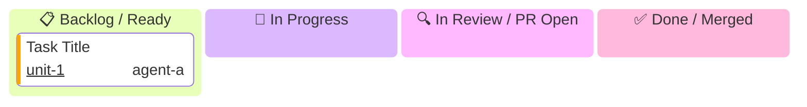

# Rule: Mandatory Live Kanban Board Task Status Updating

## Core Objective
Ensure complete visibility and traceability by requiring every agent to maintain and update the native Mermaid Kanban board file inside the target module folder (`docs/user-stories/<module-dir>/KANBAN.md`) as tasks transition through their lifecycle.

---

## Mandatory Invariants

### 1. Dedicated Module Kanban File
Every module maintains a live Kanban board markdown file located at:
```
docs/user-stories/<module-dir>/KANBAN.md
```
(e.g. `docs/user-stories/module-4-hosted-checkout-and-links/KANBAN.md`)

### 2. Native Mermaid Kanban Syntax Specification
The board uses Mermaid's native `kanban` diagram syntax with metadata:


### 3. Mandatory Agent Transition Protocol
Every subagent (Unit Implementer, Story Leader, Module Leader) assigned to any task MUST update this file upon entering each phase:

1. **Phase 1: Task Pickup (`todo` $\to$ `in_progress`)**:
   - As its first action upon invocation, the agent MUST edit `KANBAN.md`:
     - Move its task line under the `in_progress` column.
     - In the Task Allocation table, change its status from `📋 Ready` to `🔄 In Progress`.
2. **Phase 2: PR Creation (`in_progress` $\to$ `review`)**:
   - Immediately after running `gh pr create`, the agent MUST edit `KANBAN.md`:
     - Move its task line under the `review` column.
     - Update the `ticket` metadata with the GitHub PR number (e.g. `@{ ticket: '50', assigned: 'agent-a', priority: 'High' }`).
     - In the Task Allocation table, change status to `🔍 PR #XX Open` with the clickable PR link.
3. **Phase 3: PR Merged (`review` $\to$ `done`)**:
   - Once the pull request passes gatekeeper review and is merged over GitHub CLI/API (`gh pr merge` / GitHub API), the agent MUST edit `KANBAN.md`:
     - Move its task line under the `done` column.
     - In the Task Allocation table, change status to `✅ Merged (commit: <sha>)`.

### 4. Checkpoint Mirroring
When updating `KANBAN.md`, the agent must also ensure that `.agents/checkpoints/<module-id>/checkpoint.json` reflects the updated status, ensuring both human-readable Markdown and machine-readable JSON tracking remain in sync.
