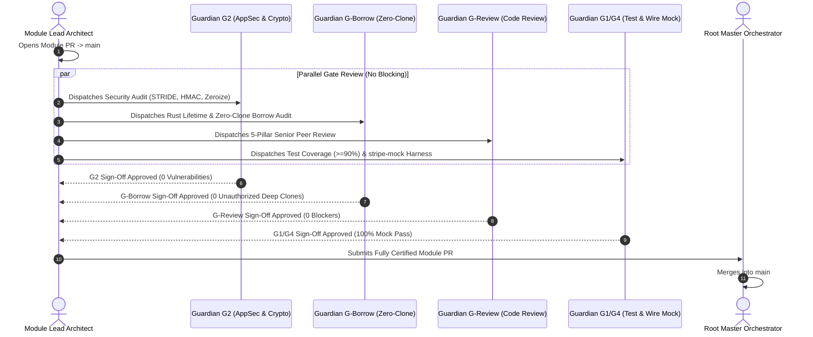

# some-stripe — Multi-Agent Divide-and-Conquer Implementation Plan

> **Architectural Specification**: [Stripe Services and API Research](../../docs/Stripe%20Services%20and%20API%20Research.md)  
> **Product Leadership**: [Product Manager Agent (.agents/agents/product-manager.md)](../../.agents/agents/product-manager.md)  
> **Execution Engine**: Hierarchical Multi-Agent Divide-and-Conquer Tree  
> **Turnkey Command**: `./scripts/orchestrate-implementation.sh --execute`  
> **Multi-Account Profiles**: Looping over 3 Google AI Pro Profiles (`agent-a`, `agent-b`, `agent-c`)  
> **Quality Gate Architecture**: Federated Specialized Gate Council (Separation of Duties)  
> **Total Hierarchical Agents**: **137 Agents**  

---

## 1. Executive Summary & Gatekeeper Specialization

To implement `some-stripe` with zero blocking dependencies and strict quality assurance, the quality gate review phase is **never concentrated into a single monolithic agent**. Having one agent evaluate test coverage, cryptographic invariants, Rust memory lifetimes, code style, and international tax compliance creates role contamination, context fatigue, and shallow approvals.

Instead, every module is governed by a **Federated Gatekeeper Council** composed of **4 independent specialist guardians** working in parallel:

```
                            [Level 1: Module Lead Architect]
                                          │
                 ┌────────────────────────┴────────────────────────┐
                 ▼                                                 ▼
      [Level 2: Story Leads]                       [Level 4: Federated Gatekeeper Council]
                 │                                 ├── Guardian G2:       AppSec & Cryptography Auditor
                 ▼                                 ├── Guardian G-Borrow: Rust Zero-Clone Borrowing Auditor
      [Level 3: Atomic Units]                      ├── Guardian G-Review: Independent Senior Code Reviewer
                                                   └── Guardian G1/G4:    Test Coverage & Mock Wire Verifier
```

---

## 2. Hierarchical Agent Tree & Role Taxonomy

```
┌────────────────────────────────────────────────────────┬─────────────┐
│ Architectural Level                                    │ Agent Count │
├────────────────────────────────────────────────────────┼─────────────┤
│ Level 0: Root Master Orchestrator                      │    1 Agent  │
│ Level 1: Module Lead Architects (8 Modules)            │    8 Agents │
│ Level 2: Story Lead Coordinators (16 User Stories)     │   16 Agents │
│ Level 3: Atomic Micro-Unit Programmers (5 per Story)   │   80 Agents │
│ Level 4: Federated Gatekeeper Council (4 per Module)   │   32 Agents │
├────────────────────────────────────────────────────────┼─────────────┤
│ TOTAL CONCURRENT AGENTS IN IMPLEMENTATION TREE         │  137 AGENTS │
└────────────────────────────────────────────────────────┴─────────────┘
```

### 2.1 The 4 Specialized Gatekeeper Roles (Level 4)
Each of the 8 functional modules deploys 4 independent gatekeepers enforcing Separation of Duties:

1. **`Guardian G2` — Application Security & Cryptography Auditor** (`security-appsec-engineer` / `security-audit`):
   - Audits constant-time HMAC byte comparisons (`subtle::ConstantTimeEq`).
   - Verifies 300s replay drift guards and volatile secret zeroization on drop.
   - Enforces 1 MB payload size caps and automated STRIDE threat defense.
2. **`Guardian G-Borrow` — Rust Zero-Clone Borrowing Auditor** (`engineering-rust-refactoring-specialist` / `stripe-best-practices`):
   - Enforces Rust 2024 edition strict borrowing (`&T`, `&mut T`) and explicit lifetimes (`'a`).
   - Verifies zero unauthorized deep `.clone()` calls; certifies that only `Arc::clone` / `Rc::clone` pointer copies exist.
   - Enforces zero-copy byte buffers (`bytes::Bytes`) and stack smallvec allocators.
3. **`Guardian G-Review & G3` — Senior Peer Code Reviewer** (`engineering-code-reviewer`):
   - Conducts independent 5-pillar code review (Correctness, Security, Maintainability, Performance, Testing).
   - Enforces microkernel isolation, zero monolithic codegen in core, and clean DRY pattern usage via `src/patterns/`.
4. **`Guardian G1 & G4` — Test Coverage & Mock Wire Verifier** (`testing-api-tester` / `stripe-docs`):
   - Asserts >=90% line and >=85% branch coverage in affected modules.
   - Runs automated contract tests, fuzz suites, and full end-to-end user journeys against `stripe-mock`.

---

## 3. Master Multi-Agent Directory (137 Agents Across 3 Profiles)

### Profile Workload Distribution

| Profile | Profile Directory | Lead Role | Module Coverage | Level 4 Gate Role |
| :--- | :--- | :--- | :--- | :--- |
| **Profile 1** | `.agent_profiles/agent-a` | `microkernel-architect` | Module 1 (Core), Module 8 (V2 Engine) | G-Review & Architecture |
| **Profile 2** | `.agent_profiles/agent-b` | `security-webhook-engineer` | Module 2 (Webhooks), Module 7 (Specialized) | G2 AppSec & Cryptography |
| **Profile 3** | `.agent_profiles/agent-c` | `domain-codegen-specialist` | Modules 3, 4, 5, 6 (Payments, Billing, Connect) | G1/G4 Test & Wire Mock |

---

### Module 1: Microkernel Core Runtime (22 Agents) — Lead: Profile 1 (`agent-a`)
- **Module Lead 1**: `agent-m1-lead` [Profile 1] (`microkernel-architect` | `stripe-docs`)
- **Story 1.1 Lead**: `agent-s1.1-lead` [Profile 1] — Concurrency & RequestOptions
  - `agent-u1.1.1` [Profile 1]: `ClientInner` & `StripeConfig` Types (`microkernel-architect` | `security-audit`)
  - `agent-u1.1.2` [Profile 2]: `SecretString` Volatile Zeroization on Drop (`security-appsec-engineer` | `security-audit`)
  - `agent-u1.1.3` [Profile 3]: `RequestOptions` Fluent Builder & Headers (`domain-codegen-specialist` | `stripe-best-practices`)
  - `agent-u1.1.4` [Profile 1]: 10k Task Concurrency & Memory Stress Test (`testing-api-tester` | `stripe-docs`)
  - `agent-u1.1.5` [Profile 2]: Redacted Debug Log Audit & Zero-Clone Gate (`engineering-rust-refactoring-specialist` | `stripe-best-practices`)
- **Story 1.2 Lead**: `agent-s1.2-lead` [Profile 2] — Dual-Protocol Serialization
  - `agent-u1.2.1` [Profile 2]: `Nullable<T>` 3-State Enum & Traits (`microkernel-architect` | `stripe-docs`)
  - `agent-u1.2.2` [Profile 3]: Zero-Indexed Bracket Form Serializer (`microkernel-architect` | `stripe-docs`)
  - `agent-u1.2.3` [Profile 1]: API v2 Operation-Scoped JSON Serializer (`domain-codegen-specialist` | `stripe-docs`)
  - `agent-u1.2.4` [Profile 2]: 100k Fuzzing Iteration Harness (`testing-api-tester` | `stripe-docs`)
  - `agent-u1.2.5` [Profile 3]: Zero-Allocation SmallVec Borrow Audit (`engineering-rust-refactoring-specialist` | `stripe-best-practices`)
- **Story 1.3 Lead**: `agent-s1.3-lead` [Profile 3] — Auto-Pagination & Transport
  - `agent-u1.3.1` [Profile 3]: `HttpClient` Trait & Reqwest Adapter (`microkernel-architect` | `stripe-docs`)
  - `agent-u1.3.2` [Profile 1]: Complete `StripeError` Taxonomy (`microkernel-architect` | `stripe-best-practices`)
  - `agent-u1.3.3` [Profile 2]: `Paginator<T>` Stream Engine & Cursors (`microkernel-architect` | `stripe-docs`)
  - `agent-u1.3.4` [Profile 3]: Jittered Exponential Backoff & 429 Test (`testing-api-tester` | `stripe-docs`)
  - `agent-u1.3.5` [Profile 1]: Circular Cursor Loop Sentinel (`engineering-rust-refactoring-specialist` | `stripe-best-practices`)
- **Module 1 Gatekeeper Council (4 Agents)**:
  - `agent-m1-g2` [Profile 2]: G2 AppSec & Secret Zeroization Guardian (`security-appsec-engineer` | `security-audit`)
  - `agent-m1-g-borrow` [Profile 3]: G-Borrow Rust Zero-Clone Guardian (`engineering-rust-refactoring-specialist` | `stripe-best-practices`)
  - `agent-m1-g-review` [Profile 1]: G-Review Peer Code Review Guardian (`engineering-code-reviewer` | `stripe-best-practices`)
  - `agent-m1-g1-g4` [Profile 3]: G1/G4 Test Coverage & Stream Verifier (`testing-api-tester` | `stripe-docs`)

---

### Module 2: Cryptographic Webhooks (17 Agents) — Lead: Profile 2 (`agent-b`)
- **Module Lead 2**: `agent-m2-lead` [Profile 2] (`security-webhook-engineer` | `security-audit`)
- **Story 2.1 Lead**: `agent-s2.1-lead` [Profile 1] — Constant-Time Signature Verification
  - `agent-u2.1.1` [Profile 1]: `StripeSignatureHeader` & Pre-Validation (`security-webhook-engineer` | `security-audit`)
  - `agent-u2.1.2` [Profile 2]: Streaming HMAC-SHA256 State Machine (`security-webhook-engineer` | `security-audit`)
  - `agent-u2.1.3` [Profile 3]: Constant-Time Bit-XOR Comparison (`security-appsec-engineer` | `security-audit`)
  - `agent-u2.1.4` [Profile 1]: Timing Statistical Variance Microbenchmark (`testing-api-tester` | `security-audit`)
  - `agent-u2.1.5` [Profile 2]: Zero-Dependency Edge Build Verification (`engineering-rust-refactoring-specialist` | `stripe-best-practices`)
- **Story 2.2 Lead**: `agent-s2.2-lead` [Profile 2] — Replay Protection & Event Unions
  - `agent-u2.2.1` [Profile 2]: 300s Timestamp Drift Tolerance Gate (`security-webhook-engineer` | `stripe-docs`)
  - `agent-u2.2.2` [Profile 3]: Test Header String Generator (`security-webhook-engineer` | `stripe-docs`)
  - `agent-u2.2.3` [Profile 1]: `EventObject` Discriminated Union Codegen (`domain-codegen-specialist` | `stripe-docs`)
  - `agent-u2.2.4` [Profile 2]: Replay Attack Rejection & Fixture Tests (`testing-api-tester` | `stripe-docs`)
  - `agent-u2.2.5` [Profile 3]: Security Escalation Hook Dispatcher (`security-appsec-engineer` | `security-audit`)
- **Module 2 Gatekeeper Council (4 Agents)**:
  - `agent-m2-g2` [Profile 2]: G2 Cryptographic Constant-Time Guardian (`security-appsec-engineer` | `security-audit`)
  - `agent-m2-g-borrow` [Profile 1]: G-Borrow Streaming Slice Lifetime Guardian (`engineering-rust-refactoring-specialist` | `stripe-best-practices`)
  - `agent-m2-g-review` [Profile 3]: G-Review Webhook Facade Review Guardian (`engineering-code-reviewer` | `stripe-docs`)
  - `agent-m2-g1-g4` [Profile 1]: G1/G4 Signature Adversarial Suite Guardian (`testing-api-tester` | `security-audit`)

---

### Module 3: Payments & Settlement (17 Agents) — Lead: Profile 3 (`agent-c`)
- **Module Lead 3**: `agent-m3-lead` [Profile 3] (`domain-codegen-specialist` | `stripe-docs`)
- **Story 3.1 Lead**: `agent-s3.1-lead` [Profile 3] — PaymentIntents Lifecycle & Capture
  - `agent-u3.1.1` [Profile 3]: `PaymentIntent` & Status Enum Models (`domain-codegen-specialist` | `stripe-docs`)
  - `agent-u3.1.2` [Profile 1]: Create & Capture Parameter DTOs (`domain-codegen-specialist` | `stripe-docs`)
  - `agent-u3.1.3` [Profile 2]: `PaymentIntentsResource` CRUD Implementation (`domain-codegen-specialist` | `stripe-docs`)
  - `agent-u3.1.4` [Profile 3]: Idempotency Collision & Capture Tests (`testing-api-tester` | `stripe-docs`)
  - `agent-u3.1.5` [Profile 1]: PSD2 SCA 3DS Redirect Action Parser (`security-appsec-engineer` | `stripe-best-practices`)
- **Story 3.2 Lead**: `agent-s3.2-lead` [Profile 1] — Refunds & Balance Ledger
  - `agent-u3.2.1` [Profile 1]: `Refund`, `Dispute`, `BalanceTransaction` (`domain-codegen-specialist` | `stripe-docs`)
  - `agent-u3.2.2` [Profile 2]: Dispute Evidence Submission Builder (`domain-codegen-specialist` | `stripe-docs`)
  - `agent-u3.2.3` [Profile 3]: `RefundsResource` & `BalanceResource` (`domain-codegen-specialist` | `stripe-docs`)
  - `agent-u3.2.4` [Profile 1]: Accounting Invariant Property Tests (`testing-api-tester` | `stripe-best-practices`)
  - `agent-u3.2.5` [Profile 2]: Balance Transaction Zero-Clone Streamer (`engineering-rust-refactoring-specialist` | `stripe-best-practices`)
- **Module 3 Gatekeeper Council (4 Agents)**:
  - `agent-m3-g2` [Profile 2]: G2 Payment Auth & Idempotency Guardian (`security-appsec-engineer` | `security-audit`)
  - `agent-m3-g-borrow` [Profile 1]: G-Borrow Zero-Clone Parameter Guardian (`engineering-rust-refactoring-specialist` | `stripe-best-practices`)
  - `agent-m3-g-review` [Profile 3]: G-Review Financial Integrity Review Guardian (`engineering-code-reviewer` | `stripe-best-practices`)
  - `agent-m3-g1-g4` [Profile 1]: G1/G4 stripe-mock Payment Suite Guardian (`testing-api-tester` | `stripe-docs`)

---

### Module 4: Hosted Checkout & Links (11 Agents) — Lead: Profile 3 (`agent-c`)
- **Module Lead 4**: `agent-m4-lead` [Profile 3] (`domain-codegen-specialist` | `stripe-docs`)
- **Story 4.1 Lead**: `agent-s4.1-lead` [Profile 2] — Checkout Sessions & Line Items
  - `agent-u4.1.1` [Profile 2]: `CheckoutSession` & `LineItem` Models (`domain-codegen-specialist` | `stripe-docs`)
  - `agent-u4.1.2` [Profile 3]: `CreateCheckoutSessionParams` Builder (`domain-codegen-specialist` | `stripe-docs`)
  - `agent-u4.1.3` [Profile 1]: `SessionsResource` Create, Retrieve, Expire (`domain-codegen-specialist` | `stripe-docs`)
  - `agent-u4.1.4` [Profile 2]: Async Payment Method Fulfillment Guard (`security-appsec-engineer` | `stripe-best-practices`)
  - `agent-u4.1.5` [Profile 3]: `stripe-mock` E2E Checkout Session Suite (`testing-api-tester` | `stripe-docs`)
- **Module 4 Gatekeeper Council (4 Agents)**:
  - `agent-m4-g2` [Profile 2]: G2 Open Redirect & Price Integrity Guardian (`security-appsec-engineer` | `security-audit`)
  - `agent-m4-g-borrow` [Profile 3]: G-Borrow Session Lifetimes Guardian (`engineering-rust-refactoring-specialist` | `stripe-best-practices`)
  - `agent-m4-g-review` [Profile 1]: G-Review Checkout Facade Review Guardian (`engineering-code-reviewer` | `stripe-best-practices`)
  - `agent-m4-g1-g4` [Profile 2]: G1/G4 Line Item Pagination & E2E Guardian (`testing-api-tester` | `stripe-docs`)

---

### Module 5: Customers & Billing (17 Agents) — Lead: Profile 3 (`agent-c`)
- **Module Lead 5**: `agent-m5-lead` [Profile 3] (`domain-codegen-specialist` | `stripe-docs`)
- **Story 5.1 Lead**: `agent-s5.1-lead` [Profile 3] — Customer Vaulting & Subscriptions
  - `agent-u5.1.1` [Profile 3]: `Customer`, `Subscription`, `SubscriptionItem` (`domain-codegen-specialist` | `stripe-docs`)
  - `agent-u5.1.2` [Profile 1]: Multi-Item Subscription Serializer (`microkernel-architect` | `stripe-best-practices`)
  - `agent-u5.1.3` [Profile 2]: Proration Math & Pause Collection Logic (`domain-codegen-specialist` | `metronome`)
  - `agent-u5.1.4` [Profile 3]: `CustomersResource` & `SubscriptionsResource` (`domain-codegen-specialist` | `stripe-docs`)
  - `agent-u5.1.5` [Profile 1]: Multi-Phase Subscription Schedule Tests (`testing-api-tester` | `metronome`)
- **Story 5.2 Lead**: `agent-s5.2-lead` [Profile 1] — Invoices, Credit Notes & Portal
  - `agent-u5.2.1` [Profile 1]: `Invoice`, `CreditNote`, `PortalSession` (`domain-codegen-specialist` | `stripe-docs`)
  - `agent-u5.2.2` [Profile 2]: `InvoicesResource` Finalize & Pay Methods (`domain-codegen-specialist` | `stripe-docs`)
  - `agent-u5.2.3` [Profile 3]: PDF Binary Stream Reader (`microkernel-architect` | `stripe-docs`)
  - `agent-u5.2.4` [Profile 1]: Credit Note Balance Adjustment Tests (`testing-api-tester` | `stripe-docs`)
  - `agent-u5.2.5` [Profile 2]: Customer Portal Session Expiry Security (`security-appsec-engineer` | `security-audit`)
- **Module 5 Gatekeeper Council (4 Agents)**:
  - `agent-m5-g2` [Profile 2]: G2 Customer IDOR & Portal Expiry Guardian (`security-appsec-engineer` | `security-audit`)
  - `agent-m5-g-borrow` [Profile 1]: G-Borrow Multi-Item Zero-Clone Guardian (`engineering-rust-refactoring-specialist` | `stripe-best-practices`)
  - `agent-m5-g-review` [Profile 3]: G-Review Recurring Billing Review Guardian (`engineering-code-reviewer` | `metronome`)
  - `agent-m5-g1-g4` [Profile 2]: G1/G4 Invoicing & Proration Suite Guardian (`testing-api-tester` | `stripe-docs`)

---

### Module 6: Connect & Marketplaces (17 Agents) — Lead: Profile 3 (`agent-c`)
- **Module Lead 6**: `agent-m6-lead` [Profile 3] (`domain-codegen-specialist` | `connect-recommend`)
- **Story 6.1 Lead**: `agent-s6.1-lead` [Profile 2] — Connected Accounts & Embedded Sessions
  - `agent-u6.1.1` [Profile 2]: `Account`, `Capabilities`, `Requirements` (`domain-codegen-specialist` | `connect-recommend`)
  - `agent-u6.1.2` [Profile 3]: KYC `Person` Entities & Redacted Fields (`domain-codegen-specialist` | `connect-required-verification-information`)
  - `agent-u6.1.3` [Profile 1]: `AccountLinks` & `AccountSessions` Resources (`domain-codegen-specialist` | `stripe-docs`)
  - `agent-u6.1.4` [Profile 2]: FinCEN CDD Beneficial Ownership Tests (`testing-api-tester` | `connect-recommend`)
  - `agent-u6.1.5` [Profile 3]: Multi-Tenant Isolation & Zero Leak Audit (`security-appsec-engineer` | `security-audit`)
- **Story 6.2 Lead**: `agent-s6.2-lead` [Profile 3] — Multi-Party Transfers & Fees
  - `agent-u6.2.1` [Profile 3]: `Transfer`, `TransferReversal`, `ApplicationFee` (`domain-codegen-specialist` | `stripe-docs`)
  - `agent-u6.2.2` [Profile 1]: Destination Charge Parameter Serializer (`microkernel-architect` | `stripe-best-practices`)
  - `agent-u6.2.3` [Profile 2]: `TransfersResource` & `PayoutsResource` (`domain-codegen-specialist` | `stripe-docs`)
  - `agent-u6.2.4` [Profile 3]: Reversal & Balance Imbalance Property Tests (`testing-api-tester` | `stripe-best-practices`)
  - `agent-u6.2.5` [Profile 1]: Platform Fee Arithmetic Invariant Audit (`engineering-rust-refactoring-specialist` | `stripe-best-practices`)
- **Module 6 Gatekeeper Council (4 Agents)**:
  - `agent-m6-g2` [Profile 2]: G2 Multi-Tenant Header & Destination Guardian (`security-appsec-engineer` | `security-audit`)
  - `agent-m6-g-borrow` [Profile 1]: G-Borrow Financial Routing Zero-Clone Guardian (`engineering-rust-refactoring-specialist` | `stripe-best-practices`)
  - `agent-m6-g-review` [Profile 3]: G-Review Marketplace Compliance Review Guardian (`engineering-code-reviewer` | `connect-recommend`)
  - `agent-m6-g1-g4` [Profile 2]: G1/G4 Transfer & Payout Wire Suite Guardian (`testing-api-tester` | `stripe-docs`)

---

### Module 7: Specialized Product Namespaces (17 Agents) — Lead: Profile 2 (`agent-b`)
- **Module Lead 7**: `agent-m7-lead` [Profile 2] (`security-webhook-engineer` | `stripe-docs`)
- **Story 7.1 Lead**: `agent-s7.1-lead` [Profile 1] — Stripe Tax & Identity
  - `agent-u7.1.1` [Profile 1]: `TaxCalculation`, `TaxTransaction` DTOs (`domain-codegen-specialist` | `stripe-docs`)
  - `agent-u7.1.2` [Profile 2]: `VerificationSession` Biometric Redaction (`security-appsec-engineer` | `security-audit`)
  - `agent-u7.1.3` [Profile 3]: `TaxResource` & `IdentityResource` (`domain-codegen-specialist` | `stripe-docs`)
  - `agent-u7.1.4` [Profile 1]: EU VAT Reverse Charge VIES Logic Tests (`testing-api-tester` | `stripe-docs`)
  - `agent-u7.1.5` [Profile 2]: Biometric Data Exclusion & Zero-Clone Gate (`engineering-rust-refactoring-specialist` | `security-audit`)
- **Story 7.2 Lead**: `agent-s7.2-lead` [Profile 2] — Issuing, Treasury & Terminal
  - `agent-u7.2.1` [Profile 2]: `Card`, `Cardholder`, `FinancialAccount` (`domain-codegen-specialist` | `stripe-docs`)
  - `agent-u7.2.2` [Profile 3]: Terminal `ConnectionToken` Generator (`domain-codegen-specialist` | `stripe-docs`)
  - `agent-u7.2.3` [Profile 1]: Outbound Treasury Wire Transfer Resource (`domain-codegen-specialist` | `stripe-docs`)
  - `agent-u7.2.4` [Profile 2]: Issuing Spend Limit Enforcement Tests (`testing-api-tester` | `stripe-docs`)
  - `agent-u7.2.5` [Profile 3]: Zero PAN Memory Leak & Bank Secrecy Audit (`security-appsec-engineer` | `security-audit`)
- **Module 7 Gatekeeper Council (4 Agents)**:
  - `agent-m7-g2` [Profile 2]: G2 Zero PAN & Biometric PII Isolation Guardian (`security-appsec-engineer` | `security-audit`)
  - `agent-m7-g-borrow` [Profile 3]: G-Borrow Treasury/Tax Models Zero-Clone Guardian (`engineering-rust-refactoring-specialist` | `stripe-best-practices`)
  - `agent-m7-g-review` [Profile 1]: G-Review Banking & POS Review Guardian (`engineering-code-reviewer` | `stripe-docs`)
  - `agent-m7-g1-g4` [Profile 3]: G1/G4 Tax & Issuing Wire Suite Guardian (`testing-api-tester` | `stripe-docs`)

---

### Module 8: API V2 Next-Gen Services (17 Agents) — Lead: Profile 1 (`agent-a`)
- **Module Lead 8**: `agent-m8-lead` [Profile 1] (`microkernel-architect` | `stripe-docs`)
- **Story 8.1 Lead**: `agent-s8.1-lead` [Profile 3] — V2 Core Events & Thin Hydration
  - `agent-u8.1.1` [Profile 3]: `V2Event`, `V2ThinEvent`, `EventDestination` (`microkernel-architect` | `stripe-docs`)
  - `agent-u8.1.2` [Profile 1]: URL-Driven `V2List` Stream Navigator (`microkernel-architect` | `stripe-docs`)
  - `agent-u8.1.3` [Profile 2]: `V2EventsResource` Live Hydration Engine (`domain-codegen-specialist` | `upgrade-stripe`)
  - `agent-u8.1.4` [Profile 3]: Amazon EventBridge Destination Tests (`testing-api-tester` | `stripe-docs`)
  - `agent-u8.1.5` [Profile 1]: Stale Replay Attack Elimination Audit (`security-appsec-engineer` | `security-audit`)
- **Story 8.2 Lead**: `agent-s8.2-lead` [Profile 1] — V2 High-Throughput Meter Billing
  - `agent-u8.2.1` [Profile 1]: `MeterEventSession` & `MeterEventPayload` (`microkernel-architect` | `metronome`)
  - `agent-u8.2.2` [Profile 2]: High-Frequency Batch Serializer (`microkernel-architect` | `stripe-best-practices`)
  - `agent-u8.2.3` [Profile 3]: `MeterEventStreamResource` Ingestion (`domain-codegen-specialist` | `metronome`)
  - `agent-u8.2.4` [Profile 1]: 10,000 Event/Sec Load Benchmark Suite (`testing-api-tester` | `metronome`)
  - `agent-u8.2.5` [Profile 2]: Client Deduplication Identifier Audit (`engineering-rust-refactoring-specialist` | `metronome`)
- **Module 8 Gatekeeper Council (4 Agents)**:
  - `agent-m8-g2` [Profile 2]: G2 V2 Session Token & EventBridge Security Guardian (`security-appsec-engineer` | `security-audit`)
  - `agent-m8-g-borrow` [Profile 1]: G-Borrow High-Frequency Stream Zero-Clone Guardian (`engineering-rust-refactoring-specialist` | `stripe-best-practices`)
  - `agent-m8-g-review` [Profile 3]: G-Review V2 JSON Protocol Review Guardian (`engineering-code-reviewer` | `upgrade-stripe`)
  - `agent-m8-g1-g4` [Profile 2]: G1/G4 10k Event Load Benchmark Guardian (`testing-api-tester` | `metronome`)

---

### Level 0: Root Master Orchestrator (1 Agent)
- **Root Master Lead**: `agent-root-lead` [Profile 1] (`microkernel-architect` / `product-manager`)

---

## 4. Parallel Gate Evaluation Flow

When a Module PR is ready for merge into `main`, the **4 Specialized Gatekeepers evaluate concurrently**:



---

## 5. Execution Command

Execute the complete multi-agent divide-and-conquer implementation tree via:

```bash
./scripts/orchestrate-implementation.sh --execute
```
