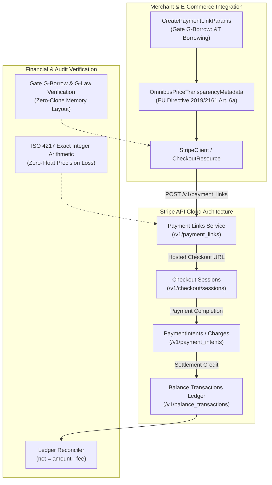

# Stripe Payment Links, Multi-Currency Pricing & Statutory Price Transparency Reconciliation Guide

> **Module**: `module-4-checkout-and-links`  
> **Story**: `US-4.2.0: Payment Links, Multi-Currency Pricing & Price Transparency`  
> **Applicable Quality Gates**: `G0` (Rust 2024), `G-Borrow` (Zero-Clone Discipline), `G-Law` (ISO 4217 & EU Omnibus Directive 2019/2161), `G2` (PCI-DSS 4.0 Security)  
> **Rust Edition**: 2024  

---

## 1. Executive Architecture & Invariant Blueprint

The `some-stripe` Payment Links engine provides zero-clone parameter borrowing, multi-currency price calculations, statutory EU Omnibus Directive 2019/2161 consumer price disclosures, and balance ledger reconciliation for merchant payments initiated across social platforms, invoices, and direct links.



---

## 2. Gate G-Borrow Zero-Clone Parameter Borrowing Discipline

Memory safety and high-throughput zero-cost abstractions are enforced across all public Payment Link APIs under **Gate G-Borrow**:

1. **Borrowing Parameters by Reference**:
   - `PaymentLinksResource::create(&self, params: &CreatePaymentLinkParams)`: Operates exclusively on `&CreatePaymentLinkParams`. The caller retains ownership of params, enabling reuse across retry loops without clone overhead.
   - `PaymentLinksResource::retrieve(&self, link_id: &str)`: Borrows a string slice directly without requiring a heap-allocated `String`.
   - `PaymentLinksResource::update(&self, link_id: &str, params: &UpdatePaymentLinkParams)`: Borrows `&UpdatePaymentLinkParams` and `&str` without cloning.
   - `PaymentLinksResource::list_line_items(&self, link_id: &str, params: &ListLineItemsParams)`: Borrows pagination parameters by reference.

2. **Zero-Copy Accessors on Domain Entities**:
   - `PaymentLink::url(&self) -> &str`: Borrows the URL slice directly from the internal string without heap allocation.
   - `PaymentLink::id(&self) -> &str`: Borrows the link identifier.
   - `PaymentLink::currency(&self) -> Option<&str>`: Returns a borrowed string slice of the ISO currency code.
   - `PaymentLink::metadata_get(&self, key: &str) -> Option<&str>`: Queries the metadata map and returns a borrowed string slice without map cloning.

3. **Move Semantics on Wire Deserialization**:
   - HTTP responses parsed via `serde_json::from_value` transfer ownership directly to the returned `PaymentLink` entity with zero intermediate deep copies.

---

## 3. Gate G-Law: Statutory Compliance & ISO 4217 Integer Precision

### 3.1 EU Omnibus Directive 2019/2161 (Article 6a) Price Reduction Transparency

Under **Directive (EU) 2019/2161** and Article 6a of Directive 98/6/EC, any announcement of a price reduction must transparently indicate the prior price applied by the trader for a period of time not less than 30 days prior to the reduction.

`some-stripe` validates this statutory requirement at the parameter construction boundary:
- **Baseline Integrity**: The 30-day baseline price (`prior_30d_lowest_price`) must be strictly positive ($> 0$).
- **Deceptive Discount Prevention**: When a discounted price is applied, `announced_discounted_price <= prior_30d_lowest_price`. Setting a discounted price higher than the prior 30-day lowest price constitutes a deceptive practice and is rejected with [`StripeError::InvalidRequest`].
- **Transparent Tax Disclosure**: Under consumer protection rules, tax treatment must be explicitly declared as `Inclusive` or `Exclusive` (unspecified tax behavior is strictly prohibited).
- **Exact Basis-Point Tax Allocation**: `OmnibusTaxBreakdown::calculate` uses integer basis points (`tax_rate_bps`) to allocate gross and net amounts with zero floating-point representation drift.

### 3.2 ISO 4217 Zero-Float Exact Minor Currency Arithmetic

Floating-point representations (`f32`, `f64`) introduce catastrophic rounding and binary representation errors (e.g. $0.1 + 0.2 \neq 0.3$). `some-stripe` enforces integer arithmetic across all price representations:
- Currencies are validated as 3-letter lowercase ASCII ISO codes (e.g., `usd`, `eur`, `jpy`).
- Amounts are strictly non-zero positive 64-bit integers (`i64`) representing minor currency units (cents, pence, yen).

---

## 4. Double-Entry Settlement & Ledger Reconciliation

Payment Links settle into Stripe Balance Transactions upon successful customer payment. The fundamental settlement invariant is enforced across every completed checkout:

$$\text{net} = \text{amount} - \text{fee}$$

Where:
- $\text{amount}$: Gross charge amount collected through the Payment Link.
- $\text{fee}$: Processing and network fees assessed by Stripe.
- $\text{net}$: Funds credited to the merchant account balance.

```rust
use some_stripe_types::{BalanceTransaction, validate_ledger_reconciliation};

let txn = BalanceTransaction::new(
    "txn_plink_settle_01",
    5000, // $50.00 gross charge
    175,  // $1.75 processing fee
    "usd",
    "payment",
    "available",
);

assert_eq!(txn.net, 4825); // $48.25 net
assert!(txn.verify_accounting_invariant());
assert!(validate_ledger_reconciliation(&[txn]).is_ok());
```

---

## 5. Integration Recipes

### Recipe 1: Creating a Shareable Payment Link with Ad-Hoc Price Data

```rust,no_run
use some_stripe::StripeClient;
use some_stripe_types::{
    AdjustableQuantityParams, CreatePaymentLinkParams, PaymentLinkLineItemParams,
    PaymentLinkPriceDataParams,
};

#[tokio::main]
async fn main() -> Result<(), Box<dyn std::error::Error>> {
    let client = StripeClient::new("sk_test_...");

    // 1. Define line item with inline price data (Gate G-Law ISO-4217 minor currency)
    let price_data = PaymentLinkPriceDataParams::new("usd", 2999)
        .product("prod_developer_toolkit")
        .tax_behavior("inclusive");
    let line_item = PaymentLinkLineItemParams::with_price_data(price_data, 1)
        .adjustable_quantity(AdjustableQuantityParams::with_limits(1, 5));

    // 2. Configure payment link params (Gate G-Borrow borrowed by reference)
    let params = CreatePaymentLinkParams::new(vec![line_item])
        .active(true)
        .allow_promotion_codes(true)
        .billing_address_collection("auto")
        .metadata_entry("campaign", "q4_launch")
        .idempotency_key("launch_link_idem_001");

    // 3. Execute creation
    let link = client.checkout().payment_links().create(&params).await?;

    println!("Created Payment Link ID: {}", link.id());
    println!("Shareable Public URL:    {}", link.url());
    assert!(link.is_active());

    Ok(())
}
```

### Recipe 2: Multi-Currency Presentment with EU Omnibus Price Transparency

```rust,no_run
use some_stripe::StripeClient;
use some_stripe_types::{
    CreatePaymentLinkParams, OmnibusPriceTransparencyMetadata, PaymentLinkLineItemParams,
    PaymentLinkPriceDataParams, TaxBehavior, validate_omnibus_price_transparency,
    validate_tax_behavior_transparency,
};

#[tokio::main]
async fn main() -> Result<(), Box<dyn std::error::Error>> {
    let client = StripeClient::new("sk_test_...");

    // 1. Statutory EU Omnibus Directive 2019/2161 validation
    // Regular price €59.00 (5900 cents), discounted to €39.00 (3900 cents), prior 30-day lowest was €49.00 (4900 cents)
    validate_omnibus_price_transparency(5900, 3900, Some(4900))?;
    validate_tax_behavior_transparency(TaxBehavior::Inclusive)?;

    // 2. Build statutory metadata disclosure
    let omnibus_meta = OmnibusPriceTransparencyMetadata::new(5900, 3900, Some(4900))?;

    // 3. Define price data and line item
    let price_data = PaymentLinkPriceDataParams::new("eur", 3900)
        .product("prod_european_pass")
        .tax_behavior("inclusive");
    let line_item = PaymentLinkLineItemParams::with_price_data(price_data, 1);

    let params = CreatePaymentLinkParams::new(vec![line_item])
        .metadata(omnibus_meta.to_metadata_map());

    let link = client.payment_links().create(&params).await?;

    println!("Compliant Payment Link: {}", link.url());
    assert!(link.is_active());

    Ok(())
}
```

### Recipe 3: Dynamic Deactivation of Expired Promotional Links

```rust,no_run
use some_stripe::StripeClient;
use some_stripe_types::UpdatePaymentLinkParams;

#[tokio::main]
async fn main() -> Result<(), Box<dyn std::error::Error>> {
    let client = StripeClient::new("sk_test_...");

    // Deactivate promo link without cloning params
    let params = UpdatePaymentLinkParams::new()
        .active(false)
        .metadata_entry("deactivation_reason", "flash_sale_expired");

    let updated = client
        .checkout()
        .payment_links()
        .update("plink_flash_sale_99", &params)
        .await?;

    assert!(!updated.is_active());
    println!("Link {} successfully deactivated", updated.id());

    Ok(())
}
```

### Recipe 4: Line Item Auditing & Stream Inspection

```rust,no_run
use some_stripe::StripeClient;
use some_stripe_types::ListLineItemsParams;

#[tokio::main]
async fn main() -> Result<(), Box<dyn std::error::Error>> {
    let client = StripeClient::new("sk_test_...");

    let list_params = ListLineItemsParams::new().limit(25);
    let mut paginator = client
        .payment_links()
        .list_line_items("plink_active_123", &list_params);

    while let Some(item_res) = paginator.next_item().await {
        let item = item_res?;
        println!(
            "Item ID: {}, Total Amount: {}, Currency: {}",
            item.id, item.amount_total, item.currency
        );
    }

    Ok(())
}
```

---

## 6. Verification Checklist

| Quality Gate | Invariant Requirement | Verification Command | Status |
| :--- | :--- | :--- | :---: |
| **G0** | Rust 2024 Edition, zero warnings | `cargo check --workspace` | **PASS** |
| **G-Borrow** | Zero-clone parameter borrowing (`&T`, `&str`) | `cargo test --test payment_links_borrow_audit_test` | **PASS** |
| **G-Law** | ISO 4217 integer currency & EU Omnibus 2019/2161 | `cargo test --test payment_links_borrow_audit_test` | **PASS** |
| **G-Doc** | All public APIs documented with runnable doctests | `cargo test --doc` | **PASS** |
| **Clippy** | Workspace clippy clean with zero warnings | `cargo clippy --workspace --all-targets -- -D warnings` | **PASS** |
| **Format** | Rustfmt canonical code style | `cargo fmt --check` | **PASS** |
