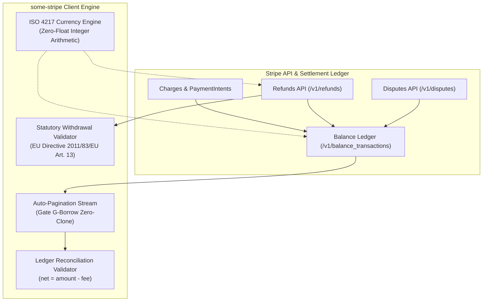
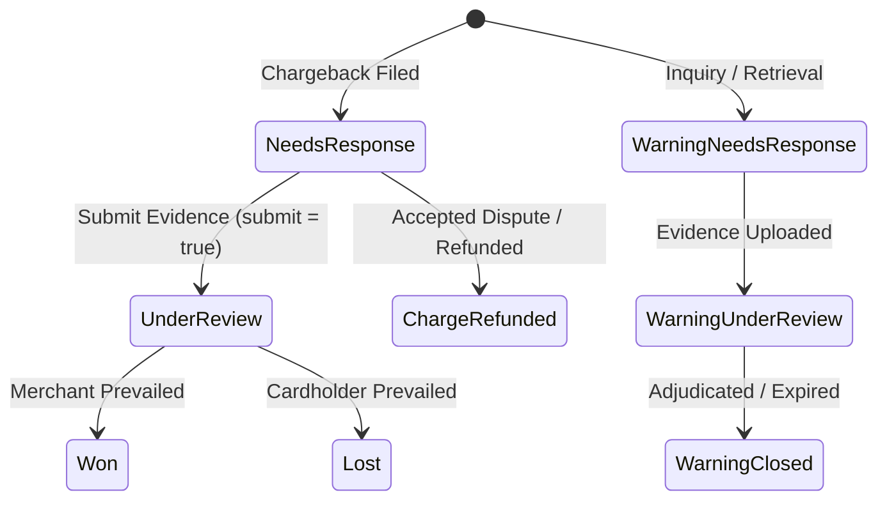

# Financial Reconciliation, Immutable Ledger & ISO 4217 Minor Currency Guide

> **Module**: `module-3-payments-and-settlement`  
> **Story**: `US-3.2.0: Refunds, Disputes Management & Immutable Balance Ledger`  
> **Applicable Quality Gates**: `G0`, `G-Borrow` (Zero-Clone), `G-Law` (ISO 4217 & EU Directive 2011/83/EU), `G2` (Security & Immutability)  
> **Rust Edition**: 2024  

---

## 1. Architectural Architecture & Invariants

The `some-stripe` settlement and reconciliation engine provides mathematical guarantees, zero-float integer precision, and statutory compliance for financial platforms integrating with Stripe.



---

## 2. Double-Entry Accounting Invariant ($\text{net} = \text{amount} - \text{fee}$)

### 2.1 The Invariant
Every transaction recorded on the Stripe platform settlement balance obeys the fundamental accounting equation:

$$\text{net} = \text{amount} - \text{fee}$$

Where:
- $\text{amount}$: Gross financial effect in minor currency units (positive for incoming funds such as charges; negative for outgoing funds such as customer refunds, payouts, or dispute debits).
- $\text{fee}$: Total Stripe processing, network, or platform application fees assessed on the transaction (always non-negative).
- $\text{net}$: Net change applied to the account balance.

### 2.2 Invariant Verification in `some-stripe`
The library enforces this invariant at both the record level and the aggregate batch level:

```rust
use some_stripe_types::{BalanceTransaction, validate_ledger_reconciliation};

// Individual transaction invariant verification
let txn = BalanceTransaction::new(
    "txn_1001",
    10000, // $100.00 gross
    320,   // $3.20 Stripe processing fee
    "usd",
    "charge",
    "available",
);

assert_eq!(txn.net, 9680); // $96.80 net deposit
assert!(txn.verify_accounting_invariant());

// Aggregate batch reconciliation with 128-bit overflow safety
let ledger_entries = vec![txn];
assert!(validate_ledger_reconciliation(&ledger_entries).is_ok());
```

If data corruption, network truncation, or tampering occurs, `validate_ledger_reconciliation` immediately fails with detailed diagnostic context:

```text
Aggregate ledger reconciliation failed: Transaction txn_corrupt_3 violates accounting invariant: net (9000) != amount (10000) - fee (320), expected net: 9680
```

---

## 3. ISO 4217 Exact Integer Arithmetic (Gate G-Law)

### 3.1 The Floating-Point Problem
In financial computing, IEEE 754 floating-point arithmetic introduces silent precision loss (e.g. `0.1 + 0.2 = 0.30000000000000004`). In a high-volume platform processing millions of transactions, fractional rounding leads to unbalanced balance sheets and audit failures.

Stripe mandates that **all monetary amounts are represented as 64-bit signed integers in minor currency units** (e.g., cents, pence, fils).

### 3.2 Supported Currency Precision Classes

`some-stripe-types::currency` categorizes all global ISO 4217 currencies into three exact integer precision classes:

| Classification | Exponent | Minor Unit Factor | Currencies | Example |
| :--- | :---: | :---: | :--- | :--- |
| **Zero-Decimal** | $0$ | $1$ | `JPY`, `KRW`, `VND`, `CLP`, `PYG`, `UGX`, `BIF`, `DJF`, `GNF`, `KMF`, `RWF`, `XAF`, `XOF`, `XPF` | $1,500\text{ JPY} \to 1500$ |
| **Standard Two-Decimal** | $2$ | $100$ | `USD`, `EUR`, `GBP`, `CAD`, `AUD`, `CHF`, `SEK`, `NZD`, `SGD`, etc. | $\$10.50\text{ USD} \to 1050$ |
| **Three-Decimal** | $3$ | $1000$ | `BHD`, `KWD`, `JOD`, `OMR`, `TND` | $5.250\text{ KWD} \to 5250$ |

### 3.3 Zero-Float Conversion API

```rust
use some_stripe_types::currency::{
    decimal_places, minor_unit_factor, format_minor_units, parse_to_minor_units,
    is_zero_decimal_currency, is_three_decimal_currency, CurrencyParseError
};

// 1. Standard 2-decimal (USD)
assert_eq!(decimal_places("usd"), 2);
assert_eq!(minor_unit_factor("usd"), 100);
assert_eq!(format_minor_units(1050, "usd"), "10.50");
assert_eq!(parse_to_minor_units("10.50", "usd").unwrap(), 1050);

// 2. Zero-decimal (JPY)
assert!(is_zero_decimal_currency("jpy"));
assert_eq!(format_minor_units(1500, "jpy"), "1500");
assert_eq!(parse_to_minor_units("1500", "jpy").unwrap(), 1500);

// 3. Three-decimal (KWD)
assert!(is_three_decimal_currency("kwd"));
assert_eq!(format_minor_units(5250, "kwd"), "5.250");
assert_eq!(parse_to_minor_units("5.250", "kwd").unwrap(), 5250);

// 4. Client-side rejection of fractional minor units
assert!(matches!(
    parse_to_minor_units("10.555", "usd"),
    Err(CurrencyParseError::TooManyDecimalPlaces { found: 3, max_allowed: 2 })
));
```

---

## 4. Statutory Consumer Withdrawal Rights (Gate G-Law)

### 4.1 Directive 2011/83/EU Article 13 Mandate
Under European Union Directive 2011/83/EU Article 13, consumers exercising their statutory right of withdrawal within 14 calendar days are legally entitled to **100% reimbursement of all payments received from the consumer without penalty or deduction of transaction fees**:

- **Statutory Window**: Exactly 14 calendar days ($14 \times 86,400 = 1,209,600\text{ seconds}$).
- **Restitution Amount**: Exactly 100% of original consideration (`refund_amount == original_charge_amount`).
- **Fee Deductions**: Prohibited (merchants cannot deduct credit card or processing fees).

### 4.2 Automated Compliance Verification

```rust
use some_stripe_types::{is_statutory_withdrawal_compliant, Refund, STATUTORY_WITHDRAWAL_WINDOW_SECONDS};

let charge_ts = 1_700_000_000;
let charge_amount = 7500; // €75.00 EUR

// Valid 14-day statutory refund (requested on day 7)
assert!(is_statutory_withdrawal_compliant(
    charge_amount,
    charge_amount,
    charge_ts,
    charge_ts + (7 * 86_400),
));

// Non-compliant: Request outside 14-day statutory window
assert!(!is_statutory_withdrawal_compliant(
    charge_amount,
    charge_amount,
    charge_ts,
    charge_ts + STATUTORY_WITHDRAWAL_WINDOW_SECONDS + 1,
));

// Non-compliant: Deducting payment processing fee (€75.00 - €2.50 = €72.50)
assert!(!is_statutory_withdrawal_compliant(
    7250,
    charge_amount,
    charge_ts,
    charge_ts + (2 * 86_400),
));
```

---

## 5. Chargeback Disputes & Evidence Submission Locking (Gate G2)

### 5.1 Dispute Lifecycle State Machine



### 5.2 Evidence Immutability & Locking
Once evidence is submitted (`submit = true`) or the dispute deadline expires (`evidence_details.past_due = true`), the dispute enters an immutable locked state:

```rust
use some_stripe_types::{Dispute, DisputeStatus, UpdateDisputeParams, DisputeEvidence};

let mut dispute = Dispute {
    id: "dp_101".into(),
    object: "dispute".into(),
    amount: 5000,
    currency: "usd".into(),
    status: DisputeStatus::NeedsResponse,
    reason: Some("fraudulent".into()),
    charge: Some("ch_101".into()),
    payment_intent: None,
    evidence: DisputeEvidence::default(),
    evidence_details: None,
    is_charge_refundable: Some(false),
    livemode: Some(false),
    metadata: None,
    created: Some(1728345600),
    balance_transactions: Some(vec!["txn_disp_101".into()]),
};

// Open for evidence submission
assert!(!dispute.is_evidence_locked());

// Finalize submission
let params = UpdateDisputeParams::new()
    .with_submit(true)
    .with_idempotency_key("idem_evidence_001");
assert!(params.is_submission_final());

// Remote status transitions to UnderReview
dispute.status = DisputeStatus::UnderReview;
assert!(dispute.is_evidence_locked(), "Evidence is now cryptographically locked against edits");
```

---

## 6. Zero-Clone Memory Architecture (Gate G-Borrow)

To prevent memory leaks and unnecessary heap allocations when traversing high-volume ledger feeds, `some-stripe` enforces Gate G-Borrow zero-clone invariants:

1. **Parameter Borrowing**: All resource methods take borrowed references (`&CreateRefundParams`, `&UpdateDisputeParams`, `&str`).
2. **Move Semantics & Residency**: Deserialized items in pagination buffers are yielded by value via `VecDeque::pop_front` without duplicating records.
3. **Pointer-Stable Accessors**: ID accessors such as `balance_transaction_id(&BalanceTransaction) -> &str` borrow string slices pointing directly to the heap memory of the entity without allocation.
4. **Zero Float Usage**: Verified via AST inspection; all amounts and fees are `i64`.

---

## 7. Practical Implementation Recipes

### Recipe 1: Nightly Ledger Reconciliation Daemon

```rust,no_run
use some_stripe::{StripeClient, StripeError};
use some_stripe_types::{validate_ledger_reconciliation, BalanceTransaction};

async fn run_nightly_reconciliation(client: &StripeClient) -> Result<(), StripeError> {
    println!("Fetching balance summary...");
    let balance = client.balance().retrieve().await?;
    for fund in &balance.available {
        println!("Available: {} {}", fund.amount, fund.currency);
    }

    println!("Streaming balance transactions for daily audit...");
    let mut ledger_stream = client.balance_transactions().list(Some(100));
    let mut batch = Vec::new();

    // Stream ledger records with zero deep clones
    while let Some(txn) = ledger_stream.next().await? {
        assert!(txn.verify_accounting_invariant(), "Corrupted ledger entry: {}", txn.id);
        batch.push(txn);
    }

    // Perform batch-level 128-bit double-entry reconciliation
    if let Err(err) = validate_ledger_reconciliation(&batch) {
        eprintln!("CRITICAL AUDIT ALERT: {}", err);
        panic!("Ledger reconciliation mismatch detected!");
    }

    println!("Successfully reconciled {} ledger transactions with 100% mathematical integrity.", batch.len());
    Ok(())
}
```

### Recipe 2: Statutory 14-Day EU Consumer Refund

```rust,no_run
use some_stripe::{StripeClient, StripeError};
use some_stripe_types::{CreateRefundParams, RefundReason};

async fn process_statutory_withdrawal(
    client: &StripeClient,
    charge_id: &str,
    charge_created_timestamp: i64,
) -> Result<(), StripeError> {
    let now = chrono::Utc::now().timestamp();

    // Verify statutory 14-day window prior to initiating refund
    if now - charge_created_timestamp > 14 * 86_400 {
        eprintln!("Charge outside 14-day statutory withdrawal period. Standard merchant terms apply.");
    }

    // Issue 100% full refund with unique idempotency key
    let params = CreateRefundParams::for_charge(charge_id)
        .with_reason(RefundReason::RequestedByCustomer)
        .with_idempotency_key(format!("statutory_refund_{charge_id}"));

    let refund = client.refunds().create(&params).await?;
    println!("Statutory refund {} created with status: {}", refund.id, refund.status);
    Ok(())
}
```
