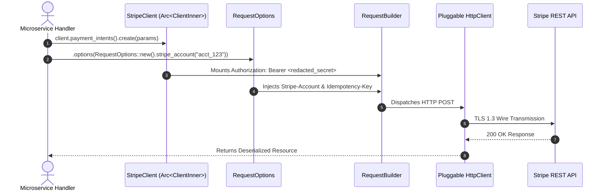

# US-1.1.0: Thread-Safe StripeClient Concurrency & RequestOptions Context

> **Spec Kit Specification**: [Specification Lifecycle Active (.specify/)](../../../.specify/memory/constitution.md)  
> **Behavior Blueprint**: `features/core/modules/microkernel/behaviours/client-concurrency/`  
> **Slicing Standard**: [10-PR Vertical Slicing Framework](../../user-stories/README.md#the-10-pr-vertical-slicing-framework-rust-sdk-adaptation)  
> **Security Gateway**: `security-audit` Level 2 Enforced  
> **Quality Gates**: `(G0–G4 + G-Review + G-Borrow + G-Law)`  

---

## 1. Spec Kit Specification

### 1.1 User Story Narrative
**As a** high-concurrency Rust backend engineer building distributed fintech microservices,  
**I want to** initialize an immutable, thread-safe `StripeClient` backed by `Arc<ClientInner>` with per-request `RequestOptions` (multi-tenant `Stripe-Account`, idempotency keys, and request timeouts),  
**So that** my application can execute thousands of concurrent Stripe operations across Tokio tasks without mutex contention, memory leaks, or credential exposure in debug logs.

#### 1.1.1 Preconditions
- The application runtime is initialized on Rust 2024 edition with an async executor (Tokio / Actix).
- A valid Stripe secret key (`sk_live_...` or `sk_test_...`) or restricted API key is provided.
- The microkernel core crate (`some-stripe-core`) is imported with zero monolithic codegen overhead.

#### 1.1.2 Postconditions
- `StripeClient` can be cloned cheaply via an atomic reference count increment (`Arc::clone`) with zero deep heap duplication.
- Outgoing HTTP requests carry verified `Authorization: Bearer <key>`, optional `Stripe-Account: <acct_id>`, and unique `Idempotency-Key` headers.
- Secret keys are safely zeroized in memory on drop and strictly redacted from all `std::fmt::Debug` implementations.

### 1.2 Acceptance Criteria (Gherkin Scenarios)

```gherkin
Feature: StripeClient Thread Safety and RequestOptions Execution

  Scenario: [AC-US-1.1.0-01] Cheap lock-free client cloning across concurrent Tokio tasks
    Given a StripeClient initialized with a valid secret key
    When 10,000 asynchronous Tokio tasks clone the StripeClient concurrently
    Then each task executes without lock contention or thread synchronization bottlenecks
    And the memory footprint of the client remains constant across all clones.

  Scenario: [AC-US-1.1.0-02] Per-request RequestOptions overriding for Connect multi-tenancy
    Given a base StripeClient authenticated as the platform account
    When an API operation is invoked with RequestOptions specifying Stripe-Account "acct_connected_123" and a custom Idempotency-Key
    Then the outgoing request header contains "Stripe-Account: acct_connected_123"
    And the header contains the exact specified Idempotency-Key
    And the base StripeClient configuration remains completely immutable and unaffected.

  Scenario: [AC-US-1.1.0-03] Secret zeroization and debug log redaction
    Given a StripeConfig configured with a live API secret "sk_live_987654321secret"
    When the config or client is formatted using the "{:?}" Debug trait specifier
    Then the output prints "[REDACTED]" for the secret key
    And upon dropping the config, secret memory bytes are zeroized using volatile writes.

  Scenario: [AC-US-1.1.0-LAW] PCI-DSS 4.0 credential protection and authentication compliance
    Given any client instantiation or network transmission
    When API credentials or authentication tokens are loaded or transmitted
    Then the system enforces TLS 1.3 encryption in transit, strict memory zeroization on drop, and complete absence of plaintext credentials in logs, fulfilling PCI-DSS Requirement 3.4 and 8.3.
```

### 1.3 Test Cases & Traceability Matrix

| Test Case ID | Target Criterion | Test Type | Execution Level | Verification Assertion & Pass Criteria |
| :--- | :--- | :--- | :--- | :--- |
| `TC-1.1.0-01` | `AC-US-1.1.0-01` | Concurrency | Integration / Stress | Assert 10k Tokio task spawns complete with `Arc::strong_count` integrity and zero data races. |
| `TC-1.1.0-02` | `AC-US-1.1.0-02` | Functional | Unit / Contract | Verify `Stripe-Account` and `Idempotency-Key` headers injected into `reqwest::RequestBuilder`. |
| `TC-1.1.0-03` | `AC-US-1.1.0-03` | Security | Unit / SAST | Assert `format!("{:?}", client)` does not contain substring `"sk_live"` and zeroize cleans memory. |
| `TC-1.1.0-LAW` | `AC-US-1.1.0-LAW` | Compliance | Static / Audit | Verify PCI-DSS 4.0 automated check: zero secret keys in memory dumps and trace spans. |

---

## 2. Behavior-Centric Architecture & Folder Blueprint

### 2.1 Colocated Behaviour Directory Tree

```
features/core/modules/microkernel/behaviours/client-concurrency/
├── services/        # StripeClient core struct, ClientInner, HTTP execution engine
├── logic/           # RequestOptions builder, SecretString zeroizer, header injection logic
├── types/           # StripeConfig, AccountId, IdempotencyKey, StripeVersion
└── constants/       # DEFAULT_API_BASE, DEFAULT_TIMEOUT_SECS, PINNED_API_VERSION
```

### 2.2 Scoping & Promotion Blueprint
- **Tier 1 (Behaviour-Local)**: `ClientInner` private atomic state and volatile zeroization helpers.
- **Tier 2 (Module-Shared)**: `StripeConfig` and `RequestOptions` shared across all microkernel services.
- **Tier 3 (Feature-Shared)**: `StripeClient` root handle re-exported for all domain plugins (`checkout`, `payments`, `billing`).
- **Tier 4 (Global-Shared)**: Re-exported from root `some-stripe` facade.

---

## 3. Technical Implementation Plan

### 3.1 Domain Invariants & Storage Schema
- **Rust Memory Law**: Strict borrowing (`&self`, `&RequestOptions`), zero deep `.clone()` calls; cloning `StripeClient` only increments `Arc<ClientInner>` atomic counter.
- **Header Immutability**: All client configuration parameters are immutable. Dynamic per-request overrides are passed by reference via `RequestOptions`.
- **Zero-Allocation Secret String**: Implement `SecretString` using `secrecy` or custom `Drop` handler with `zeroize::Zeroize`.

### 3.2 Activity & Interaction Diagram



---

## 4. Granular Implementation Tasks

### 4.1 The 10-PR Vertical Slicing Implementation Plan

| PR # | Pillar | Architectural Layer | Primary Scope & Files | Deliverables & Acceptance | Accountable Role / Agent | Assigned Skills |
| :--- | :--- | :--- | :--- | :--- | :--- | :--- |
| **PR 1** | **Pillar 1** | **Microkernel Domain Logic & Core Traits** | `crates/some-stripe-core/src/client.rs` | Thread-safe `StripeClient`, `ClientInner`, `Send + Sync` assertions. | `microkernel-architect` | `stripe-docs` |
| **PR 2** | **Pillar 2** | **Request Options & Config Modeling** | `crates/some-stripe-core/src/options.rs` | `RequestOptions` builder, `SecretString` zeroization on drop. | `microkernel-architect` | `security-audit` |
| **PR 3** | **Pillar 3** | **Transport Wire Adapter** | `crates/some-stripe-core/src/transport.rs` | Header injection middleware: `Stripe-Account`, `Stripe-Version`, `Idempotency-Key`. | `microkernel-architect` | `stripe-best-practices` |
| **PR 4** | **Pillar 4** | **Client Concurrency Engine** | `crates/some-stripe-core/src/client.rs` | Lock-free task distribution across Tokio worker pools. | `microkernel-architect` | `stripe-docs` |
| **PR 5** | **Pillar 5** | **Error Taxonomy & Redacted Debug** | `crates/some-stripe-core/src/error.rs` | Sanitize `std::fmt::Debug` on all client structs, preventing secret leakage. | `security-appsec-engineer` | `security-audit` |
| **PR 6** | **Pillar 6** | **Resource Facade Mounting** | `crates/some-stripe-core/src/facade.rs` | Zero-cost extension trait mounting resource namespaces to `StripeClient`. | `domain-codegen-specialist` | `stripe-docs` |
| **PR 7** | **Pillar 7** | **Zero-Copy Memory Hardening** | `crates/some-stripe-core/src/types.rs` | Enforce Rust zero-clone borrowing discipline; eliminate all deep clones. | `engineering-rust-refactoring-specialist` | `stripe-best-practices` |
| **PR 8** | **Pillar 8** | **Multi-Tenant Header Routing** | `crates/some-stripe-core/src/options.rs` | Comprehensive unit tests for Connect account impersonation. | `domain-codegen-specialist` | `connect-recommend` |
| **PR 9** | **Pillar 9** | **Integration Wire Verification** | `tests/client_concurrency_test.rs` | 10k task concurrency test against mock TCP server; zero memory growth. | `testing-api-tester` | `stripe-docs` |
| **PR 10** | **Pillar 10** | **Documentation & Packaging** | `README.md`, `crates/some-stripe-core/` | Public API documentation, doc-tests, and Cargo feature flags. | `engineering-technical-writer` | `stripe-docs` |

### 4.2 Implementation Phase Breakdown

#### Phase 1: Core Client Struct & Secret Management (PR 1–2)
- [ ] **Task 1.1 (Types)**: Define `ClientInner`, `StripeConfig`, and `SecretString` with `Zeroize` on drop in `types/`.  
  *Agent*: `microkernel-architect` | *Skill*: `security-audit`
- [ ] **Task 1.2 (Constants)**: Pin `DEFAULT_API_BASE` ("https://api.stripe.com") and `DEFAULT_STRIPE_VERSION` in `constants/`.  
  *Agent*: `microkernel-architect` | *Skill*: `stripe-docs`
- [ ] **Task 1.3 (Logic)**: Implement `StripeClient::new()` wrapping `Arc<ClientInner>` with lock-free atomic cloning.  
  *Agent*: `microkernel-architect` | *Skill*: `stripe-best-practices`
- [ ] **Task 1.4 (Unit Tests)**: Write unit tests verifying debug redaction (`assert!(!format!("{client:?}").contains("sk_"))`).  
  *Agent*: `testing-api-tester` | *Skill*: `security-audit`

#### Phase 2: RequestOptions Builder & Transport Adapters (PR 3–6)
- [ ] **Task 2.1 (API / Gateway)**: Implement fluent `RequestOptions` builder with `stripe_account`, `idempotency_key`, `timeout`.  
  *Agent*: `microkernel-architect` | *Skill*: `stripe-best-practices`
- [ ] **Task 2.2 (Header Injection)**: Implement header injection middleware converting `RequestOptions` into HTTP request headers.  
  *Agent*: `microkernel-architect` | *Skill*: `stripe-docs`
- [ ] **Task 2.3 (Facade Routing)**: Attach resource namespace accessors borrowing `&StripeClient` without heap allocations.  
  *Agent*: `domain-codegen-specialist` | *Skill*: `stripe-docs`
- [ ] **Task 2.4 (Integration Tests)**: Verify requests to mock server carry expected headers and custom timeouts.  
  *Agent*: `testing-api-tester` | *Skill*: `stripe-docs`

#### Phase 3: High-Concurrency Stress & Zero-Clone Hardening (PR 7–8)
- [ ] **Task 3.1 (Borrow Check)**: Audit all methods to guarantee zero deep `.clone()` on client instances; verify pointer copy only.  
  *Agent*: `engineering-rust-refactoring-specialist` | *Skill*: `stripe-best-practices`
- [ ] **Task 3.2 (Stress Testing)**: Spawn 10,000 asynchronous Tokio tasks sharing a single client clone; verify zero contention.  
  *Agent*: `testing-api-tester` | *Skill*: `stripe-docs`

#### Phase 4: Security Verification & Release Sign-Off (PR 9–10)
- [ ] **Task 4.1 (Secret Scan)**: Run memory dump inspection to confirm zero secret key plaintext leaks.  
  *Agent*: `security-appsec-engineer` | *Skill*: `security-audit`
- [ ] **Task 4.2 (G-Review)**: Peer review by Code Reviewer for lock-free concurrency and clean Rust 2024 idioms.  
  *Agent*: `engineering-code-reviewer` | *Skill*: `stripe-best-practices`
- [ ] **Task 4.3 (Documentation)**: Complete comprehensive doc-tests for `StripeClient` and `RequestOptions`.  
  *Agent*: `engineering-technical-writer` | *Skill*: `stripe-docs`

---

## 5. Security Gateway (Powered by security-audit)

### 5.1 Trust Boundaries & Security Actors
- **Trust Boundaries**:
  - `Client Execution Space`: The caller application memory and task pool.
  - `Transport Boundary`: HTTPS / TLS 1.3 socket over public networks to `api.stripe.com`.
  - `Connect Boundary`: Multi-tenant authorization boundaries controlled via `Stripe-Account` impersonation.
- **Authorized Principals**:
  - Platform Secret Key: Full administrative authority over platform resources.
  - Restricted API Keys: Scope-limited permissions enforcing least-privilege access.
  - Connected Accounts: Validated target accounts passed in `Stripe-Account`.

### 5.2 Threat Modeling & Abuse Matrix (STRIDE / ASVS)

| Threat Vector | Severity | Vulnerability Mechanism | Mitigating Control & Security Invariant |
| :--- | :--- | :--- | :--- |
| **Spoofing & Key Leakage** | Critical | Secret API keys logged in plaintext during debug logging | Custom `Debug` implementation redacts all secrets to `[REDACTED]`. |
| **Information Disclosure** | High | Memory dump inspection exposing discarded API keys | Sensitive byte buffers implement `Zeroize` on drop using volatile memory overwrite. |
| **Cross-Tenant Impersonation** | Critical | Leaking `Stripe-Account` header across subsequent client calls | `RequestOptions` are strictly per-request and never mutate client instance state. |
| **Idempotency Collision** | High | Reusing idempotency keys with differing payloads | Microkernel auto-generates unique UUID v4 keys per unique mutation operation. |

### 5.3 Cryptographic & Data Protection Controls
- **TLS 1.3 Transport**: Mandatory encrypted transport; plaintext HTTP attempts immediately rejected.
- **Memory Zeroization**: Cryptographic secrets wiped using `zeroize::zeroize_words`.
- **Debug Filter**: Compiler-enforced redaction on all sensitive structs.

### 5.4 Automated Security Verification Checklist
- [ ] **Secret Scanning**: Gitleaks and cargo-audit confirm zero hardcoded secrets.
- [ ] **Log Redaction Test**: Automated test asserts `format!("{client:?}")` does not contain the API key.
- [ ] **Memory Dump Audit**: Memory inspector confirms zeroized key bytes after drop.

### 5.5 Security Gateway (G2) Sign-Off Checklist
- [ ] Threat boundaries verified against OWASP ASVS Level 2 requirements.
- [ ] Multi-tenant isolation verified with zero cross-request header contamination.
- [ ] Zero plaintext credentials in application telemetry or log spans.
- [ ] Independent reviewer sign-off obtained; zero open findings.

---

## 6. Validation Gates & Acceptance Sign-Off

**Status: Ready for Implementation.**

### G1 — Test coverage
- [ ] **US-1.1.0-G1:** Automated test suite achieves >=90% line and >=85% branch coverage in `some-stripe-core`.

### G2 — Security audit
- [ ] **US-1.1.0-G2:** Zero-leak credential audit passes with zero critical or high findings.

### G3 — Architecture and maintainability
- [ ] **US-1.1.0-G3:** Strict compliance with microkernel architecture; zero monolithic codegen in core crate.

### G-Review — Code review
- [ ] **US-1.1.0-G-Review:** Senior peer review completed by `engineering-code-reviewer` across correctness, security, and performance.

### G-Borrow — Rust zero-clone borrowing validation
- [ ] **US-1.1.0-G-Borrow:** Verified strictly zero unauthorized deep `.clone()` calls; `Arc::clone` pointer copies used exclusively.

### G-Law — Law validation
- [ ] **US-1.1.0-G-Law:** PCI-DSS 4.0 requirement 3.4 & 8.3 credential security compliance certified by compliance reviewer.

### G4 — Integrated acceptance
- [ ] **US-1.1.0-G4:** High-concurrency 10k task execution verified against mock server with zero errors.
