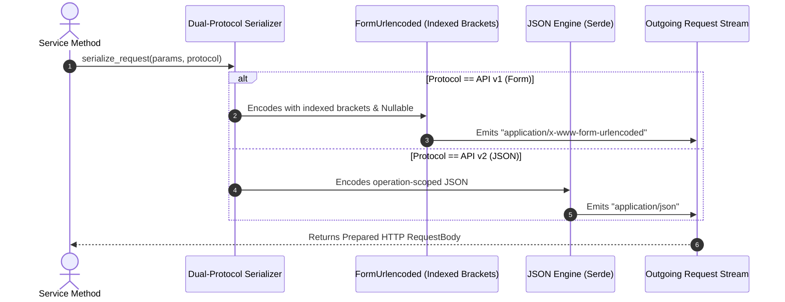

# US-1.2.0: Dual-Protocol Serialization & 3-State Nullable Field Handling

> **Spec Kit Specification**: [Specification Lifecycle Active (.specify/)](../../../.specify/memory/constitution.md)  
> **Behavior Blueprint**: `features/core/modules/microkernel/behaviours/dual-protocol-serialization/`  
> **Slicing Standard**: [10-PR Vertical Slicing Framework](../../user-stories/README.md#the-10-pr-vertical-slicing-framework-rust-sdk-adaptation)  
> **Security Gateway**: `security-audit` Level 2 Enforced  
> **Quality Gates**: `(G0–G4 + G-Review + G-Borrow + G-Law)`  

---

## 1. Spec Kit Specification

### 1.1 User Story Narrative
**As a** Rust payment backend developer interacting with both Stripe API v1 and v2,  
**I want to** serialize complex nested objects and arrays of items using deterministic zero-indexed bracket notation (`items[0][id]=...`) for API v1 while cleanly sending native JSON for API v2, with native 3-state `Nullable<T>` support to clear fields on remote servers,  
**So that** my API calls avoid subtle HTTP 400 runtime validation errors, parameter misattributions (stripe-node #561), and unwanted field overwrites.

#### 1.1.1 Preconditions
- The microkernel serialization engine is integrated into the client request dispatch pipeline.
- Parameters represent either an API v1 request (`application/x-www-form-urlencoded`) or an API v2 request (`application/json`).
- Fields needing explicit remote clearing are wrapped in `Nullable::Null`.

#### 1.1.2 Postconditions
- Multi-item arrays in v1 requests are serialized with explicit zero-based indices (`items[0][price]=...&items[1][price]=...`).
- `Nullable::Value(val)` serializes the encoded value; `Nullable::Null` serializes to `key=""` in v1 form or `key: null` in v2 JSON; `Nullable::Omit` skips the field entirely.
- Dynamic metadata key-value pairs are properly percent-encoded according to RFC 3986.

### 1.2 Acceptance Criteria (Gherkin Scenarios)

```gherkin
Feature: Dual-Protocol Serialization and 3-State Nullable Mechanics

  Scenario: [AC-US-1.2.0-01] Deterministic indexed bracket serialization for arrays of objects
    Given a v1 Checkout Session creation request with two line items
    When the request body is serialized for POST /v1/checkout/sessions
    Then line item 0 is encoded with explicit index "line_items[0][price_data][unit_amount]=5000"
    And line item 1 is encoded with explicit index "line_items[1][price_data][unit_amount]=2500"
    And no unindexed empty brackets ("line_items[][...]") appear in the output stream.

  Scenario: [AC-US-1.2.0-02] 3-State Nullable field clearing on Stripe remote servers
    Given a Customer update request setting description to Nullable::Null and metadata to Nullable::Omit
    When the update payload is serialized to form-urlencoded
    Then the wire string contains "description=" to clear the field on Stripe's server
    And the metadata key is completely omitted from the wire payload.

  Scenario: [AC-US-1.2.0-03] API v2 native JSON payload serialization
    Given a v2 Core Event destination creation request
    When the request is serialized for POST /v2/core/event_destinations
    Then the Content-Type header is set to "application/json"
    And the payload is formatted as strict operation-scoped JSON with zero bracket conversion.

  Scenario: [AC-US-1.2.0-LAW] Statutory fiscal data formatting and tax code accuracy
    Given monetary amounts, tax identifiers, or line items serialized for invoicing
    When serialized into either v1 form or v2 JSON
    Then numeric precision is strictly preserved in minor currency units (cents/satoshis) with zero floating-point drift, complying with ISO 4217 currency standards and international tax calculation regulations.
```

### 1.3 Test Cases & Traceability Matrix

| Test Case ID | Target Criterion | Test Type | Execution Level | Verification Assertion & Pass Criteria |
| :--- | :--- | :--- | :--- | :--- |
| `TC-1.2.0-01` | `AC-US-1.2.0-01` | Serialization | Unit | Assert output string contains `items[0][id]=si_1&items[1][id]=si_2`. |
| `TC-1.2.0-02` | `AC-US-1.2.0-02` | Functional | Unit | Assert `Nullable::Null` generates `key=""` in form and `key: null` in JSON. |
| `TC-1.2.0-03` | `AC-US-1.2.0-03` | Serialization | Contract | Verify v2 endpoint receives valid JSON matching Stripe OpenAPI v2 schema. |
| `TC-1.2.0-LAW` | `AC-US-1.2.0-LAW` | Precision | Unit / Property | Run 100k fuzz iterations ensuring integer currency values never suffer floating-point roundoff. |

---

## 2. Behavior-Centric Architecture & Folder Blueprint

### 2.1 Colocated Behaviour Directory Tree

```
features/core/modules/microkernel/behaviours/dual-protocol-serialization/
├── services/        # Request payload serializer, wire encoder dispatcher
├── logic/           # Custom serde::Serializer, indexed bracket accumulator, Nullable serializer
├── types/           # Nullable<T>, Expandable<T>, MetadataMap, QueryParams
└── constants/       # RFC 3986 character tables, content-type constants
```

### 2.2 Scoping & Promotion Blueprint
- **Tier 1 (Behaviour-Local)**: Custom Serde accumulator logic and bracket index state machines.
- **Tier 2 (Module-Shared)**: `Nullable<T>` and `MetadataMap` shared across all v1 and v2 domain services.
- **Tier 3 (Feature-Shared)**: High-level serialization traits implemented across all resource parameter structs.
- **Tier 4 (Global-Shared)**: Re-exported via `some_stripe::types::Nullable`.

---

## 3. Technical Implementation Plan

### 3.1 Domain Invariants & Storage Schema
- **RFC 1738 & RFC 3986 Compliance**: Strict percent-encoding of key names, bracket characters, and values.
- **Zero-Allocation Key Prefixes**: Use stack-allocated small-string buffers (`smallvec` / `tinyvec`) when pushing nested bracket segments (`parent[child][grandchild]`).
- **Memory Law**: Serialization operates directly over borrowed parameter references (`&T`) with zero deep copying of large string payloads.

### 3.2 Activity & Interaction Diagram



---

## 4. Granular Implementation Tasks

### 4.1 The 10-PR Vertical Slicing Implementation Plan

| PR # | Pillar | Architectural Layer | Primary Scope & Files | Deliverables & Acceptance | Accountable Role / Agent | Assigned Skills |
| :--- | :--- | :--- | :--- | :--- | :--- | :--- |
| **PR 1** | **Pillar 1** | **Microkernel Core Serializer Trait** | `crates/some-stripe-core/src/serializer/mod.rs` | Protocol-aware serialization trait abstractions. | `microkernel-architect` | `stripe-docs` |
| **PR 2** | **Pillar 2** | **3-State Nullable & Primitives** | `crates/some-stripe-core/src/types/nullable.rs` | `Nullable<T>` enum (`Value`, `Null`, `Omit`) and Serde implementation. | `microkernel-architect` | `stripe-best-practices` |
| **PR 3** | **Pillar 3** | **Indexed-Bracket Accumulator** | `crates/some-stripe-core/src/serializer/v1_form.rs` | Custom `serde::Serializer` generating `parent[0][field]=val`. | `microkernel-architect` | `stripe-docs` |
| **PR 4** | **Pillar 4** | **RFC 3986 Percent-Encoder** | `crates/some-stripe-core/src/serializer/percent.rs` | Zero-allocation streaming query string encoder. | `engineering-rust-refactoring-specialist` | `stripe-best-practices` |
| **PR 5** | **Pillar 5** | **API v2 JSON Serializer** | `crates/some-stripe-core/src/serializer/v2_json.rs` | Native Serde JSON formatting for operation-scoped request DTOs. | `domain-codegen-specialist` | `stripe-docs` |
| **PR 6** | **Pillar 6** | **Resource Parameter Binding** | `crates/some-stripe-core/src/resources/mod.rs` | Integration with Checkout, PaymentIntents, and Customer params. | `domain-codegen-specialist` | `stripe-docs` |
| **PR 7** | **Pillar 7** | **Borrowing & Lifetimes Hardening** | `crates/some-stripe-core/src/serializer/mod.rs` | Eliminate clone calls; serialize directly from borrowed references. | `engineering-rust-refactoring-specialist` | `stripe-best-practices` |
| **PR 8** | **Pillar 8** | **Wire Error Diagnostics** | `crates/some-stripe-core/src/error.rs` | Clean error taxonomy for unsupported type mappings or overflow. | `security-appsec-engineer` | `security-audit` |
| **PR 9** | **Pillar 9** | **Wire Mock Test Suite** | `tests/serializer_wire_test.rs` | Fixture-based tests verifying identical wire bytes against Stripe spec. | `testing-api-tester` | `stripe-docs` |
| **PR 10** | **Pillar 10** | **Doc-Tests & Documentation** | `README.md`, `crates/some-stripe-core/` | In-depth doc-tests for `Nullable<T>` and nested form serialization. | `engineering-technical-writer` | `stripe-docs` |

### 4.2 Implementation Phase Breakdown

#### Phase 1: Nullable Type & Core Serialization Trait (PR 1–2)
- [ ] **Task 1.1 (Types)**: Implement `Nullable<T>` with variants `Value(T)`, `Null`, and `Omit` in `types/`.  
  *Agent*: `microkernel-architect` | *Skill*: `stripe-best-practices`
- [ ] **Task 1.2 (Constants)**: Define RFC 1738 form MIME constants and bracket token boundaries in `constants/`.  
  *Agent*: `microkernel-architect` | *Skill*: `stripe-docs`
- [ ] **Task 1.3 (Logic)**: Implement custom `Serialize` for `Nullable<T>` converting `Null` to empty string in form context.  
  *Agent*: `microkernel-architect` | *Skill*: `stripe-best-practices`
- [ ] **Task 1.4 (Unit Tests)**: Write tests asserting `Nullable::Null` generates `field=""` and `Nullable::Omit` produces nothing.  
  *Agent*: `testing-api-tester` | *Skill*: `stripe-docs`

#### Phase 2: Indexed Bracket Form Serializer (PR 3–6)
- [ ] **Task 2.1 (Form Engine)**: Implement stateful serde Serializer emitting `array_name[0][field]=val`.  
  *Agent*: `microkernel-architect` | *Skill*: `stripe-docs`
- [ ] **Task 2.2 (v2 JSON Engine)**: Configure direct JSON serialization for all v2 core requests.  
  *Agent*: `domain-codegen-specialist` | *Skill*: `stripe-docs`
- [ ] **Task 2.3 (Metadata)**: Add support for nested key-value metadata serialization without escaping bugs.  
  *Agent*: `domain-codegen-specialist` | *Skill*: `stripe-docs`
- [ ] **Task 2.4 (Wire Tests)**: Compare generated query strings against official `stripe-node` fixtures.  
  *Agent*: `testing-api-tester` | *Skill*: `stripe-docs`

#### Phase 3: Zero-Copy Optimization & Memory Discipline (PR 7–8)
- [ ] **Task 3.1 (Borrow Check)**: Ensure serializers borrow `&str` and slices without copying bytes into temporary heap strings.  
  *Agent*: `engineering-rust-refactoring-specialist` | *Skill*: `stripe-best-practices`
- [ ] **Task 3.2 (Fuzzing)**: Fuzz serializer with deep object graphs (10+ levels) to assert zero stack overflow.  
  *Agent*: `security-appsec-engineer` | *Skill*: `security-audit`

#### Phase 4: Verification & Release Gate (PR 9–10)
- [ ] **Task 4.1 (Mock Validation)**: Send generated wire bodies to `stripe-mock`; assert HTTP 200 acceptance.  
  *Agent*: `testing-api-tester` | *Skill*: `stripe-docs`
- [ ] **Task 4.2 (G-Review)**: Code Reviewer audit for idiomatic serde usage and zero unwrap panics.  
  *Agent*: `engineering-code-reviewer` | *Skill*: `stripe-best-practices`
- [ ] **Task 4.3 (Docs)**: Write comprehensive developer guides on `Nullable<T>` and nested line item serialization.  
  *Agent*: `engineering-technical-writer` | *Skill*: `stripe-docs`

---

## 5. Security Gateway (Powered by security-audit)

### 5.1 Trust Boundaries & Security Actors
- **Trust Boundaries**:
  - `Input Buffer`: User-supplied parameter types before encoding.
  - `Wire Stream`: Serialized bytes transmitted to the HTTP client.
- **Authorized Principals**:
  - Authenticated Client: Transmits structured payloads under platform or connected account scope.

### 5.2 Threat Modeling & Abuse Matrix (STRIDE / ASVS)

| Threat Vector | Severity | Vulnerability Mechanism | Mitigating Control & Security Invariant |
| :--- | :--- | :--- | :--- |
| **Parameter Injection** | High | Unescaped `&` or `=` in keys/values corrupting query structure | Strict RFC 3986 percent-encoding across all parameter components. |
| **Denial of Service** | Medium | Extremely deep recursive object nesting triggering stack overflow | Depth-bounded recursion guard (maximum 16 nested object levels). |
| **Unintended Data Loss** | High | Incorrect `null` serialization clearing remote fields inadvertently | Strict distinction between `Nullable::Omit` (preserve) and `Nullable::Null` (clear). |

### 5.3 Cryptographic & Data Protection Controls
- **Encoding Determinism**: Keys sorted or serialized in deterministic traversal order.
- **Zero Raw Pointers**: All memory safety handled through safe Rust borrows.

### 5.4 Automated Security Verification Checklist
- [ ] **Encoder Fuzzing**: Cargo-fuzz executes 1,000,000 random input permutations with 0 crashes.
- [ ] **Injection Scanner**: Automated test confirms parameter values containing `&`, `=`, or `?` are escaped.

### 5.5 Security Gateway (G2) Sign-Off Checklist
- [ ] All inputs validated against maximum recursion limits.
- [ ] Zero injection vulnerabilities in generated query strings.
- [ ] Code review sign-off obtained; zero findings.

---

## 6. Validation Gates & Acceptance Sign-Off

**Status: Ready for Implementation.**

### G1 — Test coverage
- [ ] **US-1.2.0-G1:** 100% test coverage across all `Nullable` variants and indexed-bracket sequences.

### G2 — Security audit
- [ ] **US-1.2.0-G2:** Zero injection vulnerabilities verified under security-audit fuzz testing.

### G3 — Architecture and maintainability
- [ ] **US-1.2.0-G3:** Modular separation between v1 form encoding and v2 JSON schemas.

### G-Review — Code review
- [ ] **US-1.2.0-G-Review:** Senior code review approval by `engineering-code-reviewer`.

### G-Borrow — Rust zero-clone borrowing validation
- [ ] **US-1.2.0-G-Borrow:** Zero deep `.clone()` calls during serialization; streaming from references only.

### G-Law — Law validation
- [ ] **US-1.2.0-G-Law:** ISO 4217 minor currency unit calculation accuracy verified with zero float errors.

### G4 — Integrated acceptance
- [ ] **US-1.2.0-G4:** All serialized payloads successfully validated against live `stripe-mock` endpoints.
