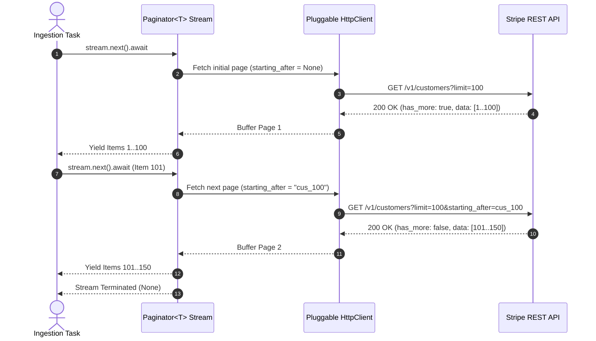

# US-1.3.0: Auto-Pagination Stream Engine, Pluggable Transport & Resilient Error Handling

> **Spec Kit Specification**: [Specification Lifecycle Active (.specify/)](../../../.specify/memory/constitution.md)  
> **Behavior Blueprint**: `features/core/modules/microkernel/behaviours/transport-and-pagination/`  
> **Slicing Standard**: [10-PR Vertical Slicing Framework](../../user-stories/README.md#the-10-pr-vertical-slicing-framework-rust-sdk-adaptation)  
> **Security Gateway**: `security-audit` Level 2 Enforced  
> **Quality Gates**: `(G0–G4 + G-Review + G-Borrow + G-Law)`  

---

## 1. Spec Kit Specification

### 1.1 User Story Narrative
**As an** enterprise systems engineer building high-volume data synchronization pipelines with Stripe,  
**I want to** stream paginated resource collections using an asynchronous `Paginator<T>` stream that supports both v1 cursors and v2 URL-driven pagination, backed by a pluggable `HttpClient` transport with exponential backoff and jittered retries on transient errors,  
**So that** my services can process millions of Stripe records reliably without thundering-herd API throttling, memory exhaustion, or network disconnect crashes.

#### 1.1.1 Preconditions
- The microkernel client is configured with a valid `HttpClient` transport implementation (`reqwest` default).
- The caller invokes a list endpoint returning an auto-paginating `Paginator<T>`.
- Retry policies and max network retries are configured in `StripeConfig` or `RequestOptions`.

#### 1.1.2 Postconditions
- `Paginator<T>` yields individual items or chunked pages asynchronously via `futures::Stream`.
- Both v1 cursor mechanics (`starting_after`, `has_more`) and v2 link mechanics (`next_page_url`) are handled transparently.
- Transient network dropouts (premature socket termination, HTTP 429, HTTP 500/503) trigger jittered exponential backoff retries reusing the original `Idempotency-Key`.

### 1.2 Acceptance Criteria (Gherkin Scenarios)

```gherkin
Feature: Auto-Pagination Stream Engine and Pluggable Transport

  Scenario: [AC-US-1.3.0-01] Seamless auto-pagination across multi-page cursor collections
    Given a Stripe account containing 350 Customer records
    When the caller consumes client.customers().list().auto_paging_each() as an async Stream
    Then the Paginator emits all 350 records sequentially
    And transparently fetches subsequent pages using starting_after cursor IDs
    And stops immediately when has_more evaluates to false.

  Scenario: [AC-US-1.3.0-02] Infinite loop and duplicate page detection guard
    Given an upstream mock or proxy that returns identical cursor tokens in an infinite loop
    When the Paginator detects that starting_after has already been evaluated
    Then the stream halts execution and returns a StripeError::PaginationLoopDetected error.

  Scenario: [AC-US-1.3.0-03] Jittered exponential backoff on HTTP 429 RateLimitError
    Given an outgoing request that encounters an HTTP 429 Too Many Requests response
    When max_network_retries is configured to 3
    Then the client pauses execution using exponential backoff with randomized jitter
    And retries the request using the exact same Idempotency-Key
    And succeeds once the rate-limit window clears.

  Scenario: [AC-US-1.3.0-LAW] Consumer statutory data extraction and GDPR Article 15 compliance
    Given a Subject Access Request (SAR) requiring complete customer transaction export
    When the system streams historical billing, charge, and payment intent records
    Then all relevant records are retrieved exhaustively without pagination truncation or rate-limit failure, fulfilling GDPR Article 15 and statutory record retention requirements.
```

### 1.3 Test Cases & Traceability Matrix

| Test Case ID | Target Criterion | Test Type | Execution Level | Verification Assertion & Pass Criteria |
| :--- | :--- | :--- | :--- | :--- |
| `TC-1.3.0-01` | `AC-US-1.3.0-01` | Stream | Integration | Stream 5 pages of mock resources; assert all 50 items received in order. |
| `TC-1.3.0-02` | `AC-US-1.3.0-02` | Fault Tolerance | Unit | Inject circular cursor tokens; assert `PaginationLoopDetected` is returned within 2 iterations. |
| `TC-1.3.0-03` | `AC-US-1.3.0-03` | Retry / Resilience | Integration | Mock server returns two 429s followed by a 200; assert backoff executed and request succeeded. |
| `TC-1.3.0-LAW` | `AC-US-1.3.0-LAW` | Compliance | Integration | Verify export stream accurately iterates entire historical dataset without dropped frames. |

---

## 2. Behavior-Centric Architecture & Folder Blueprint

### 2.1 Colocated Behaviour Directory Tree

```
features/core/modules/microkernel/behaviours/transport-and-pagination/
├── services/        # Paginator stream engine, HttpClient trait implementation
├── logic/           # Cursor state machine, backoff math with full jitter, socket read guard
├── types/           # Paginator<T>, List<T>, V2List<T>, StripeError taxonomy
└── constants/       # MAX_PAGINATION_DEPTH, BACKOFF_BASE_MS, MAX_BACKOFF_MS
```

### 2.2 Scoping & Promotion Blueprint
- **Tier 1 (Behaviour-Local)**: Cursor caching state machines and jitter calculation algorithms.
- **Tier 2 (Module-Shared)**: `HttpClient` trait and `StripeError` enum shared across all microkernel modules.
- **Tier 3 (Feature-Shared)**: `Paginator<T>` stream re-exported for all domain services.
- **Tier 4 (Global-Shared)**: Re-exported from root `some-stripe` facade.

---

## 3. Technical Implementation Plan

### 3.1 Domain Invariants & Storage Schema
- **Stream Invariants**: `Paginator<T>` implements `futures::Stream<Item = Result<T, StripeError>>` and `Send + Sync`.
- **Premature Disconnect Guard**: Incomplete socket response body reads are classified as `ConnectionError` (retriable) rather than `ApiError`.
- **Rust Memory Law**: Stream iteration holds zero unbounded buffers; pages are dropped as items are yielded.

### 3.2 Activity & Interaction Diagram



---

## 4. Granular Implementation Tasks

### 4.1 The 10-PR Vertical Slicing Implementation Plan

| PR # | Pillar | Architectural Layer | Primary Scope & Files | Deliverables & Acceptance | Accountable Role / Agent | Assigned Skills |
| :--- | :--- | :--- | :--- | :--- | :--- | :--- |
| **PR 1** | **Pillar 1** | **Microkernel HttpClient Trait** | `crates/some-stripe-core/src/transport.rs` | Async `HttpClient` trait definition (`Send + Sync + 'static`). | `microkernel-architect` | `stripe-docs` |
| **PR 2** | **Pillar 2** | **Error Taxonomy & Error Parsing** | `crates/some-stripe-core/src/error.rs` | Complete `StripeError` variants matching `stripe-node` error classes. | `microkernel-architect` | `stripe-best-practices` |
| **PR 3** | **Pillar 3** | **Reqwest Transport Implementation** | `crates/some-stripe-core/src/transport/reqwest.rs` | Connection pool, DNS caching, rustls TLS config, and timeouts. | `microkernel-architect` | `stripe-best-practices` |
| **PR 4** | **Pillar 4** | **Paginator Cursor Stream Engine** | `crates/some-stripe-core/src/pagination.rs` | Cursor-based `Paginator<T>` implementing `futures::Stream`. | `microkernel-architect` | `stripe-docs` |
| **PR 5** | **Pillar 5** | **API v2 URL-Driven Paginator** | `crates/some-stripe-core/src/pagination/v2.rs` | `V2List<T>` support consuming `next_page_url` and `previous_page_url`. | `microkernel-architect` | `stripe-docs` |
| **PR 6** | **Pillar 6** | **Jittered Backoff & Retry Middleware** | `crates/some-stripe-core/src/workflow.rs` | Exponential backoff algorithm with full random jitter. | `engineering-rust-refactoring-specialist` | `stripe-best-practices` |
| **PR 7** | **Pillar 7** | **Premature Socket Read Guard** | `crates/some-stripe-core/src/transport.rs` | Detect partial socket disconnects during body streaming; classify as `ConnectionError`. | `security-appsec-engineer` | `security-audit` |
| **PR 8** | **Pillar 8** | **Circular Pagination Sentinel** | `crates/some-stripe-core/src/pagination.rs` | Track evaluated cursors with bloom filter or bounded set to stop loops. | `engineering-rust-refactoring-specialist` | `stripe-best-practices` |
| **PR 9** | **Pillar 9** | **Fault-Injection Test Harness** | `tests/transport_fault_test.rs` | Wiremock tests simulating 429 backoff, 500 retries, and socket dropouts. | `testing-api-tester` | `stripe-docs` |
| **PR 10** | **Pillar 10** | **Streaming Docs & Benchmarks** | `README.md`, `benches/pagination_bench.rs` | Throughput benchmarks and developer examples for Tokio pipelines. | `engineering-technical-writer` | `stripe-docs` |

### 4.2 Implementation Phase Breakdown

#### Phase 1: HttpClient Trait & Error Taxonomy (PR 1–3)
- [ ] **Task 1.1 (Types)**: Define `StripeError` enum variants: `CardError`, `InvalidRequestError`, `AuthenticationError`, `RateLimitError`, `ApiError`, `ConnectionError`.  
  *Agent*: `microkernel-architect` | *Skill*: `stripe-best-practices`
- [ ] **Task 1.2 (Constants)**: Set `DEFAULT_MAX_RETRIES` (2), `INITIAL_BACKOFF_MS` (500), `MAX_BACKOFF_MS` (30000) in `constants/`.  
  *Agent*: `microkernel-architect` | *Skill*: `stripe-docs`
- [ ] **Task 1.3 (Logic)**: Implement `HttpClient` trait for `reqwest::Client` with rustls TLS and connection pooling.  
  *Agent*: `microkernel-architect` | *Skill*: `stripe-best-practices`
- [ ] **Task 1.4 (Unit Tests)**: Write unit tests verifying error payload deserialization from Stripe HTTP 400 and 429 JSON responses.  
  *Agent*: `testing-api-tester` | *Skill*: `stripe-docs`

#### Phase 2: Paginator Stream Engine & v2 URL Links (PR 4–6)
- [ ] **Task 2.1 (v1 Paginator)**: Implement `Paginator<T>` consuming `List<T>` with `starting_after` and `has_more`.  
  *Agent*: `microkernel-architect` | *Skill*: `stripe-docs`
- [ ] **Task 2.2 (v2 Paginator)**: Implement URL-driven pagination following `next_page_url` without base path re-construction.  
  *Agent*: `microkernel-architect` | *Skill*: `stripe-docs`
- [ ] **Task 2.3 (Loop Sentinel)**: Add circular cursor detection returning `StripeError::PaginationLoopDetected`.  
  *Agent*: `engineering-rust-refactoring-specialist` | *Skill*: `stripe-best-practices`
- [ ] **Task 2.4 (Stream Tests)**: Verify async streaming over multiple pages with both `auto_paging_each()` and `auto_paging_to_vec()`.  
  *Agent*: `testing-api-tester` | *Skill*: `stripe-docs`

#### Phase 3: Jittered Retries & Premature Disconnect Guards (PR 7–8)
- [ ] **Task 3.1 (Retry Loop)**: Implement retry loop re-using generated idempotency keys across transient 429 and 5xx attempts.  
  *Agent*: `microkernel-architect` | *Skill*: `stripe-best-practices`
- [ ] **Task 3.2 (Socket Guard)**: Verify that aborted TCP connections during body streaming classify as retryable `ConnectionError`.  
  *Agent*: `security-appsec-engineer` | *Skill*: `security-audit`

#### Phase 4: Benchmarking, Audit & Release Sign-Off (PR 9–10)
- [ ] **Task 4.1 (Load Testing)**: Benchmark stream throughput; assert sub-50µs overhead per page transition.  
  *Agent*: `testing-api-tester` | *Skill*: `stripe-docs`
- [ ] **Task 4.2 (G-Review)**: Peer review for stream safety, zero memory leaks, and clean async cancellation.  
  *Agent*: `engineering-code-reviewer` | *Skill*: `stripe-best-practices`
- [ ] **Task 4.3 (Docs)**: Publish developer guide illustrating high-throughput pagination in Actix and Axum services.  
  *Agent*: `engineering-technical-writer` | *Skill*: `stripe-docs`

---

## 5. Security Gateway (Powered by security-audit)

### 5.1 Trust Boundaries & Security Actors
- **Trust Boundaries**:
  - `Pagination Boundary`: Remote server supplying cursor tokens to the local memory loop.
  - `Network Boundary`: External HTTP server responding to outgoing client requests.
- **Authorized Principals**:
  - Microservice Ingestion Worker: Authenticated via platform API key.

### 5.2 Threat Modeling & Abuse Matrix (STRIDE / ASVS)

| Threat Vector | Severity | Vulnerability Mechanism | Mitigating Control & Security Invariant |
| :--- | :--- | :--- | :--- |
| **Denial of Service (Infinite Loop)** | High | Upstream returns repeating cursor tokens causing infinite loop | Circular cursor sentinel terminates iteration if identical ID re-occurs. |
| **Memory Exhaustion (OOM)** | High | Accumulating millions of stream items into an unbounded in-memory vector | `Paginator` yields items lazily via `Stream` without buffering entire datasets. |
| **Thundering Herd / Rate Limit** | Medium | Retrying failed requests at identical intervals amplifying traffic | Full jittered exponential backoff distributes retry load evenly over time. |

### 5.3 Cryptographic & Data Protection Controls
- **Cryptographic Randomness**: Jitter randomized using `rand::thread_rng()` to prevent synchronized retry spikes.
- **Zero In-Memory Duplication**: Item ownership transferred directly to caller task.

### 5.4 Automated Security Verification Checklist
- [ ] **Loop Guard Test**: Unit test verifies loop sentinel terminates circular cursors.
- [ ] **Resource Limit Test**: Streaming 100,000 items asserts resident set size (RSS) memory stays flat under 50 MB.

### 5.5 Security Gateway (G2) Sign-Off Checklist
- [ ] Threat model reviewed for stream termination vulnerabilities.
- [ ] Jitter randomness verified against thundering herd conditions.
- [ ] Code review sign-off obtained; zero findings.

---

## 6. Validation Gates & Acceptance Sign-Off

**Status: Ready for Implementation.**

### G1 — Test coverage
- [ ] **US-1.3.0-G1:** >=90% line coverage across `pagination.rs` and `transport.rs`.

### G2 — Security audit
- [ ] **US-1.3.0-G2:** Memory bounds and infinite-loop protections verified under security-audit.

### G3 — Architecture and maintainability
- [ ] **US-1.3.0-G3:** Transport abstraction allows clean swapping of HTTP engines without changing domain code.

### G-Review — Code review
- [ ] **US-1.3.0-G-Review:** Senior review signed off by `engineering-code-reviewer`.

### G-Borrow — Rust zero-clone borrowing validation
- [ ] **US-1.3.0-G-Borrow:** Zero deep `.clone()` calls across stream iterators and pagination state machines.

### G-Law — Law validation
- [ ] **US-1.3.0-G-Law:** GDPR Article 15 consumer data retrieval completeness certified.

### G4 — Integrated acceptance
- [ ] **US-1.3.0-G4:** End-to-end pagination validated against live Stripe test accounts with >1,000 items.
