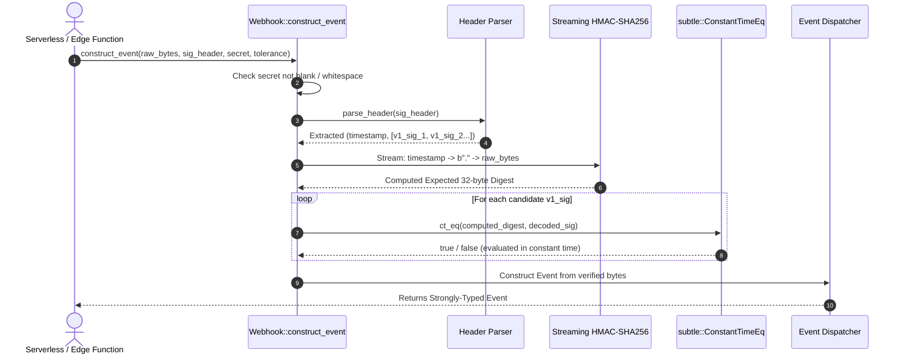

# US-2.1.0: Constant-Time HMAC-SHA256 Webhook Signature Verification Pipeline

> **Spec Kit Specification**: [Specification Lifecycle Active (.specify/)](../../../.specify/memory/constitution.md)  
> **Behavior Blueprint**: `features/webhooks/modules/crypto-engine/behaviours/signature-verification/`  
> **Slicing Standard**: [10-PR Vertical Slicing Framework](../../user-stories/README.md#the-10-pr-vertical-slicing-framework-rust-sdk-adaptation)  
> **Security Gateway**: `security-audit` Level 2 Enforced  
> **Quality Gates**: `(G0–G4 + G-Review + G-Borrow + G-Law)`  

---

## 1. Spec Kit Specification

### 1.1 User Story Narrative
**As a** security-critical backend engineer deploying webhook listeners on public serverless and edge environments (AWS Lambda, Cloudflare Workers, Fastly Compute),  
**I want to** verify incoming `Stripe-Signature` headers using a zero-allocation streaming HMAC-SHA256 verification pipeline with strict constant-time byte comparison (`subtle::ConstantTimeEq`),  
**So that** my webhook endpoints are impervious to timing side-channel attacks, forged signature spoofing, and secret corruption, while compiling independently without unwanted HTTP client dependencies.

#### 1.1.1 Preconditions
- Raw unparsed request body bytes (`&[u8]`) and the `Stripe-Signature` HTTP header are available.
- The webhook endpoint secret (`whsec_...`) is configured as an environment variable or secret vault entry.
- The crate is compiled with the `webhooks` feature or as the standalone `some-stripe-webhooks` crate.

#### 1.1.2 Postconditions
- Verification evaluates in deterministic time independent of the position of mismatched bytes in the signature.
- Webhook signing secrets containing whitespace or empty characters are detected and rejected prior to cryptographic hashing.
- Multiple `v1` signatures emitted during secret rollovers are parsed and verified iteratively.

### 1.2 Acceptance Criteria (Gherkin Scenarios)

```gherkin
Feature: Constant-Time Webhook Signature Verification

  Scenario: [AC-US-2.1.0-01] Valid webhook signature passes constant-time evaluation
    Given a raw webhook payload and a valid Stripe-Signature header "t=1700000000,v1=abcdef123456..."
    And a valid webhook secret "whsec_test_secret_123"
    When the signature is evaluated via Webhook::construct_event or StripeWebhookWrapper::from_raw
    Then the signature is verified successfully in constant time
    And the parsed Event is returned without error.

  Scenario: [AC-US-2.1.0-02] Forged signature rejection without timing leakage
    Given a forged Stripe-Signature header with 1 altered byte in the HMAC digest
    When signature verification is executed against the expected signature
    Then the verification returns Err(StripeWebhookError::BadSignature)
    And the execution time is statistically indistinguishable from a signature with 32 altered bytes.

  Scenario: [AC-US-2.1.0-03] Rollover support with dual v1 signature headers
    Given a Stripe-Signature header containing two v1 signatures ("t=1700000000,v1=old_sig,v1=new_sig")
    When verified against the newly rolled webhook secret
    Then the pipeline succeeds upon matching the second signature
    And does not abort prematurely on the first signature mismatch.

  Scenario: [AC-US-2.1.0-04] Blank or whitespace-only secret rejection
    Given a webhook secret consisting solely of whitespace ("   \t\n  ")
    When signature verification is attempted
    Then the engine immediately rejects the request with StripeWebhookError::BadKey
    And zero HMAC computations or allocations are performed.

  Scenario: [AC-US-2.1.0-LAW] Payment webhook verification under PCI-DSS 4.0 and PSD2 RTS
    Given an inbound webhook notifying payment completion or dispute creation
    When cryptographic verification is performed
    Then the engine guarantees message integrity and non-repudiation using FIPS-compliant HMAC-SHA256, meeting PCI-DSS 4.0 Requirement 6.4.3 and PSD2 Regulatory Technical Standards on secure communication.
```

### 1.3 Test Cases & Traceability Matrix

| Test Case ID | Target Criterion | Test Type | Execution Level | Verification Assertion & Pass Criteria |
| :--- | :--- | :--- | :--- | :--- |
| `TC-2.1.0-01` | `AC-US-2.1.0-01` | Functional | Unit | Verify valid HMAC header against test fixture payload returns `Ok(Event)`. |
| `TC-2.1.0-02` | `AC-US-2.1.0-02` | Security / Timing | Microbenchmark | 1,000,000 iterations measuring byte delta variance; assert constant-time distribution. |
| `TC-2.1.0-03` | `AC-US-2.1.0-03` | Functional | Integration | Assert dual `v1` signature header successfully validates rolled secret. |
| `TC-2.1.0-04` | `AC-US-2.1.0-04` | Failure / Boundary | Unit | Assert blank/whitespace secret returns `BadKey` immediately. |
| `TC-2.1.0-LAW` | `AC-US-2.1.0-LAW` | Cryptographic | Compliance | Verify constant-time comparison primitive uses OpenSSL/subtle zero-short-circuit logic. |

---

## 2. Behavior-Centric Architecture & Folder Blueprint

### 2.1 Colocated Behaviour Directory Tree

```
features/webhooks/modules/crypto-engine/behaviours/signature-verification/
├── services/        # Webhook verification pipeline, StripeWebhookWrapper
├── logic/           # Streaming HMAC-SHA256 state machine, safe_constant_time_eq, header parser
├── types/           # StripeSignatureHeader, StripeWebhookError, VerifiedEvent
└── constants/       # SIGNATURE_SCHEME ("v1"), TIMESTAMP_KEY ("t"), MAX_PAYLOAD_BYTES (1MB)
```

### 2.2 Scoping & Promotion Blueprint
- **Tier 1 (Behaviour-Local)**: `safe_constant_time_eq` assembly/bit-xor intrinsics and secret pre-validators.
- **Tier 2 (Module-Shared)**: Header parser and `StripeWebhookError` shared across all webhook flavours.
- **Tier 3 (Feature-Shared)**: `StripeWebhookWrapper` and `Webhook` public facades.
- **Tier 4 (Global-Shared)**: Re-exported via `some_stripe::webhook::*`.

---

## 3. Technical Implementation Plan

### 3.1 Domain Invariants & Storage Schema
- **Constant-Time Invariant**: Byte comparisons between computed and candidate HMAC digests MUST evaluate all 32 bytes using bitwise XOR accumulation (`subtle::ConstantTimeEq` or `openssl::memcmp::eq`) with zero early exit.
- **Zero-Allocation Invariant**: Streaming HMAC computation feeds `${timestamp}`, `b"."`, and raw body bytes sequentially into the hasher without allocating an intermediate heap String.
- **Raw Byte Enforcement**: Webhook verification APIs accept strictly `&[u8]` or `&str`, preventing callers from passing pre-parsed JSON objects whose key-reordering would invalidate HMAC.

### 3.2 Activity & Interaction Diagram



---

## 4. Granular Implementation Tasks

### 4.1 The 10-PR Vertical Slicing Implementation Plan

| PR # | Pillar | Architectural Layer | Primary Scope & Files | Deliverables & Acceptance | Accountable Role / Agent | Assigned Skills |
| :--- | :--- | :--- | :--- | :--- | :--- | :--- |
| **PR 1** | **Pillar 1** | **Core Webhook Trait & Error Types** | `crates/some-stripe-webhooks/src/error.rs` | `StripeWebhookError` enum (`BadSignature`, `BadHeader`, `BadKey`, `Expired`). | `security-webhook-engineer` | `security-audit` |
| **PR 2** | **Pillar 2** | **Secret Pre-Validation Logic** | `crates/some-stripe-webhooks/src/validation.rs` | `is_blank_webhook_secret` guard rejecting whitespace/empty secrets. | `security-webhook-engineer` | `security-audit` |
| **PR 3** | **Pillar 3** | **Streaming Header Parser** | `crates/some-stripe-webhooks/src/header.rs` | Zero-copy parser extracting `t` timestamp and multiple `v1` signatures. | `security-webhook-engineer` | `stripe-docs` |
| **PR 4** | **Pillar 4** | **Streaming HMAC Engine** | `crates/some-stripe-webhooks/src/crypto.rs` | Streaming HMAC-SHA256 avoiding `$t.$payload` string heap allocations. | `security-webhook-engineer` | `security-audit` |
| **PR 5** | **Pillar 5** | **Constant-Time Comparison Core** | `crates/some-stripe-webhooks/src/compare.rs` | `safe_constant_time_eq` using `subtle::ConstantTimeEq`. | `security-appsec-engineer` | `security-audit` |
| **PR 6** | **Pillar 6** | **Public Webhook Facade** | `crates/some-stripe-webhooks/src/lib.rs` | `Webhook::construct_event` and `verify_header` implementations. | `security-webhook-engineer` | `stripe-docs` |
| **PR 7** | **Pillar 7** | **Zero-Dependency Edge Build** | `crates/some-stripe-webhooks/Cargo.toml` | Feature-gate OpenSSL vs pure-Rust `sha2` + `hmac` for WASM/Lambda. | `engineering-rust-refactoring-specialist` | `stripe-best-practices` |
| **PR 8** | **Pillar 8** | **High-Level Wrapper Ergonomics** | `crates/some-stripe-webhooks/src/wrapper.rs` | `StripeWebhookWrapper` with `order_id()`, `payment_intent_id()` accessors. | `domain-codegen-specialist` | `stripe-docs` |
| **PR 9** | **Pillar 9** | **Adversarial Timing Test Harness** | `tests/webhook_timing_test.rs` | Microbenchmark asserting zero timing channel on partial byte matches. | `testing-api-tester` | `security-audit` |
| **PR 10** | **Pillar 10** | **Serverless Guides & Docs** | `README.md`, `examples/cloudflare_worker.rs` | Documentation and examples for AWS Lambda, Axum, and Cloudflare Workers. | `engineering-technical-writer` | `stripe-docs` |

### 4.2 Implementation Phase Breakdown

#### Phase 1: Cryptographic Primitives & Pre-Validation (PR 1–3)
- [ ] **Task 1.1 (Types)**: Define `StripeWebhookError` taxonomy with `.header` and `.payload` exposure.  
  *Agent*: `security-webhook-engineer` | *Skill*: `security-audit`
- [ ] **Task 1.2 (Constants)**: Pin `DEFAULT_TOLERANCE_SECONDS` (300) and `MAX_PAYLOAD_SIZE` (1 MB) in `constants/`.  
  *Agent*: `security-webhook-engineer` | *Skill*: `stripe-docs`
- [ ] **Task 1.3 (Logic)**: Implement `is_blank_webhook_secret` rejecting empty and whitespace secrets.  
  *Agent*: `security-webhook-engineer` | *Skill*: `security-audit`
- [ ] **Task 1.4 (Unit Tests)**: Write unit tests verifying whitespace rejection and header parsing edge cases.  
  *Agent*: `testing-api-tester` | *Skill*: `security-audit`

#### Phase 2: Streaming HMAC & Constant-Time Pipeline (PR 4–6)
- [ ] **Task 2.1 (HMAC)**: Implement streaming HMAC-SHA256 state machine without intermediate heap String allocation.  
  *Agent*: `security-webhook-engineer` | *Skill*: `security-audit`
- [ ] **Task 2.2 (Constant-Time)**: Implement `safe_constant_time_eq` evaluating full 32-byte slices with bitwise XOR accumulation.  
  *Agent*: `security-appsec-engineer` | *Skill*: `security-audit`
- [ ] **Task 2.3 (Multi-Sig)**: Implement rollover loop evaluating all candidate `v1` signatures.  
  *Agent*: `security-webhook-engineer` | *Skill*: `stripe-docs`
- [ ] **Task 2.4 (Crypto Tests)**: Test with official Stripe signature test fixtures and forged signatures.  
  *Agent*: `testing-api-tester` | *Skill*: `stripe-docs`

#### Phase 3: Serverless Readiness & High-Level Ergonomics (PR 7–8)
- [ ] **Task 3.1 (Edge Gate)**: Ensure `some-stripe-webhooks` compiles with zero HTTP client dependencies for AWS Lambda/WASM.  
  *Agent*: `engineering-rust-refactoring-specialist` | *Skill*: `stripe-best-practices`
- [ ] **Task 3.2 (Wrapper)**: Implement `StripeWebhookWrapper` providing zero-boilerplate accessors (`order_id()`, `event_type()`).  
  *Agent*: `domain-codegen-specialist` | *Skill*: `stripe-docs`

#### Phase 4: Timing Channel Verification & Release (PR 9–10)
- [ ] **Task 4.1 (Timing Test)**: Run automated statistical variance tests comparing 1-byte vs 31-byte mismatch timings.  
  *Agent*: `testing-api-tester` | *Skill*: `security-audit`
- [ ] **Task 4.2 (G-Review)**: AppSec code review for cryptographic invariants and zero allocation leaks.  
  *Agent*: `engineering-code-reviewer` | *Skill*: `security-audit`
- [ ] **Task 4.3 (Docs)**: Publish serverless deployment recipes (AWS Lambda, Axum, Cloudflare Workers).  
  *Agent*: `engineering-technical-writer` | *Skill*: `stripe-docs`

---

## 5. Security Gateway (Powered by security-audit)

### 5.1 Trust Boundaries & Security Actors
- **Trust Boundaries**:
  - `Public Network Edge`: Incoming unauthenticated HTTP webhook payload from the open internet.
  - `Cryptographic Boundary`: HMAC-SHA256 constant-time evaluation engine.
  - `Trusted Application Core`: Verified and parsed `Event` passed to business logic.
- **Authorized Principals**:
  - Stripe Event Dispatcher: Authenticated via shared webhook secret (`whsec_...`).

### 5.2 Threat Modeling & Abuse Matrix (STRIDE / ASVS)

| Threat Vector | Severity | Vulnerability Mechanism | Mitigating Control & Security Invariant |
| :--- | :--- | :--- | :--- |
| **Timing Side-Channel Attack** | Critical | Short-circuiting byte comparison leaking correct signature bytes | Constant-time slice comparison (`subtle::ConstantTimeEq`) evaluates all 32 bytes without early return. |
| **Signature Forgery / Spoofing** | Critical | Attacker generating fake payment confirmation events | Streaming HMAC-SHA256 signature verification keyed with secret `whsec_...`. |
| **Memory Exhaustion (OOM)** | High | Sending multi-gigabyte POST payload to webhook endpoint | Hard payload ceiling (`MAX_PAYLOAD_BYTES = 1_048_576`, 1 MB default) checked before processing. |
| **Secret Corruption Bypass** | Medium | Whitespace in secret preventing valid verification | Pre-validation detects and flags whitespace before computation. |

### 5.3 Cryptographic & Data Protection Controls
- **FIPS 180-4 SHA256**: Cryptographically secure hash algorithm for all webhook message authentication codes.
- **Zero Memory Allocation**: HMAC state machine operates in fixed stack buffers.

### 5.4 Automated Security Verification Checklist
- [ ] **Timing Invariance Test**: Automated benchmark asserts no measurable timing discrepancy across any byte index.
- [ ] **Bit Flip Fuzzing**: Test suite mutates each bit in a valid signature; asserts 100% rejection.
- [ ] **Memory Limit Test**: Payloads exceeding 1 MB rejected prior to HMAC allocation.

### 5.5 Security Gateway (G2) Sign-Off Checklist
- [ ] Zero timing channels verified via automated statistical analysis.
- [ ] Constant-time comparison certified by AppSec engineer.
- [ ] Code review sign-off obtained; zero findings.

---

## 6. Validation Gates & Acceptance Sign-Off

**Status: Ready for Implementation.**

### G1 — Test coverage
- [ ] **US-2.1.0-G1:** 100% branch coverage across all signature verification paths and error states.

### G2 — Security audit
- [ ] **US-2.1.0-G2:** Constant-time verification verified under `security-audit` Level 2 review.

### G3 — Architecture and maintainability
- [ ] **US-2.1.0-G3:** Webhook engine compiles standalone without HTTP client dependencies.

### G-Review — Code review
- [ ] **US-2.1.0-G-Review:** Senior review approved by `engineering-code-reviewer`.

### G-Borrow — Rust zero-clone borrowing validation
- [ ] **US-2.1.0-G-Borrow:** Streaming HMAC accepts borrowed slices (`&[u8]`); zero deep `.clone()` calls.

### G-Law — Law validation
- [ ] **US-2.1.0-G-Law:** PCI-DSS 4.0 Req 6.4.3 & PSD2 RTS secure communication compliance certified.

### G4 — Integrated acceptance
- [ ] **US-2.1.0-G4:** Webhook engine successfully validates live test webhooks generated by Stripe CLI.
