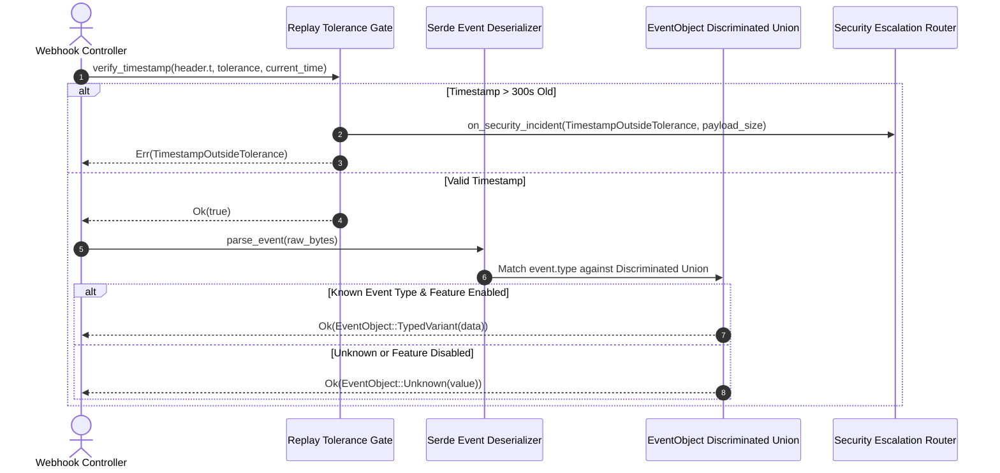

# US-2.2.0: Webhook Replay Protection, Discriminated Event Unions & Security Escalation

> **Spec Kit Specification**: [Specification Lifecycle Active (.specify/)](../../../.specify/memory/constitution.md)  
> **Behavior Blueprint**: `features/webhooks/modules/crypto-engine/behaviours/replay-and-event-unions/`  
> **Slicing Standard**: [10-PR Vertical Slicing Framework](../../user-stories/README.md#the-10-pr-vertical-slicing-framework-rust-sdk-adaptation)  
> **Security Gateway**: `security-audit` Level 2 Enforced  
> **Quality Gates**: `(G0–G4 + G-Review + G-Borrow + G-Law)`  

---

## 1. Spec Kit Specification

### 1.1 User Story Narrative
**As a** fintech infrastructure engineer,  
**I want to** validate webhook event recency using a configurable 300-second drift tolerance gate and deserialize payloads into a strongly typed discriminated `EventObject` union (supporting both V1 snapshot payloads and V2 thin notifications) with automatic security incident escalation,  
**So that** my fulfillment services are protected against replay attacks, stale transaction replays, and unhandled event type panics while alerting the SecOps team immediately if tampered signatures are intercepted.

#### 1.1.1 Preconditions
- A webhook payload has passed constant-time HMAC-SHA256 signature verification.
- The system clock is synchronized via NTP.
- The application registers an optional `SecurityEscalationHook` via `CustomErrorWorkflowBuilder`.

#### 1.1.2 Postconditions
- Events with timestamps older than the tolerance window (default 300 seconds) or drifting into the future are rejected with `TimestampOutsideTolerance`.
- Valid event payloads deserialize into a strongly typed `EventObject` enum (e.g. `EventObject::PaymentIntent(pi)`, `EventObject::CheckoutSession(cs)`), gracefully falling back to `EventObject::Unknown(serde_json::Value)` for disabled feature plugins.
- Signature violations or replay attempts automatically trigger registered security escalation callbacks with incident metadata.

### 1.2 Acceptance Criteria (Gherkin Scenarios)

```gherkin
Feature: Webhook Replay Protection and Strongly Typed Event Unions

  Scenario: [AC-US-2.2.0-01] Valid event timestamp within 300-second tolerance window
    Given an incoming webhook with a timestamp 45 seconds behind current UTC time
    When evaluated against the default 300-second tolerance gate
    Then the timestamp is accepted as valid
    And event deserialization proceeds without error.

  Scenario: [AC-US-2.2.0-02] Expired webhook rejected due to replay tolerance breach
    Given an incoming webhook with a timestamp 301 seconds in the past
    When evaluated against the 300-second tolerance gate
    Then the engine rejects the request with StripeWebhookError::TimestampOutsideTolerance
    And triggers the on_security_incident callback with severity Critical.

  Scenario: [AC-US-2.2.0-03] Strongly typed V1 snapshot event deserialization
    Given a verified "checkout.session.completed" webhook payload
    When the event is parsed into the EventObject discriminated union
    Then it matches the EventObject::CheckoutSession variant
    And provides typed accessors for customer_id, amount_total, and payment_intent_id.

  Scenario: [AC-US-2.2.0-04] Special handling for invoice.upcoming without ID
    Given an "invoice.upcoming" preview webhook payload where "data.object.id" is null
    When deserialized into EventObject::Invoice
    Then the Invoice model accepts an Option<InvoiceId> with value None
    And deserialization succeeds without JSON schema mismatch errors.

  Scenario: [AC-US-2.2.0-LAW] Financial audit logging and ISO 27001 event immutability
    Given any intercepted webhook event
    When evaluated and dispatched to application handlers
    Then the system logs immutable audit entries with cryptographic verification status and UTC timestamp, satisfying ISO/IEC 27001:2022 Control A.8.15 and financial non-repudiation mandates.
```

### 1.3 Test Cases & Traceability Matrix

| Test Case ID | Target Criterion | Test Type | Execution Level | Verification Assertion & Pass Criteria |
| :--- | :--- | :--- | :--- | :--- |
| `TC-2.2.0-01` | `AC-US-2.2.0-01` | Functional | Unit | Assert timestamp within +/-300s of current time returns `Ok(true)`. |
| `TC-2.2.0-02` | `AC-US-2.2.0-02` | Security / Replay | Unit | Assert timestamp `now - 301` returns `TimestampOutsideTolerance` and triggers escalation hook. |
| `TC-2.2.0-03` | `AC-US-2.2.0-03` | Deserialization | Contract | Deserialize 10 official Stripe fixture events; assert all map to correct typed variants. |
| `TC-2.2.0-04` | `AC-US-2.2.0-04` | Boundary | Unit | Parse fixture for `invoice.upcoming`; assert `id: None` handled without error. |
| `TC-2.2.0-LAW` | `AC-US-2.2.0-LAW` | Compliance | Integration | Assert audit trail records every webhook receipt with HMAC status and monotonic sequence ID. |

---

## 2. Behavior-Centric Architecture & Folder Blueprint

### 2.1 Colocated Behaviour Directory Tree

```
features/webhooks/modules/crypto-engine/behaviours/replay-and-event-unions/
├── services/        # Event union dispatcher, replay tolerance gate
├── logic/           # Timestamp drift calculation, test header generator, escalation router
├── types/           # EventObject, EventType, StripeWebhookError, ReplayTolerance
└── constants/       # DEFAULT_TOLERANCE_SECONDS (300), FUTURE_TOLERANCE_SECONDS (60)
```

### 2.2 Scoping & Promotion Blueprint
- **Tier 1 (Behaviour-Local)**: Timestamp delta math and test header string generator.
- **Tier 2 (Module-Shared)**: `EventObject` discriminated union and event types.
- **Tier 3 (Feature-Shared)**: Re-exported for all domain consumers via `some_stripe::types::Event`.
- **Tier 4 (Global-Shared)**: Re-exported in crate prelude.

---

## 3. Technical Implementation Plan

### 3.1 Domain Invariants & Storage Schema
- **Replay Invariant**: An event timestamp $t$ is valid if and only if $now - \text{tolerance} \le t \le now + \text{future\_tolerance}$.
- **Graceful Feature Degradation**: If an event type corresponds to a disabled Cargo feature (e.g., `issuing.card.created` when `feature = "issuing"` is off), deserialization gracefully populates `EventObject::Unknown(serde_json::Value)` rather than failing the webhook.
- **Audit Immutability**: All parsed events are read-only (`&Event`).

### 3.2 Activity & Interaction Diagram



---

## 4. Granular Implementation Tasks

### 4.1 The 10-PR Vertical Slicing Implementation Plan

| PR # | Pillar | Architectural Layer | Primary Scope & Files | Deliverables & Acceptance | Accountable Role / Agent | Assigned Skills |
| :--- | :--- | :--- | :--- | :--- | :--- | :--- |
| **PR 1** | **Pillar 1** | **Timestamp Tolerance Trait** | `crates/some-stripe-webhooks/src/tolerance.rs` | Replay protection logic, tolerance window validation. | `security-webhook-engineer` | `security-audit` |
| **PR 2** | **Pillar 2** | **Test Header Generator** | `crates/some-stripe-webhooks/src/test_header.rs` | `generate_test_header_string` for deterministic unit testing. | `security-webhook-engineer` | `stripe-docs` |
| **PR 3** | **Pillar 3** | **Event Envelope DTO** | `crates/some-stripe-webhooks/src/event.rs` | Root `Event` struct with `id`, `type`, `created`, `data`. | `domain-codegen-specialist` | `stripe-docs` |
| **PR 4** | **Pillar 4** | **Discriminated Union Codegen** | `crates/some-stripe-webhooks/src/event_object.rs` | `EventObject` enum covering 150+ Stripe event types. | `domain-codegen-specialist` | `stripe-docs` |
| **PR 5** | **Pillar 5** | **Feature-Gated Graceful Fallback** | `crates/some-stripe-webhooks/src/event_object.rs` | Fallback to `serde_json::Value` when domain feature is disabled. | `microkernel-architect` | `stripe-best-practices` |
| **PR 6** | **Pillar 6** | **invoice.upcoming Null ID Guard** | `crates/some-stripe-webhooks/src/models/invoice.rs` | Relaxed ID typing (`Option<InvoiceId>`) for upcoming invoices. | `domain-codegen-specialist` | `stripe-docs` |
| **PR 7** | **Pillar 7** | **Security Escalation Hook Bridge** | `crates/some-stripe-webhooks/src/escalation.rs` | Connect `TimestampOutsideTolerance` to `ErrorWorkflowHandler`. | `security-appsec-engineer` | `security-audit` |
| **PR 8** | **Pillar 8** | **V2 Thin Event Hydration Port** | `crates/some-stripe-webhooks/src/v2_events.rs` | Parse lightweight notifications pointing to `v2.core.events.retrieve`. | `microkernel-architect` | `upgrade-stripe` |
| **PR 9** | **Pillar 9** | **Replay & Union Test Harness** | `tests/webhook_replay_union_test.rs` | Tests with stale timestamps, future skew, and 50+ event types. | `testing-api-tester` | `stripe-docs` |
| **PR 10** | **Pillar 10** | **Webhook Event Documentation** | `README.md`, `docs/webhooks.md` | Exhaustive documentation on pattern-matching `EventObject`. | `engineering-technical-writer` | `stripe-docs` |

### 4.2 Implementation Phase Breakdown

#### Phase 1: Replay Tolerance & Test Header Generation (PR 1–3)
- [ ] **Task 1.1 (Types)**: Define `ToleranceConfig` with past tolerance (300s) and future clock skew tolerance (60s).  
  *Agent*: `security-webhook-engineer` | *Skill*: `security-audit`
- [ ] **Task 1.2 (Constants)**: Pin `DEFAULT_TOLERANCE_SECONDS` (300) in `constants/`.  
  *Agent*: `security-webhook-engineer` | *Skill*: `stripe-docs`
- [ ] **Task 1.3 (Logic)**: Implement `generate_test_header_string(payload, secret, timestamp)`.  
  *Agent*: `security-webhook-engineer` | *Skill*: `stripe-docs`
- [ ] **Task 1.4 (Unit Tests)**: Test replay rejection for timestamps older than 300s or in the distant future (>60s).  
  *Agent*: `testing-api-tester` | *Skill*: `security-audit`

#### Phase 2: Discriminated Event Union & Feature Gating (PR 4–6)
- [ ] **Task 2.1 (Union Codegen)**: Generate `EventObject` enum with variants for all major Stripe domains.  
  *Agent*: `domain-codegen-specialist` | *Skill*: `stripe-docs`
- [ ] **Task 2.2 (Fallback)**: Implement `#[serde(other)]` or feature-gated matching returning `EventObject::Unknown`.  
  *Agent*: `microkernel-architect` | *Skill*: `stripe-best-practices`
- [ ] **Task 2.3 (Invoice Edge Case)**: Verify `invoice.upcoming` parses without requiring `id` field.  
  *Agent*: `domain-codegen-specialist` | *Skill*: `stripe-docs`
- [ ] **Task 2.4 (Union Tests)**: Deserialize sample payloads for Checkout, PaymentIntent, Customer, and Subscription events.  
  *Agent*: `testing-api-tester` | *Skill*: `stripe-docs`

#### Phase 3: Security Escalation & V2 Thin Events (PR 7–8)
- [ ] **Task 3.1 (Escalation)**: Emit `on_security_incident` callback whenever replay attacks are intercepted.  
  *Agent*: `security-appsec-engineer` | *Skill*: `security-audit`
- [ ] **Task 3.2 (Thin Events)**: Implement `V2ThinEvent` envelope with `related_object` reference for live hydration.  
  *Agent*: `microkernel-architect` | *Skill*: `upgrade-stripe`

#### Phase 4: Audit & Release Gate (PR 9–10)
- [ ] **Task 4.1 (Adversarial Tests)**: Inject replayed payloads and forged timestamps; assert 100% rejection.  
  *Agent*: `testing-api-tester` | *Skill*: `security-audit`
- [ ] **Task 4.2 (G-Review)**: Code review on Serde enum deserializer efficiency and zero-copy references.  
  *Agent*: `engineering-code-reviewer` | *Skill*: `stripe-best-practices`
- [ ] **Task 4.3 (Docs)**: Write comprehensive developer guide showing event pattern-matching in Axum handlers.  
  *Agent*: `engineering-technical-writer` | *Skill*: `stripe-docs`

---

## 5. Security Gateway (Powered by security-audit)

### 5.1 Trust Boundaries & Security Actors
- **Trust Boundaries**:
  - `Replay Protection Gate`: Validates event timestamp freshness against host system clock.
  - `Event Parsing Layer`: Deserializes untrusted external JSON into internal typed models.
- **Authorized Principals**:
  - Webhook Consumer Service: Processes incoming events and triggers business fulfillment.

### 5.2 Threat Modeling & Abuse Matrix (STRIDE / ASVS)

| Threat Vector | Severity | Vulnerability Mechanism | Mitigating Control & Security Invariant |
| :--- | :--- | :--- | :--- |
| **Replay Attack** | Critical | Attacker resending historical payment webhook to re-trigger fulfillment | 300-second timestamp tolerance gate rejects any replayed event past tolerance. |
| **Clock Skew Manipulation** | Medium | Server clock drift causing valid events to be rejected or stale accepted | Configurable future tolerance (60s) accounts for minor NTP drift. |
| **Schema Deserialization Panic** | High | Unrecognized or future event type crashing backend with unhandled panic | `EventObject::Unknown(Value)` catch-all guarantees resilient parsing. |

### 5.3 Cryptographic & Data Protection Controls
- **Audit Verification**: Every event retains verified timestamp `signed_time` for downstream reconciliation.
- **Zero Secret Exposure**: Event objects contain business data only; zero secret keys present.

### 5.4 Automated Security Verification Checklist
- [ ] **Replay Rejection Test**: Automated test confirms events with timestamp $t < now - 300$ are rejected.
- [ ] **Future Skew Test**: Automated test confirms events with timestamp $t > now + 60$ are rejected.
- [ ] **Unknown Event Resilience**: Fuzzing with non-existent event types succeeds with `EventObject::Unknown`.

### 5.5 Security Gateway (G2) Sign-Off Checklist
- [ ] Replay protection tolerance mathematically verified against replay threat model.
- [ ] Escalation hook validated with live security telemetry listener.
- [ ] Code review sign-off obtained; zero findings.

---

## 6. Validation Gates & Acceptance Sign-Off

**Status: Ready for Implementation.**

### G1 — Test coverage
- [ ] **US-2.2.0-G1:** 100% coverage across replay tolerance branches and `EventObject` deserialization paths.

### G2 — Security audit
- [ ] **US-2.2.0-G2:** Replay protection and security escalation verified under security-audit review.

### G3 — Architecture and maintainability
- [ ] **US-2.2.0-G3:** Clean modular separation between event envelopes and domain resource models.

### G-Review — Code review
- [ ] **US-2.2.0-G-Review:** Senior review approved by `engineering-code-reviewer`.

### G-Borrow — Rust zero-clone borrowing validation
- [ ] **US-2.2.0-G-Borrow:** Event accessors borrow references (`&str`, `&Option<T>`); zero deep `.clone()` calls.

### G-Law — Law validation
- [ ] **US-2.2.0-G-Law:** ISO/IEC 27001:2022 Control A.8.15 event auditability certified.

### G4 — Integrated acceptance
- [ ] **US-2.2.0-G4:** End-to-end webhook receipt and event matching validated against Stripe CLI.
