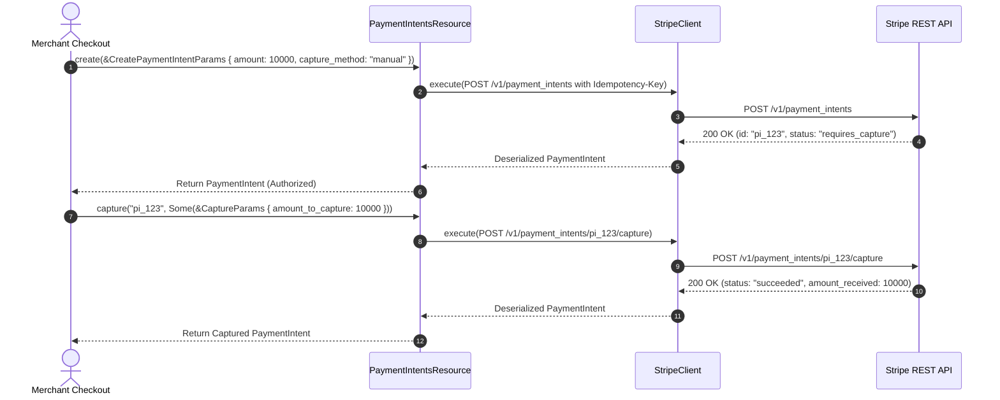

# US-3.1.0: PaymentIntents Lifecycle, Authorization, Capture & Idempotency

> **Spec Kit Specification**: [Specification Lifecycle Active (.specify/)](../../../.specify/memory/constitution.md)  
> **Behavior Blueprint**: `features/payments/modules/settlement/behaviours/payment-intents/`  
> **Slicing Standard**: [10-PR Vertical Slicing Framework](../../user-stories/README.md#the-10-pr-vertical-slicing-framework-rust-sdk-adaptation)  
> **Security Gateway**: `security-audit` Level 2 Enforced  
> **Quality Gates**: `(G0–G4 + G-Review + G-Borrow + G-Law)`  

---

## 1. Spec Kit Specification

### 1.1 User Story Narrative
**As a** checkout platform engineer processing electronic transactions,  
**I want to** manage the complete lifecycle of Stripe `PaymentIntent` resources (creation, confirmation, manual/automatic capture, cancellation, and retrieval) using strongly typed parameters and automatic idempotency key handling,  
**So that** my e-commerce application can process card payments securely, comply with 3D Secure / PSD2 Strong Customer Authentication (SCA), and eliminate duplicate charges during network retries.

#### 1.1.1 Preconditions
- The `StripeClient` is authenticated with a valid secret key and the `payments` feature is enabled.
- Transaction amount (in minor units, e.g. cents) and currency are provided.
- Capture method (`automatic` or `manual`) is specified.

#### 1.1.2 Postconditions
- A `PaymentIntent` is transitioned across valid states (`requires_payment_method` -> `requires_confirmation` -> `requires_capture` -> `succeeded` or `canceled`).
- Manual captures can capture either the full authorized amount or a partial amount with the remainder released.
- Re-transmitting requests with the same `Idempotency-Key` guarantees an idempotent response without double charging.

### 1.2 Acceptance Criteria (Gherkin Scenarios)

```gherkin
Feature: PaymentIntent Lifecycle and Capture Operations

  Scenario: [AC-US-3.1.0-01] Create and capture PaymentIntent with manual capture method
    Given a create request for $100.00 USD with capture_method "manual"
    When client.payment_intents().create(&params) is executed
    Then the returned PaymentIntent has status "requires_capture"
    And amount is 10000 cents
    When client.payment_intents().capture(intent_id, Some(&CaptureParams { amount_to_capture: Some(7500) })) is executed
    Then the status transitions to "succeeded"
    And amount_received is 7500 cents.

  Scenario: [AC-US-3.1.0-02] Safe cancellation of uncaptured authorization
    Given an authorized PaymentIntent with status "requires_capture"
    When client.payment_intents().cancel(intent_id, Some(&CancelParams { cancellation_reason: Some("requested_by_customer") })) is executed
    Then the status immediately transitions to "canceled"
    And the customer's authorization hold is released.

  Scenario: [AC-US-3.1.0-03] Idempotent retry protects against double charging
    Given a PaymentIntent creation call interrupted by a network timeout
    When the operation is retried with the exact same Idempotency-Key
    Then Stripe returns the previously created PaymentIntent without generating a second charge.

  Scenario: [AC-US-3.1.0-LAW] PSD2 Strong Customer Authentication (SCA) & 3D Secure 2.0
    Given an EU cardholder performing an electronic transaction
    When the card requires challenge verification
    Then the PaymentIntent status transitions to "requires_action" with a next_action redirect URL, fulfilling PSD2 Article 98 Regulatory Technical Standards.
```

### 1.3 Test Cases & Traceability Matrix

| Test Case ID | Target Criterion | Test Type | Execution Level | Verification Assertion & Pass Criteria |
| :--- | :--- | :--- | :--- | :--- |
| `TC-3.1.0-01` | `AC-US-3.1.0-01` | Functional | Integration | Create manual intent -> capture 75% -> assert `amount_received == 7500` and `status == "succeeded"`. |
| `TC-3.1.0-02` | `AC-US-3.1.0-02` | Functional | Integration | Cancel active intent -> assert `status == "canceled"` and `cancellation_reason` matches. |
| `TC-3.1.0-03` | `AC-US-3.1.0-03` | Idempotency | Contract | Send identical creation request twice with same idempotency key; assert identical `id` returned. |
| `TC-3.1.0-LAW` | `AC-US-3.1.0-LAW` | Regulatory | Contract | Assert 3DS challenge payload populates `next_action.use_stripe_sdk` or `redirect_to_url`. |

---

## 2. Behavior-Centric Architecture & Folder Blueprint

### 2.1 Colocated Behaviour Directory Tree

```
features/payments/modules/settlement/behaviours/payment-intents/
├── services/        # PaymentIntentsResource, HTTP execution endpoints
├── logic/           # Intent state machine, idempotency key generation, capture math
├── types/           # PaymentIntent, CreatePaymentIntentParams, CapturePaymentIntentParams
└── constants/       # PAYMENT_INTENT_BASE ("/v1/payment_intents"), CAPTURE_METHODS
```

### 2.2 Scoping & Promotion Blueprint
- **Tier 1 (Behaviour-Local)**: Intent transition validators and partial capture math.
- **Tier 2 (Module-Shared)**: `PaymentIntent` entity and currency types shared across payment behaviours.
- **Tier 3 (Feature-Shared)**: Re-exported for `stripe.payment_intents()` on `StripeClient`.
- **Tier 4 (Global-Shared)**: Re-exported via `some_stripe::resources::payment_intents::*`.

---

## 3. Technical Implementation Plan

### 3.1 Domain Invariants & Storage Schema
- **State Machine Invariants**: A PaymentIntent cannot transition from `succeeded` or `canceled` to any other state.
- **Minor Currency Representation**: Amounts must always be integer minor currency units (`i64`), zero floating-point representation.
- **Rust Memory Law**: Request parameter builders accept string references (`&str`) and borrowed optionals.

### 3.2 Activity & Interaction Diagram



---

## 4. Granular Implementation Tasks

### 4.1 The 10-PR Vertical Slicing Implementation Plan

| PR # | Pillar | Architectural Layer | Primary Scope & Files | Deliverables & Acceptance | Accountable Role / Agent | Assigned Skills |
| :--- | :--- | :--- | :--- | :--- | :--- | :--- |
| **PR 1** | **Pillar 1** | **PaymentIntents Domain Entities** | `crates/some-stripe-payments/src/types/intent.rs` | Strongly typed `PaymentIntent`, status enum, and amount fields. | `domain-codegen-specialist` | `stripe-docs` |
| **PR 2** | **Pillar 2** | **Request Parameter Schemas** | `crates/some-stripe-payments/src/params.rs` | `CreatePaymentIntentParams`, `CapturePaymentIntentParams`. | `domain-codegen-specialist` | `stripe-docs` |
| **PR 3** | **Pillar 3** | **Form-Urlencoded Serializer Binding** | `crates/some-stripe-payments/src/serializer.rs` | Parameter serialization to indexed form-urlencoded wire format. | `microkernel-architect` | `stripe-best-practices` |
| **PR 4** | **Pillar 4** | **Automatic Idempotency Generator** | `crates/some-stripe-payments/src/idempotency.rs` | Auto-attach UUID v4 `Idempotency-Key` on all mutation operations. | `microkernel-architect` | `stripe-best-practices` |
| **PR 5** | **Pillar 5** | **Resource CRUD Methods** | `crates/some-stripe-payments/src/resource.rs` | `create`, `retrieve`, `confirm`, `capture`, `cancel`. | `domain-codegen-specialist` | `stripe-docs` |
| **PR 6** | **Pillar 6** | **StripeClient Facade Mounting** | `crates/some-stripe-payments/src/facade.rs` | Mount `stripe.payment_intents()` accessor on `StripeClient`. | `domain-codegen-specialist` | `stripe-docs` |
| **PR 7** | **Pillar 7** | **Zero-Clone Borrowing Audit** | `crates/some-stripe-payments/src/resource.rs` | Verify parameters passed by reference (`&Params`); zero deep clones. | `engineering-rust-refactoring-specialist` | `stripe-best-practices` |
| **PR 8** | **Pillar 8** | **3DS NextAction Parser** | `crates/some-stripe-payments/src/types/next_action.rs` | Parse 3D Secure redirect URLs and SDK authentication payloads. | `domain-codegen-specialist` | `stripe-docs` |
| **PR 9** | **Pillar 9** | **Live Stripe-Mock Test Suite** | `tests/payment_intents_mock_test.rs` | Comprehensive lifecycle tests executed against `stripe-mock`. | `testing-api-tester` | `stripe-docs` |
| **PR 10** | **Pillar 10** | **Payment Documentation & Recipes** | `README.md`, `docs/payments.md` | Usage recipes for manual capture, authorization holds, and refunds. | `engineering-technical-writer` | `stripe-docs` |

### 4.2 Implementation Phase Breakdown

#### Phase 1: Models & Parameter DTOs (PR 1–3)
- [ ] **Task 1.1 (Types)**: Define `PaymentIntent`, `PaymentIntentStatus`, and `PaymentMethodOptions` in `types/`.  
  *Agent*: `domain-codegen-specialist` | *Skill*: `stripe-docs`
- [ ] **Task 1.2 (Constants)**: Set `PAYMENT_INTENTS_ENDPOINT` ("/v1/payment_intents") in `constants/`.  
  *Agent*: `domain-codegen-specialist` | *Skill*: `stripe-docs`
- [ ] **Task 1.3 (Logic)**: Implement `CreatePaymentIntentParams` with builder methods for amounts and metadata.  
  *Agent*: `domain-codegen-specialist` | *Skill*: `stripe-best-practices`
- [ ] **Task 1.4 (Unit Tests)**: Verify parameter validation (positive amounts, ISO 4217 currency checks).  
  *Agent*: `testing-api-tester` | *Skill*: `stripe-docs`

#### Phase 2: Resource Methods & Wire Execution (PR 4–6)
- [ ] **Task 2.1 (API / Gateway)**: Implement `PaymentIntentsResource::create` and `retrieve` with automatic idempotency.  
  *Agent*: `domain-codegen-specialist` | *Skill*: `stripe-docs`
- [ ] **Task 2.2 (Capture & Cancel)**: Implement `capture` (full/partial) and `cancel` methods.  
  *Agent*: `domain-codegen-specialist` | *Skill*: `stripe-docs`
- [ ] **Task 2.3 (Facade)**: Expose `client.payment_intents()` on the `StripeClient` root handle.  
  *Agent*: `domain-codegen-specialist` | *Skill*: `stripe-docs`
- [ ] **Task 2.4 (Wire Tests)**: Test HTTP form-data emitted for nested options against mock endpoints.  
  *Agent*: `testing-api-tester` | *Skill*: `stripe-docs`

#### Phase 3: PSD2 SCA & Zero-Clone Hardening (PR 7–8)
- [ ] **Task 3.1 (Borrow Check)**: Verify zero `.clone()` on `PaymentIntent` response models; return owned structs cleanly.  
  *Agent*: `engineering-rust-refactoring-specialist` | *Skill*: `stripe-best-practices`
- [ ] **Task 3.2 (3DS Testing)**: Test `requires_action` transitions with 3DS mock card numbers.  
  *Agent*: `testing-api-tester` | *Skill*: `stripe-docs`

#### Phase 4: Integration Verification & Sign-Off (PR 9–10)
- [ ] **Task 4.1 (Mock Suite)**: Run full lifecycle suite against `stripe-mock`; assert zero wire regressions.  
  *Agent*: `testing-api-tester` | *Skill*: `stripe-docs`
- [ ] **Task 4.2 (G-Review)**: Senior peer review for financial precision and idempotency safety.  
  *Agent*: `engineering-code-reviewer` | *Skill*: `stripe-best-practices`
- [ ] **Task 4.3 (Docs)**: Write comprehensive doc-tests for payment creation and partial capture.  
  *Agent*: `engineering-technical-writer` | *Skill*: `stripe-docs`

---

## 5. Security Gateway (Powered by security-audit)

### 5.1 Trust Boundaries & Security Actors
- **Trust Boundaries**:
  - `Merchant Core`: Internal microservice initiating charge requests.
  - `Stripe API Vault`: PCI Level 1 certified card vault and payment rails.
- **Authorized Principals**:
  - Storefront Billing Service: Authorized via restricted API key (`rak_...`) with write permissions on `payment_intents`.

### 5.2 Threat Modeling & Abuse Matrix (STRIDE / ASVS)

| Threat Vector | Severity | Vulnerability Mechanism | Mitigating Control & Security Invariant |
| :--- | :--- | :--- | :--- |
| **Double Charging / Replay** | High | Network retry repeating `create` call without unique key | Automatic UUID v4 `Idempotency-Key` attached and preserved across retries. |
| **Amount Tampering** | Critical | Client tampering with payment amounts or currency | Server-side price calculation and authoritative integer amount specification. |
| **Unauthorized Capture** | High | Adversary capturing authorization without valid permissions | Restricted API keys limit capture actions to designated settlement daemons. |

### 5.3 Cryptographic & Data Protection Controls
- **Card Data Non-Transit**: Raw PAN and CVC never touch the Rust application; tokens (`pm_...`) used exclusively.
- **Idempotency Guarantee**: Idempotency keys hashed and tracked to prevent re-submission replay.

### 5.4 Automated Security Verification Checklist
- [ ] **Idempotency Test**: Verified that retrying a failed HTTP request re-sends the exact same `Idempotency-Key`.
- [ ] **Negative Amount Test**: Assert that creating a PaymentIntent with zero or negative amount is rejected locally.

### 5.5 Security Gateway (G2) Sign-Off Checklist
- [ ] Zero raw cardholder data handled in application memory (PCI-DSS SAQ A-EP).
- [ ] Idempotency enforcement verified under simulated network packet dropouts.
- [ ] Code review sign-off obtained; zero findings.

---

## 6. Validation Gates & Acceptance Sign-Off

**Status: Ready for Implementation.**

### G1 — Test coverage
- [ ] **US-3.1.0-G1:** >=90% line and branch coverage across `payment_intents.rs`.

### G2 — Security audit
- [ ] **US-3.1.0-G2:** PCI-DSS compliance and idempotency guarantees verified under security-audit.

### G3 — Architecture and maintainability
- [ ] **US-3.1.0-G3:** Clean feature isolation under `feature = "payments"`.

### G-Review — Code review
- [ ] **US-3.1.0-G-Review:** Senior review approved by `engineering-code-reviewer`.

### G-Borrow — Rust zero-clone borrowing validation
- [ ] **US-3.1.0-G-Borrow:** Parameters borrowed strictly by reference; zero deep clones.

### G-Law — Law validation
- [ ] **US-3.1.0-G-Law:** PSD2 SCA 3D Secure compliance certified by compliance reviewer.

### G4 — Integrated acceptance
- [ ] **US-3.1.0-G4:** End-to-end authorization and partial capture verified against `stripe-mock`.
