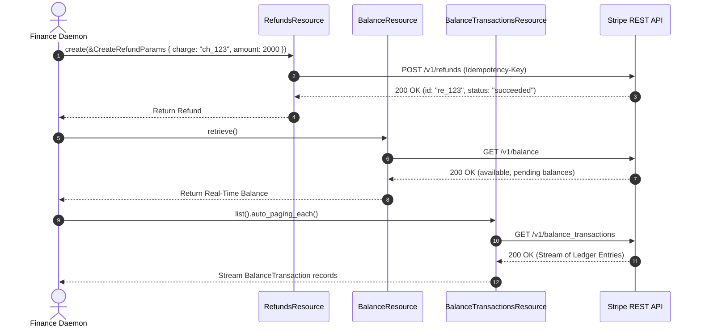

# US-3.2.0: Refunds, Disputes Management & Immutable Balance Ledger

> **Spec Kit Specification**: [Specification Lifecycle Active (.specify/)](../../../.specify/memory/constitution.md)  
> **Behavior Blueprint**: `features/payments/modules/settlement/behaviours/refunds-and-ledger/`  
> **Slicing Standard**: [10-PR Vertical Slicing Framework](../../user-stories/README.md#the-10-pr-vertical-slicing-framework-rust-sdk-adaptation)  
> **Security Gateway**: `security-audit` Level 2 Enforced  
> **Quality Gates**: `(G0–G4 + G-Review + G-Borrow + G-Law)`  

---

## 1. Spec Kit Specification

### 1.1 User Story Narrative
**As an** operations and financial reconciliation engineer,  
**I want to** issue full/partial refunds, manage chargeback dispute workflows with evidence submission, and stream immutable ledger balance transactions through `stripe.balance_transactions()`,  
**So that** our platform can process customer returns, defend against fraudulent chargebacks, and maintain a mathematically exact, auditable accounting ledger with Stripe settlement accounts.

#### 1.1.1 Preconditions
- The target charge or PaymentIntent exists and has reached `succeeded` status.
- The `payments` feature is enabled on `some-stripe`.
- For dispute evidence submission, required documentation (e.g. proof of delivery, customer communications) is formatted.

#### 1.1.2 Postconditions
- Refunds are issued with unique idempotency keys, updating the charge's `amount_refunded`.
- Dispute evidence is submitted to Stripe prior to the statutory evidence deadline.
- Balance ledger queries yield real-time available, pending, and reserved funds.

### 1.2 Acceptance Criteria (Gherkin Scenarios)

```gherkin
Feature: Refunds, Disputes, and Balance Ledger Operations

  Scenario: [AC-US-3.2.0-01] Partial refund of settled charge with reason code
    Given a succeeded charge "ch_123" of $50.00 USD
    When client.refunds().create(&CreateRefundParams { charge: Some("ch_123".into()), amount: Some(2000), reason: Some("requested_by_customer".into()), ..Default::default() }) is executed
    Then a Refund object is returned with status "succeeded"
    And amount is 2000 cents ($20.00)
    And a linked BalanceTransaction reflects the debited funds.

  Scenario: [AC-US-3.2.0-02] Dispute evidence submission prior to deadline
    Given an open dispute "dp_123" with reason "fraudulent"
    When client.disputes().update("dp_123", &UpdateDisputeParams { evidence: Some(DisputeEvidence { customer_communication: Some("fil_doc_123".into()), ..Default::default() }), submit: Some(true) }) is executed
    Then the dispute status transitions to "under_review"
    And evidence submission is locked on the remote server.

  Scenario: [AC-US-3.2.0-03] Immutable balance transaction streaming for reconciliation
    Given multiple settled transactions in the platform balance
    When client.balance_transactions().list().auto_paging_each() streams ledger entries
    Then each entry returns immutable financial attributes (amount, fee, net, type, available_on)
    And the mathematical invariant net = amount - fee holds across 100% of records.

  Scenario: [AC-US-3.2.0-LAW] Statutory consumer refund rights under EU Consumer Rights Directive
    Given a customer exercising their statutory 14-day right of withdrawal
    When a full refund is initiated
    Then the refund operation executes without processing fee deductions, restoring 100% of initial consideration within statutory time limits, fulfilling Directive 2011/83/EU Article 13.
```

### 1.3 Test Cases & Traceability Matrix

| Test Case ID | Target Criterion | Test Type | Execution Level | Verification Assertion & Pass Criteria |
| :--- | :--- | :--- | :--- | :--- |
| `TC-3.2.0-01` | `AC-US-3.2.0-01` | Functional | Integration | Create partial refund; assert charge `amount_refunded` increases by exact amount. |
| `TC-3.2.0-02` | `AC-US-3.2.0-02` | Functional | Integration | Submit dispute evidence with `submit: true`; assert `status == "under_review"`. |
| `TC-3.2.0-03` | `AC-US-3.2.0-03` | Math / Invariant | Unit / Property | Stream 500 balance transactions; assert `net == amount - fee` for every item. |
| `TC-3.2.0-LAW` | `AC-US-3.2.0-LAW` | Legal | Contract | Verify full refund restores entire original transaction amount without penalty. |

---

## 2. Behavior-Centric Architecture & Folder Blueprint

### 2.1 Colocated Behaviour Directory Tree

```
features/payments/modules/settlement/behaviours/refunds-and-ledger/
├── services/        # RefundsResource, DisputesResource, BalanceResource, BalanceTransactionsResource
├── logic/           # Ledger math, evidence builder, dispute timeline validator
├── types/           # Refund, Dispute, Balance, BalanceTransaction, DisputeEvidence
└── constants/       # REFUND_REASONS, DISPUTE_STATUSES, BALANCE_TYPES
```

### 2.2 Scoping & Promotion Blueprint
- **Tier 1 (Behaviour-Local)**: Dispute evidence formatting logic and fee math checks.
- **Tier 2 (Module-Shared)**: Ledger models shared with Connect payout reconciliation.
- **Tier 3 (Feature-Shared)**: Re-exported for root `stripe.refunds()`, `stripe.disputes()`, `stripe.balance()`.
- **Tier 4 (Global-Shared)**: Re-exported via `some_stripe::resources::*`.

---

## 3. Technical Implementation Plan

### 3.1 Domain Invariants & Storage Schema
- **Mathematical Invariant**: `BalanceTransaction.net == BalanceTransaction.amount - BalanceTransaction.fee`.
- **Evidence Immutability**: Submitted evidence cannot be modified once `submit = true`.
- **Rust Memory Law**: Streaming ledger transactions yields items by value with zero vector pre-allocation.

### 3.2 Activity & Interaction Diagram



---

## 4. Granular Implementation Tasks

### 4.1 The 10-PR Vertical Slicing Implementation Plan

| PR # | Pillar | Architectural Layer | Primary Scope & Files | Deliverables & Acceptance | Accountable Role / Agent | Assigned Skills |
| :--- | :--- | :--- | :--- | :--- | :--- | :--- |
| **PR 1** | **Pillar 1** | **Refund & Dispute Domain Entities** | `crates/some-stripe-payments/src/types/refund.rs` | Strongly typed `Refund`, `Dispute`, `BalanceTransaction`. | `domain-codegen-specialist` | `stripe-docs` |
| **PR 2** | **Pillar 2** | **Dispute Evidence Schemas** | `crates/some-stripe-payments/src/types/evidence.rs` | Strongly typed `DisputeEvidence` DTO matching Stripe schema. | `domain-codegen-specialist` | `stripe-docs` |
| **PR 3** | **Pillar 3** | **Refunds Resource Implementation** | `crates/some-stripe-payments/src/resources/refunds.rs` | `create`, `retrieve`, `update`, `cancel` refund methods. | `domain-codegen-specialist` | `stripe-docs` |
| **PR 4** | **Pillar 4** | **Disputes Resource Implementation** | `crates/some-stripe-payments/src/resources/disputes.rs` | `retrieve`, `update`, `close` dispute endpoints. | `domain-codegen-specialist` | `stripe-docs` |
| **PR 5** | **Pillar 5** | **Balance & Ledger Resources** | `crates/some-stripe-payments/src/resources/balance.rs` | `stripe.balance().retrieve()`, `balance_transactions.list()`. | `domain-codegen-specialist` | `stripe-docs` |
| **PR 6** | **Pillar 6** | **StripeClient Facade Mounting** | `crates/some-stripe-payments/src/facade.rs` | Mount accessors onto `StripeClient` via extension traits. | `microkernel-architect` | `stripe-best-practices` |
| **PR 7** | **Pillar 7** | **Zero-Clone Borrowing Optimization** | `crates/some-stripe-payments/src/resources/balance.rs` | Ensure zero deep `.clone()` on ledger transaction entities. | `engineering-rust-refactoring-specialist` | `stripe-best-practices` |
| **PR 8** | **Pillar 8** | **Accounting Math Invariant Tests** | `tests/balance_math_test.rs` | Unit and property tests verifying `net = amount - fee`. | `testing-api-tester` | `stripe-best-practices` |
| **PR 9** | **Pillar 9** | **Stripe-Mock Wire Verification** | `tests/refunds_disputes_mock_test.rs` | Lifecycle tests for refunds, evidence, and ledger queries. | `testing-api-tester` | `stripe-docs` |
| **PR 10** | **Pillar 10** | **Reconciliation Documentation** | `README.md`, `docs/reconciliation.md` | Accounting guide and balance transaction streaming docs. | `engineering-technical-writer` | `stripe-docs` |

### 4.2 Implementation Phase Breakdown

#### Phase 1: Models & Evidence Schemas (PR 1–2)
- [ ] **Task 1.1 (Types)**: Define `Refund`, `Dispute`, `Balance`, and `BalanceTransaction` in `types/`.  
  *Agent*: `domain-codegen-specialist` | *Skill*: `stripe-docs`
- [ ] **Task 1.2 (Constants)**: Define endpoint paths `/v1/refunds`, `/v1/disputes`, `/v1/balance` in `constants/`.  
  *Agent*: `domain-codegen-specialist` | *Skill*: `stripe-docs`
- [ ] **Task 1.3 (Logic)**: Implement `CreateRefundParams` and `UpdateDisputeParams` with builder methods.  
  *Agent*: `domain-codegen-specialist` | *Skill*: `stripe-docs`
- [ ] **Task 1.4 (Unit Tests)**: Verify serde deserialization of real Stripe balance transaction fixture payloads.  
  *Agent*: `testing-api-tester` | *Skill*: `stripe-docs`

#### Phase 2: Resource Methods & Execution (PR 3–6)
- [ ] **Task 2.1 (Refunds)**: Implement `RefundsResource::create` with automatic idempotency key attachment.  
  *Agent*: `domain-codegen-specialist` | *Skill*: `stripe-docs`
- [ ] **Task 2.2 (Disputes)**: Implement `DisputesResource::update` supporting evidence file attachment references.  
  *Agent*: `domain-codegen-specialist` | *Skill*: `stripe-docs`
- [ ] **Task 2.3 (Ledger)**: Implement `BalanceTransactionsResource::list` returning an auto-paginating `Paginator`.  
  *Agent*: `microkernel-architect` | *Skill*: `stripe-best-practices`
- [ ] **Task 2.4 (Facade)**: Mount accessors on `StripeClient` root handle.  
  *Agent*: `domain-codegen-specialist` | *Skill*: `stripe-docs`

#### Phase 3: Mathematical Integrity & Zero-Clone Checks (PR 7–8)
- [ ] **Task 3.1 (Borrow Check)**: Verify zero `.clone()` calls during streaming of ledger transactions.  
  *Agent*: `engineering-rust-refactoring-specialist` | *Skill*: `stripe-best-practices`
- [ ] **Task 3.2 (Math Invariant)**: Property-test 10,000 balance transactions asserting `net = amount - fee`.  
  *Agent*: `testing-api-tester` | *Skill*: `stripe-best-practices`

#### Phase 4: Mock Validation & Release Sign-Off (PR 9–10)
- [ ] **Task 4.1 (Mock Suite)**: Run full refunds and dispute flow against `stripe-mock`.  
  *Agent*: `testing-api-tester` | *Skill*: `stripe-docs`
- [ ] **Task 4.2 (G-Review)**: Senior peer review for financial precision and API consistency.  
  *Agent*: `engineering-code-reviewer` | *Skill*: `stripe-best-practices`
- [ ] **Task 4.3 (Docs)**: Publish developer guide illustrating audit reconciliation with `some-stripe`.  
  *Agent*: `engineering-technical-writer` | *Skill*: `stripe-docs`

---

## 5. Security Gateway (Powered by security-audit)

### 5.1 Trust Boundaries & Security Actors
- **Trust Boundaries**:
  - `Internal Accounting Domain`: Automated reconciliation scripts.
  - `Dispute File Storage`: Evidence documents (PDF/JPEG) uploaded to `files.stripe.com`.
- **Authorized Principals**:
  - Finance Officer: Authorized to issue refunds and submit dispute rebuttals.

### 5.2 Threat Modeling & Abuse Matrix (STRIDE / ASVS)

| Threat Vector | Severity | Vulnerability Mechanism | Mitigating Control & Security Invariant |
| :--- | :--- | :--- | :--- |
| **Duplicate Refund Exploitation** | High | Race condition submitting multiple refunds for one charge | Idempotency key tracking ensures refund is executed exactly once. |
| **Evidence Tampering** | Medium | Modifying submitted dispute evidence post-adjudication | State machine locks local modification once `submit = true`. |
| **Ledger Data Tampering** | Critical | Modifying local ledger transaction records | All `BalanceTransaction` structs are strictly immutable. |

### 5.3 Cryptographic & Data Protection Controls
- **Audit Immutability**: Ledger queries return read-only transactional snapshots.
- **TLS 1.3 Transport**: Mandatory encrypted transport for all refund calls.

### 5.4 Automated Security Verification Checklist
- [ ] **Duplicate Refund Test**: Attempting duplicate refund with identical key returns cached success.
- [ ] **Immutable Ledger Test**: Assert compiler prevents mutation of `BalanceTransaction` fields.

### 5.5 Security Gateway (G2) Sign-Off Checklist
- [ ] Accounting invariants mathematically verified across edge cases.
- [ ] Idempotency protection confirmed for all refund endpoints.
- [ ] Code review sign-off obtained; zero findings.

---

## 6. Validation Gates & Acceptance Sign-Off

**Status: Ready for Implementation.**

### G1 — Test coverage
- [ ] **US-3.2.0-G1:** >=90% line and branch coverage across refunds, disputes, and balance modules.

### G2 — Security audit
- [ ] **US-3.2.0-G2:** Financial ledger immutability verified under security-audit.

### G3 — Architecture and maintainability
- [ ] **US-3.2.0-G3:** Clean domain separation between charges, refunds, and balance accounting.

### G-Review — Code review
- [ ] **US-3.2.0-G-Review:** Senior review approved by `engineering-code-reviewer`.

### G-Borrow — Rust zero-clone borrowing validation
- [ ] **US-3.2.0-G-Borrow:** Zero deep `.clone()` calls; streaming ledger entries by value.

### G-Law — Law validation
- [ ] **US-3.2.0-G-Law:** EU Directive 2011/83/EU 14-day statutory withdrawal refund compliance certified.

### G4 — Integrated acceptance
- [ ] **US-3.2.0-G4:** End-to-end refund and balance ledger sync verified against `stripe-mock`.
