# Module 4: Hosted Checkout & Links — Live Multi-Agent Kanban Board

This Kanban board tracks the end-to-end execution of **Module 4 (Hosted Checkout & Links)** across all tiers and micro-units.

> [!IMPORTANT]
> **Mandatory Agent Rule**: Every subagent assigned to a task MUST update this file upon:
> 1. Starting execution $\to$ update status to `🔄 In Progress`.
> 2. Pushing branch and opening PR $\to$ update status to `🔍 In Review / PR Open (#XX)` and link the PR.
> 3. Merging the PR $\to$ update status to `✅ Merged`.

---

## 1. Visual Mermaid Kanban Flow

```mermaid
flowchart LR
    subgraph BACKLOG["📋 Backlog / Ready to Start"]
        direction TB
        M4_MOD["Module 4: Hosted Checkout & Links<br/>Branch: feat/module-4-checkout-and-links<br/>Assigned: Module 4 Lead (agent-a)"]
        S41_STORY["US-4.1.0: Checkout Sessions Promotion<br/>Branch: feat/us-4.1.0-checkout-sessions<br/>Assigned: US-4.1.0 Story Leader (agent-b)"]
        S42_STORY["US-4.2.0: Payment Links Promotion<br/>Branch: feat/us-4.2.0-payment-links<br/>Assigned: US-4.2.0 Story Leader (agent-c)"]
        
        U41_1["Unit 4.1.0-1: CheckoutSession & LineItem Entities<br/>Branch: feat/us-4.1.0/unit-1-session-line-item-entities<br/>Assigned: Entity Specialist (agent-a)"]
        U41_2["Unit 4.1.0-2: CreateCheckoutSessionParams Builder<br/>Branch: feat/us-4.1.0/unit-2-params-and-bracket-serialization<br/>Assigned: Schema Specialist (agent-b)"]
        U41_3["Unit 4.1.0-3: SessionsResource CRUD & Expire<br/>Branch: feat/us-4.1.0/unit-3-sessions-resource-crud<br/>Assigned: CRUD Implementer (agent-c)"]
        U41_4["Unit 4.1.0-4: Async Fulfillment & Redirect Guard<br/>Branch: feat/us-4.1.0/unit-4-async-fulfillment-wire-tests<br/>Assigned: AppSec Engineer (agent-a)"]
        U41_5["Unit 4.1.0-5: Borrow Audit, Doctests & Mocks<br/>Branch: feat/us-4.1.0/unit-5-borrow-audit-and-doctests<br/>Assigned: QA & Docs Engineer (agent-b)"]

        U42_1["Unit 4.2.0-1: PaymentLink Domain Entities<br/>Branch: feat/us-4.2.0/unit-1-payment-link-entities<br/>Assigned: Entity Specialist (agent-c)"]
        U42_2["Unit 4.2.0-2: PaymentLink Params & Multi-Currency<br/>Branch: feat/us-4.2.0/unit-2-payment-link-params<br/>Assigned: Schema Specialist (agent-a)"]
        U42_3["Unit 4.2.0-3: PaymentLinksResource CRUD<br/>Branch: feat/us-4.2.0/unit-3-payment-links-resource-crud<br/>Assigned: CRUD Implementer (agent-b)"]
        U42_4["Unit 4.2.0-4: EU Omnibus 2019/2161 Wire Mocks<br/>Branch: feat/us-4.2.0/unit-4-omnibus-price-wire-tests<br/>Assigned: AppSec Engineer (agent-c)"]
        U42_5["Unit 4.2.0-5: Borrow Audit & Reconciliation Docs<br/>Branch: feat/us-4.2.0/unit-5-borrow-audit-and-reconciliation<br/>Assigned: QA & Docs Engineer (agent-a)"]
    end

    subgraph IN_PROGRESS["🔄 In Progress"]
        direction TB
        IP_NONE["(None currently active)"]
    end

    subgraph REVIEW["🔍 In Review / PR Open"]
        direction TB
        REV_NONE["(No open PRs currently)"]
    end

    subgraph DONE["✅ Merged to Target"]
        direction TB
        DONE_NONE["(Awaiting Unit 1 start)"]
    end
```

---

## 2. Live Task Allocation & Status Matrix

| Task ID | Task Scope | Assigned Role | Profile | Worktree Directory | Branch | Status | PR |
| :--- | :--- | :--- | :--- | :--- | :--- | :---: | :---: |
| **M4-PROMO** | Module 4 Final Promotion to `main` | `Module 4 Lead Architect` | `agent-a` (`account1`) | `.worktrees/feat-module-4-checkout-and-links` | `feat/module-4-checkout-and-links` | 📋 Ready | Pending |
| **US-4.1.0** | Hosted Checkout Sessions Story | `US-4.1.0 Story Leader` | `agent-b` (`account2`) | `.worktrees/feat-us-410-checkout-sessions` | `feat/us-4.1.0-checkout-sessions` | 📋 Ready | Pending |
| **U-4.1.0-1** | `CheckoutSession` & `LineItem` Entities | `Entity Specialist` | `agent-a` (`account1`) | `.worktrees/feat-us-410-unit-1-session-line-item-entities` | `feat/us-4.1.0/unit-1-session-line-item-entities` | 📋 Ready | Pending |
| **U-4.1.0-2** | `CreateCheckoutSessionParams` & Bracket Serde | `Schema Specialist` | `agent-b` (`account2`) | `.worktrees/feat-us-410-unit-2-params-and-bracket-serialization` | `feat/us-4.1.0/unit-2-params-and-bracket-serialization` | 📋 Ready | Pending |
| **U-4.1.0-3** | `SessionsResource` CRUD & Expire | `CRUD Implementer` | `agent-c` (`account3`) | `.worktrees/feat-us-410-unit-3-sessions-resource-crud` | `feat/us-4.1.0/unit-3-sessions-resource-crud` | 📋 Ready | Pending |
| **U-4.1.0-4** | Async Payment Fulfillment & Open Redirect Guard | `AppSec Engineer` | `agent-a` (`account1`) | `.worktrees/feat-us-410-unit-4-async-fulfillment-wire-tests` | `feat/us-4.1.0/unit-4-async-fulfillment-wire-tests` | 📋 Ready | Pending |
| **U-4.1.0-5** | Gate G-Borrow Audit, Doctests & Mock Suite | `QA & Docs Specialist` | `agent-b` (`account2`) | `.worktrees/feat-us-410-unit-5-borrow-audit-and-doctests` | `feat/us-4.1.0/unit-5-borrow-audit-and-doctests` | 📋 Ready | Pending |
| **US-4.2.0** | Payment Links & Multi-Currency Story | `US-4.2.0 Story Leader` | `agent-c` (`account3`) | `.worktrees/feat-us-420-payment-links` | `feat/us-4.2.0-payment-links` | 📋 Ready | Pending |
| **U-4.2.0-1** | `PaymentLink` Domain Entity & Lifecycle | `Entity Specialist` | `agent-c` (`account3`) | `.worktrees/feat-us-420-unit-1-payment-link-entities` | `feat/us-4.2.0/unit-1-payment-link-entities` | 📋 Ready | Pending |
| **U-4.2.0-2** | `PaymentLinkParams` & Multi-Currency Schemas | `Schema Specialist` | `agent-a` (`account1`) | `.worktrees/feat-us-420-unit-2-payment-link-params` | `feat/us-4.2.0/unit-2-payment-link-params` | 📋 Ready | Pending |
| **U-4.2.0-3** | `PaymentLinksResource` CRUD & Line Items | `CRUD Implementer` | `agent-b` (`account2`) | `.worktrees/feat-us-420-unit-3-payment-links-resource-crud` | `feat/us-4.2.0/unit-3-payment-links-resource-crud` | 📋 Ready | Pending |
| **U-4.2.0-4** | EU Omnibus 2019/2161 Price Wire Mock Suite | `AppSec Engineer` | `agent-c` (`account3`) | `.worktrees/feat-us-420-unit-4-omnibus-price-wire-tests` | `feat/us-4.2.0/unit-4-omnibus-price-wire-tests` | 📋 Ready | Pending |
| **U-4.2.0-5** | Borrow Audit, Doctests & Reconciliation Guide | `QA & Docs Specialist` | `agent-a` (`account1`) | `.worktrees/feat-us-420-unit-5-borrow-audit-and-reconciliation` | `feat/us-4.2.0/unit-5-borrow-audit-and-reconciliation` | 📋 Ready | Pending |

---

## 3. Protocol for Updating Status
Whenever an agent updates its task status:
1. Open this file `docs/user-stories/module-4-hosted-checkout-and-links/KANBAN.md`.
2. Move your task node in the Mermaid chart from `BACKLOG` to `IN_PROGRESS`, `REVIEW`, or `DONE`.
3. In the Task Allocation table, update the `Status` and `PR` columns.
4. Also update `.agents/checkpoints/module-4/checkpoint.json` to keep machine-readable tracking in sync.
