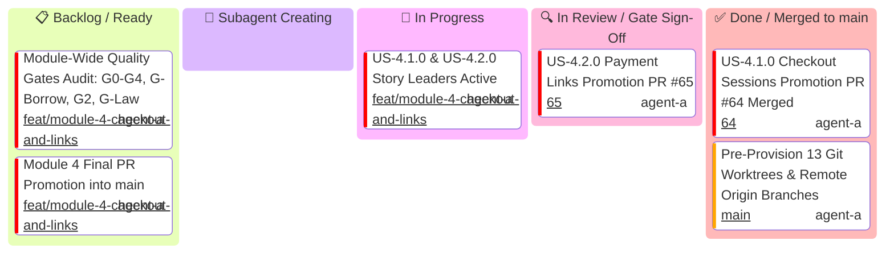
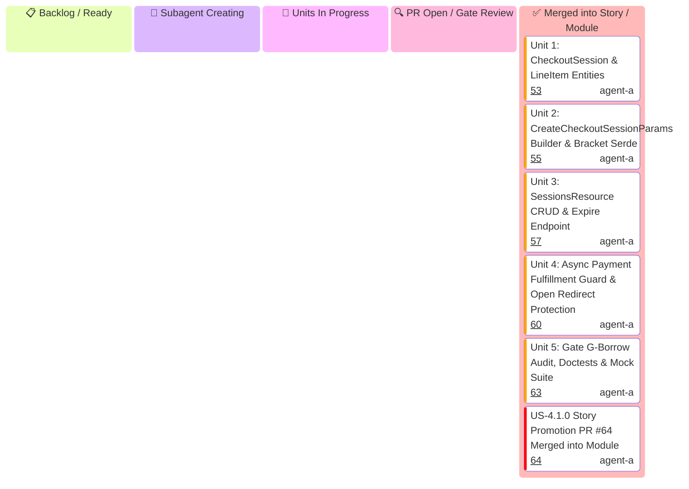
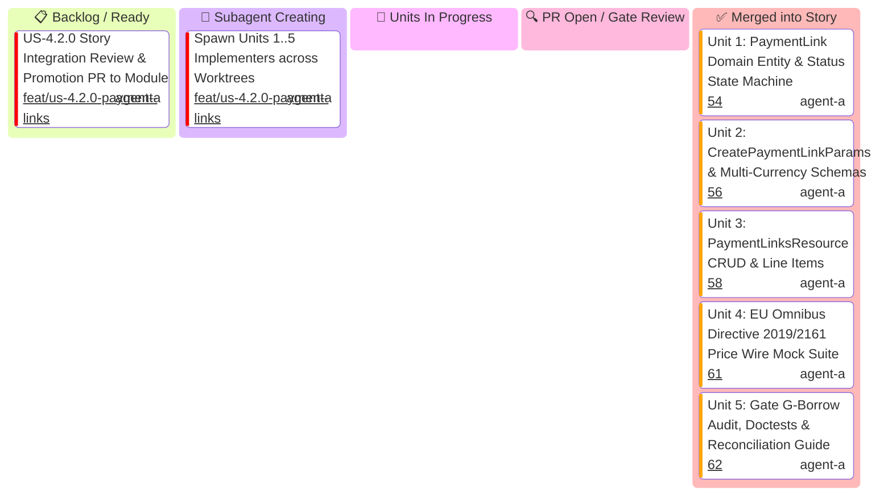

# Module 4: Hosted Checkout & Links — Hierarchical Multi-Tier Kanban Boards

This document serves as the master Kanban tracking system for **Module 4 (Hosted Checkout & Links)**, organized into distinct tier-specific Kanban boards:
1. **Module Level Executive Kanban**: Tracks high-level milestones, story promotion merges, and final release into `main`.
2. **User Story 4.1.0 Kanban**: Tracks the 5 micro-units of Checkout Sessions & Line Items.
3. **User Story 4.2.0 Kanban**: Tracks the 5 micro-units of Payment Links & Multi-Currency Pricing.

> [!IMPORTANT]
> **Mandatory Subagent Spawning State**: User Story and Module leaders MUST transition through the **`spawning[🤖 Subagent Creating]`** column. If any leader idles in this state for >3 minutes, the Main Supervisor Watchdog intervenes and directly spawns the missing subagents.
>
> **Mandatory Unit PR Naming**: Every micro-unit PR title MUST include the unit number:
> `feat(us-x.y.0/unit-N): <short-summary>`
>
> **Federated Gatekeeper Council & Skills Standard**: Every PR must be independently reviewed and approved by specialized gatekeeper subagents from `.agents/agents/` armed with mandatory skills from `.agents/skills/`. **Self-approval is strictly prohibited**.

---

## 1. Module Level Executive Kanban

Tracks module-wide promotion PRs, integration gates, and merging into `main`.

---

## 2. User Story 4.1.0 Kanban (Checkout Sessions & Line Items)

Tracks micro-units 1 through 5 for `US-4.1.0`.

---

## 3. User Story 4.2.0 Kanban (Payment Links & Price Transparency)

Tracks micro-units 1 through 5 for `US-4.2.0`.

---

## 4. Master Task, Branch, PR, Gatekeeper Subagents & Skills Matrix

| Task ID | Level | Mandatory PR Title Format | Implementer & Profile | Implementer Skill | Gatekeeper Subagents | Gatekeeper Skills | Worktree Directory | Branch | Status |
| :--- | :---: | :--- | :--- | :--- | :--- | :--- | :--- | :--- | :---: |
| **M4-SETUP** | Module | `N/A (Baseline Commit)` | `Supervisor` (`agent-a`) | `agy-customizations` | `Main Supervisor Watchdog` | `antigravity-guide` | `.worktrees/feat-module-4-checkout-and-links` | `feat/module-4-checkout-and-links` | ✅ Done |
| **M4-SPAWN** | Module | `N/A (Agent Dispatch)` | `Module 4 Lead` (`agent-a`) | `stripe-best-practices` | `Main Supervisor Watchdog` | `antigravity-guide` | `.worktrees/feat-module-4-checkout-and-links` | `feat/module-4-checkout-and-links` | 🔄 In Progress |
| **U-4.1.0-1** | Unit | `feat(us-4.1.0/unit-1): checkout session and line item domain entities` | `Entity Specialist` (`agent-a`) | `stripe-docs` | `Rust Refactoring Specialist` `Code Reviewer` | `upgrade-stripe` `security-audit` | `.worktrees/feat-us-410-unit-1-session-line-item-entities` | `feat/us-4.1.0/unit-1-session-line-item-entities` | ✅ Merged ([#53](https://github.com/some-of-cs/some-stripe/pull/53)) |
| **U-4.1.0-2** | Unit | `feat(us-4.1.0/unit-2): create checkout session parameter schemas and bracket notation` | `Schema Specialist` (`agent-a`) | `stripe-docs` `stripe-best-practices` | `microkernel-architect` `Code Reviewer` | `stripe-docs` `stripe-best-practices` | `.worktrees/feat-us-410-unit-2-params-and-bracket-serialization` | `feat/us-4.1.0/unit-2-params-and-bracket-serialization` | ✅ Merged ([#55](https://github.com/some-of-cs/some-stripe/pull/55)) |
| **U-4.1.0-3** | Unit | `feat(us-4.1.0/unit-3): sessions resource crud and session expire endpoint` | `CRUD Implementer` (`agent-a`) | `stripe-docs` `stripe-best-practices` | `API Tester` `Code Reviewer` | `stripe-docs` `stripe-best-practices` | `.worktrees/feat-us-410-unit-3-sessions-resource-crud` | `feat/us-4.1.0/unit-3-sessions-resource-crud` | ✅ Merged ([#57](https://github.com/some-of-cs/some-stripe/pull/57)) |
| **U-4.1.0-4** | Unit | `feat(us-4.1.0/unit-4): async payment fulfillment deferral and open redirect guard` | `AppSec Engineer` (`agent-a`) | `security-audit` `stripe-best-practices` | `Application Security Engineer` `Code Reviewer` | `security-audit` `stripe-best-practices` | `.worktrees/feat-us-410-unit-4-async-fulfillment-wire-tests` | `feat/us-4.1.0/unit-4-async-fulfillment-wire-tests` | ✅ Merged ([#60](https://github.com/some-of-cs/some-stripe/pull/60)) |
| **U-4.1.0-5** | Unit | `feat(us-4.1.0/unit-5): gate g-borrow zero-clone audit, doctests and mock test suite` | `QA Specialist` (`agent-a`) | `stripe-docs` | `Rust Refactoring Specialist` `Technical Writer` `Code Reviewer` | `upgrade-stripe` `stripe-docs` `security-audit` | `.worktrees/feat-us-410-unit-5-borrow-audit-and-doctests` | `feat/us-4.1.0/unit-5-borrow-audit-and-doctests` | ✅ Merged ([#63](https://github.com/some-of-cs/some-stripe/pull/63)) |
| **US-4.1.0** | Story | `feat(us-4.1.0): hosted checkout sessions & line items (Units 1..5 Promotion)` | `US-4.1.0 Story Lead` (`agent-a`) | `stripe-best-practices` | `API Tester` `microkernel-architect` `Code Reviewer` | `stripe-docs` `stripe-best-practices` `security-audit` | `.worktrees/feat-us-410-checkout-sessions` | `feat/us-4.1.0-checkout-sessions` | ✅ Merged ([#64](https://github.com/some-of-cs/some-stripe/pull/64)) |
| **U-4.2.0-1** | Unit | `feat(us-4.2.0/unit-1): payment link domain entities and status state machine` | `Entity Specialist` (`agent-a`) | `stripe-docs` | `Rust Refactoring Specialist` `Code Reviewer` | `upgrade-stripe` `security-audit` | `.worktrees/feat-us-420-unit-1-payment-link-entities` | `feat/us-4.2.0/unit-1-payment-link-entities` | ✅ Merged ([#54](https://github.com/some-of-cs/some-stripe/pull/54)) |
| **U-4.2.0-2** | Unit | `feat(us-4.2.0/unit-2): create payment link params and multi-currency schemas` | `Schema Specialist` (`agent-a`) | `stripe-docs` `stripe-best-practices` | `microkernel-architect` `Code Reviewer` | `stripe-docs` `stripe-best-practices` | `.worktrees/feat-us-420-unit-2-payment-link-params` | `feat/us-4.2.0/unit-2-payment-link-params` | ✅ Merged ([#56](https://github.com/some-of-cs/some-stripe/pull/56)) |
| **U-4.2.0-3** | Unit | `feat(us-4.2.0/unit-3): payment links resource crud and line item listing` | `CRUD Implementer` (`agent-a`) | `stripe-docs` `stripe-best-practices` | `API Tester` `Code Reviewer` | `stripe-docs` `stripe-best-practices` | `.worktrees/feat-us-420-unit-3-payment-links-resource-crud` | `feat/us-4.2.0/unit-3-payment-links-resource-crud` | ✅ Merged ([#58](https://github.com/some-of-cs/some-stripe/pull/58)) |
| **U-4.2.0-4** | Unit | `feat(us-4.2.0/unit-4): eu omnibus directive 2019/2161 price wire mock suite` | `AppSec Engineer` (`agent-a`) | `security-audit` `stripe-best-practices` | `Application Security Engineer` `Code Reviewer` | `security-audit` `stripe-best-practices` | `.worktrees/feat-us-420-unit-4-omnibus-price-wire-tests` | `feat/us-4.2.0/unit-4-omnibus-price-wire-tests` | ✅ Merged ([#61](https://github.com/some-of-cs/some-stripe/pull/61)) |
| **U-4.2.0-5** | Unit | `feat(us-4.2.0/unit-5): gate g-borrow zero-clone audit, doctests and reconciliation guide` | `QA Specialist` (`agent-a`) | `stripe-docs` | `Rust Refactoring Specialist` `Technical Writer` `Code Reviewer` | `upgrade-stripe` `stripe-docs` `security-audit` | `.worktrees/feat-us-420-unit-5-borrow-audit-and-reconciliation` | `feat/us-4.2.0/unit-5-borrow-audit-and-reconciliation` | ✅ Merged ([#62](https://github.com/some-of-cs/some-stripe/pull/62)) |
| **US-4.2.0** | Story | `feat(us-4.2.0): payment links & price transparency (Units 1..5 Promotion)` | `US-4.2.0 Story Lead` (`agent-a`) | `stripe-best-practices` | `API Tester` `microkernel-architect` `Code Reviewer` | `stripe-docs` `stripe-best-practices` `security-audit` | `.worktrees/feat-us-420-payment-links` | `feat/us-4.2.0-payment-links` | 🔍 In Review ([#65](https://github.com/some-of-cs/some-stripe/pull/65)) |
| **M4-MAIN** | Module | `feat(module-4): hosted checkout and links engine (US-4.1.0 & US-4.2.0 Promotion)` | `Module 4 Lead` (`agent-a`) | `stripe-best-practices` | Full Gatekeeper Council (`Code Reviewer`, `AppSec`, `Rust Specialist`, `API Tester`, `Tech Writer`) | `security-audit` `upgrade-stripe` `stripe-docs` `stripe-best-practices` | `.worktrees/feat-module-4-checkout-and-links` | `feat/module-4-checkout-and-links` | 📋 Ready |
