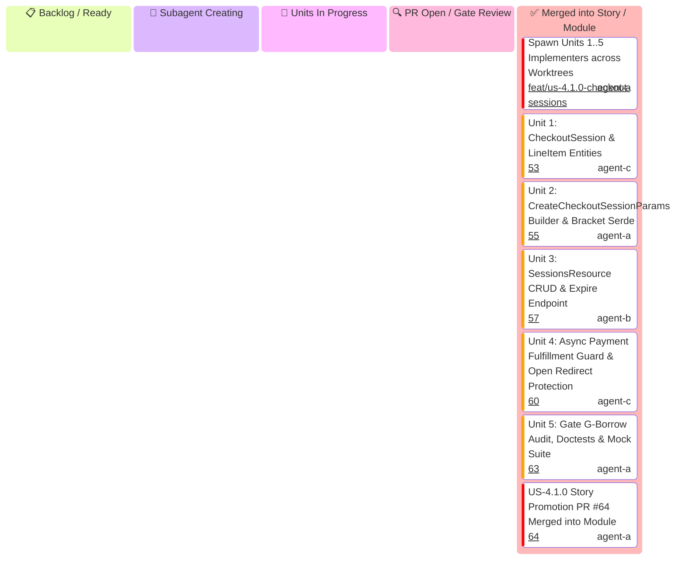

# US-4.1.0: Checkout Sessions & Line Items — Story Kanban Board

This Kanban board tracks the micro-units of **User Story 4.1.0 (Checkout Sessions & Line Items)** with an explicit **`🤖 Subagent Creating`** state to track unit implementer generation.

> [!IMPORTANT]
> **Story Leader Invariant**: Upon invocation, the Story Leader moves into `spawning[🤖 Subagent Creating]` and immediately spawns all 5 Unit Implementers. If this stage takes >3 minutes, the Supervisor Watchdog intervenes.
>
> **Federated Gatekeeper Council & Skills Invariant**: Every PR must undergo independent verification by specialized gatekeeper subagents from `.agents/agents/` armed with designated skills from `.agents/skills/`. **Zero self-approval**.

---

## 1. User Story 4.1.0 Mermaid Kanban

---

## 2. Micro-Unit Implementer, Gatekeeper Subagents & Skills Matrix

| Unit ID | Unit Scope | Implementer & Profile | Mandatory Implementer Skill | Assigned Gatekeeper Subagents | Mandatory Gatekeeper Skills | Status | PR |
| :--- | :--- | :--- | :--- | :--- | :--- | :--- | :---: |
| **S41-SPAWN** | Spawn 5 Unit Implementers | `US-4.1.0 Story Leader` (`agent-b`) | `stripe-best-practices` | `Main Supervisor Watchdog` | `antigravity-guide` | ✅ Complete | Ready |
| **U-4.1.0-1** | `CheckoutSession` & `LineItem` Entities | `Entity Specialist` (`agent-c`) | `stripe-docs` | `Rust Refactoring Specialist` `Code Reviewer` | `upgrade-stripe` `security-audit` | ✅ Merged | [#53](https://github.com/some-of-cs/some-stripe/pull/53) |
| **U-4.1.0-2** | `CreateCheckoutSessionParams` & Bracket Serde | `Schema Specialist` (`agent-a`) | `stripe-docs` `stripe-best-practices` | `microkernel-architect` `Code Reviewer` | `stripe-docs` `stripe-best-practices` | ✅ Merged | [#55](https://github.com/some-of-cs/some-stripe/pull/55) |
| **U-4.1.0-3** | `SessionsResource` CRUD & Expire | `CRUD Implementer` (`agent-b`) | `stripe-docs` `stripe-best-practices` | `API Tester` `Code Reviewer` | `stripe-docs` `stripe-best-practices` | ✅ Merged | [#57](https://github.com/some-of-cs/some-stripe/pull/57) |
| **U-4.1.0-4** | Async Fulfillment & Redirect Guard | `AppSec Engineer` (`agent-c`) | `security-audit` `stripe-best-practices` | `Application Security Engineer` `Code Reviewer` | `security-audit` `stripe-best-practices` | ✅ Merged | [#60](https://github.com/some-of-cs/some-stripe/pull/60) |
| **U-4.1.0-5** | Borrow Audit, Doctests & Wire Mocks | `QA & Docs Specialist` (`agent-a`) | `stripe-docs` | `Rust Refactoring Specialist` `Technical Writer` `Code Reviewer` | `upgrade-stripe` `stripe-docs` `security-audit` | ✅ Merged | [#63](https://github.com/some-of-cs/some-stripe/pull/63) |
| **S41-PROMO** | Story Integration & Promotion PR | `US-4.1.0 Story Leader` (`agent-a`) | `stripe-best-practices` | `API Tester` `microkernel-architect` `Code Reviewer` | `stripe-docs` `stripe-best-practices` `security-audit` | ✅ Merged | [#64](https://github.com/some-of-cs/some-stripe/pull/64) |
