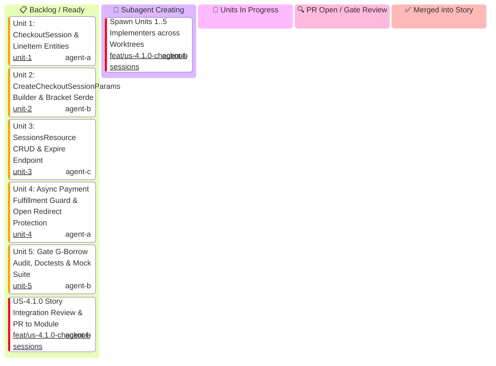

# US-4.1.0: Checkout Sessions & Line Items — Story Kanban Board

This Kanban board tracks the micro-units of **User Story 4.1.0 (Checkout Sessions & Line Items)** with an explicit **`🤖 Subagent Creating`** state to track unit implementer generation.

> [!IMPORTANT]
> **Story Leader Invariant**: Upon invocation, the Story Leader moves into `spawning[🤖 Subagent Creating]` and immediately spawns all 5 Unit Implementers. If this stage takes >3 minutes, the Supervisor Watchdog intervenes.

---

## 1. User Story 4.1.0 Mermaid Kanban

---

## 2. Micro-Unit Task & Cascading Promotion Matrix

| Unit ID | Unit Scope | Implementer Role | Profile | Worktree Directory | Branch | Status | PR |
| :--- | :--- | :--- | :--- | :--- | :--- | :---: | :---: |
| **S41-SPAWN** | Spawn 5 Unit Implementers | `US-4.1.0 Story Leader` | `agent-b` (`account2`) | `.worktrees/feat-us-410-checkout-sessions` | `feat/us-4.1.0-checkout-sessions` | 🤖 Spawning | Ready |
| **U-4.1.0-1** | `CheckoutSession` & `LineItem` Entities | `Entity Specialist` | `agent-a` (`account1`) | `.worktrees/feat-us-410-unit-1-session-line-item-entities` | `feat/us-4.1.0/unit-1-session-line-item-entities` | 📋 Ready | Pending |
| **U-4.1.0-2** | `CreateCheckoutSessionParams` & Bracket Serde | `Schema Specialist` | `agent-b` (`account2`) | `.worktrees/feat-us-410-unit-2-params-and-bracket-serialization` | `feat/us-4.1.0/unit-2-params-and-bracket-serialization` | 📋 Ready | Pending |
| **U-4.1.0-3** | `SessionsResource` CRUD & Expire | `CRUD Implementer` | `agent-c` (`account3`) | `.worktrees/feat-us-410-unit-3-sessions-resource-crud` | `feat/us-4.1.0/unit-3-sessions-resource-crud` | 📋 Ready | Pending |
| **U-4.1.0-4** | Async Fulfillment & Redirect Guard | `AppSec Engineer` | `agent-a` (`account1`) | `.worktrees/feat-us-410-unit-4-async-fulfillment-wire-tests` | `feat/us-4.1.0/unit-4-async-fulfillment-wire-tests` | 📋 Ready | Pending |
| **U-4.1.0-5** | Borrow Audit, Doctests & Wire Mocks | `QA & Docs Specialist` | `agent-b` (`account2`) | `.worktrees/feat-us-410-unit-5-borrow-audit-and-doctests` | `feat/us-4.1.0/unit-5-borrow-audit-and-doctests` | 📋 Ready | Pending |
| **S41-PROMO** | Story Integration & Promotion PR | `US-4.1.0 Story Leader` | `agent-b` (`account2`) | `.worktrees/feat-us-410-checkout-sessions` | `feat/us-4.1.0-checkout-sessions` | 📋 Ready | Pending |
