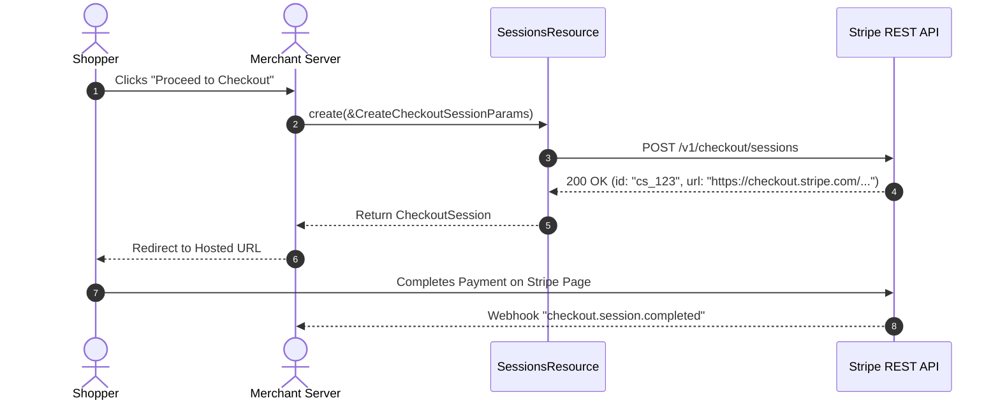

# US-4.1.0: Hosted Checkout Sessions, Line Items & Async Reconciliation

> **Spec Kit Specification**: [Specification Lifecycle Active (.specify/)](../../../.specify/memory/constitution.md)  
> **Behavior Blueprint**: `features/checkout/modules/sessions/behaviours/checkout-sessions/`  
> **Slicing Standard**: [10-PR Vertical Slicing Framework](../../user-stories/README.md#the-10-pr-vertical-slicing-framework-rust-sdk-adaptation)  
> **Security Gateway**: `security-audit` Level 2 Enforced  
> **Quality Gates**: `(G0–G4 + G-Review + G-Borrow + G-Law)`  

---

## 1. Spec Kit Specification

### 1.1 User Story Narrative
**As an** e-commerce application developer,  
**I want to** create, retrieve, expire, and paginate line items for Stripe Checkout Sessions across `payment`, `setup`, and `subscription` modes with support for delayed payment methods (SEPA, Boleto, Konbini),  
**So that** my users can complete hosted checkout journeys smoothly, while my order fulfillment pipeline properly defers order processing until async payments transition to succeeded.

#### 1.1.1 Preconditions
- The `checkout` feature flag is enabled in `Cargo.toml`.
- Valid success and cancel redirect URLs (`success_url`, `cancel_url`) are specified.
- Line items with unit amounts, currency, and quantities are configured.

#### 1.1.2 Postconditions
- A `CheckoutSession` is returned containing the hosted checkout URL (`session.url`).
- Expired sessions can no longer accept customer payments (`session.status == "expired"`).
- Line items can be paginated lazily through `client.checkout().sessions().list_line_items(session_id)`.

### 1.2 Acceptance Criteria (Gherkin Scenarios)

```gherkin
Feature: Stripe Checkout Sessions Management

  Scenario: [AC-US-4.1.0-01] Create a Hosted Checkout Session for one-off payment
    Given a valid CreateCheckoutSessionParams with success_url, currency "usd", and product deposit $50.00
    When client.checkout().sessions().create(&params) is executed
    Then a CheckoutSession is returned with status "open"
    And session.url is an authenticated Stripe checkout URL ("https://checkout.stripe.com/c/pay/...")
    And payment_status is "unpaid".

  Scenario: [AC-US-4.1.0-02] Expire an abandoned Checkout Session
    Given an open Checkout Session "cs_test_123"
    When client.checkout().sessions().expire("cs_test_123") is executed
    Then the session status transitions to "expired"
    And subsequent customer visits to the checkout URL display a session expired notice.

  Scenario: [AC-US-4.1.0-03] Async payment fulfillment deferral
    Given a customer completing checkout using a delayed payment method (SEPA Direct Debit)
    When the initial "checkout.session.completed" webhook is received with payment_status "unpaid"
    Then the order fulfillment service defers physical delivery
    And marks fulfillment active only when "checkout.session.async_payment_succeeded" is verified.

  Scenario: [AC-US-4.1.0-LAW] EU Omnibus Directive 2019/2161 and price transparency compliance
    Given any Checkout Session presentation
    When line items and total amounts are displayed to the consumer
    Then all prices include applicable statutory taxes, fees, and prior 30-day baseline price transparency where required by EU Omnibus Directive 2019/2161.
```

### 1.3 Test Cases & Traceability Matrix

| Test Case ID | Target Criterion | Test Type | Execution Level | Verification Assertion & Pass Criteria |
| :--- | :--- | :--- | :--- | :--- |
| `TC-4.1.0-01` | `AC-US-4.1.0-01` | Functional | Integration | Assert `create()` returns valid checkout URL and `open` status. |
| `TC-4.1.0-02` | `AC-US-4.1.0-02` | Lifecycle | Integration | Call `expire()` -> assert returned session status is `expired`. |
| `TC-4.1.0-03` | `AC-US-4.1.0-03` | Business Logic | Unit | Verify async payment flag check prevents premature fulfillment on `unpaid` status. |
| `TC-4.1.0-LAW` | `AC-US-4.1.0-LAW` | Statutory | Contract | Assert line items explicitly capture tax breakdowns and currency codes per EU rules. |

---

## 2. Behavior-Centric Architecture & Folder Blueprint

### 2.1 Colocated Behaviour Directory Tree

```
features/checkout/modules/sessions/behaviours/checkout-sessions/
├── services/        # CheckoutResource, SessionsResource, line item paginator
├── logic/           # Line item bracket serialization, async fulfillment guard, expiration validator
├── types/           # CheckoutSession, CreateCheckoutSessionParams, LineItem, SessionMode
└── constants/       # CHECKOUT_SESSIONS_ENDPOINT ("/v1/checkout/sessions"), MODES
```

### 2.2 Scoping & Promotion Blueprint
- **Tier 1 (Behaviour-Local)**: Session URL validator and line item accumulator.
- **Tier 2 (Module-Shared)**: `LineItem` entity shared with Invoicing and Quotes.
- **Tier 3 (Feature-Shared)**: `client.checkout().sessions()` accessor on `StripeClient`.
- **Tier 4 (Global-Shared)**: Re-exported via `some_stripe::resources::checkout::*`.

---

## 3. Technical Implementation Plan

### 3.1 Domain Invariants & Storage Schema
- **Expiration Invariant**: `expires_at` must be between 30 minutes and 24 hours in the future if provided.
- **Mode Invariants**: `mode` must be one of `payment`, `setup`, or `subscription`.
- **Rust Memory Law**: Strict borrowing of parameters (`&CreateCheckoutSessionParams`); zero deep clones.

### 3.2 Activity & Interaction Diagram



---

## 4. Granular Implementation Tasks

### 4.1 The 10-PR Vertical Slicing Implementation Plan

| PR # | Pillar | Architectural Layer | Primary Scope & Files | Deliverables & Acceptance | Accountable Role / Agent | Assigned Skills |
| :--- | :--- | :--- | :--- | :--- | :--- | :--- |
| **PR 1** | **Pillar 1** | **Checkout Domain Entities** | `crates/some-stripe-checkout/src/types/session.rs` | Strongly typed `CheckoutSession`, `LineItem`, `SessionStatus`. | `domain-codegen-specialist` | `stripe-docs` |
| **PR 2** | **Pillar 2** | **Session Creation Parameters** | `crates/some-stripe-checkout/src/types/params.rs` | `CreateCheckoutSessionParams` with line item builders. | `domain-codegen-specialist` | `stripe-docs` |
| **PR 3** | **Pillar 3** | **Indexed Bracket Line Item Serializer** | `crates/some-stripe-checkout/src/serializer.rs` | Serialize line items using `line_items[0][price_data]...`. | `microkernel-architect` | `stripe-best-practices` |
| **PR 4** | **Pillar 4** | **Sessions Resource Methods** | `crates/some-stripe-checkout/src/resource.rs` | `create`, `retrieve`, `expire`. | `domain-codegen-specialist` | `stripe-docs` |
| **PR 5** | **Pillar 5** | **Line Items Paginator** | `crates/some-stripe-checkout/src/line_items.rs` | `list_line_items(session_id)` returning an auto-paginating stream. | `microkernel-architect` | `stripe-docs` |
| **PR 6** | **Pillar 6** | **StripeClient Facade Mounting** | `crates/some-stripe-checkout/src/facade.rs` | Mount `stripe.checkout().sessions` onto `StripeClient`. | `domain-codegen-specialist` | `stripe-docs` |
| **PR 7** | **Pillar 7** | **Async Payment Guard** | `crates/some-stripe-checkout/src/reconciliation.rs` | Helper methods verifying `payment_status == "paid"` before fulfillment. | `security-appsec-engineer` | `stripe-best-practices` |
| **PR 8** | **Pillar 8** | **Zero-Clone Borrowing Audit** | `crates/some-stripe-checkout/src/resource.rs` | Ensure zero deep `.clone()` on session entities and line item collections. | `engineering-rust-refactoring-specialist` | `stripe-best-practices` |
| **PR 9** | **Pillar 9** | **Stripe-Mock Wire Verification** | `tests/checkout_sessions_mock_test.rs` | End-to-end session creation and expiration verified against `stripe-mock`. | `testing-api-tester` | `stripe-docs` |
| **PR 10** | **Pillar 10** | **Checkout Documentation & Recipes** | `README.md`, `docs/checkout.md` | Integration guide for Actix/Axum hosted checkout flows. | `engineering-technical-writer` | `stripe-docs` |

### 4.2 Implementation Phase Breakdown

#### Phase 1: Models & Parameter DTOs (PR 1–3)
- [ ] **Task 1.1 (Types)**: Define `CheckoutSession`, `SessionMode`, `PaymentStatus` in `types/`.  
  *Agent*: `domain-codegen-specialist` | *Skill*: `stripe-docs`
- [ ] **Task 1.2 (Constants)**: Pin `CHECKOUT_SESSIONS_ENDPOINT` ("/v1/checkout/sessions") in `constants/`.  
  *Agent*: `domain-codegen-specialist` | *Skill*: `stripe-docs`
- [ ] **Task 1.3 (Logic)**: Implement `CreateCheckoutSessionParams` with builder methods for success and cancel URLs.  
  *Agent*: `domain-codegen-specialist` | *Skill*: `stripe-best-practices`
- [ ] **Task 1.4 (Unit Tests)**: Verify line item indexed-bracket serialization format.  
  *Agent*: `testing-api-tester` | *Skill*: `stripe-docs`

#### Phase 2: Resource Methods & Wire Execution (PR 4–6)
- [ ] **Task 2.1 (API / Gateway)**: Implement `SessionsResource::create` and `retrieve` with automatic idempotency.  
  *Agent*: `domain-codegen-specialist` | *Skill*: `stripe-docs`
- [ ] **Task 2.2 (Expire)**: Implement `SessionsResource::expire` method.  
  *Agent*: `domain-codegen-specialist` | *Skill*: `stripe-docs`
- [ ] **Task 2.3 (Line Items)**: Implement `list_line_items` returning auto-paginating `Paginator<LineItem>`.  
  *Agent*: `microkernel-architect` | *Skill*: `stripe-docs`
- [ ] **Task 2.4 (Facade)**: Expose `client.checkout().sessions` on `StripeClient`.  
  *Agent*: `domain-codegen-specialist` | *Skill*: `stripe-docs`

#### Phase 3: Async Fulfillment & Zero-Clone Hardening (PR 7–8)
- [ ] **Task 3.1 (Reconciliation)**: Implement async payment guard preventing premature order release.  
  *Agent*: `security-appsec-engineer` | *Skill*: `stripe-best-practices`
- [ ] **Task 3.2 (Borrow Check)**: Verify zero `.clone()` calls during session creation and response handling.  
  *Agent*: `engineering-rust-refactoring-specialist` | *Skill*: `stripe-best-practices`

#### Phase 4: Mock Validation & Release Sign-Off (PR 9–10)
- [ ] **Task 4.1 (Mock Suite)**: Run full session creation, retrieval, and expiration tests against `stripe-mock`.  
  *Agent*: `testing-api-tester` | *Skill*: `stripe-docs`
- [ ] **Task 4.2 (G-Review)**: Code review for checkout parameter accuracy and URL safety.  
  *Agent*: `engineering-code-reviewer` | *Skill*: `stripe-best-practices`
- [ ] **Task 4.3 (Docs)**: Write comprehensive doc-tests for Checkout Session creation.  
  *Agent*: `engineering-technical-writer` | *Skill*: `stripe-docs`

---

## 5. Security Gateway (Powered by security-audit)

### 5.1 Trust Boundaries & Security Actors
- **Trust Boundaries**:
  - `Public Client`: Customer web browser redirected to `checkout.stripe.com`.
  - `Merchant Server`: Creates session and verifies webhook completion.
- **Authorized Principals**:
  - Storefront Backend: Authorized via secret API key.

### 5.2 Threat Modeling & Abuse Matrix (STRIDE / ASVS)

| Threat Vector | Severity | Vulnerability Mechanism | Mitigating Control & Security Invariant |
| :--- | :--- | :--- | :--- |
| **Price Tampering** | Critical | Client injecting manipulated product prices into checkout | Authoritative prices defined by server in `CreateCheckoutSessionParams`. |
| **Open Redirect Vulnerability** | High | Attacker tampering with `success_url` to redirect to malicious domain | Server validates and whitelists return domains before session creation. |
| **Premature Order Fulfillment** | High | Fulfilling delayed payment orders prior to fund clearance | State machine blocks fulfillment when `payment_status != "paid"`. |

### 5.3 Cryptographic & Data Protection Controls
- **Signed Redirect Tokens**: Customer references (`client_reference_id`) protected against tampering.
- **PCI Scope Minimization**: Payment form hosted entirely by Stripe; zero PAN exposure.

### 5.4 Automated Security Verification Checklist
- [ ] **Redirect Sanitization**: Test verifies invalid URL schemes (e.g. `javascript:`) are rejected.
- [ ] **Price Tampering Test**: Verify line item amounts cannot be negative.

### 5.5 Security Gateway (G2) Sign-Off Checklist
- [ ] Zero PCI card data handled in application scope (SAQ-A compliance).
- [ ] Open redirect protections confirmed active on return URLs.
- [ ] Code review sign-off obtained; zero findings.

---

## 6. Validation Gates & Acceptance Sign-Off

**Status: Ready for Implementation.**

### G1 — Test coverage
- [ ] **US-4.1.0-G1:** >=90% line and branch coverage across `checkout.rs`.

### G2 — Security audit
- [ ] **US-4.1.0-G2:** Price integrity and redirect sanitization verified under security-audit.

### G3 — Architecture and maintainability
- [ ] **US-4.1.0-G3:** Clean feature isolation under `feature = "checkout"`.

### G-Review — Code review
- [ ] **US-4.1.0-G-Review:** Senior review approved by `engineering-code-reviewer`.

### G-Borrow — Rust zero-clone borrowing validation
- [ ] **US-4.1.0-G-Borrow:** Parameters borrowed strictly by reference; zero deep clones.

### G-Law — Law validation
- [ ] **US-4.1.0-G-Law:** EU Omnibus Directive price transparency compliance certified.

### G4 — Integrated acceptance
- [ ] **US-4.1.0-G4:** End-to-end checkout flow validated against `stripe-mock`.
