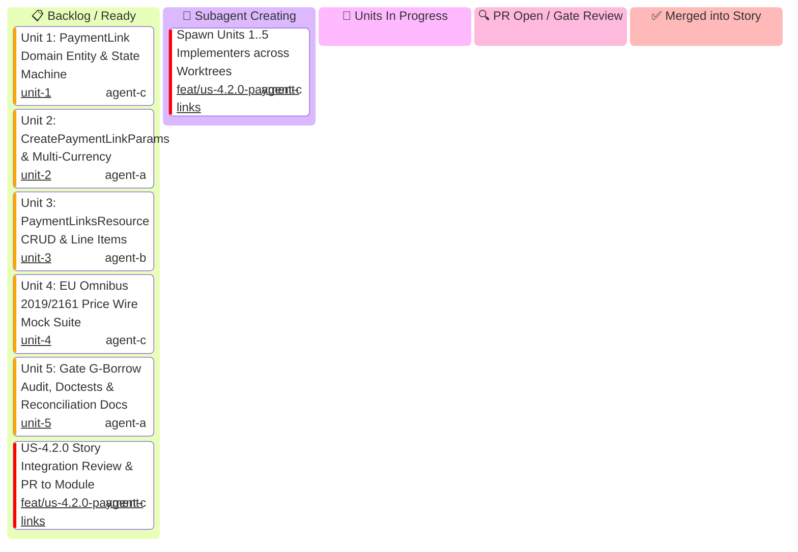

# US-4.2.0: Payment Links & Price Transparency — Story Kanban Board

This Kanban board tracks the micro-units of **User Story 4.2.0 (Payment Links & Price Transparency)** with an explicit **`🤖 Subagent Creating`** state to track unit implementer generation.

> [!IMPORTANT]
> **Story Leader Invariant**: Upon invocation, the Story Leader moves into `spawning[🤖 Subagent Creating]` and immediately spawns all 5 Unit Implementers. If this stage takes >3 minutes, the Supervisor Watchdog intervenes.
>
> **Federated Gatekeeper Council & Skills Invariant**: Every PR must undergo independent verification by specialized gatekeeper subagents from `.agents/agents/` armed with designated skills from `.agents/skills/`. **Zero self-approval**.

---

## 1. User Story 4.2.0 Mermaid Kanban

---

## 2. Micro-Unit Implementer, Gatekeeper Subagents & Skills Matrix

| Unit ID | Unit Scope | Implementer & Profile | Mandatory Implementer Skill | Assigned Gatekeeper Subagents | Mandatory Gatekeeper Skills | Status | PR |
| :--- | :--- | :--- | :--- | :--- | :--- | :---: | :---: |
| **S42-SPAWN** | Spawn 5 Unit Implementers | `US-4.2.0 Story Leader` (`agent-c`) | `stripe-best-practices` | `Main Supervisor Watchdog` | `antigravity-guide` | 🤖 Spawning | Ready |
| **U-4.2.0-1** | `PaymentLink` Domain Entity & State Machine | `Entity Specialist` (`agent-c`) | `stripe-docs` | `Rust Refactoring Specialist` `Code Reviewer` | `upgrade-stripe` `security-audit` | 📋 Ready | Pending |
| **U-4.2.0-2** | `PaymentLinkParams` & Multi-Currency Schemas | `Schema Specialist` (`agent-a`) | `stripe-docs` `stripe-best-practices` | `microkernel-architect` `Code Reviewer` | `stripe-docs` `stripe-best-practices` | 📋 Ready | Pending |
| **U-4.2.0-3** | `PaymentLinksResource` CRUD & Line Items | `CRUD Implementer` (`agent-b`) | `stripe-docs` `stripe-best-practices` | `API Tester` `Code Reviewer` | `stripe-docs` `stripe-best-practices` | 📋 Ready | Pending |
| **U-4.2.0-4** | EU Omnibus 2019/2161 Price Wire Mock Suite | `AppSec Engineer` (`agent-c`) | `security-audit` `stripe-best-practices` | `Application Security Engineer` `Code Reviewer` | `security-audit` `stripe-best-practices` | 📋 Ready | Pending |
| **U-4.2.0-5** | Borrow Audit, Doctests & Reconciliation Guide | `QA & Docs Specialist` (`agent-a`) | `stripe-docs` | `Rust Refactoring Specialist` `Technical Writer` `Code Reviewer` | `upgrade-stripe` `stripe-docs` `security-audit` | 📋 Ready | Pending |
| **S42-PROMO** | Story Integration & Promotion PR | `US-4.2.0 Story Leader` (`agent-c`) | `stripe-best-practices` | `API Tester` `microkernel-architect` `Code Reviewer` | `stripe-docs` `stripe-best-practices` `security-audit` | 📋 Ready | Pending |
