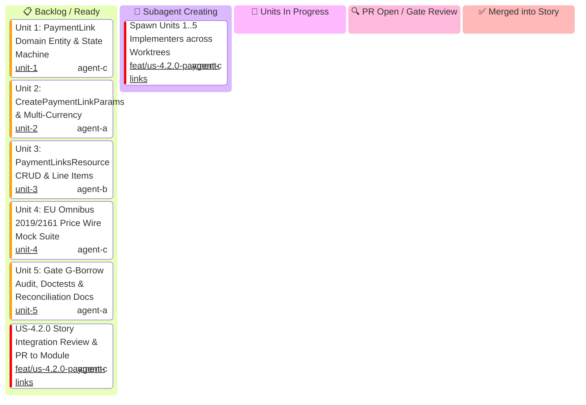

# US-4.2.0: Payment Links & Price Transparency — Story Kanban Board

This Kanban board tracks the micro-units of **User Story 4.2.0 (Payment Links & Price Transparency)** with an explicit **`🤖 Subagent Creating`** state to track unit implementer generation.

> [!IMPORTANT]
> **Story Leader Invariant**: Upon invocation, the Story Leader moves into `spawning[🤖 Subagent Creating]` and immediately spawns all 5 Unit Implementers. If this stage takes >3 minutes, the Supervisor Watchdog intervenes.

---

## 1. User Story 4.2.0 Mermaid Kanban

---

## 2. Micro-Unit Task & Cascading Promotion Matrix

| Unit ID | Unit Scope | Implementer Role | Profile | Worktree Directory | Branch | Status | PR |
| :--- | :--- | :--- | :--- | :--- | :--- | :---: | :---: |
| **S42-SPAWN** | Spawn 5 Unit Implementers | `US-4.2.0 Story Leader` | `agent-c` (`account3`) | `.worktrees/feat-us-420-payment-links` | `feat/us-4.2.0-payment-links` | 🤖 Spawning | Ready |
| **U-4.2.0-1** | `PaymentLink` Domain Entity & State Machine | `Entity Specialist` | `agent-c` (`account3`) | `.worktrees/feat-us-420-unit-1-payment-link-entities` | `feat/us-4.2.0/unit-1-payment-link-entities` | 📋 Ready | Pending |
| **U-4.2.0-2** | `PaymentLinkParams` & Multi-Currency Schemas | `Schema Specialist` | `agent-a` (`account1`) | `.worktrees/feat-us-420-unit-2-payment-link-params` | `feat/us-4.2.0/unit-2-payment-link-params` | 📋 Ready | Pending |
| **U-4.2.0-3** | `PaymentLinksResource` CRUD & Line Items | `CRUD Implementer` | `agent-b` (`account2`) | `.worktrees/feat-us-420-unit-3-payment-links-resource-crud` | `feat/us-4.2.0/unit-3-payment-links-resource-crud` | 📋 Ready | Pending |
| **U-4.2.0-4** | EU Omnibus 2019/2161 Price Wire Mock Suite | `AppSec Engineer` | `agent-c` (`account3`) | `.worktrees/feat-us-420-unit-4-omnibus-price-wire-tests` | `feat/us-4.2.0/unit-4-omnibus-price-wire-tests` | 📋 Ready | Pending |
| **U-4.2.0-5** | Borrow Audit, Doctests & Reconciliation Guide | `QA & Docs Specialist` | `agent-a` (`account1`) | `.worktrees/feat-us-420-unit-5-borrow-audit-and-reconciliation` | `feat/us-4.2.0/unit-5-borrow-audit-and-reconciliation` | 📋 Ready | Pending |
| **S42-PROMO** | Story Integration & Promotion PR | `US-4.2.0 Story Leader` | `agent-c` (`account3`) | `.worktrees/feat-us-420-payment-links` | `feat/us-4.2.0-payment-links` | 📋 Ready | Pending |
