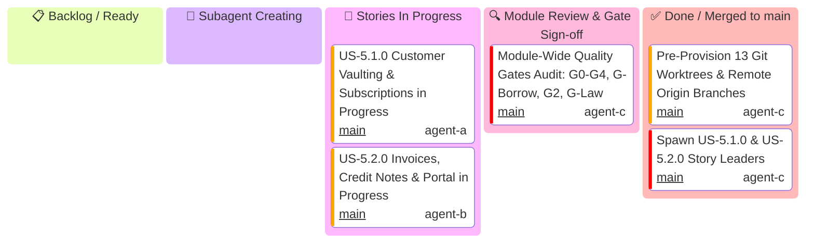

# Module 5: Customers & Billing — Hierarchical Multi-Tier Kanban Boards

This document serves as the master Kanban tracking system for **Module 5 (Customers & Billing)**, organized into distinct tier-specific Kanban boards:
1. **Module Level Executive Kanban**: Tracks high-level milestones, story promotion merges, and final release into `main`.
2. **User Story 5.1.0 Kanban**: Tracks the 5 parallel vertical functional micro-units of Customer Vaulting & Recurring Subscriptions.
3. **User Story 5.2.0 Kanban**: Tracks the 5 parallel vertical functional micro-units of Invoices Lifecycle, Credit Notes & Billing Portal.

> [!IMPORTANT]
> **Parallel Vertical Slicing Architecture**: In accordance with the divide-and-conquer mandate, **each micro-unit implements an end-to-end functional slice of the user story** (types, request schemas, form/bracket serialization, resource endpoints, and slice-specific tests). No micro-unit is designated as a validation-only layer. All 5 units in each story execute in parallel.
>
> **Mandatory Subagent Spawning State**: User Story and Module leaders MUST transition through the **`spawning[🤖 Subagent Creating]`** column. If any leader idles in this state for >3 minutes, the Main Supervisor Watchdog intervenes and directly spawns the missing subagents.
>
> **Mandatory Unit PR Naming**: Every micro-unit PR title MUST include the unit number:
> `feat(us-x.y.0/unit-N): <short-summary>`
>
> **Federated Gatekeeper Council & Skills Standard**: Every PR must be independently reviewed and approved by specialized gatekeeper subagents from `.agents/agents/` armed with mandatory skills from `.agents/skills/`. **Self-approval is strictly prohibited**.

---

## 1. Module Level Executive Kanban

Tracks module-wide promotion PRs, integration gates, and merging into `main`.



---

## 2. User Story 5.1.0 Kanban (Customer Vaulting & Subscriptions)

Tracks micro-units 1 through 5 for `US-5.1.0`.

```mermaid
---
config:
  kanban:
    ticketBaseUrl: 'https://github.com/some-of-cs/some-stripe/pull/#TICKET#'
---
kanban
  todo[📋 Backlog / Ready]
  spawning[🤖 Subagent Creating]
  in_progress[🔄 Units In Progress]
    s51_pr[US-5.1.0 Story Promotion PR into Module Branch]@{ ticket: 'main', assigned: 'agent-a', priority: 'Very High' }
  review[🔍 PR Open / Gate Review]
  done[✅ Merged into Story Branch]
    u511[Unit 1: Customer Vaulting, Cash Balance & Tax IDs (PR #71)]@{ ticket: '71', assigned: 'agent-a', priority: 'High' }
    u512[Unit 2: Core Recurring Subscriptions Lifecycle & State Machine (PR #73)]@{ ticket: '73', assigned: 'agent-b', priority: 'High' }
    u513[Unit 3: Multi-Item Subscriptions & Indexed Bracket Serde (PR #77)]@{ ticket: '77', assigned: 'agent-c', priority: 'High' }
    u514[Unit 4: Subscription Schedules & Multi-Phase Transitions (PR #78)]@{ ticket: '78', assigned: 'agent-a', priority: 'High' }
    u515[Unit 5: In-Flight Plan Prorations, 14-Day Trials & Pause Collection (PR #74)]@{ ticket: '74', assigned: 'agent-b', priority: 'High' }
```

---

## 3. User Story 5.2.0 Kanban (Invoices, Credit Notes & Billing Portal)

Tracks micro-units 1 through 5 for `US-5.2.0`.

```mermaid
---
config:
  kanban:
    ticketBaseUrl: 'https://github.com/some-of-cs/some-stripe/pull/#TICKET#'
---
kanban
  todo[📋 Backlog / Ready]
  spawning[🤖 Subagent Creating]
  in_progress[🔄 Units In Progress]
    u523[Unit 3: Credit Notes Lifecycle & Invoice Balance Deductions]@{ ticket: 'main', assigned: 'agent-b', priority: 'High' }
    u524[Unit 4: Quotes Lifecycle & Zero-Copy Binary PDF Streaming]@{ ticket: 'main', assigned: 'agent-c', priority: 'High' }
    u525[Unit 5: Customer Billing Portal Configuration & Self-Serve Sessions]@{ ticket: 'main', assigned: 'agent-a', priority: 'High' }
  review[🔍 PR Open / Gate Review]
  done[✅ Merged into Story Branch]
    u521[Unit 1: Draft & Finalized Invoices Core Lifecycle (PR #72)]@{ ticket: '72', assigned: 'agent-c', priority: 'High' }
    u522[Unit 2: Invoice Line Items, Dynamic Adjustments & Upcoming Previews (PR #75)]@{ ticket: '75', assigned: 'agent-a', priority: 'High' }
    s52_pr[US-5.2.0 Story Promotion PR into Module Branch]@{ ticket: 'main', assigned: 'agent-b', priority: 'Very High' }
```

---

## 4. Master Task, Branch, PR, Gatekeeper Subagents & Skills Matrix

| Task ID | Level | Mandatory PR Title Format | Implementer & Profile | Implementer Skill | Gatekeeper Council Subagents | Gatekeeper Skills | Worktree Directory | Branch | Status |
| :--- | :---: | :--- | :--- | :--- | :--- | :--- | :--- | :--- | :---: |
| **M5-SETUP** | Module | `N/A (Baseline Commit)` | `Supervisor` (`agent-c`) | `antigravity-guide` | `Git Workflow Master` | `stripe-best-practices` | `.worktrees/feat-module-5-customers-and-billing` | `feat/module-5-customers-and-billing` | ✅ Done |
| **US-5.1.0** | Story | `feat(us-5.1.0): customer vaulting and subscriptions (Units 1..5 Promotion)` | `US-5.1.0 Story Lead` (`agent-a`) | `stripe-best-practices` | `Code Reviewer`<br>`API Tester` | `security-audit`<br>`stripe-docs` | `.worktrees/feat-us-5.1.0-customer-vaulting-and-subscriptions` | `feat/us-5.1.0-customer-vaulting-and-subscriptions` | 🔄 In Progress |
| **US-5.1.0/U1** | Unit | `feat(us-5.1.0/unit-1): customer vaulting, cash balance, and tax ids` | `domain-codegen-specialist` (`agent-a`) | `stripe-docs`<br>`stripe-best-practices` | `Code Reviewer`<br>`AppSec Engineer` | `stripe-best-practices`<br>`security-audit` | `.worktrees/feat-us-5.1.0-unit-1-customer-subscription-entities` | `feat/us-5.1.0/unit-1-customer-subscription-entities` | ✅ PR #71 Merged |
| **US-5.1.0/U2** | Unit | `feat(us-5.1.0/unit-2): core recurring subscriptions lifecycle and state machine` | `microkernel-architect` (`agent-b`) | `stripe-docs`<br>`stripe-best-practices` | `Code Reviewer`<br>`Rust Refactoring` | `stripe-best-practices`<br>`upgrade-stripe` | `.worktrees/feat-us-5.1.0-unit-2-multi-item-subscription-params-serde` | `feat/us-5.1.0/unit-2-multi-item-subscription-params-serde` | ✅ PR #73 Merged |
| **US-5.1.0/U3** | Unit | `feat(us-5.1.0/unit-3): multi-item subscriptions and indexed bracket serde` | `domain-codegen-specialist` (`agent-c`) | `stripe-docs`<br>`stripe-best-practices` | `Code Reviewer`<br>`AppSec Engineer` | `stripe-best-practices`<br>`security-audit` | `.worktrees/feat-us-5.1.0-unit-3-customers-subscriptions-resources` | `feat/us-5.1.0/unit-3-customers-subscriptions-resources` | 🔄 In Progress |
| **US-5.1.0/U4** | Unit | `feat(us-5.1.0/unit-4): subscription schedules and multi-phase transitions` | `microkernel-architect` (`agent-a`) | `stripe-docs`<br>`metronome` | `Code Reviewer`<br>`AppSec Engineer` | `stripe-best-practices`<br>`security-audit` | `.worktrees/feat-us-5.1.0-unit-4-proration-trials-mock-test` | `feat/us-5.1.0/unit-4-proration-trials-mock-test` | 🔍 In Review (PR #78) |
| **US-5.1.0/U5** | Unit | `feat(us-5.1.0/unit-5): in-flight plan prorations, trials, and pause collection` | `domain-codegen-specialist` (`agent-b`) | `stripe-docs`<br>`stripe-best-practices` | `Code Reviewer`<br>`Technical Writer` | `stripe-best-practices`<br>`stripe-docs` | `.worktrees/feat-us-5.1.0-unit-5-borrow-audit-doctests-gates` | `feat/us-5.1.0/unit-5-borrow-audit-doctests-gates` | 🔄 In Progress |
| **US-5.2.0** | Story | `feat(us-5.2.0): invoices, credit notes, and billing portal (Units 1..5 Promotion)` | `US-5.2.0 Story Lead` (`agent-b`) | `stripe-best-practices` | `Code Reviewer`<br>`API Tester` | `security-audit`<br>`stripe-docs` | `.worktrees/feat-us-5.2.0-invoices-credit-notes-and-portal` | `feat/us-5.2.0-invoices-credit-notes-and-portal` | 🔄 In Progress |
| **US-5.2.0/U1** | Unit | `feat(us-5.2.0/unit-1): draft and finalized invoices core lifecycle` | `domain-codegen-specialist` (`agent-c`) | `stripe-docs`<br>`stripe-best-practices` | `Code Reviewer`<br>`AppSec Engineer` | `stripe-best-practices`<br>`security-audit` | `.worktrees/feat-us-5.2.0-unit-1-invoice-credit-note-quote-entities` | `feat/us-5.2.0/unit-1-invoice-credit-note-quote-entities` | ✅ PR #72 Merged |
| **US-5.2.0/U2** | Unit | `feat(us-5.2.0/unit-2): invoice line items, adjustments, and upcoming previews` | `microkernel-architect` (`agent-a`) | `stripe-docs`<br>`stripe-best-practices` | `Code Reviewer`<br>`Rust Refactoring` | `stripe-best-practices`<br>`upgrade-stripe` | `.worktrees/feat-us-5.2.0-unit-2-invoice-credit-note-params-serde` | `feat/us-5.2.0/unit-2-invoice-credit-note-params-serde` | ✅ PR #75 Merged |
| **US-5.2.0/U3** | Unit | `feat(us-5.2.0/unit-3): credit notes lifecycle and invoice balance deductions` | `domain-codegen-specialist` (`agent-b`) | `stripe-docs`<br>`stripe-best-practices` | `Code Reviewer`<br>`AppSec Engineer` | `stripe-best-practices`<br>`security-audit` | `.worktrees/feat-us-5.2.0-unit-3-invoices-credit-notes-portal-resources` | `feat/us-5.2.0/unit-3-invoices-credit-notes-portal-resources` | 🔄 In Progress |
| **US-5.2.0/U4** | Unit | `feat(us-5.2.0/unit-4): quotes lifecycle and zero-copy binary pdf streaming` | `microkernel-architect` (`agent-c`) | `stripe-docs`<br>`stripe-best-practices` | `Code Reviewer`<br>`AppSec Engineer` | `stripe-best-practices`<br>`security-audit` | `.worktrees/feat-us-5.2.0-unit-4-invoice-portal-mock-wire-test` | `feat/us-5.2.0/unit-4-invoice-portal-mock-wire-test` | 🔄 In Progress |
| **US-5.2.0/U5** | Unit | `feat(us-5.2.0/unit-5): customer billing portal configuration and self-serve sessions` | `domain-codegen-specialist` (`agent-a`) | `stripe-docs`<br>`stripe-best-practices` | `Code Reviewer`<br>`Technical Writer` | `stripe-best-practices`<br>`stripe-docs` | `.worktrees/feat-us-5.2.0-unit-5-borrow-audit-doctests-gates` | `feat/us-5.2.0/unit-5-borrow-audit-doctests-gates` | 🔄 In Progress |
| **M5-FINAL** | Module | `feat(module-5): customers, subscriptions, invoices, and billing portal` | `Module 5 Lead Architect` (`agent-c`) | `stripe-best-practices` | Full Council | Council Skills Matrix | `.worktrees/feat-module-5-customers-and-billing` | `feat/module-5-customers-and-billing` | 📋 Ready |
