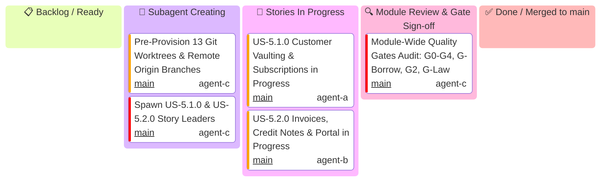

# Module 5: Customers & Billing — Module Level Executive Kanban

This executive Kanban board tracks high-level milestone promotions for **Module 5 (Customers & Billing)** with an explicit **`🤖 Subagent Creating`** state to eliminate spawning latency.

> [!IMPORTANT]
> **Supervisor Invariant**: If the Module Leader remains in `spawning[🤖 Subagent Creating]` for >3 minutes without creating the 2 User Story Leaders, the Active Supervisor Watchdog intervenes and spawns them directly.
>
> **Gatekeeper Subagents & Skills Invariant**: Module promotions require full sign-off by the Federated Gatekeeper Council, each executing with their designated specialized skills from `.agents/skills/`.

---

## 1. Module Level Mermaid Kanban

---

## 2. Milestone Promotion Matrix with Subagents & Skills

| Milestone ID | Milestone Scope | Lead Assignee & Profile | Mandatory Lead Skill | Assigned Gatekeeper Council Subagents | Mandatory Gatekeeper Skills | Status | PR / SHA |
| :--- | :--- | :--- | :--- | :--- | :--- | :---: | :---: |
| **M5-SETUP** | Provision 13 worktrees & origin branches | `Module Lead` (`agent-c`) | `antigravity-guide` | `Git Workflow Master` | `stripe-best-practices` | 📋 Ready | Pending |
| **M5-SPAWN** | Spawn US-5.1.0 & US-5.2.0 Story Leaders | `Module 5 Lead Architect` (`agent-c`) | `stripe-docs` | `Main Supervisor Watchdog` | `antigravity-guide` | 🤖 Spawning | Pending |
| **M5-S51** | US-5.1.0 Promotion (Customer & Subs) | `US-5.1.0 Story Leader` (`agent-a`) | `stripe-best-practices` | `API Tester` `microkernel-architect` `Code Reviewer` | `stripe-docs` `stripe-best-practices` `security-audit` | 📋 Ready | Story PR |
| **M5-S52** | US-5.2.0 Promotion (Invoices & Portal) | `US-5.2.0 Story Leader` (`agent-b`) | `stripe-best-practices` | `API Tester` `microkernel-architect` `Code Reviewer` | `stripe-docs` `stripe-best-practices` `security-audit` | 📋 Ready | Story PR |
| **M5-GATES** | Full Workspace Quality Gate Sign-Off | `Module 5 Lead Architect` (`agent-c`) | `stripe-best-practices` | Full Council (`Code Reviewer`, `AppSec`, `Rust Refactoring`, `API Tester`, `Tech Writer`) | `security-audit` `upgrade-stripe` `stripe-docs` `stripe-best-practices` | 📋 Ready | Council Review |
| **M5-MAIN** | Module 5 Final Merge into `main` | `Module 5 Lead Architect` (`agent-c`) | `stripe-best-practices` | `Code Reviewer` `Git Workflow Master` | `security-audit` `stripe-best-practices` | 📋 Ready | Module PR |
