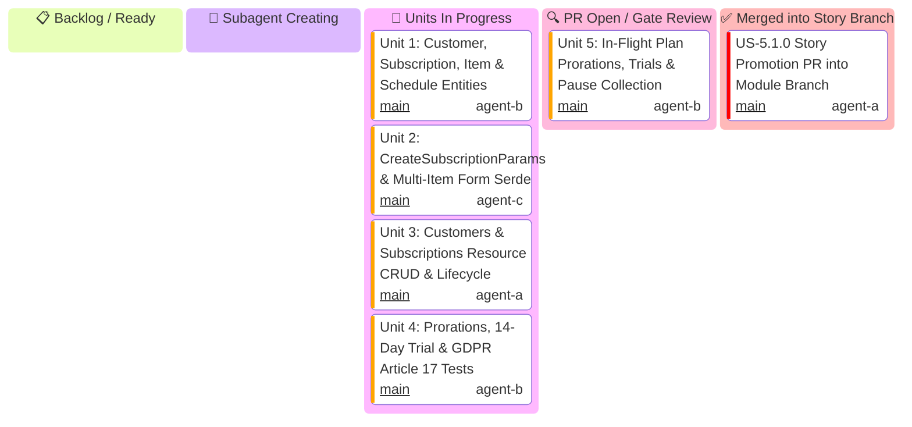

# US-5.1.0: Customer Vaulting & Subscriptions — User Story Kanban

Tracks micro-units 1 through 5 for `US-5.1.0` (Customer Vaulting, Recurring Subscriptions & Multi-Phase Schedules).

> [!IMPORTANT]
> **Mandatory Subagent Spawning State**: The Story Leader MUST transition through the **`spawning[🤖 Subagent Creating]`** column. If idling for >3 minutes, the Main Supervisor Watchdog intervenes.

---

## 1. User Story 5.1.0 Mermaid Kanban

---

## 2. Micro-Unit Task & Gatekeeper Matrix

| Unit ID | Scope & Files | Implementer & Profile | Mandatory Skill | Gatekeeper Council Subagents | Gatekeeper Skills | Branch | Target PR Title |
| :--- | :--- | :--- | :--- | :--- | :--- | :--- | :--- |
| **Unit 1** | `Customer`, `Subscription`, `SubscriptionItem`, `SubscriptionSchedule` domain entities in `some-stripe-types` | `domain-codegen-specialist` (`agent-b`) | `stripe-docs` | `Code Reviewer` `AppSec Engineer` | `stripe-best-practices` `security-audit` | `feat/us-5.1.0/unit-1-customer-subscription-entities` | `feat(us-5.1.0/unit-1): customer, subscription, and schedule domain entities` |
| **Unit 2** | `CreateSubscriptionParams`, `UpdateSubscriptionParams`, `PauseCollectionParams`, indexed form serde | `microkernel-architect` (`agent-c`) | `stripe-docs` | `Code Reviewer` `Rust Refactoring` | `stripe-best-practices` `upgrade-stripe` | `feat/us-5.1.0/unit-2-multi-item-subscription-params-serde` | `feat(us-5.1.0/unit-2): multi-item subscription parameters and indexed bracket serde` |
| **Unit 3** | `CustomersResource`, `SubscriptionsResource`, `SubscriptionSchedulesResource` CRUD and facade mounting | `domain-codegen-specialist` (`agent-a`) | `stripe-docs` | `Code Reviewer` `AppSec Engineer` | `stripe-best-practices` `security-audit` | `feat/us-5.1.0/unit-3-customers-subscriptions-resources` | `feat(us-5.1.0/unit-3): customers and subscriptions resource crud and client facade` |
| **Unit 4** | `stripe-mock` wire tests: 14-day trials, proration calculation, pause collection, GDPR Article 17 sanitization | `API Tester` (`agent-b`) | `stripe-docs` | `Code Reviewer` `AppSec Engineer` | `stripe-best-practices` `security-audit` | `feat/us-5.1.0/unit-4-proration-trials-mock-test` | `feat(us-5.1.0/unit-4): subscription wire mock tests and gdpr compliance verification` |
| **Unit 5** | In-flight plan prorations, 14-day free trials & pause collection | `domain-codegen-specialist` (`agent-b`) | `stripe-docs` `stripe-best-practices` | `Code Reviewer` `Technical Writer` | `stripe-best-practices` `security-audit` | `feat/us-5.1.0/unit-5-borrow-audit-doctests-gates` | `feat(us-5.1.0/unit-5): in-flight plan prorations, trials, and pause collection` |
