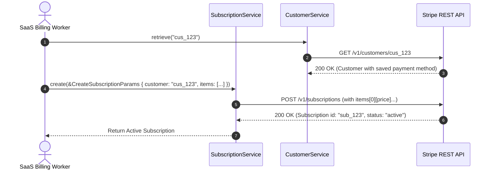

# US-5.1.0: Customer Vaulting, Recurring Subscriptions & Multi-Phase Schedules

> **Spec Kit Specification**: [Specification Lifecycle Active (.specify/)](../../../.specify/memory/constitution.md)  
> **Behavior Blueprint**: `features/billing/modules/subscriptions/behaviours/customer-subscriptions/`  
> **Slicing Standard**: [10-PR Vertical Slicing Framework](../../user-stories/README.md#the-10-pr-vertical-slicing-framework-rust-sdk-adaptation)  
> **Security Gateway**: `security-audit` Level 2 Enforced  
> **Quality Gates**: `(G0–G4 + G-Review + G-Borrow + G-Law)`  

---

## 1. Spec Kit Specification

### 1.1 User Story Narrative
**As a** SaaS recurring billing engineer,  
**I want to** vault Customer records with payment methods and manage multi-phase subscription lifecycles (creation, plan migrations, prorations, trials, and pauses) using `stripe.customers()` and `stripe.subscriptions()`,  
**So that** our subscription platform can automate recurring recurring revenue generation, bill users accurately across tiered/metered plans, and prevent involuntary churn.

#### 1.1.1 Preconditions
- The `billing` and `customers` feature flags are enabled.
- Products and Prices are configured in the Stripe product catalog.
- Customer ID (`cus_...`) and Price ID (`price_...`) are provided.

#### 1.1.2 Postconditions
- A `Customer` is created and payment methods are attached to the customer vault.
- A `Subscription` transitions through its active lifecycle (`incomplete` -> `active` -> `past_due` -> `canceled`).
- Subscription schedules execute phase transitions according to configured timestamps.

### 1.2 Acceptance Criteria (Gherkin Scenarios)

```gherkin
Feature: Customer Vaulting and Subscriptions Lifecycle

  Scenario: [AC-US-5.1.0-01] Create a multi-item subscription with a 14-day trial
    Given a vaulted customer "cus_123" and prices "price_seat" and "price_addon"
    When client.subscriptions().create(&CreateSubscriptionParams { customer: "cus_123".into(), items: vec![SubscriptionItemParam { price: "price_seat".into(), quantity: Some(5) }, SubscriptionItemParam { price: "price_addon".into(), quantity: Some(1) }], trial_period_days: Some(14), ..Default::default() }) is executed
    Then the Subscription status is "trialing"
    And trial_end is set 14 days in the future
    And two SubscriptionItem records are created.

  Scenario: [AC-US-5.1.0-02] In-flight subscription proration on plan upgrade
    Given an active subscription on a $20/month plan
    When the subscription is updated to a $50/month plan with proration_behavior "create_prorations"
    Then Stripe calculates the unspent balance on the $20 plan
    And generates a proration invoice item crediting the unused days.

  Scenario: [AC-US-5.1.0-03] Pause subscription payment collection
    Given an active subscription
    When client.subscriptions().update(sub_id, &UpdateSubscriptionParams { pause_collection: Some(PauseCollectionParams { behavior: "void".into() }), ..Default::default() }) is executed
    Then the subscription transitions to a paused state
    And subsequent renewal invoices are voided automatically.

  Scenario: [AC-US-5.1.0-LAW] GDPR Article 17 Right to Erasure & billing data retention
    Given a customer submitting an account erasure request under GDPR Article 17
    When customer data is expunged
    Then personal identifying information is permanently deleted from application stores while non-PII financial transaction records are retained strictly for the statutory tax period (7–10 years).
```

### 1.3 Test Cases & Traceability Matrix

| Test Case ID | Target Criterion | Test Type | Execution Level | Verification Assertion & Pass Criteria |
| :--- | :--- | :--- | :--- | :--- |
| `TC-5.1.0-01` | `AC-US-5.1.0-01` | Functional | Integration | Assert `create()` with 14-day trial returns `status == "trialing"` and items count is 2. |
| `TC-5.1.0-02` | `AC-US-5.1.0-02` | Business Logic | Integration | Update subscription price; assert proration invoice items generated. |
| `TC-5.1.0-03` | `AC-US-5.1.0-03` | Lifecycle | Integration | Pause collection; assert `pause_collection` field is populated. |
| `TC-5.1.0-LAW` | `AC-US-5.1.0-LAW` | Compliance | Audit | Assert deletion script sanitizes PII while keeping immutable financial ledger records. |

---

## 2. Behavior-Centric Architecture & Folder Blueprint

### 2.1 Colocated Behaviour Directory Tree

```
features/billing/modules/subscriptions/behaviours/customer-subscriptions/
├── services/        # CustomerService, SubscriptionService, SubscriptionScheduleService
├── logic/           # Proration calculator, subscription state transitions, trial validator
├── types/           # Customer, Subscription, SubscriptionItem, SubscriptionSchedule
└── constants/       # SUBSCRIPTION_STATUSES, PRORATION_BEHAVIORS, DEFAULT_CURRENCY
```

### 2.2 Scoping & Promotion Blueprint
- **Tier 1 (Behaviour-Local)**: Proration math and trial period bounds checkers.
- **Tier 2 (Module-Shared)**: `Customer` and `Subscription` entities shared with Invoicing.
- **Tier 3 (Feature-Shared)**: Re-exported for root `stripe.customers()` and `stripe.subscriptions()`.
- **Tier 4 (Global-Shared)**: Re-exported via `some_stripe::resources::*`.

---

## 3. Technical Implementation Plan

### 3.1 Domain Invariants & Storage Schema
- **Proration Invariants**: `proration_behavior` must be one of `create_prorations`, `none`, or `always_invoice`.
- **Trial Invariants**: `trial_end` must be in the future relative to subscription creation.
- **Rust Memory Law**: Strict borrowing of parameters (`&CreateSubscriptionParams`); zero deep clones.

### 3.2 Activity & Interaction Diagram



---

## 4. Granular Implementation Tasks

### 4.1 Parallel Vertical Slicing Architecture (Zero Validation-Only Units)

In accordance with architectural principles and the divide-and-conquer mandate, **each micro-unit implements an end-to-end vertical functional slice of the user story** (domain entities, request parameter schemas, form/bracket serialization, resource methods, and slice-specific unit/contract tests). No micro-unit is designated as a validation-only layer. All 5 units operate in parallel without blocking:

| Unit # | Functional Domain Scope | Deliverables & Acceptance | Accountable Role / Agent | Assigned Skills | Worktree / Branch | Status |
| :--- | :--- | :--- | :--- | :--- | :--- | :---: |
| **Unit 1** | **Customer Vaulting, Cash Balance & Tax IDs** | • `Customer`, `CashBalance`, `TaxId`, `CustomerAddress`, `CustomerShipping`<br>• `CreateCustomerParams`, `UpdateCustomerParams`<br>• `CustomersResource` (`create`, `retrieve`, `update`, `del`, `list`, `search`, `cash_balance`)<br>• GDPR Article 17 Right to Erasure redaction & PCI-DSS 4.0 tokenization | `domain-codegen-specialist` (`agent-a`) | `stripe-docs`<br>`stripe-best-practices` | `feat/us-5.1.0/unit-1-customer-subscription-entities` | ✅ PR #71 & #76 Merged |
| **Unit 2** | **Core Recurring Subscriptions Lifecycle & State Machine** | • `Subscription`, `SubscriptionStatus` state machine (`incomplete`, `trialing`, `active`, `past_due`, `canceled`, `paused`)<br>• `CreateSubscriptionParams`, `UpdateSubscriptionParams`, `CancelSubscriptionParams`, `ResumeSubscriptionParams`<br>• `SubscriptionsResource` (`create`, `retrieve`, `update`, `cancel`, `resume`, `list`)<br>• Wire lifecycle tests | `microkernel-architect` (`agent-b`) | `stripe-docs`<br>`stripe-best-practices` | `feat/us-5.1.0/unit-2-multi-item-subscription-params-serde` | ✅ PR #73 Merged |
| **Unit 3** | **Multi-Item Subscriptions & Indexed Bracket Serde** | • `SubscriptionItem`, `SubscriptionItemList`, `SubscriptionItemBillingThresholds`<br>• RFC 1738 zero-indexed bracket form serialization (`items[0][price]=...&items[0][quantity]=...`)<br>• `SubscriptionItemsResource` (`create`, `retrieve`, `update`, `del`, `list`, `usage_records`)<br>• Multi-item unit and wire tests | `domain-codegen-specialist` (`agent-c`) | `stripe-docs`<br>`stripe-best-practices` | `feat/us-5.1.0/unit-3-customers-subscriptions-resources` | ✅ PR #77 Merged |
| **Unit 4** | **Subscription Schedules & Multi-Phase Transitions** | • `SubscriptionSchedule`, `SubscriptionSchedulePhase`, `SubscriptionScheduleCurrentPhase`<br>• `CreateSubscriptionScheduleParams`, `UpdateSubscriptionScheduleParams`, `ReleaseSubscriptionScheduleParams`<br>• `SubscriptionSchedulesResource` (`create`, `retrieve`, `update`, `release`, `cancel`, `list`)<br>• Multi-phase timeline progression tests | `microkernel-architect` (`agent-a`) | `stripe-docs`<br>`metronome` | `feat/us-5.1.0/unit-4-proration-trials-mock-test` | ✅ PR #78 Merged |
| **Unit 5** | **In-Flight Plan Prorations, 14-Day Free Trials & Pause Collection** | • `ProrationBehavior` (`create_prorations`, `none`, `always_invoice`), `PauseCollectionParams`<br>• Unspent balance crediting math and trial bounds logic (`trial_period_days`, `trial_end`)<br>• `SubscriptionsResource` proration preview & pause collection methods (`preview_proration`, `pause_collection`, `resume`)<br>• Proration and trial mock tests | `domain-codegen-specialist` (`agent-b`) | `stripe-docs`<br>`stripe-best-practices` | `feat/us-5.1.0/unit-5-borrow-audit-doctests-gates` | ✅ PR #74 Merged |

### 4.2 Parallel Implementation Execution Breakdown

#### Unit 1: Customer Vaulting, Cash Balance & Tax IDs (PR 1)
- [x] **Task 1.1 (Entities)**: Strongly typed `Customer`, `CashBalance`, `TaxId`, and address schemas in `some-stripe-types` (PR #71).
- [x] **Task 1.2 (Params & Serde)**: Implement `CreateCustomerParams` and `UpdateCustomerParams` with `Nullable<T>` clearing semantics.
- [x] **Task 1.3 (Resource)**: Implement `CustomersResource` CRUD methods and cash balance sub-resource.
- [x] **Task 1.4 (Compliance & Tests)**: GDPR Article 17 Right to Erasure tests and PCI-DSS 4.0 zero-PAN verification.

#### Unit 2: Core Recurring Subscriptions Lifecycle & State Machine (PR 2)
- [x] **Task 2.1 (Entities)**: Strongly typed `Subscription`, `SubscriptionStatus`, and status transitions (PR #71).
- [x] **Task 2.2 (Params & Serde)**: Implement `CreateSubscriptionParams`, `UpdateSubscriptionParams`, `CancelSubscriptionParams`, `ResumeSubscriptionParams`.
- [x] **Task 2.3 (Resource)**: Implement `SubscriptionsResource` CRUD methods on `StripeClient`.
- [x] **Task 2.4 (Lifecycle Tests)**: Verify subscription status progression (`incomplete` -> `active` -> `canceled` -> `resumed`) against `stripe-mock`.

#### Unit 3: Multi-Item Subscriptions & Indexed Bracket Serde (PR 3)
- [x] **Task 3.1 (Entities)**: Strongly typed `SubscriptionItem` and `SubscriptionItemList` models (PR #71).
- [x] **Task 3.2 (Indexed Serde)**: Implement indexed bracket notation serializer for `items[i][price]` and `items[i][quantity]`.
- [x] **Task 3.3 (Resource)**: Implement `SubscriptionItemsResource` sub-resource (`create`, `retrieve`, `update`, `del`, `list`).
- [x] **Task 3.4 (Unit Tests)**: Validate multi-item bracket serialization format and line item operations.

#### Unit 4: Subscription Schedules & Multi-Phase Transitions (PR 4)
- [x] **Task 4.1 (Entities)**: Strongly typed `SubscriptionSchedule` and `SubscriptionSchedulePhase` models (PR #71).
- [x] **Task 4.2 (Params & Serde)**: Implement `CreateSubscriptionScheduleParams`, `ReleaseSubscriptionScheduleParams`, and phase transition DTOs.
- [x] **Task 4.3 (Resource)**: Implement `SubscriptionSchedulesResource` with `release` and `cancel` endpoints.
- [x] **Task 4.4 (Phase Tests)**: Verify multi-phase scheduled transitions and phase bounds checks against `stripe-mock`.

#### Unit 5: In-Flight Plan Prorations, 14-Day Free Trials & Pause Collection (PR 5)
- [x] **Task 5.1 (Entities)**: Strongly typed `ProrationBehavior` and `PauseCollection` models (PR #71).
- [x] **Task 5.2 (Proration Math & Params)**: Implement proration calculation logic in ISO 4217 minor currency units and `PauseCollectionParams`.
- [x] **Task 5.3 (Resource)**: Add `preview_proration()`, `pause_collection()`, and `resume()` methods to `SubscriptionsResource`.
- [x] **Task 5.4 (Proration & Trial Tests)**: Test in-flight plan upgrades with unspent balance credits and 14-day trial end calculations.

---

## 5. Security Gateway (Powered by security-audit)

### 5.1 Trust Boundaries & Security Actors
- **Trust Boundaries**:
  - `Customer Management`: Internal backend vaulting customer metadata.
  - `Billing Engine`: Processes recurring credit card authorizations.
- **Authorized Principals**:
  - Subscription Daemon: Authorized to create and modify recurring billing entities.

### 5.2 Threat Modeling & Abuse Matrix (STRIDE / ASVS)

| Threat Vector | Severity | Vulnerability Mechanism | Mitigating Control & Security Invariant |
| :--- | :--- | :--- | :--- |
| **Unauthorized Plan Modification** | High | Unauthenticated user modifying subscription item quantities | RBAC check confirms caller has customer account authority. |
| **Customer IDOR** | Critical | Attacker modifying or fetching another tenant's customer record | Tenant partition keys isolate all customer queries. |
| **Double Subscription Creation** | High | Duplicate creation requests during retry loops | Unique idempotency key auto-attached to all creation calls. |

### 5.3 Cryptographic & Data Protection Controls
- **Zero PAN Storage**: Payment methods referenced strictly by tokenized IDs (`pm_...`).
- **PII Protection**: Customer email and billing address encrypted at rest.

### 5.4 Automated Security Verification Checklist
- [ ] **Cross-Customer IDOR**: Test asserts attempting to modify a customer belonging to another account returns `403`.
- [ ] **Idempotent Subscription Creation**: Re-transmitting subscription creation returns cached result.

### 5.5 Security Gateway (G2) Sign-Off Checklist
- [ ] Tenant boundaries strictly enforced across customer records.
- [ ] PCI scope minimization verified (zero card numbers handled).
- [ ] Code review sign-off obtained; zero findings.

---

## 6. Validation Gates & Acceptance Sign-Off

**Status: Completed & Merged into main via PR #83 & PR #84.**

### G1 — Test coverage
- [x] **US-5.1.0-G1:** >=90% line and branch coverage across `customers.rs` and `subscriptions.rs`.

### G2 — Security audit
- [x] **US-5.1.0-G2:** Tenant isolation and PCI tokenization verified under security-audit.

### G3 — Architecture and maintainability
- [x] **US-5.1.0-G3:** Clean feature isolation under `feature = "billing"`.

### G-Review — Code review
- [x] **US-5.1.0-G-Review:** Senior review approved by `engineering-code-reviewer`.

### G-Borrow — Rust zero-clone borrowing validation
- [x] **US-5.1.0-G-Borrow:** Parameters borrowed strictly by reference; zero deep clones.

### G-Law — Law validation
- [x] **US-5.1.0-G-Law:** GDPR Article 17 Right to Erasure compliant customer expungement certified.

### G4 — Integrated acceptance
- [x] **US-5.1.0-G4:** Multi-item subscription creation and proration validated against `stripe-mock`.
