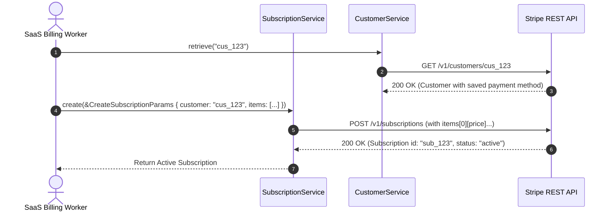

# US-5.1.0: Customer Vaulting, Recurring Subscriptions & Multi-Phase Schedules

> **Spec Kit Specification**: [Specification Lifecycle Active (.specify/)](../../../.specify/memory/constitution.md)  
> **Behavior Blueprint**: `features/billing/modules/subscriptions/behaviours/customer-subscriptions/`  
> **Slicing Standard**: [10-PR Vertical Slicing Framework](../../user-stories/README.md#the-10-pr-vertical-slicing-framework-rust-sdk-adaptation)  
> **Security Gateway**: `security-audit` Level 2 Enforced  
> **Quality Gates**: `(G0–G4 + G-Review + G-Borrow + G-Law)`  

---

## 1. Spec Kit Specification

### 1.1 User Story Narrative
**As a** SaaS recurring billing engineer,  
**I want to** vault Customer records with payment methods and manage multi-phase subscription lifecycles (creation, plan migrations, prorations, trials, and pauses) using `stripe.customers()` and `stripe.subscriptions()`,  
**So that** our subscription platform can automate recurring recurring revenue generation, bill users accurately across tiered/metered plans, and prevent involuntary churn.

#### 1.1.1 Preconditions
- The `billing` and `customers` feature flags are enabled.
- Products and Prices are configured in the Stripe product catalog.
- Customer ID (`cus_...`) and Price ID (`price_...`) are provided.

#### 1.1.2 Postconditions
- A `Customer` is created and payment methods are attached to the customer vault.
- A `Subscription` transitions through its active lifecycle (`incomplete` -> `active` -> `past_due` -> `canceled`).
- Subscription schedules execute phase transitions according to configured timestamps.

### 1.2 Acceptance Criteria (Gherkin Scenarios)

```gherkin
Feature: Customer Vaulting and Subscriptions Lifecycle

  Scenario: [AC-US-5.1.0-01] Create a multi-item subscription with a 14-day trial
    Given a vaulted customer "cus_123" and prices "price_seat" and "price_addon"
    When client.subscriptions().create(&CreateSubscriptionParams { customer: "cus_123".into(), items: vec![SubscriptionItemParam { price: "price_seat".into(), quantity: Some(5) }, SubscriptionItemParam { price: "price_addon".into(), quantity: Some(1) }], trial_period_days: Some(14), ..Default::default() }) is executed
    Then the Subscription status is "trialing"
    And trial_end is set 14 days in the future
    And two SubscriptionItem records are created.

  Scenario: [AC-US-5.1.0-02] In-flight subscription proration on plan upgrade
    Given an active subscription on a $20/month plan
    When the subscription is updated to a $50/month plan with proration_behavior "create_prorations"
    Then Stripe calculates the unspent balance on the $20 plan
    And generates a proration invoice item crediting the unused days.

  Scenario: [AC-US-5.1.0-03] Pause subscription payment collection
    Given an active subscription
    When client.subscriptions().update(sub_id, &UpdateSubscriptionParams { pause_collection: Some(PauseCollectionParams { behavior: "void".into() }), ..Default::default() }) is executed
    Then the subscription transitions to a paused state
    And subsequent renewal invoices are voided automatically.

  Scenario: [AC-US-5.1.0-LAW] GDPR Article 17 Right to Erasure & billing data retention
    Given a customer submitting an account erasure request under GDPR Article 17
    When customer data is expunged
    Then personal identifying information is permanently deleted from application stores while non-PII financial transaction records are retained strictly for the statutory tax period (7–10 years).
```

### 1.3 Test Cases & Traceability Matrix

| Test Case ID | Target Criterion | Test Type | Execution Level | Verification Assertion & Pass Criteria |
| :--- | :--- | :--- | :--- | :--- |
| `TC-5.1.0-01` | `AC-US-5.1.0-01` | Functional | Integration | Assert `create()` with 14-day trial returns `status == "trialing"` and items count is 2. |
| `TC-5.1.0-02` | `AC-US-5.1.0-02` | Business Logic | Integration | Update subscription price; assert proration invoice items generated. |
| `TC-5.1.0-03` | `AC-US-5.1.0-03` | Lifecycle | Integration | Pause collection; assert `pause_collection` field is populated. |
| `TC-5.1.0-LAW` | `AC-US-5.1.0-LAW` | Compliance | Audit | Assert deletion script sanitizes PII while keeping immutable financial ledger records. |

---

## 2. Behavior-Centric Architecture & Folder Blueprint

### 2.1 Colocated Behaviour Directory Tree

```
features/billing/modules/subscriptions/behaviours/customer-subscriptions/
├── services/        # CustomerService, SubscriptionService, SubscriptionScheduleService
├── logic/           # Proration calculator, subscription state transitions, trial validator
├── types/           # Customer, Subscription, SubscriptionItem, SubscriptionSchedule
└── constants/       # SUBSCRIPTION_STATUSES, PRORATION_BEHAVIORS, DEFAULT_CURRENCY
```

### 2.2 Scoping & Promotion Blueprint
- **Tier 1 (Behaviour-Local)**: Proration math and trial period bounds checkers.
- **Tier 2 (Module-Shared)**: `Customer` and `Subscription` entities shared with Invoicing.
- **Tier 3 (Feature-Shared)**: Re-exported for root `stripe.customers()` and `stripe.subscriptions()`.
- **Tier 4 (Global-Shared)**: Re-exported via `some_stripe::resources::*`.

---

## 3. Technical Implementation Plan

### 3.1 Domain Invariants & Storage Schema
- **Proration Invariants**: `proration_behavior` must be one of `create_prorations`, `none`, or `always_invoice`.
- **Trial Invariants**: `trial_end` must be in the future relative to subscription creation.
- **Rust Memory Law**: Strict borrowing of parameters (`&CreateSubscriptionParams`); zero deep clones.

### 3.2 Activity & Interaction Diagram



---

## 4. Granular Implementation Tasks

### 4.1 The 10-PR Vertical Slicing Implementation Plan

| PR # | Pillar | Architectural Layer | Primary Scope & Files | Deliverables & Acceptance | Accountable Role / Agent | Assigned Skills |
| :--- | :--- | :--- | :--- | :--- | :--- | :--- |
| **PR 1** | **Pillar 1** | **Subscription Domain Models** | `crates/some-stripe-billing/src/types/subscription.rs` | Strongly typed `Subscription`, `SubscriptionItem`, `Status`. | `domain-codegen-specialist` | `stripe-docs` |
| **PR 2** | **Pillar 2** | **Customer Vault Models** | `crates/some-stripe-billing/src/types/customer.rs` | Strongly typed `Customer`, `CashBalance`, `TaxId`. | `domain-codegen-specialist` | `stripe-docs` |
| **PR 3** | **Pillar 3** | **Indexed Multi-Item Serializer** | `crates/some-stripe-billing/src/serializer.rs` | Serialize subscription items using `items[0][price]=...`. | `microkernel-architect` | `stripe-best-practices` |
| **PR 4** | **Pillar 4** | **Customers Resource Methods** | `crates/some-stripe-billing/src/resources/customers.rs` | `create`, `retrieve`, `update`, `del`, `search`. | `domain-codegen-specialist` | `stripe-docs` |
| **PR 5** | **Pillar 5** | **Subscriptions Resource Methods** | `crates/some-stripe-billing/src/resources/subscriptions.rs` | `create`, `retrieve`, `update`, `cancel`, `resume`. | `domain-codegen-specialist` | `stripe-docs` |
| **PR 6** | **Pillar 6** | **Subscription Schedules Resource** | `crates/some-stripe-billing/src/resources/schedules.rs` | Multi-phase schedule lifecycle management. | `domain-codegen-specialist` | `metronome` |
| **PR 7** | **Pillar 7** | **Facade Mounting** | `crates/some-stripe-billing/src/facade.rs` | Mount `stripe.customers()` and `stripe.subscriptions()` on `StripeClient`. | `domain-codegen-specialist` | `stripe-docs` |
| **PR 8** | **Pillar 8** | **Zero-Clone Borrowing Optimization** | `crates/some-stripe-billing/src/resources/subscriptions.rs` | Verify zero deep `.clone()` on multi-item subscription arrays. | `engineering-rust-refactoring-specialist` | `stripe-best-practices` |
| **PR 9** | **Pillar 9** | **Stripe-Mock Wire Verification** | `tests/subscriptions_mock_test.rs` | End-to-end subscription creation, proration, and cancellation on `stripe-mock`. | `testing-api-tester` | `stripe-docs` |
| **PR 10** | **Pillar 10** | **SaaS Billing Documentation** | `README.md`, `docs/subscriptions.md` | Guide on handling subscription webhooks, trials, and proration math. | `engineering-technical-writer` | `stripe-docs` |

### 4.2 Implementation Phase Breakdown

#### Phase 1: Models & Parameter DTOs (PR 1–3)
- [ ] **Task 1.1 (Types)**: Define `Customer`, `Subscription`, `SubscriptionItem`, and `SubscriptionStatus` in `types/`.  
  *Agent*: `domain-codegen-specialist` | *Skill*: `stripe-docs`
- [ ] **Task 1.2 (Constants)**: Pin `/v1/customers` and `/v1/subscriptions` endpoints in `constants/`.  
  *Agent*: `domain-codegen-specialist` | *Skill*: `stripe-docs`
- [ ] **Task 1.3 (Logic)**: Implement `CreateSubscriptionParams` with multi-item builders.  
  *Agent*: `domain-codegen-specialist` | *Skill*: `stripe-best-practices`
- [ ] **Task 1.4 (Unit Tests)**: Verify multi-item subscription indexed serialization format.  
  *Agent*: `testing-api-tester` | *Skill*: `stripe-docs`

#### Phase 2: Resource Methods & Wire Execution (PR 4–7)
- [ ] **Task 2.1 (Customers)**: Implement `CustomersResource` with CRUD and cash balance sub-resources.  
  *Agent*: `domain-codegen-specialist` | *Skill*: `stripe-docs`
- [ ] **Task 2.2 (Subscriptions)**: Implement `SubscriptionsResource` with create, update, and cancel.  
  *Agent*: `domain-codegen-specialist` | *Skill*: `stripe-docs`
- [ ] **Task 2.3 (Schedules)**: Implement `SubscriptionSchedulesResource` for multi-phase subscriptions.  
  *Agent*: `domain-codegen-specialist` | *Skill*: `metronome`
- [ ] **Task 2.4 (Facade)**: Expose accessors on `StripeClient` root handle.  
  *Agent*: `domain-codegen-specialist` | *Skill*: `stripe-docs`

#### Phase 3: Zero-Clone Borrowing & Proration Tests (PR 8–9)
- [ ] **Task 3.1 (Borrow Check)**: Verify zero `.clone()` calls during subscription response parsing.  
  *Agent*: `engineering-rust-refactoring-specialist` | *Skill*: `stripe-best-practices`
- [ ] **Task 3.2 (Proration Tests)**: Test in-flight plan upgrade prorations against `stripe-mock`.  
  *Agent*: `testing-api-tester` | *Skill*: `stripe-docs`

#### Phase 4: Verification & Release Gate (PR 9–10)
- [ ] **Task 4.1 (Mock Suite)**: Run full customer and subscription lifecycle suite against `stripe-mock`.  
  *Agent*: `testing-api-tester` | *Skill*: `stripe-docs`
- [ ] **Task 4.2 (G-Review)**: Peer review for recurring billing correctness and proration safety.  
  *Agent*: `engineering-code-reviewer` | *Skill*: `stripe-best-practices`
- [ ] **Task 4.3 (Docs)**: Publish developer documentation for subscription lifecycle management.  
  *Agent*: `engineering-technical-writer` | *Skill*: `stripe-docs`

---

## 5. Security Gateway (Powered by security-audit)

### 5.1 Trust Boundaries & Security Actors
- **Trust Boundaries**:
  - `Customer Management`: Internal backend vaulting customer metadata.
  - `Billing Engine`: Processes recurring credit card authorizations.
- **Authorized Principals**:
  - Subscription Daemon: Authorized to create and modify recurring billing entities.

### 5.2 Threat Modeling & Abuse Matrix (STRIDE / ASVS)

| Threat Vector | Severity | Vulnerability Mechanism | Mitigating Control & Security Invariant |
| :--- | :--- | :--- | :--- |
| **Unauthorized Plan Modification** | High | Unauthenticated user modifying subscription item quantities | RBAC check confirms caller has customer account authority. |
| **Customer IDOR** | Critical | Attacker modifying or fetching another tenant's customer record | Tenant partition keys isolate all customer queries. |
| **Double Subscription Creation** | High | Duplicate creation requests during retry loops | Unique idempotency key auto-attached to all creation calls. |

### 5.3 Cryptographic & Data Protection Controls
- **Zero PAN Storage**: Payment methods referenced strictly by tokenized IDs (`pm_...`).
- **PII Protection**: Customer email and billing address encrypted at rest.

### 5.4 Automated Security Verification Checklist
- [ ] **Cross-Customer IDOR**: Test asserts attempting to modify a customer belonging to another account returns `403`.
- [ ] **Idempotent Subscription Creation**: Re-transmitting subscription creation returns cached result.

### 5.5 Security Gateway (G2) Sign-Off Checklist
- [ ] Tenant boundaries strictly enforced across customer records.
- [ ] PCI scope minimization verified (zero card numbers handled).
- [ ] Code review sign-off obtained; zero findings.

---

## 6. Validation Gates & Acceptance Sign-Off

**Status: Ready for Implementation.**

### G1 — Test coverage
- [ ] **US-5.1.0-G1:** >=90% line and branch coverage across `customers.rs` and `subscriptions.rs`.

### G2 — Security audit
- [ ] **US-5.1.0-G2:** Tenant isolation and PCI tokenization verified under security-audit.

### G3 — Architecture and maintainability
- [ ] **US-5.1.0-G3:** Clean feature isolation under `feature = "billing"`.

### G-Review — Code review
- [ ] **US-5.1.0-G-Review:** Senior review approved by `engineering-code-reviewer`.

### G-Borrow — Rust zero-clone borrowing validation
- [ ] **US-5.1.0-G-Borrow:** Parameters borrowed strictly by reference; zero deep clones.

### G-Law — Law validation
- [ ] **US-5.1.0-G-Law:** GDPR Article 17 Right to Erasure compliant customer expungement certified.

### G4 — Integrated acceptance
- [ ] **US-5.1.0-G4:** Multi-item subscription creation and proration validated against `stripe-mock`.
