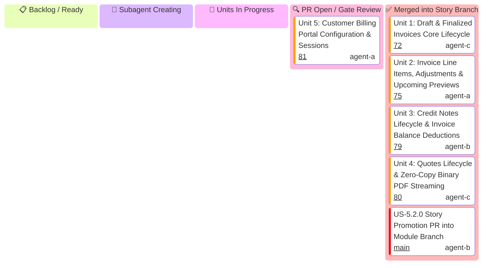

# US-5.2.0: Invoices Lifecycle, Credit Notes & Billing Portal — User Story Kanban

Tracks micro-units 1 through 5 for `US-5.2.0` (Invoices Lifecycle, Credit Notes, Quotes & Billing Portal).

> [!IMPORTANT]
> **Mandatory Subagent Spawning State**: The Story Leader MUST transition through the **`spawning[🤖 Subagent Creating]`** column. If idling for >3 minutes, the Main Supervisor Watchdog intervenes.

---

## 1. User Story 5.2.0 Mermaid Kanban

---

## 2. Micro-Unit Task & Gatekeeper Matrix

| Unit ID | Scope & Files | Implementer & Profile | Mandatory Skill | Gatekeeper Council Subagents | Gatekeeper Skills | Branch | Target PR Title |
| :--- | :--- | :--- | :--- | :--- | :--- | :--- | :--- |
| **Unit 1** | `Invoice`, `CreditNote`, `Quote`, `PortalSession` domain entities and status enums | `domain-codegen-specialist` (`agent-c`) | `stripe-docs` | `Code Reviewer` `AppSec Engineer` | `stripe-best-practices` `security-audit` | `feat/us-5.2.0/unit-1-invoice-credit-note-quote-entities` | `feat(us-5.2.0/unit-1): invoice, credit note, quote, and portal domain entities` |
| **Unit 2** | `CreateInvoiceParams`, `CreateCreditNoteParams`, `CreatePortalSessionParams`, bracket serialization | `microkernel-architect` (`agent-a`) | `stripe-docs` | `Code Reviewer` `Rust Refactoring` | `stripe-best-practices` `upgrade-stripe` | `feat/us-5.2.0/unit-2-invoice-credit-note-params-serde` | `feat(us-5.2.0/unit-2): invoice and billing portal parameters and form serde` |
| **Unit 3** | `InvoicesResource` (`finalize`, `pay`, `void`), `CreditNotesResource`, `QuotesResource`, `PortalResource` | `domain-codegen-specialist` (`agent-b`) | `stripe-docs` | `Code Reviewer` `AppSec Engineer` | `stripe-best-practices` `security-audit` | `feat/us-5.2.0/unit-3-invoices-credit-notes-portal-resources` | `feat(us-5.2.0/unit-3): invoices, credit notes, quotes, and billing portal resources` |
| **Unit 4** | `stripe-mock` wire tests: finalize/pay lifecycle, PDF stream reader, EU VAT Directive 2006/112/EC sequential numbering | `API Tester` (`agent-c`) | `stripe-docs` | `Code Reviewer` `AppSec Engineer` | `stripe-best-practices` `security-audit` | `feat/us-5.2.0/unit-4-invoice-portal-mock-wire-test` | `feat(us-5.2.0/unit-4): invoice and billing portal wire mock tests and vat compliance` |
| **Unit 5** | Gate G-Borrow audit, 100% doctests passing, zero-warning clippy/fmt hygiene | `Rust Refactoring Specialist` (`agent-a`) | `upgrade-stripe` | `Code Reviewer` `Technical Writer` | `stripe-best-practices` `stripe-docs` | `feat/us-5.2.0/unit-5-borrow-audit-doctests-gates` | `feat(us-5.2.0/unit-5): zero-clone borrowing audit and documentation gates` |
