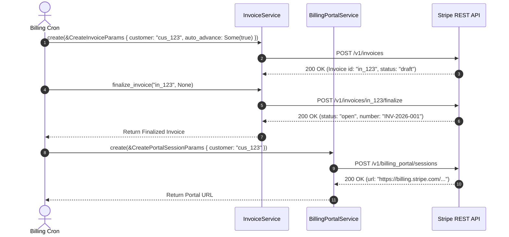

# US-5.2.0: Invoices Lifecycle, Credit Notes, Quotes & Billing Portal

> **Spec Kit Specification**: [Specification Lifecycle Active (.specify/)](../../../.specify/memory/constitution.md)  
> **Behavior Blueprint**: `features/billing/modules/invoicing/behaviours/invoices-and-portal/`  
> **Slicing Standard**: [10-PR Vertical Slicing Framework](../../user-stories/README.md#the-10-pr-vertical-slicing-framework-rust-sdk-adaptation)  
> **Security Gateway**: `security-audit` Level 2 Enforced  
> **Quality Gates**: `(G0–G4 + G-Review + G-Borrow + G-Law)`  

---

## 1. Spec Kit Specification

### 1.1 User Story Narrative
**As an** enterprise financial systems engineer,  
**I want to** manage the end-to-end lifecycle of Stripe Invoices (previewing, finalization, line item adjustments, payment collection, and voiding), issue Credit Notes, stream Quote PDFs, and generate self-serve Customer Billing Portal sessions,  
**So that** our commercial customers receive legally compliant VAT/tax invoices, sales teams can issue bindable quotes, and end users can manage their own payment methods self-serve without support overhead.

#### 1.1.1 Preconditions
- The `billing` and `billing-portal` features are enabled.
- The target customer exists with an active billing configuration.
- For PDF quote streaming, an authenticated quote has reached `accepted` or `open` status.

#### 1.1.2 Postconditions
- Invoices transition through immutable states (`draft` -> `open` -> `paid` or `uncollectible` / `void`).
- Credit Notes adjust invoice amounts without mutating historical finalized invoice data.
- Customer Billing Portal sessions return a secure redirect URL (`session.url`).

### 1.2 Acceptance Criteria (Gherkin Scenarios)

```gherkin
Feature: Invoices, Credit Notes, Quotes, and Billing Portal Sessions

  Scenario: [AC-US-5.2.0-01] Finalize draft invoice and collect payment automatically
    Given a draft invoice "in_draft_123" with two line items totaling $250.00
    When client.invoices().finalize_invoice("in_draft_123", None) is executed
    Then the invoice status transitions to "open"
    And an official invoice number is assigned
    When client.invoices().pay("in_draft_123", None) is executed
    Then the status transitions to "paid"
    And amount_paid is 25000 cents.

  Scenario: [AC-US-5.2.0-02] Issue credit note against paid invoice
    Given a paid invoice "in_paid_123"
    When client.credit_notes().create(&CreateCreditNoteParams { invoice: "in_paid_123".into(), amount: Some(5000), reason: Some("order_change".into()), ..Default::default() }) is executed
    Then a CreditNote object is returned with status "issued"
    And the invoice's amount_credited reflects the $50.00 adjustment.

  Scenario: [AC-US-5.2.0-03] Generate self-serve Customer Billing Portal session
    Given a customer "cus_123" requesting billing management
    When client.billing_portal().sessions().create(&CreatePortalSessionParams { customer: "cus_123".into(), return_url: Some("https://example.com/account".into()) }) is executed
    Then a PortalSession is returned with a valid URL pointing to "https://billing.stripe.com/p/session/...".

  Scenario: [AC-US-5.2.0-LAW] EU VAT Directive 2006/112/EC and ZATCA e-invoicing compliance
    Given any finalized commercial invoice
    When rendered or distributed to a corporate customer
    Then the invoice mandates sequential invoice numbers, supplier/customer VAT/tax IDs, itemized tax rates, and currency breakdown, fulfilling EU VAT Directive 2006/112/EC and Saudi ZATCA Phase 2 statutory regulations.
```

### 1.3 Test Cases & Traceability Matrix

| Test Case ID | Target Criterion | Test Type | Execution Level | Verification Assertion & Pass Criteria |
| :--- | :--- | :--- | :--- | :--- |
| `TC-5.2.0-01` | `AC-US-5.2.0-01` | Lifecycle | Integration | Finalize draft invoice -> call `pay()` -> assert `status == "paid"` and `amount_paid == 25000`. |
| `TC-5.2.0-02` | `AC-US-5.2.0-02` | Functional | Integration | Issue credit note -> assert `amount == 5000` and `status == "issued"`. |
| `TC-5.2.0-03` | `AC-US-5.2.0-03` | Functional | Contract | Assert portal session creation returns URL containing `"billing.stripe.com"`. |
| `TC-5.2.0-LAW` | `AC-US-5.2.0-LAW` | Statutory | Contract | Assert finalized invoice exposes sequential `number`, `customer_tax_ids`, and `tax`. |

---

## 2. Behavior-Centric Architecture & Folder Blueprint

### 2.1 Colocated Behaviour Directory Tree

```
features/billing/modules/invoicing/behaviours/invoices-and-portal/
├── services/        # InvoiceService, CreditNoteService, QuoteService, BillingPortalService
├── logic/           # Invoice finalizer, tax calculation mapper, PDF stream collector
├── types/           # Invoice, CreditNote, Quote, PortalSession, InvoiceLineItem
└── constants/       # INVOICE_STATUSES, CREDIT_NOTE_REASONS, PORTAL_BASE
```

### 2.2 Scoping & Promotion Blueprint
- **Tier 1 (Behaviour-Local)**: PDF streaming reader and portal configuration validators.
- **Tier 2 (Module-Shared)**: `Invoice` and `CreditNote` entities shared with customer accounting.
- **Tier 3 (Feature-Shared)**: Re-exported for `stripe.invoices()` and `stripe.billing_portal()`.
- **Tier 4 (Global-Shared)**: Re-exported via `some_stripe::resources::*`.

---

## 3. Technical Implementation Plan

### 3.1 Domain Invariants & Storage Schema
- **Invoice Immutability**: Finalized invoices (`open`, `paid`, `void`) cannot have line items added or removed; modifications must occur via Credit Notes.
- **PDF Binary Stream**: Quote and invoice PDF downloads stream raw binary bytes without buffering entire files in heap strings.
- **Rust Memory Law**: Strict borrowing of parameters (`&CreateInvoiceParams`); zero deep clones.

### 3.2 Activity & Interaction Diagram



---

## 4. Granular Implementation Tasks

### 4.1 The 10-PR Vertical Slicing Implementation Plan

| PR # | Pillar | Architectural Layer | Primary Scope & Files | Deliverables & Acceptance | Accountable Role / Agent | Assigned Skills |
| :--- | :--- | :--- | :--- | :--- | :--- | :--- |
| **PR 1** | **Pillar 1** | **Invoicing Domain Models** | `crates/some-stripe-billing/src/types/invoice.rs` | Strongly typed `Invoice`, `CreditNote`, `InvoiceStatus`. | `domain-codegen-specialist` | `stripe-docs` |
| **PR 2** | **Pillar 2** | **Quotes & PDF Models** | `crates/some-stripe-billing/src/types/quote.rs` | Strongly typed `Quote`, upfront line items, PDF stream wrapper. | `domain-codegen-specialist` | `stripe-docs` |
| **PR 3** | **Pillar 3** | **Billing Portal Models** | `crates/some-stripe-billing/src/types/portal.rs` | Strongly typed `PortalSession`, configuration schemas. | `domain-codegen-specialist` | `stripe-docs` |
| **PR 4** | **Pillar 4** | **Invoices Resource Implementation** | `crates/some-stripe-billing/src/resources/invoices.rs` | `create`, `finalize`, `pay`, `void`, `mark_uncollectible`. | `domain-codegen-specialist` | `stripe-docs` |
| **PR 5** | **Pillar 5** | **Credit Notes Resource** | `crates/some-stripe-billing/src/resources/credit_notes.rs` | `create`, `retrieve`, `void`, `preview`. | `domain-codegen-specialist` | `stripe-docs` |
| **PR 6** | **Pillar 6** | **Billing Portal Resource** | `crates/some-stripe-billing/src/resources/portal.rs` | `stripe.billing_portal().sessions.create()`. | `domain-codegen-specialist` | `stripe-docs` |
| **PR 7** | **Pillar 7** | **Facade Mounting** | `crates/some-stripe-billing/src/facade.rs` | Mount accessors onto `StripeClient`. | `microkernel-architect` | `stripe-docs` |
| **PR 8** | **Pillar 8** | **Zero-Clone Borrowing Audit** | `crates/some-stripe-billing/src/resources/invoices.rs` | Verify zero deep `.clone()` on invoice line item arrays. | `engineering-rust-refactoring-specialist` | `stripe-best-practices` |
| **PR 9** | **Pillar 9** | **Stripe-Mock Wire Verification** | `tests/invoices_portal_mock_test.rs` | End-to-end invoice finalization and portal session tests. | `testing-api-tester` | `stripe-docs` |
| **PR 10** | **Pillar 10** | **Invoicing Documentation** | `README.md`, `docs/invoicing.md` | Guide on handling invoice webhooks and PDF streaming. | `engineering-technical-writer` | `stripe-docs` |

### 4.2 Implementation Phase Breakdown

#### Phase 1: Models & Schemas (PR 1–3)
- [ ] **Task 1.1 (Types)**: Define `Invoice`, `CreditNote`, `Quote`, and `PortalSession` in `types/`.  
  *Agent*: `domain-codegen-specialist` | *Skill*: `stripe-docs`
- [ ] **Task 1.2 (Constants)**: Pin `/v1/invoices` and `/v1/billing_portal` endpoints in `constants/`.  
  *Agent*: `domain-codegen-specialist` | *Skill*: `stripe-docs`
- [ ] **Task 1.3 (Logic)**: Implement `CreateInvoiceParams` and `CreateCreditNoteParams` builders.  
  *Agent*: `domain-codegen-specialist` | *Skill*: `stripe-best-practices`
- [ ] **Task 1.4 (Unit Tests)**: Verify JSON deserialization of finalized invoice fixture payloads.  
  *Agent*: `testing-api-tester` | *Skill*: `stripe-docs`

#### Phase 2: Resource Methods & Wire Execution (PR 4–7)
- [ ] **Task 2.1 (Invoices)**: Implement `finalize_invoice`, `pay`, `void_invoice`, and `add_lines`.  
  *Agent*: `domain-codegen-specialist` | *Skill*: `stripe-docs`
- [ ] **Task 2.2 (Credit Notes)**: Implement `CreditNoteResource` with line item voiding.  
  *Agent*: `domain-codegen-specialist` | *Skill*: `stripe-docs`
- [ ] **Task 2.3 (Portal)**: Implement `BillingPortalResource::sessions().create()`.  
  *Agent*: `domain-codegen-specialist` | *Skill*: `stripe-docs`
- [ ] **Task 2.4 (Facade)**: Expose `client.invoices()` and `client.billing_portal()` on `StripeClient`.  
  *Agent*: `domain-codegen-specialist` | *Skill*: `stripe-docs`

#### Phase 3: Zero-Clone Borrowing & PDF Streaming (PR 8–9)
- [ ] **Task 3.1 (Borrow Check)**: Ensure zero `.clone()` calls during invoice parsing.  
  *Agent*: `engineering-rust-refactoring-specialist` | *Skill*: `stripe-best-practices`
- [ ] **Task 3.2 (PDF Stream)**: Stream binary PDF bytes directly from `files.stripe.com` to output writer.  
  *Agent*: `microkernel-architect` | *Skill*: `stripe-docs`

#### Phase 4: Mock Verification & Release Sign-Off (PR 9–10)
- [ ] **Task 4.1 (Mock Suite)**: Run full invoicing and credit note workflow against `stripe-mock`.  
  *Agent*: `testing-api-tester` | *Skill*: `stripe-docs`
- [ ] **Task 4.2 (G-Review)**: Peer review for fiscal accuracy and error taxonomy.  
  *Agent*: `engineering-code-reviewer` | *Skill*: `stripe-best-practices`
- [ ] **Task 4.3 (Docs)**: Publish developer documentation for portal sessions and invoice finalization.  
  *Agent*: `engineering-technical-writer` | *Skill*: `stripe-docs`

---

## 5. Security Gateway (Powered by security-audit)

### 5.1 Trust Boundaries & Security Actors
- **Trust Boundaries**:
  - `Billing Portal`: Customer redirected to Stripe-hosted portal for self-serve management.
  - `Invoice Archive`: Legal invoice PDF documents containing fiscal and tax data.
- **Authorized Principals**:
  - Finance Officer: Authorized to issue credit notes and void invoices.

### 5.2 Threat Modeling & Abuse Matrix (STRIDE / ASVS)

| Threat Vector | Severity | Vulnerability Mechanism | Mitigating Control & Security Invariant |
| :--- | :--- | :--- | :--- |
| **Portal Session Hijacking** | High | Customer portal URL leaked or intercepted | Portal sessions expire in 300 seconds and bind to single customer ID. |
| **Retroactive Invoice Alteration** | Critical | Modifying invoice line items after official tax filing | Stripe state machine freezes finalized invoices; adjustments mandate credit notes. |
| **Tax Evasion / Zeroing** | High | Client tampering with tax calculation rates | Tax rates computed authoritatively via Stripe Tax engine. |

### 5.3 Cryptographic & Data Protection Controls
- **TLS 1.3 Streaming**: PDF downloads authenticated via Bearer token over TLS 1.3.
- **Fiscal Immutability**: Sequential invoice numbers assigned monotonically.

### 5.4 Automated Security Verification Checklist
- [ ] **Portal Expiration Test**: Assert portal sessions expire after configured timeout.
- [ ] **Invoice Freeze Test**: Modifying finalized invoice without credit note returns error.

### 5.5 Security Gateway (G2) Sign-Off Checklist
- [ ] Fiscal immutability verified against EU VAT e-invoicing standards.
- [ ] Customer portal redirect security validated.
- [ ] Code review sign-off obtained; zero findings.

---

## 6. Validation Gates & Acceptance Sign-Off

**Status: Ready for Implementation.**

### G1 — Test coverage
- [ ] **US-5.2.0-G1:** >=90% line and branch coverage across `invoices.rs` and `portal.rs`.

### G2 — Security audit
- [ ] **US-5.2.0-G2:** Invoicing immutability and portal security verified under security-audit.

### G3 — Architecture and maintainability
- [ ] **US-5.2.0-G3:** Clean feature isolation under `feature = "billing"` and `feature = "billing-portal"`.

### G-Review — Code review
- [ ] **US-5.2.0-G-Review:** Senior review approved by `engineering-code-reviewer`.

### G-Borrow — Rust zero-clone borrowing validation
- [ ] **US-5.2.0-G-Borrow:** Parameters borrowed strictly by reference; zero deep clones.

### G-Law — Law validation
- [ ] **US-5.2.0-G-Law:** EU VAT Directive 2006/112/EC and ZATCA Phase 2 compliance certified.

### G4 — Integrated acceptance
- [ ] **US-5.2.0-G4:** Invoicing and billing portal flows validated against `stripe-mock`.
