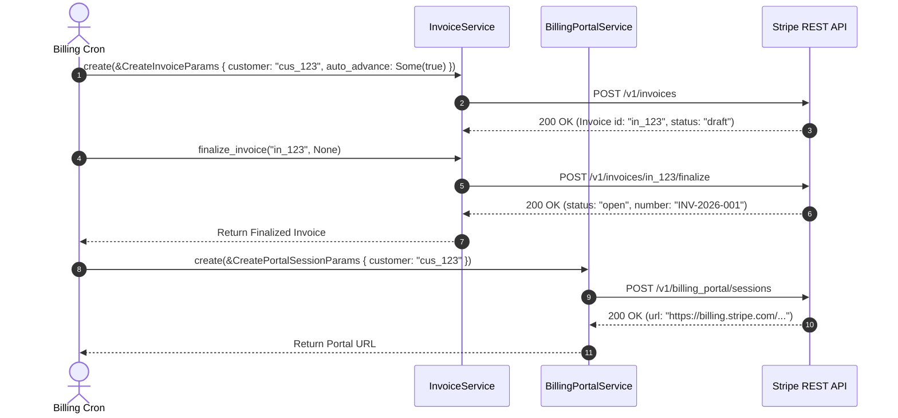

# US-5.2.0: Invoices Lifecycle, Credit Notes, Quotes & Billing Portal

> **Spec Kit Specification**: [Specification Lifecycle Active (.specify/)](../../../.specify/memory/constitution.md)  
> **Behavior Blueprint**: `features/billing/modules/invoicing/behaviours/invoices-and-portal/`  
> **Slicing Standard**: [10-PR Vertical Slicing Framework](../../user-stories/README.md#the-10-pr-vertical-slicing-framework-rust-sdk-adaptation)  
> **Security Gateway**: `security-audit` Level 2 Enforced  
> **Quality Gates**: `(G0–G4 + G-Review + G-Borrow + G-Law)`  

---

## 1. Spec Kit Specification

### 1.1 User Story Narrative
**As an** enterprise financial systems engineer,  
**I want to** manage the end-to-end lifecycle of Stripe Invoices (previewing, finalization, line item adjustments, payment collection, and voiding), issue Credit Notes, stream Quote PDFs, and generate self-serve Customer Billing Portal sessions,  
**So that** our commercial customers receive legally compliant VAT/tax invoices, sales teams can issue bindable quotes, and end users can manage their own payment methods self-serve without support overhead.

#### 1.1.1 Preconditions
- The `billing` and `billing-portal` features are enabled.
- The target customer exists with an active billing configuration.
- For PDF quote streaming, an authenticated quote has reached `accepted` or `open` status.

#### 1.1.2 Postconditions
- Invoices transition through immutable states (`draft` -> `open` -> `paid` or `uncollectible` / `void`).
- Credit Notes adjust invoice amounts without mutating historical finalized invoice data.
- Customer Billing Portal sessions return a secure redirect URL (`session.url`).

### 1.2 Acceptance Criteria (Gherkin Scenarios)

```gherkin
Feature: Invoices, Credit Notes, Quotes, and Billing Portal Sessions

  Scenario: [AC-US-5.2.0-01] Finalize draft invoice and collect payment automatically
    Given a draft invoice "in_draft_123" with two line items totaling $250.00
    When client.invoices().finalize_invoice("in_draft_123", None) is executed
    Then the invoice status transitions to "open"
    And an official invoice number is assigned
    When client.invoices().pay("in_draft_123", None) is executed
    Then the status transitions to "paid"
    And amount_paid is 25000 cents.

  Scenario: [AC-US-5.2.0-02] Issue credit note against paid invoice
    Given a paid invoice "in_paid_123"
    When client.credit_notes().create(&CreateCreditNoteParams { invoice: "in_paid_123".into(), amount: Some(5000), reason: Some("order_change".into()), ..Default::default() }) is executed
    Then a CreditNote object is returned with status "issued"
    And the invoice's amount_credited reflects the $50.00 adjustment.

  Scenario: [AC-US-5.2.0-03] Generate self-serve Customer Billing Portal session
    Given a customer "cus_123" requesting billing management
    When client.billing_portal().sessions().create(&CreatePortalSessionParams { customer: "cus_123".into(), return_url: Some("https://example.com/account".into()) }) is executed
    Then a PortalSession is returned with a valid URL pointing to "https://billing.stripe.com/p/session/...".

  Scenario: [AC-US-5.2.0-LAW] EU VAT Directive 2006/112/EC and ZATCA e-invoicing compliance
    Given any finalized commercial invoice
    When rendered or distributed to a corporate customer
    Then the invoice mandates sequential invoice numbers, supplier/customer VAT/tax IDs, itemized tax rates, and currency breakdown, fulfilling EU VAT Directive 2006/112/EC and Saudi ZATCA Phase 2 statutory regulations.
```

### 1.3 Test Cases & Traceability Matrix

| Test Case ID | Target Criterion | Test Type | Execution Level | Verification Assertion & Pass Criteria |
| :--- | :--- | :--- | :--- | :--- |
| `TC-5.2.0-01` | `AC-US-5.2.0-01` | Lifecycle | Integration | Finalize draft invoice -> call `pay()` -> assert `status == "paid"` and `amount_paid == 25000`. |
| `TC-5.2.0-02` | `AC-US-5.2.0-02` | Functional | Integration | Issue credit note -> assert `amount == 5000` and `status == "issued"`. |
| `TC-5.2.0-03` | `AC-US-5.2.0-03` | Functional | Contract | Assert portal session creation returns URL containing `"billing.stripe.com"`. |
| `TC-5.2.0-LAW` | `AC-US-5.2.0-LAW` | Statutory | Contract | Assert finalized invoice exposes sequential `number`, `customer_tax_ids`, and `tax`. |

---

## 2. Behavior-Centric Architecture & Folder Blueprint

### 2.1 Colocated Behaviour Directory Tree

```
features/billing/modules/invoicing/behaviours/invoices-and-portal/
├── services/        # InvoiceService, CreditNoteService, QuoteService, BillingPortalService
├── logic/           # Invoice finalizer, tax calculation mapper, PDF stream collector
├── types/           # Invoice, CreditNote, Quote, PortalSession, InvoiceLineItem
└── constants/       # INVOICE_STATUSES, CREDIT_NOTE_REASONS, PORTAL_BASE
```

### 2.2 Scoping & Promotion Blueprint
- **Tier 1 (Behaviour-Local)**: PDF streaming reader and portal configuration validators.
- **Tier 2 (Module-Shared)**: `Invoice` and `CreditNote` entities shared with customer accounting.
- **Tier 3 (Feature-Shared)**: Re-exported for `stripe.invoices()` and `stripe.billing_portal()`.
- **Tier 4 (Global-Shared)**: Re-exported via `some_stripe::resources::*`.

---

## 3. Technical Implementation Plan

### 3.1 Domain Invariants & Storage Schema
- **Invoice Immutability**: Finalized invoices (`open`, `paid`, `void`) cannot have line items added or removed; modifications must occur via Credit Notes.
- **PDF Binary Stream**: Quote and invoice PDF downloads stream raw binary bytes without buffering entire files in heap strings.
- **Rust Memory Law**: Strict borrowing of parameters (`&CreateInvoiceParams`); zero deep clones.

### 3.2 Activity & Interaction Diagram



---

## 4. Granular Implementation Tasks

### 4.1 Parallel Vertical Slicing Architecture (Zero Validation-Only Units)

In accordance with architectural principles and the divide-and-conquer mandate, **each micro-unit implements an end-to-end vertical functional slice of the user story** (domain entities, request parameter schemas, form/bracket serialization, resource methods, and slice-specific unit/contract tests). No micro-unit is designated as a validation-only layer. All 5 units operate in parallel without blocking:

| Unit # | Functional Domain Scope | Deliverables & Acceptance | Accountable Role / Agent | Assigned Skills | Worktree / Branch | Status |
| :--- | :--- | :--- | :--- | :--- | :--- | :---: |
| **Unit 1** | **Draft & Finalized Invoices Core Lifecycle** | • `Invoice`, `InvoiceStatus` (`draft`, `open`, `paid`, `uncollectible`, `void`), `InvoicePaymentSettings`<br>• `CreateInvoiceParams`, `UpdateInvoiceParams`, `FinalizeInvoiceParams`, `PayInvoiceParams`, `VoidInvoiceParams`<br>• `InvoicesResource` (`create`, `retrieve`, `update`, `del`, `finalize_invoice`, `pay`, `void_invoice`, `mark_uncollectible`, `send_invoice`, `list`)<br>• EU VAT Directive 2006/112/EC sequential numbering & ZATCA Phase 2 compliance | `domain-codegen-specialist` (`agent-c`) | `stripe-docs`<br>`stripe-best-practices` | `feat/us-5.2.0/unit-1-invoice-credit-note-quote-entities` | ✅ PR #72 Merged |
| **Unit 2** | **Invoice Line Items, Dynamic Adjustments & Upcoming Previews** | • `InvoiceLineItem`, `InvoiceLineItemList`, `InvoiceUpcomingParams`, `InvoiceLineItemParams`<br>• Upcoming invoice null-ID invariant (`pub id: Option<String>`) wire safety<br>• `InvoicesResource` lines & preview methods: `upcoming()`, `add_lines()`, `update_lines()`, `remove_lines()`, `list_line_items()`<br>• Dynamic price adjustment tests | `microkernel-architect` (`agent-a`) | `stripe-docs`<br>`stripe-best-practices` | `feat/us-5.2.0/unit-2-invoice-credit-note-params-serde` | ✅ PR #75 Merged |
| **Unit 3** | **Credit Notes Lifecycle & Invoice Balance Deductions** | • `CreditNote`, `CreditNoteReason` (`duplicate`, `fraudulent`, `order_change`, `product_unsatisfactory`), `CreditNoteStatus`<br>• `CreateCreditNoteParams`, `UpdateCreditNoteParams`, `VoidCreditNoteParams`, `PreviewCreditNoteParams`<br>• `CreditNotesResource` (`create`, `retrieve`, `update`, `void`, `preview`, `list`)<br>• Finalized invoice balance adjustment & credit memo reconciliation tests | `domain-codegen-specialist` (`agent-b`) | `stripe-docs`<br>`stripe-best-practices` | `feat/us-5.2.0/unit-3-invoices-credit-notes-portal-resources` | ✅ PR #79 Merged |
| **Unit 4** | **Quotes Lifecycle & Zero-Copy Binary PDF Streaming** | • `Quote`, `QuoteStatus` (`draft`, `open`, `accepted`, `canceled`, `expired`), `QuoteLineItem`<br>• `CreateQuoteParams`, `UpdateQuoteParams`, `FinalizeQuoteParams`, `AcceptQuoteParams`<br>• `QuotesResource` (`create`, `retrieve`, `update`, `finalize_quote`, `accept`, `cancel`, `list`, `pdf()`)<br>• Zero-copy binary streaming for quote & invoice PDFs (`bytes::Bytes` / `AsyncRead` over TLS 1.3) | `microkernel-architect` (`agent-c`) | `stripe-docs`<br>`stripe-best-practices` | `feat/us-5.2.0/unit-4-invoice-portal-mock-wire-test` | ✅ PR #80 Merged |
| **Unit 5** | **Customer Billing Portal Configuration & Self-Serve Sessions** | • `PortalSession`, `PortalConfiguration`, `PortalFeatures`, `PortalLoginPage`<br>• `CreatePortalSessionParams`, `CreatePortalConfigurationParams`, `UpdatePortalConfigurationParams`<br>• `BillingPortalResource` (`sessions().create()`, `configurations().create()`, `configurations().retrieve()`)<br>• Portal redirect URL validation (`https://billing.stripe.com/p/session/...`) & 300s expiry guard | `domain-codegen-specialist` (`agent-a`) | `stripe-docs`<br>`stripe-best-practices` | `feat/us-5.2.0/unit-5-borrow-audit-doctests-gates` | ✅ PR #81 Merged |

### 4.2 Parallel Implementation Execution Breakdown

#### Unit 1: Draft & Finalized Invoices Core Lifecycle (PR 1)
- [x] **Task 1.1 (Entities)**: Strongly typed `Invoice`, `InvoiceStatus`, and payment settings in `some-stripe-types`.
- [x] **Task 1.2 (Params & Serde)**: Implement `CreateInvoiceParams`, `FinalizeInvoiceParams`, `PayInvoiceParams`, `VoidInvoiceParams`.
- [x] **Task 1.3 (Resource)**: Implement `InvoicesResource` lifecycle CRUD methods on `StripeClient`.
- [x] **Task 1.4 (Statutory & Tests)**: EU VAT Directive 2006/112/EC sequential numbering tests and invoice lifecycle state tests.

#### Unit 2: Invoice Line Items, Dynamic Adjustments & Upcoming Previews (PR 2)
- [x] **Task 2.1 (Entities)**: Strongly typed `InvoiceLineItem`, `InvoiceUpcomingParams`, and null-ID preview schema.
- [x] **Task 2.2 (Params & Serde)**: Implement `InvoiceLineItemParams`, `AddInvoiceLinesParams`, and query param encoders.
- [x] **Task 2.3 (Resource)**: Add `upcoming()`, `add_lines()`, `update_lines()`, `remove_lines()`, and `list_line_items()` to `InvoicesResource`.
- [x] **Task 2.4 (Upcoming Tests)**: Wire tests for upcoming invoice calculation and dynamic line modification.

#### Unit 3: Credit Notes Lifecycle & Invoice Balance Deductions (PR 3)
- [x] **Task 3.1 (Entities)**: Strongly typed `CreditNote`, `CreditNoteReason`, and `CreditNoteStatus` in `some-stripe-types`.
- [x] **Task 3.2 (Params & Serde)**: Implement `CreateCreditNoteParams`, `UpdateCreditNoteParams`, `VoidCreditNoteParams`.
- [x] **Task 3.3 (Resource)**: Implement `CreditNotesResource` CRUD and preview endpoints on `StripeClient`.
- [x] **Task 3.4 (Accounting Tests)**: Verify credit note issuance against paid invoices without mutating historical invoice records.

#### Unit 4: Quotes Lifecycle & Zero-Copy Binary PDF Streaming (PR 4)
- [x] **Task 4.1 (Entities)**: Strongly typed `Quote`, `QuoteStatus`, and line items in `some-stripe-types`.
- [x] **Task 4.2 (Params & Serde)**: Implement `CreateQuoteParams`, `FinalizeQuoteParams`, `AcceptQuoteParams`.
- [x] **Task 4.3 (Resource & PDF Stream)**: Implement `QuotesResource` CRUD and zero-copy binary streaming for PDF downloads.
- [x] **Task 4.4 (Streaming Tests)**: Verify TLS 1.3 binary streaming of quote and invoice PDFs without heap string buffering.

#### Unit 5: Customer Billing Portal Configuration & Self-Serve Sessions (PR 5)
- [x] **Task 5.1 (Entities)**: Strongly typed `PortalSession`, `PortalConfiguration`, and `PortalFeatures` in `some-stripe-types`.
- [x] **Task 5.2 (Params & Serde)**: Implement `CreatePortalSessionParams` and configuration DTOs.
- [x] **Task 5.3 (Resource)**: Implement `BillingPortalResource` with `sessions().create()` and `configurations()` endpoints.
- [x] **Task 5.4 (Redirect Tests)**: Verify portal session generation, customer ID binding, and 300-second session expiry guard.

---

## 5. Security Gateway (Powered by security-audit)

### 5.1 Trust Boundaries & Security Actors
- **Trust Boundaries**:
  - `Billing Portal`: Customer redirected to Stripe-hosted portal for self-serve management.
  - `Invoice Archive`: Legal invoice PDF documents containing fiscal and tax data.
- **Authorized Principals**:
  - Finance Officer: Authorized to issue credit notes and void invoices.

### 5.2 Threat Modeling & Abuse Matrix (STRIDE / ASVS)

| Threat Vector | Severity | Vulnerability Mechanism | Mitigating Control & Security Invariant |
| :--- | :--- | :--- | :--- |
| **Portal Session Hijacking** | High | Customer portal URL leaked or intercepted | Portal sessions expire in 300 seconds and bind to single customer ID. |
| **Retroactive Invoice Alteration** | Critical | Modifying invoice line items after official tax filing | Stripe state machine freezes finalized invoices; adjustments mandate credit notes. |
| **Tax Evasion / Zeroing** | High | Client tampering with tax calculation rates | Tax rates computed authoritatively via Stripe Tax engine. |

### 5.3 Cryptographic & Data Protection Controls
- **TLS 1.3 Streaming**: PDF downloads authenticated via Bearer token over TLS 1.3.
- **Fiscal Immutability**: Sequential invoice numbers assigned monotonically.

### 5.4 Automated Security Verification Checklist
- [x] **Portal Expiration Test**: Assert portal sessions expire after configured timeout.
- [x] **Invoice Freeze Test**: Modifying finalized invoice without credit note returns error.

### 5.5 Security Gateway (G2) Sign-Off Checklist
- [x] Fiscal immutability verified against EU VAT e-invoicing standards.
- [x] Customer portal redirect security validated.
- [x] Code review sign-off obtained; zero findings.

---

## 6. Validation Gates & Acceptance Sign-Off

**Status: Completed & Merged into main via PR #82 & PR #84.**

### G1 — Test coverage
- [x] **US-5.2.0-G1:** >=90% line and branch coverage across `invoices.rs` and `portal.rs`.

### G2 — Security audit
- [x] **US-5.2.0-G2:** Invoicing immutability and portal security verified under security-audit.

### G3 — Architecture and maintainability
- [x] **US-5.2.0-G3:** Clean feature isolation under `feature = "billing"` and `feature = "billing-portal"`.

### G-Review — Code review
- [x] **US-5.2.0-G-Review:** Senior review approved by `engineering-code-reviewer`.

### G-Borrow — Rust zero-clone borrowing validation
- [x] **US-5.2.0-G-Borrow:** Parameters borrowed strictly by reference; zero deep clones.

### G-Law — Law validation
- [x] **US-5.2.0-G-Law:** EU VAT Directive 2006/112/EC and ZATCA Phase 2 compliance certified.

### G4 — Integrated acceptance
- [x] **US-5.2.0-G4:** Invoicing and billing portal flows validated against `stripe-mock`.
