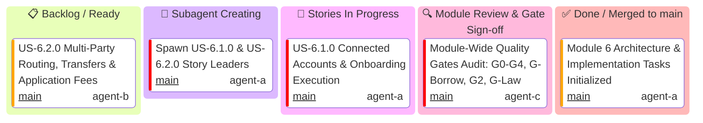
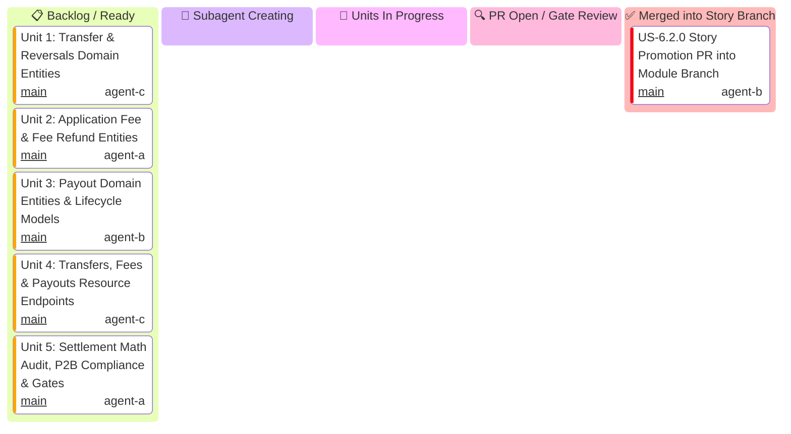

# Module 6: Connect & Marketplaces — Hierarchical Multi-Tier Kanban Boards

This document serves as the master Kanban tracking system for **Module 6 (Connect & Marketplaces)**, organized into distinct tier-specific Kanban boards:
1. **Module Level Executive Kanban**: Tracks high-level milestones, story promotion merges, and final release into `main`.
2. **User Story 6.1.0 Kanban**: Tracks the 5 parallel vertical functional micro-units of Connected Accounts, AccountLinks, AccountSessions & KYC Persons.
3. **User Story 6.2.0 Kanban**: Tracks the 5 parallel vertical functional micro-units of Multi-Party Payment Routing, Transfers, Application Fees & Payouts.

> [!IMPORTANT]
> **Strict Hierarchical Delegation Invariant**:
> - **The Module Leader generates ONLY User Story Leaders** (`US-6.1.0 Story Leader`, `US-6.2.0 Story Leader`). The Module Leader is **STRICTLY PROHIBITED** from generating Unit Implementers directly.
> - **Each User Story Leader generates its own 5 Unit Implementers** (`Unit 1`, `Unit 2`, `Unit 3`, `Unit 4`, `Unit 5`).
> - **Dedicated Quota Sentinel**: `quota-sentinel` monitors API quota continuously. At 1% remaining quota or 429 warnings, it broadcasts an alert and enforces a wait timer until quota resets.
> - **End-of-Module Whole-Codebase Review**: At the main conversation level, upon module completion, full verification (`cargo test --workspace`, `cargo test --doc`, `cargo clippy`, `cargo fmt`) and independent Gatekeeper review is executed across Modules 1..6.

---

## 1. Module Level Executive Kanban

Tracks module-wide promotion PRs, integration gates, and merging into `main`.



---

## 2. User Story 6.1.0 Kanban (Connected Accounts, Links, Sessions & KYC)

Tracks micro-units 1 through 5 for `US-6.1.0`.

```mermaid
---
config:
  kanban:
    ticketBaseUrl: 'https://github.com/some-of-cs/some-stripe/pull/#TICKET#'
---
kanban
  todo[📋 Backlog / Ready]
    u612[Unit 2: Account Links & Embedded Account Sessions (PR TBD)]@{ ticket: 'main', assigned: 'agent-b', priority: 'High' }
    u613[Unit 3: KYC Person Entities & Beneficial Ownership (PR TBD)]@{ ticket: 'main', assigned: 'agent-c', priority: 'High' }
    u615[Unit 5: Borrow Audit, Multi-Tenant Isolation & Gates (PR TBD)]@{ ticket: 'main', assigned: 'agent-b', priority: 'High' }
  spawning[🤖 Subagent Creating]
  in_progress[🔄 Units In Progress]
    u611[Unit 1: Connect Account Domain Entities & Requirements]@{ ticket: 'main', assigned: 'agent-a', priority: 'High' }
    u614[Unit 4: Accounts, Links, Sessions & Persons Resources (PR TBD)]@{ ticket: 'main', assigned: 'agent-a', priority: 'High' }
  review[🔍 PR Open / Gate Review]
  done[✅ Merged into Story Branch]
    s61_pr[US-6.1.0 Story Promotion PR into Module Branch]@{ ticket: 'main', assigned: 'agent-a', priority: 'Very High' }
```

---

## 3. User Story 6.2.0 Kanban (Transfers, Fees & Payouts)

Tracks micro-units 1 through 5 for `US-6.2.0`.



---

## 4. Master Task, Branch, PR, Gatekeeper Subagents & Skills Matrix

| Task ID | Level | Mandatory PR Title Format | Implementer & Profile | Implementer Skill | Gatekeeper Council Subagents | Gatekeeper Skills | Worktree Directory | Branch | Status |
| :--- | :---: | :--- | :--- | :--- | :--- | :--- | :--- | :--- | :---: |
| **M6-SETUP** | Module | `N/A (Baseline Commit)` | `Supervisor` (`agent-a`) | `antigravity-guide` | `Git Workflow Master` | `stripe-best-practices` | `.worktrees/feat-module-6-connect-and-marketplaces` | `feat/module-6-connect-and-marketplaces` | 🔄 In Progress |
| **US-6.1.0** | Story | `feat(us-6.1.0): connected accounts, links, sessions and kyc (Units 1..5 Promotion)` | `US-6.1.0 Story Lead` (`agent-a`) | `connect-recommend` | `Code Reviewer`<br>`API Tester` | `security-audit`<br>`stripe-docs` | `.worktrees/feat-us-6.1.0-connected-accounts-and-embedded-sessions` | `feat/us-6.1.0-connected-accounts-and-embedded-sessions` | 📋 Ready |
| **US-6.1.0/U1** | Unit | `feat(us-6.1.0/unit-1): connect account domain entities and requirements` | `domain-codegen-specialist` (`agent-a`) | `connect-recommend`<br>`stripe-docs` | `Code Reviewer`<br>`AppSec Engineer` | `stripe-best-practices`<br>`security-audit` | `.worktrees/feat-us-6.1.0-unit-1-account-domain-entities` | `feat/us-6.1.0/unit-1-account-domain-entities` | 📋 Ready |
| **US-6.1.0/U2** | Unit | `feat(us-6.1.0/unit-2): account links and embedded account sessions` | `microkernel-architect` (`agent-b`) | `stripe-docs`<br>`stripe-best-practices` | `Code Reviewer`<br>`Rust Refactoring` | `stripe-best-practices`<br>`upgrade-stripe` | `.worktrees/feat-us-6.1.0-unit-2-account-links-and-sessions` | `feat/us-6.1.0/unit-2-account-links-and-sessions` | 📋 Ready |
| **US-6.1.0/U3** | Unit | `feat(us-6.1.0/unit-3): kyc person entities and beneficial ownership` | `domain-codegen-specialist` (`agent-c`) | `connect-required-verification-information` | `Code Reviewer`<br>`AppSec Engineer` | `stripe-best-practices`<br>`security-audit` | `.worktrees/feat-us-6.1.0-unit-3-kyc-persons-entities` | `feat/us-6.1.0/unit-3-kyc-persons-entities` | 📋 Ready |
| **US-6.1.0/U4** | Unit | `feat(us-6.1.0/unit-4): accounts, links, sessions and persons resources` | `microkernel-architect` (`agent-a`) | `stripe-docs`<br>`stripe-best-practices` | `Code Reviewer`<br>`AppSec Engineer` | `stripe-best-practices`<br>`security-audit` | `.worktrees/feat-us-6.1.0-unit-4-accounts-links-sessions-resources` | `feat/us-6.1.0/unit-4-accounts-links-sessions-resources` | 📋 Ready |
| **US-6.1.0/U5** | Unit | `feat(us-6.1.0/unit-5): borrow audit, multi-tenant isolation, doctests and gates` | `Rust Refactoring Specialist` (`agent-b`) | `upgrade-stripe`<br>`security-audit` | `Code Reviewer`<br>`Technical Writer` | `stripe-best-practices`<br>`stripe-docs` | `.worktrees/feat-us-6.1.0-unit-5-borrow-audit-doctests-gates` | `feat/us-6.1.0/unit-5-borrow-audit-doctests-gates` | 📋 Ready |
| **US-6.2.0** | Story | `feat(us-6.2.0): multi-party payment routing, transfers and fees (Units 1..5 Promotion)` | `US-6.2.0 Story Lead` (`agent-b`) | `stripe-best-practices` | `Code Reviewer`<br>`API Tester` | `security-audit`<br>`stripe-docs` | `.worktrees/feat-us-6.2.0-multi-party-transfers-and-application-fees` | `feat/us-6.2.0-multi-party-transfers-and-application-fees` | 📋 Ready |
| **US-6.2.0/U1** | Unit | `feat(us-6.2.0/unit-1): transfer and reversals domain entities` | `domain-codegen-specialist` (`agent-c`) | `stripe-docs`<br>`stripe-best-practices` | `Code Reviewer`<br>`AppSec Engineer` | `stripe-best-practices`<br>`security-audit` | `.worktrees/feat-us-6.2.0-unit-1-transfers-and-reversals-entities` | `feat/us-6.2.0/unit-1-transfers-and-reversals-entities` | 📋 Ready |
| **US-6.2.0/U2** | Unit | `feat(us-6.2.0/unit-2): application fee and fee refund entities` | `microkernel-architect` (`agent-a`) | `stripe-docs`<br>`stripe-best-practices` | `Code Reviewer`<br>`Rust Refactoring` | `stripe-best-practices`<br>`upgrade-stripe` | `.worktrees/feat-us-6.2.0-unit-2-application-fees-and-refunds` | `feat/us-6.2.0/unit-2-application-fees-and-refunds` | 📋 Ready |
| **US-6.2.0/U3** | Unit | `feat(us-6.2.0/unit-3): payout domain entities and lifecycle models` | `domain-codegen-specialist` (`agent-b`) | `stripe-docs`<br>`stripe-best-practices` | `Code Reviewer`<br>`AppSec Engineer` | `stripe-best-practices`<br>`security-audit` | `.worktrees/feat-us-6.2.0-unit-3-payouts-domain-entities` | `feat/us-6.2.0/unit-3-payouts-domain-entities` | 📋 Ready |
| **US-6.2.0/U4** | Unit | `feat(us-6.2.0/unit-4): transfers, fees and payouts resource endpoints` | `microkernel-architect` (`agent-c`) | `stripe-docs`<br>`stripe-best-practices` | `Code Reviewer`<br>`AppSec Engineer` | `stripe-best-practices`<br>`security-audit` | `.worktrees/feat-us-6.2.0-unit-4-transfers-fees-payouts-resources` | `feat/us-6.2.0/unit-4-transfers-fees-payouts-resources` | 📋 Ready |
| **US-6.2.0/U5** | Unit | `feat(us-6.2.0/unit-5): settlement math audit, p2b compliance, doctests and gates` | `Rust Refactoring Specialist` (`agent-a`) | `stripe-best-practices`<br>`security-audit` | `Code Reviewer`<br>`Technical Writer` | `stripe-best-practices`<br>`stripe-docs` | `.worktrees/feat-us-6.2.0-unit-5-settlement-math-borrow-audit-gates` | `feat/us-6.2.0/unit-5-settlement-math-borrow-audit-gates` | 📋 Ready |
| **M6-FINAL** | Module | `feat(module-6): connect and marketplaces` | `Module 6 Lead Architect` (`agent-c`) | `connect-recommend` | Full Council | Council Skills Matrix | `.worktrees/feat-module-6-connect-and-marketplaces` | `feat/module-6-connect-and-marketplaces` | 📋 Ready |
