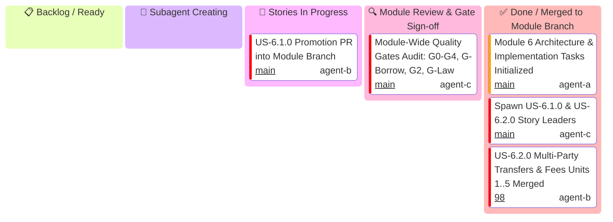

# Module 6: Connect & Marketplaces — Executive Module Kanban

Master high-level tracking for **Module 6 (Connect & Marketplaces)** execution across User Stories `US-6.1.0` and `US-6.2.0`.

> [!IMPORTANT]
> **Strict Hierarchical Delegation Invariant**:
> - **The Module Leader generates ONLY User Story Leaders** (`US-6.1.0 Story Leader`, `US-6.2.0 Story Leader`).
> - The Module Leader is STRICTLY FORBIDDEN from creating Unit Implementers directly.
> - **3-Minute Supervision Schedule**: The Module Leader maintains a 3-minute supervision schedule to track story progress.

---

## 1. Module Level Executive Kanban

---

## 2. Story Promotion & Release Milestone Matrix

| Story ID | Story Title | Story Leader & Profile | Story Branch | Promotion PR Title | Status |
| :--- | :--- | :--- | :--- | :--- | :---: |
| **US-6.1.0** | Connected Accounts Onboarding, AccountSessions & KYC Verification | `US-6.1.0 Story Lead` (`agent-b`) | `feat/us-6.1.0-connected-accounts-and-embedded-sessions` | `feat(us-6.1.0): Connected Accounts, Links, Sessions & KYC (Units 1..5 Promotion)` | 🔍 In Review / Promotion Open |
| **US-6.2.0** | Multi-Party Payment Routing, Transfers & Application Fees | `US-6.2.0 Story Lead` (`agent-b`) | `feat/us-6.2.0-multi-party-transfers-and-application-fees` | `feat(us-6.2.0): Multi-Party Transfers and Application Fees (Units 1..5 Promotion)` | ✅ Merged into Module Branch ([#98](https://github.com/some-of-cs/some-stripe/pull/98)) |
| **MODULE-6** | Connect & Marketplaces Full Release | `Module 6 Lead Architect` (`agent-c`) | `feat/module-6-connect-and-marketplaces` | `feat(module-6): connect and marketplaces` | 🔄 In Progress |
