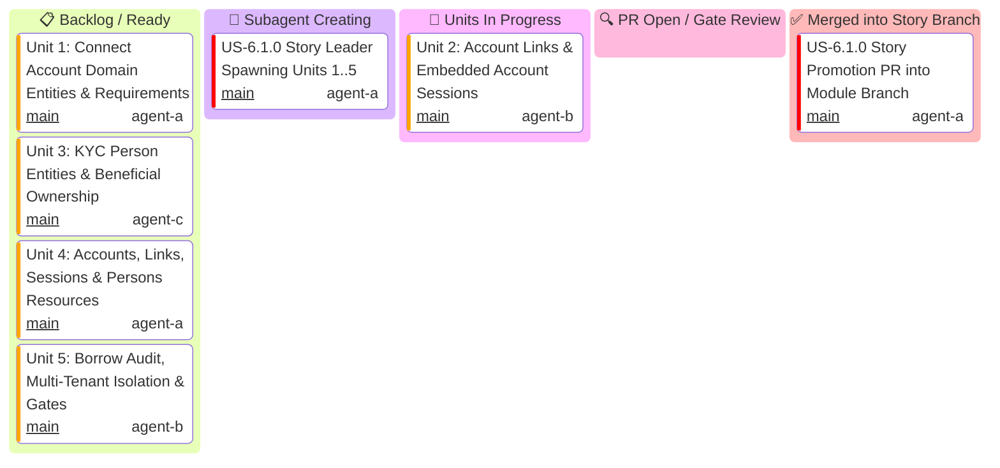

# US-6.1.0: Connected Accounts Onboarding, AccountSessions & KYC Verification — User Story Kanban

Tracks micro-units 1 through 5 for `US-6.1.0` (Connected Accounts, Hosted Account Links, Embedded Account Sessions & KYC Persons).

> [!IMPORTANT]
> **Strict Hierarchical Delegation Invariant**:
> - **The US-6.1.0 Story Leader generates its own 5 Unit Implementers** (`Unit 1`, `Unit 2`, `Unit 3`, `Unit 4`, `Unit 5`).
> - The Module Leader NEVER generates Unit Implementers directly.
> - **1-Minute Supervision Schedule**: The Story Leader maintains a 1-minute supervision schedule to track unit implementers.

---

## 1. User Story 6.1.0 Mermaid Kanban

---

## 2. Micro-Unit Task & Gatekeeper Matrix

| Unit ID | Scope & Files | Implementer & Profile | Mandatory Skill | Gatekeeper Council Subagents | Gatekeeper Skills | Branch | Target PR Title | Status |
| :--- | :--- | :--- | :--- | :--- | :--- | :--- | :--- | :--- |
| **Unit 1** | `Account`, `AccountType`, `AccountCapabilities`, `AccountRequirements`, `CreateAccountParams`, `UpdateAccountParams` in `some-stripe-types` | `domain-codegen-specialist` (`agent-a`) | `connect-recommend` `stripe-docs` | `Code Reviewer` `AppSec Engineer` | `stripe-best-practices` `security-audit` | `feat/us-6.1.0/unit-1-account-domain-entities` | `feat(us-6.1.0/unit-1): connect account domain entities and requirements` | 📋 Ready |
| **Unit 2** | `AccountLink`, `AccountSession`, `AccountSessionComponents`, `CreateAccountLinkParams`, `CreateAccountSessionParams` in `some-stripe-types` | `microkernel-architect` (`agent-b`) | `stripe-docs` `stripe-best-practices` | `Code Reviewer` `Rust Refactoring` | `stripe-best-practices` `upgrade-stripe` | `feat/us-6.1.0/unit-2-account-links-and-sessions` | `feat(us-6.1.0/unit-2): account links and embedded account sessions` | 🔄 In Progress |
| **Unit 3** | `Person`, `PersonRelationship`, `PersonVerification`, `PersonDocuments`, `CreatePersonParams`, `UpdatePersonParams` in `some-stripe-types` | `domain-codegen-specialist` (`agent-c`) | `connect-required-verification-information` | `Code Reviewer` `AppSec Engineer` | `stripe-best-practices` `security-audit` | `feat/us-6.1.0/unit-3-kyc-persons-entities` | `feat(us-6.1.0/unit-3): kyc person entities and beneficial ownership` | 📋 Ready |
| **Unit 4** | Endpoints in `AccountsResource` (`create`, `update`, `del`, `reject`, `list`), `AccountLinksResource`, `AccountSessionsResource`, `PersonsResource` | `microkernel-architect` (`agent-a`) | `stripe-docs` `stripe-best-practices` | `Code Reviewer` `AppSec Engineer` | `stripe-best-practices` `security-audit` | `feat/us-6.1.0/unit-4-accounts-links-sessions-resources` | `feat(us-6.1.0/unit-4): accounts, links, sessions and persons resources` | 📋 Ready |
| **Unit 5** | Zero-clone borrowing audit, `Stripe-Account` tenant isolation, FinCEN CDD / DAC7 compliance tests, doctests, gate validation | `Rust Refactoring Specialist` (`agent-b`) | `upgrade-stripe` `security-audit` | `Code Reviewer` `Technical Writer` | `stripe-best-practices` `stripe-docs` | `feat/us-6.1.0/unit-5-borrow-audit-doctests-gates` | `feat(us-6.1.0/unit-5): borrow audit, multi-tenant isolation, doctests and gates` | 📋 Ready |
