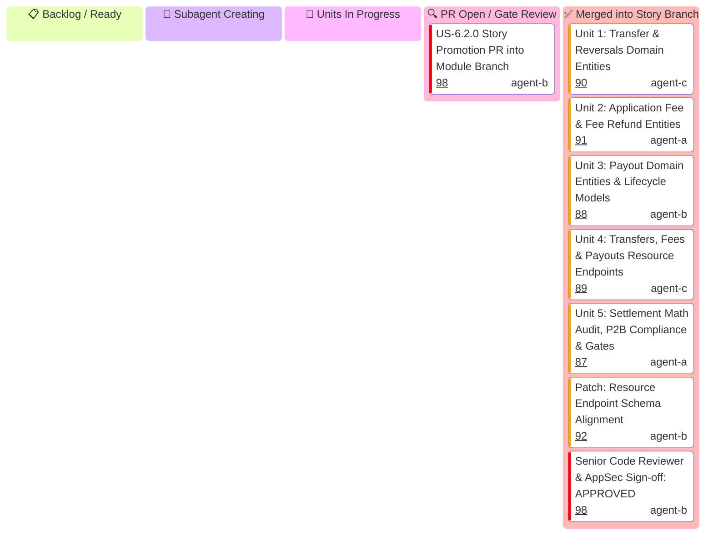

# US-6.2.0: Multi-Party Payment Routing, Transfers & Application Fees — User Story Kanban

Tracks micro-units 1 through 5 for `US-6.2.0` (Separate Charges & Transfers, On-Behalf-Of, Application Fees & Seller Payouts).

> [!IMPORTANT]
> **Strict Hierarchical Delegation Invariant**:
> - **The US-6.2.0 Story Leader generates its own 5 Unit Implementers** (`Unit 1`, `Unit 2`, `Unit 3`, `Unit 4`, `Unit 5`).
> - The Module Leader NEVER generates Unit Implementers directly.
> - **1-Minute Supervision Schedule**: The Story Leader maintains a 1-minute supervision schedule to track unit implementers.

---

## 1. User Story 6.2.0 Mermaid Kanban

---

## 2. Micro-Unit Task & Gatekeeper Matrix

| Unit ID | Scope & Files | Implementer & Profile | Mandatory Skill | Gatekeeper Council Subagents | Gatekeeper Skills | Branch | Target PR Title | Status |
| :--- | :--- | :--- | :--- | :--- | :--- | :--- | :--- | :--- |
| **Unit 1** | `Transfer`, `TransferReversal`, `CreateTransferParams`, `CreateTransferReversalParams` in `some-stripe-types` | `domain-codegen-specialist` (`agent-c`) | `stripe-docs` `stripe-best-practices` | `Code Reviewer` `AppSec Engineer` | `stripe-best-practices` `security-audit` | `feat/us-6.2.0/unit-1-transfers-and-reversals-entities` | `feat(us-6.2.0/unit-1): transfer and reversals domain entities` | ✅ Merged (PR #90) |
| **Unit 2** | `ApplicationFee`, `FeeRefund`, `CreateFeeRefundParams` in `some-stripe-types` | `microkernel-architect` (`agent-a`) | `stripe-docs` `stripe-best-practices` | `Code Reviewer` `Rust Refactoring` | `stripe-best-practices` `upgrade-stripe` | `feat/us-6.2.0/unit-2-application-fees-and-refunds` | `feat(us-6.2.0/unit-2): application fee and fee refund entities` | ✅ Merged (PR #91) |
| **Unit 3** | `Payout`, `PayoutStatus`, `PayoutMethod`, `CreatePayoutParams`, `CancelPayoutParams` in `some-stripe-types` | `domain-codegen-specialist` (`agent-b`) | `stripe-docs` `stripe-best-practices` | `Code Reviewer` `AppSec Engineer` | `stripe-best-practices` `security-audit` | `feat/us-6.2.0/unit-3-payouts-domain-entities` | `feat(us-6.2.0/unit-3): payout domain entities and lifecycle models` | ✅ Merged (PR #88) |
| **Unit 4** | `TransfersResource` (`create`, `retrieve`, `update`, `reverse`, `list`), `ApplicationFeesResource`, `PayoutsResource` in `src/resources/` | `microkernel-architect` (`agent-c`) | `stripe-docs` `stripe-best-practices` | `Code Reviewer` `AppSec Engineer` | `stripe-best-practices` `security-audit` | `feat/us-6.2.0/unit-4-transfers-fees-payouts-resources` | `feat(us-6.2.0/unit-4): transfers, fees and payouts resource endpoints` | ✅ Merged (PR #89) |
| **Unit 5** | Split settlement math verification, EU P2B Regulation 2019/1150 transparency, borrow audit, doctests, gate validation | `Rust Refactoring Specialist` (`agent-a`) | `stripe-best-practices` `security-audit` | `Code Reviewer` `Technical Writer` | `stripe-best-practices` `stripe-docs` | `feat/us-6.2.0/unit-5-settlement-math-borrow-audit-gates` | `feat(us-6.2.0/unit-5): settlement math audit, p2b compliance, doctests and gates` | ✅ Merged (PR #87) |
| **Patch** | Alignment of resource endpoints with domain parameter schemas & UUID v4 idempotency | `patch-implementer` (`agent-b`) | `stripe-best-practices` `security-audit` | `Code Reviewer` `AppSec Engineer` | `stripe-best-practices` `security-audit` | `patch/us-6.2.0-resources-types-alignment` | `fix(us-6.2.0): align resource endpoints with domain parameter schemas` | ✅ Merged (PR #92) |
| **Review** | Formal Gate Sign-off (G0, G-Borrow, G2, G-Law, G1, G4) | `Senior Code Reviewer` (`agent-b`) | `security-audit` `stripe-best-practices` | `Code Reviewer` `AppSec Engineer` | `stripe-best-practices` `security-audit` | `feat/us-6.2.0-multi-party-transfers-and-application-fees` | N/A | ✅ APPROVED (0 Issues) |
| **Promotion** | Promotion PR into Module Branch | `user-story-leader` (`agent-b`) | `stripe-best-practices` | `Module Leader` | `architecture-review` | `feat/us-6.2.0-multi-party-transfers-and-application-fees` | `feat(us-6.2.0): Multi-Party Transfers and Application Fees (Units 1..5 Promotion)` | 🔍 Open (PR #98) |
