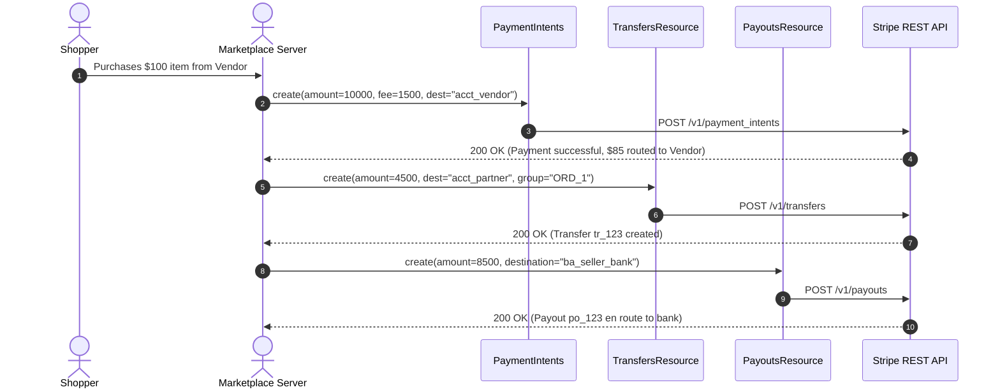

# US-6.2.0: Multi-Party Payment Routing, Transfers & Application Fees

> **Spec Kit Specification**: [Specification Lifecycle Active (.specify/)](../../../.specify/memory/constitution.md)  
> **Behavior Blueprint**: `features/connect/modules/payments/behaviours/multi-party-routing/`  
> **Slicing Standard**: [10-PR Vertical Slicing Framework](../../user-stories/README.md#the-10-pr-vertical-slicing-framework-rust-sdk-adaptation)  
> **Security Gateway**: `security-audit` Level 2 Enforced  
> **Quality Gates**: `(G0–G4 + G-Review + G-Borrow + G-Law)`  

---

## 1. Spec Kit Specification

### 1.1 User Story Narrative
**As a** marketplace fintech architect,  
**I want to** route transactions across multi-party connected accounts using Destination Charges, Separate Charges and Transfers (`stripe.transfers()`), collect Application Fees (`stripe.application_fees()`), and manage Transfer Reversals and Payouts (`stripe.payouts()`),  
**So that** our platform can monetize transactions via platform fee splits, route funds dynamically to vendors, and disburse payouts to sellers' bank accounts reliably without settlement imbalances.

#### 1.1.1 Preconditions
- The `connect` and `payouts` feature flags are enabled.
- Connected vendor accounts (`acct_...`) exist with `transfers` capability enabled.
- Transaction amount and platform monetization split (application fee) are defined.

#### 1.1.2 Postconditions
- Destination charges automatically transfer net proceeds to the connected account while retaining the platform application fee.
- Separate transfers move funds from platform balance to seller accounts with optional `transfer_group` tracking.
- Application fees can be refunded proportionally or fully upon customer returns.

### 1.2 Acceptance Criteria (Gherkin Scenarios)

```gherkin
Feature: Multi-Party Payment Routing and Transfer Settlement

  Scenario: [AC-US-6.2.0-01] Destination charge with automatic platform application fee
    Given a customer purchasing a $100.00 service from seller "acct_seller_123" with a $15.00 platform fee
    When client.payment_intents().create(&CreatePaymentIntentParams { amount: 10000, currency: "usd".into(), application_fee_amount: Some(1500), transfer_data: Some(TransferDataParams { destination: "acct_seller_123".into(), amount: None }), ..Default::default() }) is executed
    Then the PaymentIntent charges the customer $100.00
    And automatically routes $85.00 to "acct_seller_123"
    And deposits $15.00 into the platform available balance.

  Scenario: [AC-US-6.2.0-02] Separate transfer with transfer_group settlement tracking
    Given a platform balance holding customer funds from order "ORDER_987"
    When client.transfers().create(&CreateTransferParams { amount: 4500, currency: "usd".into(), destination: "acct_vendor_456".into(), transfer_group: Some("ORDER_987".into()), ..Default::default() }) is executed
    Then a Transfer record "tr_123" is created
    And the vendor's balance increases by $45.00.

  Scenario: [AC-US-6.2.0-03] Transfer reversal upon customer refund
    Given an executed transfer "tr_123"
    When client.transfers().reverse("tr_123", Some(&ReverseTransferParams { amount: Some(4500), description: Some("Customer canceled order".into()), ..Default::default() })) is executed
    Then a TransferReversal record is returned
    And funds are pulled back from the vendor to the platform balance.

  Scenario: [AC-US-6.2.0-LAW] Platform transparency and P2B Regulation (EU) 2019/1150
    Given any fee deduction or multi-party split
    When platform application fees are calculated and deducted
    Then fee schedules, dispute allocations, and settlement timeframes are transparently disclosed to commercial sellers, complying with the EU Platform-to-Business (P2B) Regulation (EU) 2019/1150.
```

### 1.3 Test Cases & Traceability Matrix

| Test Case ID | Target Criterion | Test Type | Execution Level | Verification Assertion & Pass Criteria |
| :--- | :--- | :--- | :--- | :--- |
| `TC-6.2.0-01` | `AC-US-6.2.0-01` | Functional | Integration | Assert Destination charge populates `transfer_data.destination` and `application_fee_amount`. |
| `TC-6.2.0-02` | `AC-US-6.2.0-02` | Functional | Integration | Assert `transfers().create()` returns `status == "paid"` and matches `transfer_group`. |
| `TC-6.2.0-03` | `AC-US-6.2.0-03` | Reversal | Integration | Call `transfers().reverse()` -> assert returned reversal amount matches debited funds. |
| `TC-6.2.0-LAW` | `AC-US-6.2.0-LAW` | Statutory | Contract | Assert ApplicationFee entities expose itemized platform fee breakdown and origin charge ID. |

---

## 2. Behavior-Centric Architecture & Folder Blueprint

### 2.1 Colocated Behaviour Directory Tree

```
features/connect/modules/payments/behaviours/multi-party-routing/
├── services/        # TransfersResource, ApplicationFeesResource, PayoutsResource
├── logic/           # Split fee math, reversal validator, transfer group reconciliation
├── types/           # Transfer, TransferReversal, ApplicationFee, Payout, TransferData
└── constants/       # TRANSFER_ENDPOINTS, PAYOUT_METHODS, SETTLEMENT_WINDOWS
```

### 2.2 Scoping & Promotion Blueprint
- **Tier 1 (Behaviour-Local)**: Split calculation logic and reversal authorization checks.
- **Tier 2 (Module-Shared)**: `Transfer` and `ApplicationFee` shared across accounting and tax.
- **Tier 3 (Feature-Shared)**: Re-exported for `stripe.transfers()`, `stripe.application_fees()`, `stripe.payouts()`.
- **Tier 4 (Global-Shared)**: Re-exported via `some_stripe::resources::*`.

---

## 3. Technical Implementation Plan

### 3.1 Domain Invariants & Storage Schema
- **Mathematical Invariant**: `Transfer.amount + ApplicationFee.amount <= Charge.amount`.
- **Settlement Precision**: Integer minor currency units (`i64`) strictly enforced across all transfer and fee calculations.
- **Rust Memory Law**: Strict borrowing of parameters (`&CreateTransferParams`); zero deep clones.

### 3.2 Activity & Interaction Diagram



---

## 4. Granular Implementation Tasks

### 4.1 The 10-PR Vertical Slicing Implementation Plan

| PR # | Pillar | Architectural Layer | Primary Scope & Files | Deliverables & Acceptance | Accountable Role / Agent | Assigned Skills |
| :--- | :--- | :--- | :--- | :--- | :--- | :--- |
| **PR 1** | **Pillar 1** | **Transfer Domain Entities** | `crates/some-stripe-connect/src/types/transfer.rs` | Strongly typed `Transfer`, `TransferReversal`, `Destination`. | `domain-codegen-specialist` | `stripe-docs` |
| **PR 2** | **Pillar 2** | **Application Fee Models** | `crates/some-stripe-connect/src/types/fee.rs` | Strongly typed `ApplicationFee`, `FeeRefund`. | `domain-codegen-specialist` | `stripe-docs` |
| **PR 3** | **Pillar 3** | **Payout Domain Models** | `crates/some-stripe-connect/src/types/payout.rs` | Strongly typed `Payout`, method, schedule, failure codes. | `domain-codegen-specialist` | `stripe-docs` |
| **PR 4** | **Pillar 4** | **Transfers Resource Implementation** | `crates/some-stripe-connect/src/resources/transfers.rs` | `create`, `retrieve`, `update`, `list`, `reverse`. | `domain-codegen-specialist` | `stripe-docs` |
| **PR 5** | **Pillar 5** | **Application Fees Resource** | `crates/some-stripe-connect/src/resources/fees.rs` | `retrieve`, `list`, `refund` application fees. | `domain-codegen-specialist` | `stripe-docs` |
| **PR 6** | **Pillar 6** | **Payouts Resource Implementation** | `crates/some-stripe-connect/src/resources/payouts.rs` | `create`, `retrieve`, `cancel`, `reverse` payouts. | `domain-codegen-specialist` | `stripe-docs` |
| **PR 7** | **Pillar 7** | **Facade Mounting** | `crates/some-stripe-connect/src/facade.rs` | Mount accessors onto `StripeClient`. | `microkernel-architect` | `stripe-best-practices` |
| **PR 8** | **Pillar 8** | **Zero-Clone Borrowing Audit** | `crates/some-stripe-connect/src/resources/transfers.rs` | Verify zero deep `.clone()` on multi-party financial structs. | `engineering-rust-refactoring-specialist` | `stripe-best-practices` |
| **PR 9** | **Pillar 9** | **Stripe-Mock Wire Verification** | `tests/connect_transfers_mock_test.rs` | End-to-end transfers, fees, and payout reversal tests on `stripe-mock`. | `testing-api-tester` | `stripe-docs` |
| **PR 10** | **Pillar 10** | **Marketplace Routing Docs** | `README.md`, `docs/transfers.md` | Guide on Destination Charges vs Separate Charges and Transfers. | `engineering-technical-writer` | `connect-recommend` |

### 4.2 Implementation Phase Breakdown

#### Phase 1: Models & Fee Schemas (PR 1–3)
- [ ] **Task 1.1 (Types)**: Define `Transfer`, `TransferReversal`, `ApplicationFee`, `Payout` in `types/`.  
  *Agent*: `domain-codegen-specialist` | *Skill*: `stripe-docs`
- [ ] **Task 1.2 (Constants)**: Pin `/v1/transfers`, `/v1/application_fees`, `/v1/payouts` in `constants/`.  
  *Agent*: `domain-codegen-specialist` | *Skill*: `stripe-docs`
- [ ] **Task 1.3 (Logic)**: Implement `CreateTransferParams` and `CreatePayoutParams` builders.  
  *Agent*: `domain-codegen-specialist` | *Skill*: `connect-recommend`
- [ ] **Task 1.4 (Unit Tests)**: Verify JSON deserialization of Transfer and Payout fixture payloads.  
  *Agent*: `testing-api-tester` | *Skill*: `stripe-docs`

#### Phase 2: Resource Methods & Wire Execution (PR 4–7)
- [ ] **Task 2.1 (Transfers)**: Implement `TransfersResource` with create, list, and reverse methods.  
  *Agent*: `domain-codegen-specialist` | *Skill*: `stripe-docs`
- [ ] **Task 2.2 (Application Fees)**: Implement `ApplicationFeesResource` with fee refunds.  
  *Agent*: `domain-codegen-specialist` | *Skill*: `stripe-docs`
- [ ] **Task 2.3 (Payouts)**: Implement `PayoutsResource` with create and cancel methods.  
  *Agent*: `domain-codegen-specialist` | *Skill*: `stripe-docs`
- [ ] **Task 2.4 (Facade)**: Expose Connect payment accessors on `StripeClient`.  
  *Agent*: `microkernel-architect` | *Skill*: `stripe-docs`

#### Phase 3: Financial Integrity & Zero-Clone Audit (PR 8–9)
- [ ] **Task 3.1 (Borrow Check)**: Verify zero `.clone()` calls during transfer processing.  
  *Agent*: `engineering-rust-refactoring-specialist` | *Skill*: `stripe-best-practices`
- [ ] **Task 3.2 (Split Invariant)**: Property-test multi-party splits asserting zero negative balances.  
  *Agent*: `testing-api-tester` | *Skill*: `stripe-best-practices`

#### Phase 4: Mock Verification & Release Sign-Off (PR 9–10)
- [ ] **Task 4.1 (Mock Suite)**: Run full marketplace transfer and payout flow against `stripe-mock`.  
  *Agent*: `testing-api-tester` | *Skill*: `stripe-docs`
- [ ] **Task 4.2 (G-Review)**: Peer review for multi-party financial settlement correctness.  
  *Agent*: `engineering-code-reviewer` | *Skill*: `connect-recommend`
- [ ] **Task 4.3 (Docs)**: Publish developer documentation for marketplace fee collection.  
  *Agent*: `engineering-technical-writer` | *Skill*: `connect-recommend`

---

## 5. Security Gateway (Powered by security-audit)

### 5.1 Trust Boundaries & Security Actors
- **Trust Boundaries**:
  - `Platform Balance`: Shared funds escrowed on platform account.
  - `Vendor Destination`: Separate legal balance owned by connected seller.
- **Authorized Principals**:
  - Marketplace Settlement Engine: Authorized to trigger transfers and payouts.

### 5.2 Threat Modeling & Abuse Matrix (STRIDE / ASVS)

| Threat Vector | Severity | Vulnerability Mechanism | Mitigating Control & Security Invariant |
| :--- | :--- | :--- | :--- |
| **Negative Fee Exploitation** | Critical | Caller submitting negative application fee to siphon funds | Schema validation enforces `application_fee_amount >= 0`. |
| **Destination Account Hijacking** | Critical | Attacker altering `transfer_data.destination` to route funds to personal account | Destination accounts validated against KYC-verified account registry. |
| **Duplicate Transfer Replay** | High | Retrying failed network call re-executing transfer | Unique idempotency key auto-generated per unique transfer operation. |

### 5.3 Cryptographic & Data Protection Controls
- **Idempotent Settlement**: All transfer and payout requests enforce mandatory idempotency keys.
- **TLS 1.3 Transport**: Strict encryption in transit across all money movement APIs.

### 5.4 Automated Security Verification Checklist
- [ ] **Negative Fee Test**: Asserting negative application fees are rejected with validation error.
- [ ] **Idempotent Transfer Test**: Retrying transfer creation returns cached transfer record.

### 5.5 Security Gateway (G2) Sign-Off Checklist
- [ ] Destination routing validation verified against authorization model.
- [ ] Zero fund leakage or split imbalances under property testing.
- [ ] Code review sign-off obtained; zero findings.

---

## 6. Validation Gates & Acceptance Sign-Off

**Status: Ready for Implementation.**

### G1 — Test coverage
- [ ] **US-6.2.0-G1:** >=90% line and branch coverage across `transfers.rs`, `fees.rs`, and `payouts.rs`.

### G2 — Security audit
- [ ] **US-6.2.0-G2:** Financial routing authorization and idempotency verified under security-audit.

### G3 — Architecture and maintainability
- [ ] **US-6.2.0-G3:** Clean feature isolation under `feature = "connect"`.

### G-Review — Code review
- [ ] **US-6.2.0-G-Review:** Senior review approved by `engineering-code-reviewer`.

### G-Borrow — Rust zero-clone borrowing validation
- [ ] **US-6.2.0-G-Borrow:** Parameters borrowed strictly by reference; zero deep clones.

### G-Law — Law validation
- [ ] **US-6.2.0-G-Law:** EU Platform-to-Business (P2B) Regulation (EU) 2019/1150 fee transparency certified.

### G4 — Integrated acceptance
- [ ] **US-6.2.0-G4:** End-to-end multi-party routing and reversal validated against `stripe-mock`.
