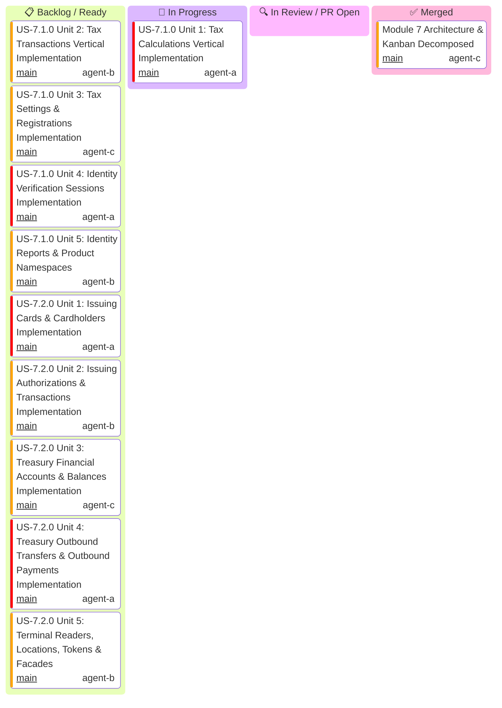

# Module 7: Specialized Product Namespaces — Master Kanban & Task Tracking

Master hierarchical task tracking for **Module 7 (Specialized Product Namespaces)**.

> [!IMPORTANT]
> **Parallel Implementation Architecture & Strict Role Boundaries (Rule 16)**:
> - **All 10 units across US-7.1.0 and US-7.2.0 are pure IMPLEMENTING units** (models, parameters, serializers, resource endpoints, and integration wire tests).
> - **Zero validation-only units**: Quality gates (G0–G4, G-Borrow, G2, G-Law, G-Complexity, G-Docs, G-Review) are enforced on every unit PR by independent gatekeeper subagents during code review.
> - **Zero inter-unit blocking**: Each unit owns an isolated vertical functional scope and distinct files, enabling **100% parallel execution** without merge blockades.
> - **Streaming Pipelined PRs & Ordered Cascading Merge Queue**: As each unit finishes in its worktree, its PR is opened immediately.

---

## 1. Executive Status Board

---

## 2. Micro-Unit Decomposition & Implementation Workstreams

### US-7.1.0: Stripe Tax Compliance Engine & Stripe Identity Verification
- **Unit 1**: **Tax Calculations Vertical Implementation** (`TaxCalculation`, `TaxCalculationLineItem`, `TaxBreakdown`, `TaxJurisdiction`, `CreateTaxCalculationParams`, `CalculationsResource` (`create`, `list_line_items`)).
- **Unit 2**: **Tax Transactions Vertical Implementation** (`TaxTransaction`, `TaxTransactionLineItem`, `CreateTaxTransactionFromCalculationParams`, `CreateTaxTransactionReversalParams`, `TransactionsResource` (`create_from_calculation`, `create_reversal`, `retrieve`)).
- **Unit 3**: **Tax Settings & Registrations Implementation** (`TaxSettings`, `TaxRegistration`, `TaxStatus`, `UpdateTaxSettingsParams`, `CreateTaxRegistrationParams`, `SettingsResource` & `RegistrationsResource`).
- **Unit 4**: **Identity Verification Sessions Implementation** (`VerificationSession`, `VerificationOptions`, `DocumentOptions`, `CreateVerificationSessionParams`, `UpdateVerificationSessionParams`, `VerificationSessionsResource` (`create`, `retrieve`, `update`, `cancel`, `redact`)).
- **Unit 5**: **Identity Reports & Product Namespaces Implementation** (`VerificationReport`, `DocumentReport`, `SelfieReport`, `ListVerificationReportsParams`, `VerificationReportsResource` (`retrieve`, `list`), and client namespace mounting `stripe.tax()`, `stripe.identity()`).

### US-7.2.0: Stripe Issuing, Treasury Financial Accounts & Terminal POS
- **Unit 1**: **Issuing Cards & Cardholders Implementation** (`IssuingCard`, `IssuingCardholder`, `SpendingControls`, `SpendingLimit`, `CreateCardParams`, `UpdateCardParams`, `CreateCardholderParams`, `UpdateCardholderParams`, `IssuingCardsResource` (`create`, `retrieve`, `update`, `list`)).
- **Unit 2**: **Issuing Authorizations & Transactions Implementation** (`IssuingAuthorization`, `IssuingTransaction`, `AuthorizationMerchantData`, `ApproveAuthorizationParams`, `DeclineAuthorizationParams`, `ListIssuingAuthorizationsParams`, `ListIssuingTransactionsParams`, `IssuingAuthorizationsResource` (`retrieve`, `update`, `approve`, `decline`, `list`)).
- **Unit 3**: **Treasury Financial Accounts & Balances Implementation** (`FinancialAccount`, `FinancialAccountBalance`, `FinancialAccountFeatures`, `FinancialAddresses`, `CreateFinancialAccountParams`, `UpdateFinancialAccountParams`, `ListFinancialAccountsParams`, `TreasuryFinancialAccountsResource` (`create`, `retrieve`, `update`, `list`, `close`)).
- **Unit 4**: **Treasury Outbound Transfers & Outbound Payments Implementation** (`OutboundTransfer`, `OutboundPayment`, `ReceivedCredit`, `CreateOutboundTransferParams`, `CancelOutboundTransferParams`, `CreateOutboundPaymentParams`, `CancelOutboundPaymentParams`, `TreasuryTransfersResource` (`create`, `retrieve`, `cancel`, `list`)).
- **Unit 5**: **Terminal Readers, Locations, Tokens & Facades Implementation** (`TerminalReader`, `TerminalLocation`, `ConnectionToken`, `CreateReaderParams`, `CreateLocationParams`, `CreateConnectionTokenParams`, `TerminalResource` (`readers`, `locations`, `connection_tokens`), and client namespace mounting `stripe.issuing()`, `stripe.treasury()`, `stripe.terminal()`).
