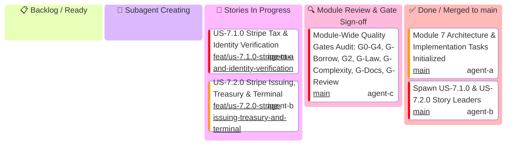

# Module 7: Specialized Product Namespaces — Executive Module Kanban

Master high-level tracking for **Module 7 (Specialized Product Namespaces)** execution across User Stories `US-7.1.0` and `US-7.2.0`.

> [!IMPORTANT]
> **Strict Hierarchical Delegation Invariant (Rule 16)**:
> - **The Module Leader generates ONLY User Story Leaders** (`US-7.1.0 Story Leader`, `US-7.2.0 Story Leader`).
> - The Module Leader is STRICTLY FORBIDDEN from creating Unit Implementers directly.
> - **3-Minute Supervision Schedule**: The Module Leader maintains a 3-minute supervision schedule to track story progress.

---

## 1. Module Level Executive Kanban

---

## 2. Story Promotion & Release Milestone Matrix

| Story ID | Story Title | Story Leader & Profile | Story Branch | Promotion PR Title | Status |
| :--- | :--- | :--- | :--- | :--- | :---: |
| **US-7.1.0** | Stripe Tax Compliance Engine & Stripe Identity Verification | `US-7.1.0 Story Leader` (`agent-a`) | `feat/us-7.1.0-stripe-tax-and-identity-verification` | `feat(us-7.1.0): stripe tax and identity verification (Units 1..5 Promotion)` | 🔄 In Progress |
| **US-7.2.0** | Stripe Issuing, Treasury Financial Accounts & Terminal POS | `US-7.2.0 Story Leader` (`agent-b`) | `feat/us-7.2.0-stripe-issuing-treasury-and-terminal` | `feat(us-7.2.0): stripe issuing treasury and terminal (Units 1..5 Promotion)` | 🔄 In Progress |
| **MODULE-7** | Specialized Product Namespaces Full Release | `Module 7 Lead Architect` (`agent-b`) | `feat/module-7-specialized-product-namespaces` | `feat(module-7): specialized product namespaces` | 📋 Ready |
