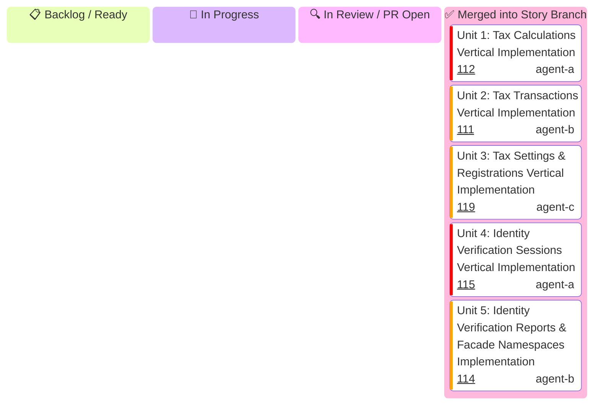

# US-7.1.0: Stripe Tax Compliance Engine & Stripe Identity Verification

**Module Leader**: Agent C (`agent-c`)
**Story Leader**: Agent A (`agent-a`)
**Status**: 🔄 In Progress
**Story Branch**: `feat/us-7.1.0-stripe-tax-and-identity-verification`
**Target PR**: `feat(us-7.1.0): stripe tax compliance engine & stripe identity verification (Units 1..5 Promotion)`

---

## 1. Visual Status Board

---

## 2. Micro-Unit Specifications Matrix

| Unit ID | Unit Title & Functional Scope | Assigned Profile | Branch Name | Target PR Title | Status |
| :--- | :--- | :---: | :--- | :--- | :---: |
| **Unit 1** | **Tax Calculations Vertical Implementation**: `TaxCalculation`, `TaxCalculationLineItem`, `TaxBreakdown`, `TaxJurisdiction`, `CreateTaxCalculationParams`, `ListTaxCalculationLineItemsParams`, and `CalculationsResource` (`create`, `list_line_items`). | `agent-a` | `feat/us-7.1.0/unit-1-tax-calculations-resource` | `feat(us-7.1.0/unit-1): tax calculations domain models and resource endpoints` | ✅ Merged (#112) |
| **Unit 2** | **Tax Transactions Vertical Implementation**: `TaxTransaction`, `TaxTransactionLineItem`, `CreateTaxTransactionFromCalculationParams`, `CreateTaxTransactionReversalParams`, and `TransactionsResource` (`create_from_calculation`, `create_reversal`, `retrieve`). | `agent-b` | `feat/us-7.1.0/unit-2-tax-transactions-resource` | `feat(us-7.1.0/unit-2): tax transactions domain models and ledger endpoints` | ✅ Merged (#111) |
| **Unit 3** | **Tax Settings & Registrations Vertical Implementation**: `TaxSettings`, `TaxRegistration`, `TaxStatus`, `UpdateTaxSettingsParams`, `CreateTaxRegistrationParams`, and `SettingsResource` & `RegistrationsResource` (`retrieve_settings`, `update_settings`, `create_registration`, `list_registrations`). | `agent-c` | `feat/us-7.1.0/unit-3-tax-settings-registrations-resource` | `feat(us-7.1.0/unit-3): tax settings and registrations resource implementation` | ✅ Merged (#119) |
| **Unit 4** | **Identity Verification Sessions Vertical Implementation**: `VerificationSession`, `VerificationOptions`, `DocumentOptions`, `CreateVerificationSessionParams`, `UpdateVerificationSessionParams`, and `VerificationSessionsResource` (`create`, `retrieve`, `update`, `cancel`, `redact`). | `agent-a` | `feat/us-7.1.0/unit-4-identity-sessions-resource` | `feat(us-7.1.0/unit-4): identity verification sessions resource and biometric models` | ✅ Merged (#115) |
| **Unit 5** | **Identity Verification Reports & Facade Namespaces Implementation**: `VerificationReport`, `DocumentReport`, `SelfieReport`, `ListVerificationReportsParams`, `VerificationReportsResource` (`retrieve`, `list`), and `TaxResource` / `IdentityResource` namespace mounting on `StripeClient`. | `agent-b` | `feat/us-7.1.0/unit-5-identity-reports-namespaces` | `feat(us-7.1.0/unit-5): identity verification reports and product namespaces mounting` | ✅ Merged (#114) |
