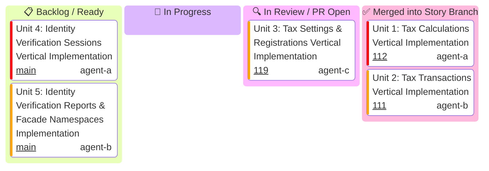

# US-7.1.0: Stripe Tax & Identity Verification — Story Kanban

Detailed tracking for **US-7.1.0 (Stripe Tax Compliance Engine & Stripe Identity Verification)** execution across all 5 Level 3 Micro-Units.

> [!IMPORTANT]
> **Parallel Implementation Architecture & Strict Role Boundaries (Rule 16)**:
> - **All 5 units are pure IMPLEMENTING units** (models, parameters, serializers, resource endpoints, and integration wire tests).
> - **Zero validation-only units**: Quality gates (G0–G4, G-Borrow, G2, G-Law, G-Complexity, G-Docs, G-Review) are enforced on every unit by independent gatekeeper subagents during PR code review.
> - **Zero inter-unit blocking**: Each unit owns an isolated vertical functional scope and distinct files, enabling **100% parallel execution** without merge blockades.
> - **Streaming Pipelined PRs & Ordered Cascading Merge Queue**: As each unit finishes in its worktree, its PR is opened immediately.

---

## 1. Unit Execution Kanban

---

## 2. Micro-Unit Specifications Matrix

| Unit ID | Unit Title & Functional Scope | Assigned Profile | Branch Name | Target PR Title | Status |
| :--- | :--- | :---: | :--- | :--- | :---: |
| **Unit 1** | **Tax Calculations Vertical Implementation**: `TaxCalculation`, `TaxCalculationLineItem`, `TaxBreakdown`, `TaxJurisdiction`, `CreateTaxCalculationParams`, `ListTaxCalculationLineItemsParams`, and `CalculationsResource` (`create`, `list_line_items`). | `agent-a` | `feat/us-7.1.0/unit-1-tax-calculations-resource` | `feat(us-7.1.0/unit-1): tax calculations domain models and resource endpoints` | ✅ Merged (#112) |
| **Unit 2** | **Tax Transactions Vertical Implementation**: `TaxTransaction`, `TaxTransactionLineItem`, `CreateTaxTransactionFromCalculationParams`, `CreateTaxTransactionReversalParams`, and `TransactionsResource` (`create_from_calculation`, `create_reversal`, `retrieve`). | `agent-b` | `feat/us-7.1.0/unit-2-tax-transactions-resource` | `feat(us-7.1.0/unit-2): tax transactions domain models and ledger endpoints` | ✅ Merged (#111) |
| **Unit 3** | **Tax Settings & Registrations Vertical Implementation**: `TaxSettings`, `TaxRegistration`, `TaxStatus`, `UpdateTaxSettingsParams`, `CreateTaxRegistrationParams`, and `SettingsResource` & `RegistrationsResource` (`retrieve_settings`, `update_settings`, `create_registration`, `list_registrations`). | `agent-c` | `feat/us-7.1.0/unit-3-tax-settings-registrations-resource` | `feat(us-7.1.0/unit-3): tax settings and registrations resource implementation` | 🔍 In Review (#119) |
| **Unit 4** | **Identity Verification Sessions Vertical Implementation**: `VerificationSession`, `VerificationOptions`, `DocumentOptions`, `CreateVerificationSessionParams`, `UpdateVerificationSessionParams`, and `VerificationSessionsResource` (`create`, `retrieve`, `update`, `cancel`, `redact`). | `agent-a` | `feat/us-7.1.0/unit-4-identity-sessions-resource` | `feat(us-7.1.0/unit-4): identity verification sessions resource and biometric models` | 📋 Ready |
| **Unit 5** | **Identity Verification Reports & Facade Namespaces Implementation**: `VerificationReport`, `DocumentReport`, `SelfieReport`, `ListVerificationReportsParams`, `VerificationReportsResource` (`retrieve`, `list`), and `TaxResource` / `IdentityResource` namespace mounting on `StripeClient`. | `agent-b` | `feat/us-7.1.0/unit-5-identity-reports-namespaces` | `feat(us-7.1.0/unit-5): identity verification reports and product namespaces mounting` | 📋 Ready |
