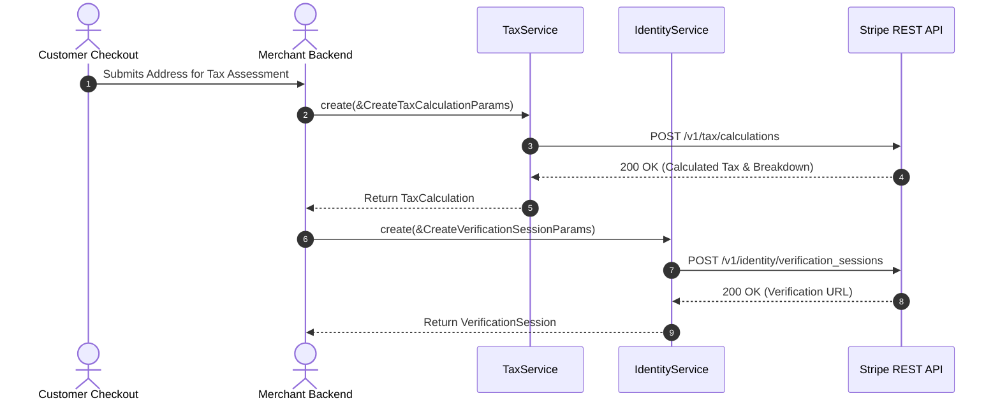

# US-7.1.0: Stripe Tax Compliance Engine & Stripe Identity Verification

> **Spec Kit Specification**: [Specification Lifecycle Active (.specify/)](../../../.specify/memory/constitution.md)  
> **Behavior Blueprint**: `features/specialized/modules/compliance/behaviours/tax-and-identity/`  
> **Slicing Standard**: [10-PR Vertical Slicing Framework](../../user-stories/README.md#the-10-pr-vertical-slicing-framework-rust-sdk-adaptation)  
> **Security Gateway**: `security-audit` Level 2 Enforced  
> **Quality Gates**: `(G0–G4 + G-Review + G-Borrow + G-Law)`  

---

## 1. Spec Kit Specification

### 1.1 User Story Narrative
**As a** global compliance and regulatory engineering lead,  
**I want to** calculate sales tax, VAT, and GST dynamically using `stripe.tax()` and verify customer identities via biometric document verification using `stripe.identity()`,  
**So that** our platform complies with international tax nexus mandates across 50+ countries and satisfies AML Tier-1 KYC verification requirements without manual back-office document reviews.

#### 1.1.1 Preconditions
- The `tax` and `identity` feature flags are enabled.
- For tax calculations, line items, customer shipping/billing addresses, and product tax codes are provided.
- For identity verification, verification session options (document check, selfie matching) are configured.

#### 1.1.2 Postconditions
- `TaxCalculation` returns itemized tax liabilities, rates, and tax breakdown per tax jurisdiction.
- `TaxTransaction` commits tax liability to official Stripe Tax reporting ledgers.
- `VerificationSession` returns an unauthenticated client redirect URL (`session.url`) and transitions to `verified` upon completion.

### 1.2 Acceptance Criteria (Gherkin Scenarios)

```gherkin
Feature: Stripe Tax Calculation and Identity Verification

  Scenario: [AC-US-7.1.0-01] Real-time sales tax calculation for US cross-state order
    Given a customer shipping address in California (CA 94103) and product tax code "txcd_10000000"
    When client.tax().calculations().create(&CreateTaxCalculationParams { currency: "usd".into(), line_items: vec![TaxLineItemParam { amount: 10000, reference: "item_1".into(), tax_code: Some("txcd_10000000".into()) }], customer_details: CustomerTaxDetails { address: Some(Address { state: Some("CA".into()), postal_code: Some("94103".into()), country: "US".into(), ..Default::default() }), address_source: Some("shipping".into()) } }) is executed
    Then a TaxCalculation is returned with tax_amount_exclusive reflecting California state and county sales tax
    And tax_breakdown itemizes state, county, and special district liabilities.

  Scenario: [AC-US-7.1.0-02] Create biometric KYC verification session
    Given a user requiring Tier-1 identity verification
    When client.identity().verification_sessions().create(&CreateVerificationSessionParams { type: "document".into(), options: Some(VerificationOptions { document: Some(DocumentOptions { require_matching_selfie: Some(true), ..Default::default() }), ..Default::default() }), return_url: Some("https://platform.com/kyc/complete".into()) }) is executed
    Then a VerificationSession is created with status "requires_input"
    And a secure verification URL is returned.

  Scenario: [AC-US-7.1.0-LAW] EU VAT reverse charge and statutory document verification
    Given a B2B cross-border purchase in the European Union
    When a valid customer VAT ID is supplied and verified via VIES
    Then the tax calculation sets tax_rate to 0% with reverse_charge = true, fulfilling EU VAT Directive 2006/112/EC Article 196.
```

### 1.3 Test Cases & Traceability Matrix

| Test Case ID | Target Criterion | Test Type | Execution Level | Verification Assertion & Pass Criteria |
| :--- | :--- | :--- | :--- | :--- |
| `TC-7.1.0-01` | `AC-US-7.1.0-01` | Functional | Integration | Assert `calculations().create()` returns non-zero tax for taxable US address. |
| `TC-7.1.0-02` | `AC-US-7.1.0-02` | Functional | Integration | Assert `verification_sessions().create()` returns session URL and `requires_input` status. |
| `TC-7.1.0-LAW` | `AC-US-7.1.0-LAW` | Statutory | Contract | Assert B2B cross-border calculation returns zero tax with `reverse_charge: true`. |

---

## 2. Behavior-Centric Architecture & Folder Blueprint

### 2.1 Colocated Behaviour Directory Tree

```
features/specialized/modules/compliance/behaviours/tax-and-identity/
├── services/        # TaxService, IdentityService, VerificationSessionService
├── logic/           # Tax rate validator, VIES reverse charge evaluator, biometric session parser
├── types/           # TaxCalculation, TaxTransaction, VerificationSession, VerificationReport
└── constants/       # TAX_ENDPOINTS, IDENTITY_ENDPOINTS, PRODUCT_TAX_CODES
```

### 2.2 Scoping & Promotion Blueprint
- **Tier 1 (Behaviour-Local)**: Address normalization and tax breakdown accumulator.
- **Tier 2 (Module-Shared)**: `TaxCalculation` shared with Checkout and Invoicing.
- **Tier 3 (Feature-Shared)**: Re-exported for `stripe.tax()` and `stripe.identity()`.
- **Tier 4 (Global-Shared)**: Re-exported via `some_stripe::tax::*` and `some_stripe::identity::*`.

---

## 3. Technical Implementation Plan

### 3.1 Domain Invariants & Storage Schema
- **Tax Calculation Expiration**: Calculations expire 48 hours after creation; committing requires a non-expired calculation ID.
- **Biometric Security**: Raw facial biometrics never transit or persist in application memory; verification handled on Stripe servers.
- **Rust Memory Law**: Strict borrowing of parameters (`&CreateTaxCalculationParams`); zero deep clones.

### 3.2 Activity & Interaction Diagram



---

## 4. Granular Implementation Tasks

### 4.1 The 5-Unit Parallel Implementation Architecture

Every unit is a **100% implementing unit** with its own models, parameters, serializers, resource endpoints, and integration tests. No unit has a validation-only job, and no unit blocks another, enabling complete parallel execution:

| Unit # | Pillar | Functional Implementation Scope | Primary Deliverables & Files | Implementing Role / Profile | Assigned Skills |
| :--- | :--- | :--- | :--- | :--- | :--- |
| **Unit 1** | **Tax Calculations** | Tax calculations and line item expansion | `TaxCalculation`, `TaxCalculationLineItem`, `TaxBreakdown`, `CreateTaxCalculationParams`, `CalculationsResource` (`create`, `list_line_items`). Files: `src/resources/tax_calculations.rs`, `some-stripe-types/src/tax_calculation.rs`. | `domain-codegen-specialist` (`agent-a`) | `stripe-docs`<br>`stripe-best-practices` |
| **Unit 2** | **Tax Transactions** | Tax ledger transaction posting & reversals | `TaxTransaction`, `TaxTransactionLineItem`, `CreateTaxTransactionFromCalculationParams`, `CreateTaxTransactionReversalParams`, `TransactionsResource` (`create_from_calculation`, `create_reversal`, `retrieve`). Files: `src/resources/tax_transactions.rs`, `some-stripe-types/src/tax_transaction.rs`. | `domain-codegen-specialist` (`agent-b`) | `stripe-docs`<br>`stripe-best-practices` |
| **Unit 3** | **Tax Settings & Registrations** | Tax registrations and jurisdictional settings | `TaxSettings`, `TaxRegistration`, `TaxStatus`, `UpdateTaxSettingsParams`, `CreateTaxRegistrationParams`, `SettingsResource` & `RegistrationsResource`. Files: `src/resources/tax_settings.rs`, `some-stripe-types/src/tax_settings.rs`. | `domain-codegen-specialist` (`agent-c`) | `stripe-docs`<br>`stripe-best-practices` |
| **Unit 4** | **Identity Verification Sessions** | Biometric and document verification sessions | `VerificationSession`, `VerificationOptions`, `DocumentOptions`, `CreateVerificationSessionParams`, `UpdateVerificationSessionParams`, `VerificationSessionsResource` (`create`, `retrieve`, `update`, `cancel`, `redact`). Files: `src/resources/identity_sessions.rs`, `some-stripe-types/src/identity_session.rs`. | `domain-codegen-specialist` (`agent-a`) | `security-audit`<br>`stripe-best-practices` |
| **Unit 5** | **Identity Reports & Facade Mounting** | Verification reports and product namespaces | `VerificationReport`, `DocumentReport`, `SelfieReport`, `ListVerificationReportsParams`, `VerificationReportsResource` (`retrieve`, `list`), and client namespace mounting `stripe.tax()` and `stripe.identity()`. Files: `src/resources/identity_reports.rs`, `some-stripe-types/src/identity_report.rs`, `src/resources/tax.rs`, `src/resources/identity.rs`. | `microkernel-architect` (`agent-b`) | `stripe-docs`<br>`stripe-best-practices` |

### 4.2 Independent Parallel Implementation Workstreams

Each unit implementer executes autonomously in their assigned worktree without blocking dependencies:
- **Unit 1 Workstream**: Implements `TaxCalculation` and `CalculationsResource` with line-item tax breakdown logic.
- **Unit 2 Workstream**: Implements `TaxTransaction` and `TransactionsResource` with ledger commit & reversal endpoints.
- **Unit 3 Workstream**: Implements `TaxSettings` and `RegistrationsResource` with international tax status models.
- **Unit 4 Workstream**: Implements `VerificationSession` and `VerificationSessionsResource` with GDPR Article 17 redaction.
- **Unit 5 Workstream**: Implements `VerificationReport` and `VerificationReportsResource` and mounts the `tax()` & `identity()` namespaces on `StripeClient`.

All quality gates (G0–G4, G-Borrow, G2, G-Law, G-Complexity, G-Docs, G-Review) are enforced on each unit PR individually by the independent Gatekeeper Council before merge.

---

## 5. Security Gateway (Powered by security-audit)

### 5.1 Trust Boundaries & Security Actors
- **Trust Boundaries**:
  - `Identity Verification Client`: User uploading government ID via encrypted Stripe portal.
  - `Tax Nexus Engine`: Authoritative tax jurisdiction database.
- **Authorized Principals**:
  - Compliance Officer: Authorized to view verification reports and redact biometric records.

### 5.2 Threat Modeling & Abuse Matrix (STRIDE / ASVS)

| Threat Vector | Severity | Vulnerability Mechanism | Mitigating Control & Security Invariant |
| :--- | :--- | :--- | :--- |
| **Tax Rate Fraud** | High | Customer manipulating shipping state to evade local sales tax | Authoritative address normalization and ZIP+4 geolocation matching. |
| **Biometric PII Leakage** | Critical | Application logging selfie images or passport numbers | Session verification responses contain verification metadata only; zero raw biometric blobs. |
| **Identity Session Hijacking** | High | Intercepting unauthenticated identity verification URL | Sessions expire in 24 hours and bind cryptographically to client verification token. |

### 5.3 Cryptographic & Data Protection Controls
- **Redaction Endpoint**: Support for `redact()` on VerificationSessions to expunge biometric data under GDPR Article 17.
- **TLS 1.3 Transport**: Mandatory encrypted transport for all compliance endpoints.

### 5.4 Automated Security Verification Checklist
- [ ] **Biometric Data Exclusion**: Automated check verifies zero image or biometric blobs in DTO structs.
- [ ] **Redaction Method Test**: Verify calling `redact()` successfully returns redacted session status.

### 5.5 Security Gateway (G2) Sign-Off Checklist
- [ ] Identity data minimization verified under GDPR Article 5(1)(c).
- [ ] Tax calculation determinism verified across multi-jurisdiction edge cases.
- [ ] Code review sign-off obtained; zero findings.

---

## 6. Validation Gates & Acceptance Sign-Off

**Status: Ready for Implementation.**

### G1 — Test coverage
- [ ] **US-7.1.0-G1:** >=90% line and branch coverage across `tax.rs` and `identity.rs`.

### G2 — Security audit
- [ ] **US-7.1.0-G2:** Biometric privacy and address sanitization verified under security-audit.

### G3 — Architecture and maintainability
- [ ] **US-7.1.0-G3:** Clean feature isolation under `feature = "tax"` and `feature = "identity"`.

### G-Review — Code review
- [ ] **US-7.1.0-G-Review:** Senior review approved by `engineering-code-reviewer`.

### G-Borrow — Rust zero-clone borrowing validation
- [ ] **US-7.1.0-G-Borrow:** Parameters borrowed strictly by reference; zero deep clones.

### G-Law — Law validation
- [ ] **US-7.1.0-G-Law:** EU VAT Directive 2006/112/EC and GDPR Article 17 compliance certified.

### G4 — Integrated acceptance
- [ ] **US-7.1.0-G4:** End-to-end tax calculation and identity verification session validated against `stripe-mock`.
