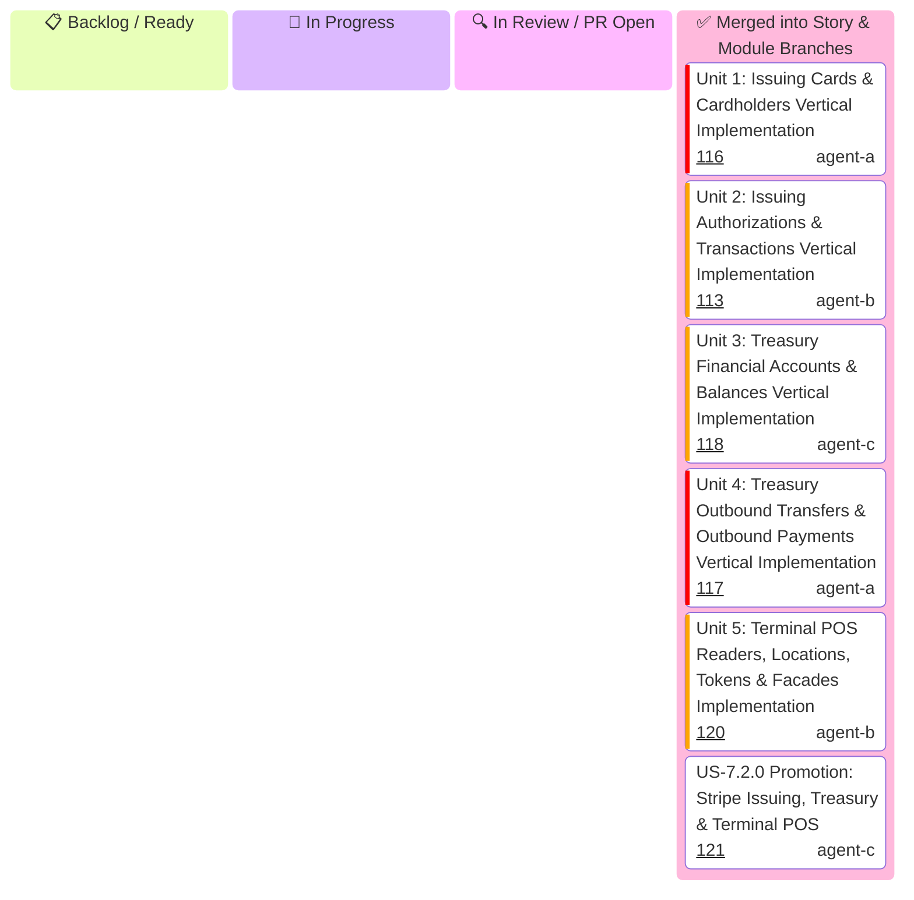

# US-7.2.0: Stripe Issuing, Treasury & Terminal — Story Kanban

Detailed tracking for **US-7.2.0 (Stripe Issuing, Treasury Financial Accounts & Terminal POS)** execution across all 5 Level 3 Micro-Units.

> [!IMPORTANT]
> **Parallel Implementation Architecture & Strict Role Boundaries (Rule 16)**:
> - **All 5 units are pure IMPLEMENTING units** (models, parameters, serializers, resource endpoints, and integration wire tests).
> - **Zero validation-only units**: Quality gates (G0–G4, G-Borrow, G2, G-Law, G-Complexity, G-Docs, G-Review) are enforced on every unit by independent gatekeeper subagents during PR code review.
> - **Zero inter-unit blocking**: Each unit owns an isolated vertical functional scope and distinct files, enabling **100% parallel execution** without merge blockades.
> - **Streaming Pipelined PRs & Ordered Cascading Merge Queue**: As each unit finishes in its worktree, its PR is opened immediately.

---

## 1. Unit Execution Kanban

---

## 2. Micro-Unit Specifications Matrix

| Unit ID | Unit Title & Functional Scope | Assigned Profile | Branch Name | Target PR Title | Status |
| :--- | :--- | :---: | :--- | :--- | :---: |
| **Unit 1** | **Issuing Cards & Cardholders Vertical Implementation**: `IssuingCard`, `IssuingCardholder`, `SpendingControls`, `SpendingLimit`, `CreateCardParams`, `UpdateCardParams`, `CreateCardholderParams`, `UpdateCardholderParams`, and `IssuingCardsResource` (`create`, `retrieve`, `update`, `list`). | `agent-a` | `feat/us-7.2.0/unit-1-issuing-cards-resource` | `feat(us-7.2.0/unit-1): issuing cards and cardholders domain models and resource endpoints` | ✅ Merged (#116) |
| **Unit 2** | **Issuing Authorizations & Transactions Vertical Implementation**: `IssuingAuthorization`, `IssuingTransaction`, `AuthorizationMerchantData`, `ApproveAuthorizationParams`, `DeclineAuthorizationParams`, `ListIssuingAuthorizationsParams`, `ListIssuingTransactionsParams`, and `IssuingAuthorizationsResource` (`retrieve`, `update`, `approve`, `decline`, `list`). | `agent-b` | `feat/us-7.2.0/unit-2-issuing-authorizations-resource` | `feat(us-7.2.0/unit-2): issuing authorizations and transactions domain models and ledger endpoints` | ✅ Merged (#113) |
| **Unit 3** | **Treasury Financial Accounts & Balances Vertical Implementation**: `FinancialAccount`, `FinancialAccountBalance`, `FinancialAccountFeatures`, `FinancialAddresses`, `CreateFinancialAccountParams`, `UpdateFinancialAccountParams`, `ListFinancialAccountsParams`, and `TreasuryFinancialAccountsResource` (`create`, `retrieve`, `update`, `list`, `close`). | `agent-c` | `feat/us-7.2.0/unit-3-treasury-financial-accounts-resource` | `feat(us-7.2.0/unit-3): treasury financial accounts domain models and resource endpoints` | ✅ Merged (#118) |
| **Unit 4** | **Treasury Outbound Transfers & Outbound Payments Vertical Implementation**: `OutboundTransfer`, `OutboundPayment`, `ReceivedCredit`, `CreateOutboundTransferParams`, `CancelOutboundTransferParams`, `CreateOutboundPaymentParams`, `CancelOutboundPaymentParams`, and `TreasuryTransfersResource` (`create`, `retrieve`, `cancel`, `list`). | `agent-a` | `feat/us-7.2.0/unit-4-treasury-transfers-resource` | `feat(us-7.2.0/unit-4): treasury outbound transfers and outbound payments resource implementation` | ✅ Merged (#117) |
| **Unit 5** | **Terminal POS Readers, Locations, Tokens & Facades Implementation**: `TerminalReader`, `TerminalLocation`, `ConnectionToken`, `CreateReaderParams`, `CreateLocationParams`, `CreateConnectionTokenParams`, `TerminalResource` (`readers`, `locations`, `connection_tokens`), and client namespace mounting `stripe.issuing()`, `stripe.treasury()`, `stripe.terminal()`. | `agent-b` | `feat/us-7.2.0/unit-5-terminal-and-product-namespaces` | `feat(us-7.2.0/unit-5): terminal reader pos resources and product namespaces mounting` | ✅ Merged (#120) |
| **US-7.2.0** | **US-7.2.0 Promotion: Stripe Issuing, Treasury Financial Accounts & Terminal POS**: Full promotion of Units 1..5 into `feat/module-7-specialized-product-namespaces`. | `agent-c` | `feat/us-7.2.0-stripe-issuing-treasury-and-terminal` | `feat(us-7.2.0): Stripe Issuing, Treasury Financial Accounts & Terminal POS (Units 1..5 Promotion)` | ✅ Merged (#121) |
