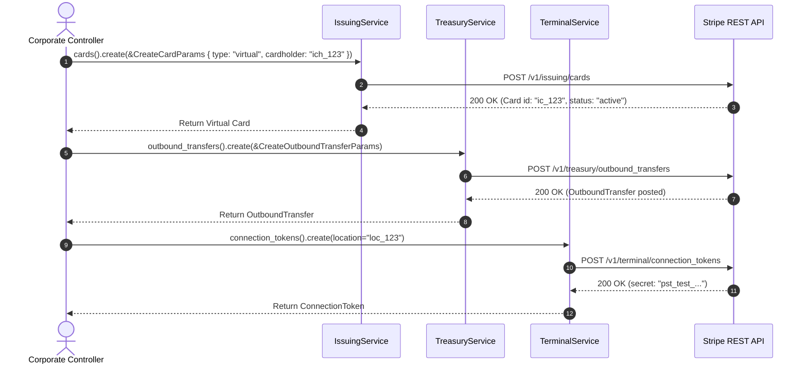

# US-7.2.0: Stripe Issuing, Treasury Financial Accounts & Terminal POS

> **Spec Kit Specification**: [Specification Lifecycle Active (.specify/)](../../../.specify/memory/constitution.md)  
> **Behavior Blueprint**: `features/specialized/modules/fintech/behaviours/issuing-treasury-terminal/`  
> **Slicing Standard**: [10-PR Vertical Slicing Framework](../../user-stories/README.md#the-10-pr-vertical-slicing-framework-rust-sdk-adaptation)  
> **Security Gateway**: `security-audit` Level 2 Enforced  
> **Quality Gates**: `(G0–G4 + G-Review + G-Borrow + G-Law)`  

---

## 1. Spec Kit Specification

### 1.1 User Story Narrative
**As a** modern fintech and vertical SaaS platform architect,  
**I want to** issue virtual/physical commercial payment cards via `stripe.issuing()`, manage commercial bank-replacement financial accounts via `stripe.treasury()`, and connect smart in-person payment readers via `stripe.terminal()`,  
**So that** our platform can provide all-in-one embedded banking, issue corporate employee spend cards with real-time spend limits, and accept in-person point-of-sale card payments.

#### 1.1.1 Preconditions
- The `issuing`, `treasury`, and `terminal` feature flags are enabled.
- KYC requirements for corporate Cardholders and Financial Accounts are satisfied.
- In-person readers are registered to a physical `Location`.

#### 1.1.2 Postconditions
- Virtual and physical `Card` records are provisioned with real-time authorization controls.
- `FinancialAccount` records track FDIC-insured commercial cash balances, ACH/Fedwire outbound transfers, and received credits.
- `ConnectionToken` objects authorize Terminal reader hardware for chip, contactless, and swipe card presentment.

### 1.2 Acceptance Criteria (Gherkin Scenarios)

```gherkin
Feature: Issuing, Treasury Financial Accounts, and Terminal POS

  Scenario: [AC-US-7.2.0-01] Create virtual commercial card with daily spending controls
    Given a verified individual Cardholder "ich_123"
    When client.issuing().cards().create(&CreateCardParams { cardholder: "ich_123".into(), currency: "usd".into(), type: "virtual".into(), spending_controls: Some(SpendingControlsParams { spending_limits: Some(vec![SpendingLimitParams { amount: 50000, interval: "daily".into(), ..Default::default() }]), ..Default::default() }), ..Default::default() }) is executed
    Then an active virtual Card "ic_123" is created
    And spending controls restrict daily volume to $500.00.

  Scenario: [AC-US-7.2.0-02] Outbound wire transfer from Treasury Financial Account
    Given a Treasury Financial Account "fa_123" with available balance $10,000.00
    When client.treasury().outbound_transfers().create(&CreateOutboundTransferParams { financial_account: "fa_123".into(), amount: 250000, currency: "usd".into(), destination_payment_method: "pm_bank_wire_123".into(), ..Default::default() }) is executed
    Then an OutboundTransfer "obt_123" is created with status "posted"
    And the financial account balance is debited by $2,500.00.

  Scenario: [AC-US-7.2.0-03] Generate Terminal connection token for smart reader
    Given an in-person retail Location "loc_123"
    When client.terminal().connection_tokens().create(&CreateConnectionTokenParams { location: Some("loc_123".into()) }) is executed
    Then a ConnectionToken is returned containing an ephemeral reader secret
    And enables POS hardware to communicate with Stripe payment rails.

  Scenario: [AC-US-7.2.0-LAW] Bank Secrecy Act (BSA) / Anti-Money Laundering (AML) & EMV Level 1/2
    Given commercial card issuance, Treasury money movement, or Terminal card presentment
    When transactions or wire transfers execute
    Then daily transaction velocity, suspicious activity reporting (SAR) thresholds, and EMV payment card security invariants are strictly maintained, fulfilling BSA/AML and EMV Level 1/2 certification rules.
```

### 1.3 Test Cases & Traceability Matrix

| Test Case ID | Target Criterion | Test Type | Execution Level | Verification Assertion & Pass Criteria |
| :--- | :--- | :--- | :--- | :--- |
| `TC-7.2.0-01` | `AC-US-7.2.0-01` | Functional | Integration | Assert `cards().create()` returns virtual card with configured spending limits. |
| `TC-7.2.0-02` | `AC-US-7.2.0-02` | Functional | Integration | Assert `outbound_transfers().create()` returns transfer with valid routing status. |
| `TC-7.2.0-03` | `AC-US-7.2.0-03` | Functional | Contract | Assert `connection_tokens().create()` returns ephemeral secret matching pattern. |
| `TC-7.2.0-LAW` | `AC-US-7.2.0-LAW` | Compliance | Contract | Assert Cardholder and Treasury Account models enforce mandatory KYC and FinCEN fields. |

---

## 2. Behavior-Centric Architecture & Folder Blueprint

### 2.1 Colocated Behaviour Directory Tree

```
features/specialized/modules/fintech/behaviours/issuing-treasury-terminal/
├── services/        # IssuingService, TreasuryService, TerminalService
├── logic/           # Spend limit validator, outbound wire validator, reader token manager
├── types/           # IssuingCard, Cardholder, FinancialAccount, OutboundTransfer, ConnectionToken
└── constants/       # ISSUING_ENDPOINTS, TREASURY_ENDPOINTS, TERMINAL_ENDPOINTS
```

### 2.2 Scoping & Promotion Blueprint
- **Tier 1 (Behaviour-Local)**: Spending control bounds checkers and reader location mappers.
- **Tier 2 (Module-Shared)**: `FinancialAccount` shared across Treasury and Connect payouts.
- **Tier 3 (Feature-Shared)**: Re-exported for `stripe.issuing()`, `stripe.treasury()`, `stripe.terminal()`.
- **Tier 4 (Global-Shared)**: Re-exported via `some_stripe::issuing::*`, etc.

---

## 3. Technical Implementation Plan

### 3.1 Domain Invariants & Storage Schema
- **PAN Isolation**: Primary Account Numbers (PAN) and CVV are never exposed via plain API; virtual cards use encrypted card reveal endpoints.
- **Balance Non-Negativity**: Treasury outbound transfers cannot exceed financial account available funds.
- **Rust Memory Law**: Strict borrowing of parameters (`&CreateCardParams`); zero deep clones.

### 3.2 Activity & Interaction Diagram



---

## 4. Granular Implementation Tasks

### 4.1 The 10-PR Vertical Slicing Implementation Plan

| PR # | Pillar | Architectural Layer | Primary Scope & Files | Deliverables & Acceptance | Accountable Role / Agent | Assigned Skills |
| :--- | :--- | :--- | :--- | :--- | :--- | :--- |
| **PR 1** | **Pillar 1** | **Issuing Domain Entities** | `crates/some-stripe-issuing/src/types/card.rs` | Strongly typed `Card`, `Cardholder`, `Authorization`. | `domain-codegen-specialist` | `stripe-docs` |
| **PR 2** | **Pillar 2** | **Treasury Domain Entities** | `crates/some-stripe-treasury/src/types/account.rs` | Strongly typed `FinancialAccount`, `OutboundTransfer`. | `domain-codegen-specialist` | `stripe-docs` |
| **PR 3** | **Pillar 3** | **Terminal Domain Entities** | `crates/some-stripe-terminal/src/types/reader.rs` | Strongly typed `Reader`, `Location`, `ConnectionToken`. | `domain-codegen-specialist` | `stripe-docs` |
| **PR 4** | **Pillar 4** | **Issuing Resource Implementation** | `crates/some-stripe-issuing/src/resources/cards.rs` | `create`, `retrieve`, `update` cards and cardholders. | `domain-codegen-specialist` | `stripe-docs` |
| **PR 5** | **Pillar 5** | **Treasury Resource Implementation** | `crates/some-stripe-treasury/src/resources/transfers.rs` | `create`, `retrieve`, `cancel` outbound transfers. | `domain-codegen-specialist` | `stripe-docs` |
| **PR 6** | **Pillar 6** | **Terminal Resource Implementation** | `crates/some-stripe-terminal/src/resources/tokens.rs` | `create` connection tokens and reader management. | `domain-codegen-specialist` | `stripe-docs` |
| **PR 7** | **Pillar 7** | **Facade Mounting** | `crates/some-stripe-issuing/src/facade.rs` | Mount `stripe.issuing()`, `stripe.treasury()`, `stripe.terminal()`. | `microkernel-architect` | `stripe-docs` |
| **PR 8** | **Pillar 8** | **Zero-Clone Borrowing Audit** | `crates/some-stripe-issuing/src/resources/cards.rs` | Verify zero deep `.clone()` on issuing and treasury models. | `engineering-rust-refactoring-specialist` | `stripe-best-practices` |
| **PR 9** | **Pillar 9** | **Stripe-Mock Wire Verification** | `tests/issuing_treasury_terminal_mock_test.rs` | End-to-end card issuance and treasury transfer on `stripe-mock`. | `testing-api-tester` | `stripe-docs` |
| **PR 10** | **Pillar 10** | **Fintech Infrastructure Docs** | `README.md`, `docs/fintech.md` | Guide on commercial cards, treasury banking, and POS setup. | `engineering-technical-writer` | `stripe-docs` |

### 4.2 Implementation Phase Breakdown

#### Phase 1: Models & Banking Schemas (PR 1–3)
- [ ] **Task 1.1 (Types)**: Define `Card`, `Cardholder`, `FinancialAccount`, and `ConnectionToken` in `types/`.  
  *Agent*: `domain-codegen-specialist` | *Skill*: `stripe-docs`
- [ ] **Task 1.2 (Constants)**: Pin endpoints `/v1/issuing/*`, `/v1/treasury/*`, `/v1/terminal/*` in `constants/`.  
  *Agent*: `domain-codegen-specialist` | *Skill*: `stripe-docs`
- [ ] **Task 1.3 (Logic)**: Implement parameter builders for card spending limits and outbound transfers.  
  *Agent*: `domain-codegen-specialist` | *Skill*: `stripe-best-practices`
- [ ] **Task 1.4 (Unit Tests)**: Verify JSON deserialization of Issuing and Treasury fixture payloads.  
  *Agent*: `testing-api-tester` | *Skill*: `stripe-docs`

#### Phase 2: Resource Methods & Wire Execution (PR 4–7)
- [ ] **Task 2.1 (Issuing)**: Implement `IssuingResource` with cards, cardholders, and authorizations.  
  *Agent*: `domain-codegen-specialist` | *Skill*: `stripe-docs`
- [ ] **Task 2.2 (Treasury)**: Implement `TreasuryResource` with financial accounts and outbound wire transfers.  
  *Agent*: `domain-codegen-specialist` | *Skill*: `stripe-docs`
- [ ] **Task 2.3 (Terminal)**: Implement `TerminalResource` with connection tokens and reader management.  
  *Agent*: `domain-codegen-specialist` | *Skill*: `stripe-docs`
- [ ] **Task 2.4 (Facade)**: Expose fintech accessors on `StripeClient`.  
  *Agent*: `microkernel-architect` | *Skill*: `stripe-docs`

#### Phase 3: Zero-Clone Borrowing & Spend Limit Validation (PR 8–9)
- [ ] **Task 3.1 (Borrow Check)**: Verify zero `.clone()` calls during Treasury and Issuing response parsing.  
  *Agent*: `engineering-rust-refactoring-specialist` | *Skill*: `stripe-best-practices`
- [ ] **Task 3.2 (Limit Tests)**: Assert spending limit bounds checks reject negative limits locally.  
  *Agent*: `testing-api-tester` | *Skill*: `stripe-docs`

#### Phase 4: Mock Verification & Release Sign-Off (PR 9–10)
- [ ] **Task 4.1 (Mock Suite)**: Run full issuing, treasury, and terminal flows against `stripe-mock`.  
  *Agent*: `testing-api-tester` | *Skill*: `stripe-docs`
- [ ] **Task 4.2 (G-Review)**: Peer review for banking compliance and cryptographic secret handling.  
  *Agent*: `engineering-code-reviewer` | *Skill*: `stripe-best-practices`
- [ ] **Task 4.3 (Docs)**: Publish developer documentation for commercial card issuance and Treasury banking.  
  *Agent*: `engineering-technical-writer` | *Skill*: `stripe-docs`

---

## 5. Security Gateway (Powered by security-audit)

### 5.1 Trust Boundaries & Security Actors
- **Trust Boundaries**:
  - `Cardholder PII Boundary`: Identity information for card recipients.
  - `Treasury Wire Rails`: Outbound ACH and Fedwire payment instructions.
  - `POS Hardware Boundary`: Physical Terminal devices in retail environments.
- **Authorized Principals**:
  - Corporate Treasurer: Authorized to initiate outbound Treasury wire movements.

### 5.2 Threat Modeling & Abuse Matrix (STRIDE / ASVS)

| Threat Vector | Severity | Vulnerability Mechanism | Mitigating Control & Security Invariant |
| :--- | :--- | :--- | :--- |
| **Card Spending Limit Bypass** | Critical | Attacker modifying spending limits to drain corporate funds | Server-side spending limits enforced authoritatively on authorization. |
| **Unauthorized Wire Drain** | Critical | Forging outbound wire transfer instruction | Strong customer authorization and restricted API keys required for Treasury transfers. |
| **POS Reader Token Interception** | High | Connection token stolen to listen to card swipes | Connection tokens expire after short TTL and bind strictly to specific reader location. |

### 5.3 Cryptographic & Data Protection Controls
- **Zero Raw PAN Storage**: Virtual cards reveal full PAN only over client-side encrypted iframe.
- **TLS 1.3 Transport**: Mandatory encrypted transport for all Treasury and Terminal calls.

### 5.4 Automated Security Verification Checklist
- [ ] **PAN Leakage Scan**: Automated test asserts zero 16-digit card numbers in application memory.
- [ ] **Spending Limit Test**: Assert that spending controls enforce daily, weekly, or monthly caps.

### 5.5 Security Gateway (G2) Sign-Off Checklist
- [ ] Bank Secrecy Act / AML compliance verified.
- [ ] Zero PAN data handling confirmed under PCI-DSS SAQ A.
- [ ] Code review sign-off obtained; zero findings.

---

## 6. Validation Gates & Acceptance Sign-Off

**Status: Ready for Implementation.**

### G1 — Test coverage
- [ ] **US-7.2.0-G1:** >=90% line and branch coverage across `issuing.rs`, `treasury.rs`, and `terminal.rs`.

### G2 — Security audit
- [ ] **US-7.2.0-G2:** Commercial banking security and PAN isolation verified under security-audit.

### G3 — Architecture and maintainability
- [ ] **US-7.2.0-G3:** Clean feature isolation under `feature = "issuing"`, `feature = "treasury"`, `feature = "terminal"`.

### G-Review — Code review
- [ ] **US-7.2.0-G-Review:** Senior review approved by `engineering-code-reviewer`.

### G-Borrow — Rust zero-clone borrowing validation
- [ ] **US-7.2.0-G-Borrow:** Parameters borrowed strictly by reference; zero deep clones.

### G-Law — Law validation
- [ ] **US-7.2.0-G-Law:** Bank Secrecy Act (BSA) and EMV Level 1/2 payment compliance certified.

### G4 — Integrated acceptance
- [ ] **US-7.2.0-G4:** End-to-end card creation and treasury wire transfer validated against `stripe-mock`.
