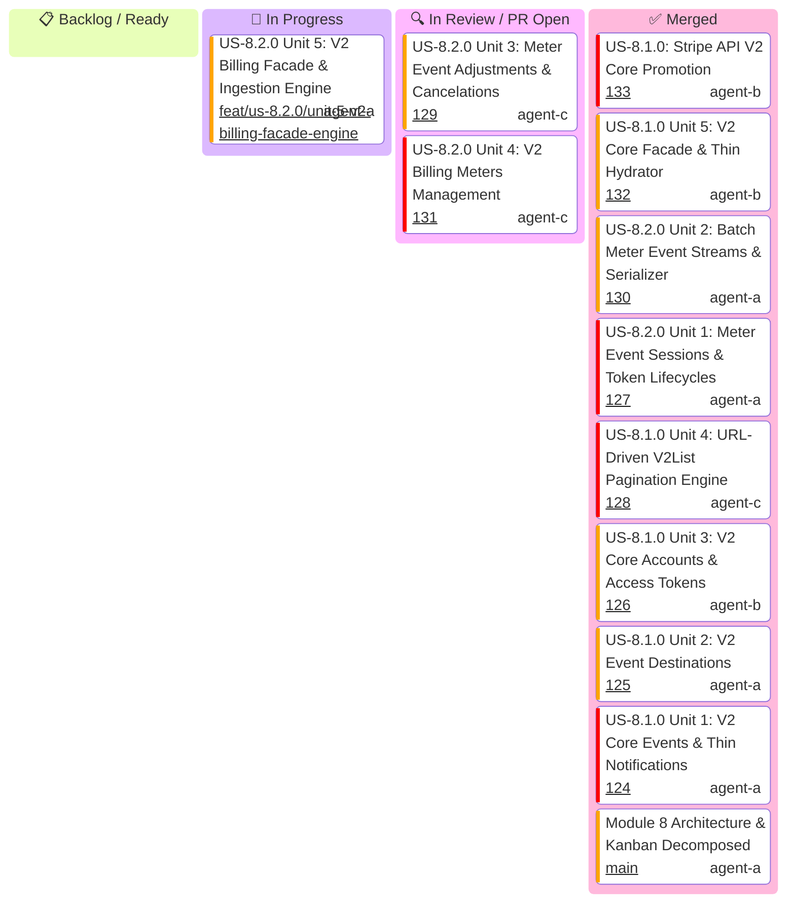

# Module 8: API V2 Next-Gen Services — Master Kanban & Task Tracking

Master hierarchical task tracking for **Module 8 (API V2 Next-Gen Services)**.

> [!IMPORTANT]
> **Parallel Implementation Architecture & Strict Role Boundaries (Rule 16)**:
> - **All 10 units across US-8.1.0 and US-8.2.0 are pure IMPLEMENTING units** (models, parameters, serializers, resource endpoints, and integration wire tests).
> - **Zero validation-only units**: Quality gates (G0–G4, G-Borrow, G2, G-Law, G-Complexity, G-Docs, G-Review) are enforced on every unit PR by independent gatekeeper subagents during code review.
> - **Zero inter-unit blocking**: Each unit owns an isolated vertical functional scope and distinct files, enabling **100% parallel execution** without merge blockades.
> - **Streaming Pipelined PRs & Ordered Cascading Merge Queue**: As each unit finishes in its worktree, its PR is opened immediately.

---

## 1. Executive Status Board

---

## 2. Micro-Unit Decomposition & Implementation Workstreams

### US-8.1.0: Stripe API V2 Core, Event Destinations & Thin Event Hydration
- **Unit 1**: **V2 Core Events & Thin Notifications** (`V2Event`, `V2ThinEvent`, `V2RelatedObject`, `V2EventContext`, `ListV2EventsParams`, `V2EventsResource` (`retrieve`, `list`)).
- **Unit 2**: **V2 Event Destinations** (`EventDestination`, `AmazonEventBridgeDetails`, `AzureEventGridDetails`, `CreateEventDestinationParams`, `EventDestinationsResource` (`create`, `retrieve`, `update`, `del`, `list`, `enable`, `disable`, `ping`)).
- **Unit 3**: **V2 Core Accounts & Access Tokens** (`V2Account`, `V2AccountStatus`, `V2AccountConfiguration`, `CreateV2AccountParams`, `V2AccountsResource` (`create`, `retrieve`, `update`, `del`, `list`, `create_token`)).
- **Unit 4**: **URL-Driven V2List Pagination Engine** (`V2List<T>`, `V2PageInfo`, `V2Paginator<T>` streaming engine consuming `next_page_url` and `previous_page_url`).
- **Unit 5**: **V2 Core Facade & Thin Hydrator** (`V2Core` facade mounting `events()`, `event_destinations()`, `accounts()`, `ThinEventHydrator`, replay protection guard, client facade mounting `client.v2().core()`).

### US-8.2.0: High-Throughput Usage Meter Ingestion & Event Stream Billing
- **Unit 1**: **Meter Event Sessions & Token Lifecycles** (`MeterEventSession`, `CreateMeterEventSessionParams`, `MeterEventSessionResource` (`create`, `retrieve`, `expire`), zeroization on drop).
- **Unit 2**: **Batch Meter Event Streams & Serializer** (`MeterEventPayload`, `MeterPayload`, `MeterEventBatch`, `CreateMeterEventStreamParams`, `MeterBatchSerializer`, `MeterEventStreamResource` (`create`, `create_batch`)).
- **Unit 3**: **Meter Event Adjustments & Cancelations** (`MeterEventAdjustment`, `CancelAdjustmentDetails`, `CreateMeterEventAdjustmentParams`, `MeterEventAdjustmentsResource` (`create`, `retrieve`, `list`)).
- **Unit 4**: **V2 Billing Meters Management** (`V2BillingMeter`, `MeterStatus`, `ValueSettings`, `CreateBillingMeterParams`, `BillingMetersResource` (`create`, `retrieve`, `update`, `deactivate`, `reactivate`, `list`)).
- **Unit 5**: **V2 Billing Facade & Ingestion Engine** (`V2Billing` facade mounting `meter_event_session()`, `meter_event_stream()`, `meter_event_adjustments()`, `meters()`, `MeterIngestionEngine`, client facade mounting `client.v2().billing()`).
