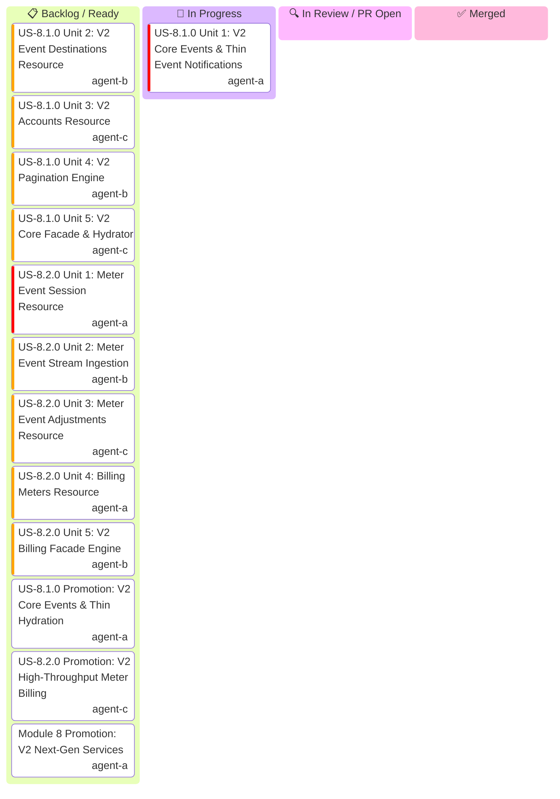

# Module 8: Stripe API V2 Next-Gen Services — Master Kanban & Task Tracking

Master hierarchical task tracking for **Module 8 (Stripe API V2 Next-Gen Services)**.

> [!IMPORTANT]
> **Parallel Implementation Architecture & Strict Role Boundaries (Rule 16)**:
> - **All 10 units across US-8.1.0 and US-8.2.0 are pure IMPLEMENTING units** (models, parameters, serializers, resource endpoints, and integration wire tests).
> - **Zero validation-only units**: Quality gates (G0–G4, G-Borrow, G2, G-Law, G-Complexity, G-Docs, G-Review) are enforced on every unit PR by independent gatekeeper subagents during code review.
> - **Zero inter-unit blocking**: Each unit owns an isolated vertical functional scope and distinct files, enabling **100% parallel execution** without merge blockades.
> - **Streaming Pipelined PRs & Ordered Cascading Merge Queue**: As each unit finishes in its worktree, its PR is opened immediately.

---

## 1. Executive Status Board

---

## 2. Micro-Unit Decomposition & Implementation Workstreams

### US-8.1.0: Stripe API V2 Core, Event Destinations & Thin Event Hydration
- **Unit 1**: **V2 Core Events & Thin Event Notifications** (`V2Event`, `V2RelatedObject`, `V2EventContext`, `V2EventReason`, `ListV2EventsParams`, `V2EventsResource` (`retrieve`, `list`)).
- **Unit 2**: **V2 Event Destinations Resource** (`EventDestination`, EventBridge/Webhook/EventGrid params, `V2EventDestinationsResource` (`create`, `retrieve`, `update`, `delete`, `enable`, `disable`, `ping`)).
- **Unit 3**: **V2 Accounts Resource** (`V2Account`, `V2AccountsResource` (`retrieve`, `list`)).
- **Unit 4**: **V2 Pagination Engine** (`V2List<T>`, URL-driven next_page_url streaming, automatic page traversal).
- **Unit 5**: **V2 Core Facade & Hydrator Engine** (`client.v2().core().events()`, thin event live hydration orchestration).

### US-8.2.0: High-Throughput Usage Meter Ingestion & Event Stream Billing
- **Unit 1**: **Meter Event Session Resource** (`MeterEventSession`, session tokens, `V2MeterEventSessionsResource`).
- **Unit 2**: **Meter Event Stream Ingestion** (`MeterEventStream`, high-throughput batch ingestion, payload models).
- **Unit 3**: **Meter Event Adjustments Resource** (`MeterEventAdjustment`, cancel adjustments, deduction calculations).
- **Unit 4**: **Billing Meters Resource** (`BillingMeter`, meter configurations, status models).
- **Unit 5**: **V2 Billing Facade Engine** (`client.v2().billing()`, unified meter billing namespace mounting).
