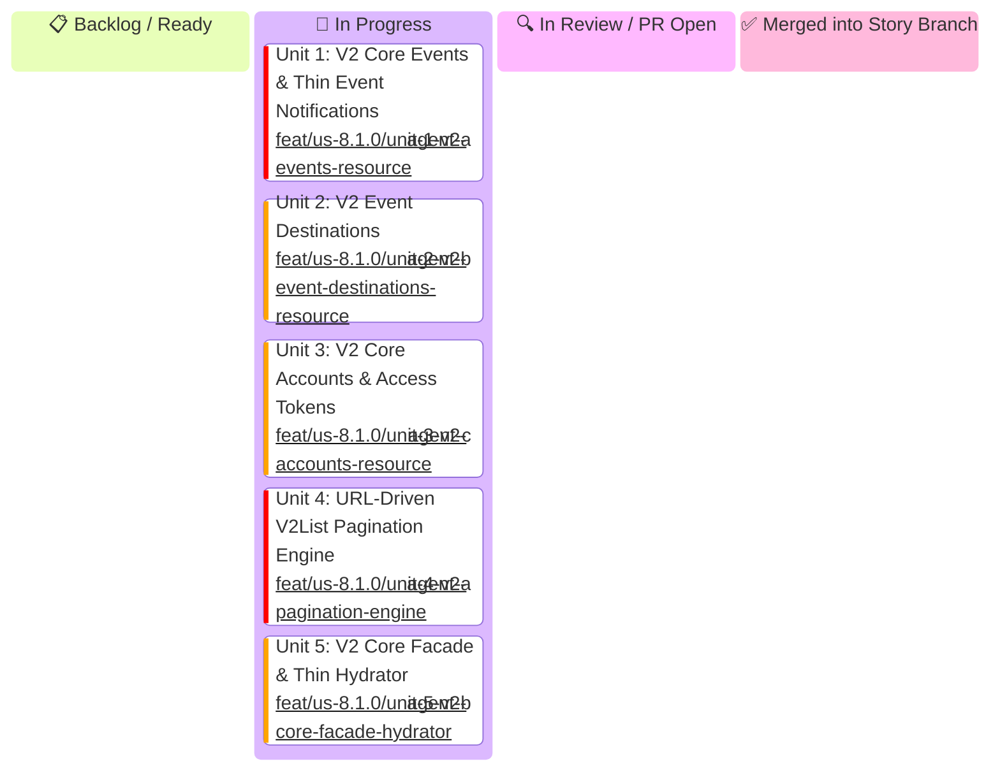

# US-8.1.0: Stripe API V2 Core, Event Destinations & Thin Event Hydration — Kanban Board

Hierarchical task tracking for **US-8.1.0 (Stripe API V2 Core, Event Destinations & Thin Event Hydration)**.

---

## 1. Status Board

---

## 2. Micro-Unit Specifications Matrix

| Unit ID | Unit Title & Functional Scope | Assigned Profile | Branch Name | Target PR Title | Status |
| :--- | :--- | :---: | :--- | :--- | :---: |
| **Unit 1** | **V2 Core Events & Thin Event Notifications**: `V2Event`, `V2ThinEvent`, `V2RelatedObject`, `V2EventContext`, `V2EventReason`, `ListV2EventsParams`, and `V2EventsResource` (`retrieve`, `list`). | `agent-a` | `feat/us-8.1.0/unit-1-v2-events-resource` | `feat(us-8.1.0/unit-1): v2 core events and thin event notifications domain entities and resource` | 📋 Backlog |
| **Unit 2** | **V2 Event Destinations**: `EventDestination`, `AmazonEventBridgeDetails`, `AzureEventGridDetails`, `WebhookEndpointDetails`, `CreateEventDestinationParams`, `UpdateEventDestinationParams`, and `EventDestinationsResource` (`create`, `retrieve`, `update`, `del`, `list`, `enable`, `disable`, `ping`). | `agent-b` | `feat/us-8.1.0/unit-2-v2-event-destinations-resource` | `feat(us-8.1.0/unit-2): event destinations domain models and resource endpoints` | 📋 Backlog |
| **Unit 3** | **V2 Core Accounts & Access Tokens**: `V2Account`, `V2AccountStatus`, `V2AccountConfiguration`, `V2AccountToken`, `CreateV2AccountParams`, `UpdateV2AccountParams`, `ListV2AccountsParams`, `CreateV2AccountTokenParams`, and `V2AccountsResource` (`create`, `retrieve`, `update`, `del`, `list`, `create_token`). | `agent-c` | `feat/us-8.1.0/unit-3-v2-accounts-resource` | `feat(us-8.1.0/unit-3): v2 core accounts and token entities and resource endpoints` | 📋 Backlog |
| **Unit 4** | **URL-Driven V2List Pagination Engine**: `V2List<T>`, `V2PageInfo`, `V2Paginator<T>` stream implementation navigating `next_page_url` and `previous_page_url` with query preservation, and pagination integration on resources. | `agent-a` | `feat/us-8.1.0/unit-4-v2-pagination-engine` | `feat(us-8.1.0/unit-4): url-driven v2 list pagination and stream engine` | 📋 Backlog |
| **Unit 5** | **V2 Core Facade & Thin Hydrator**: `V2Core` resource facade mounting `events()`, `event_destinations()`, `accounts()`, `ThinEventHydrator` (`hydrate_thin_event`), replay protection drift guard, and `StripeClient` integration `client.v2().core()`. | `agent-b` | `feat/us-8.1.0/unit-5-v2-core-facade-hydrator` | `feat(us-8.1.0/unit-5): v2 core facade and thin event hydrator implementation` | 📋 Backlog |
