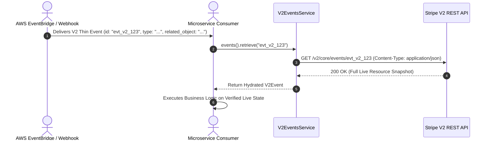

# US-8.1.0: Stripe API V2 Core, Event Destinations & Thin Event Hydration

> **Spec Kit Specification**: [Specification Lifecycle Active (.specify/)](../../../.specify/memory/constitution.md)  
> **Behavior Blueprint**: `features/v2/modules/core/behaviours/v2-events-and-hydration/`  
> **Slicing Standard**: [10-PR Vertical Slicing Framework](../../user-stories/README.md#the-10-pr-vertical-slicing-framework-rust-sdk-adaptation)  
> **Security Gateway**: `security-audit` Level 2 Enforced  
> **Quality Gates**: `(G0–G4 + G-Review + G-Borrow + G-Law)`  

---

## 1. Spec Kit Specification

### 1.1 User Story Narrative
**As an** event-driven systems architect building modern microservices with Stripe API v2,  
**I want to** ingest lightweight V2 Thin Events, configure enterprise Event Destinations (Webhook endpoints, Amazon EventBridge, Azure Event Grid) via `stripe.v2.core.event_destinations()`, and perform authenticated live resource hydration via `stripe.v2.core.events().retrieve(event_id)` using operation-scoped JSON schemas and URL-driven pagination,  
**So that** our cloud infrastructure eliminates stale webhook replay vulnerabilities, scales across massive event notification volumes without bandwidth saturation, and routes events natively into AWS/Azure event buses.

#### 1.1.1 Preconditions
- The `v2-core` feature flag is enabled in `Cargo.toml`.
- The `StripeClient` is initialized with dual-protocol support.
- Event destinations are configured for Webhook, Amazon EventBridge, or Azure Event Grid.

#### 1.1.2 Postconditions
- Inbound V2 Thin Events contain lightweight notification metadata (`id`, `type`, `created`, `related_object`).
- Invoking `client.v2().core().events().retrieve(event_id)` fetches the live authenticated resource over API v2 using strict JSON serialization.
- `V2List<T>` paginates using `next_page_url` without base path re-construction.

### 1.2 Acceptance Criteria (Gherkin Scenarios)

```gherkin
Feature: Stripe API V2 Core and Thin Event Hydration

  Scenario: [AC-US-8.1.0-01] V2 Thin Event notification ingestion and authenticated hydration
    Given an inbound V2 Thin Event with type "v2.billing.meter.error_report_triggered" and related_object "meter_123"
    When the application receives the lightweight notification envelope
    And invokes client.v2().core().events().retrieve("evt_v2_123")
    Then the client executes GET /v2/core/events/evt_v2_123 with Content-Type application/json
    And returns the full authenticated V2Event resource with live state.

  Scenario: [AC-US-8.1.0-02] Configure Amazon EventBridge Event Destination
    Given an AWS account ID "123456789012" and AWS region "us-east-1"
    When client.v2().core().event_destinations().create(&CreateEventDestinationParams { type: "amazon_eventbridge".into(), amazon_eventbridge: Some(AmazonEventBridgeParams { aws_account_id: "123456789012".into(), aws_region: "us-east-1".into() }), events: vec!["v2.*".into()], ..Default::default() }) is executed
    Then an EventDestination is created with status "enabled"
    And partner event source ARN is generated for AWS EventBridge.

  Scenario: [AC-US-8.1.0-03] URL-driven V2List pagination following next_page_url
    Given multiple pages of V2 Event records
    When client.v2().core().events().list().auto_paging_each() streams results
    Then the Paginator follows the exact next_page_url provided in the response envelope
    And seamlessly terminates when next_page_url is None.

  Scenario: [AC-US-8.1.0-LAW] Event logging and NIST SP 800-92 security event logging
    Given all ingested V2 events and destination configuration updates
    When recorded by system audit monitors
    Then events are logged with authenticated source credentials, monotonic timestamps, and zero credentials in accordance with NIST SP 800-92 log management standards.
```

### 1.3 Test Cases & Traceability Matrix

| Test Case ID | Target Criterion | Test Type | Execution Level | Verification Assertion & Pass Criteria |
| :--- | :--- | :--- | :--- | :--- |
| `TC-8.1.0-01` | `AC-US-8.1.0-01` | Functional | Integration | Assert `events().retrieve()` returns full live hydrated payload for thin event ID. |
| `TC-8.1.0-02` | `AC-US-8.1.0-02` | Functional | Integration | Assert EventBridge destination returns active status and AWS account binding. |
| `TC-8.1.0-03` | `AC-US-8.1.0-03` | Stream | Integration | Assert `V2List` auto-pagination accurately follows `next_page_url` links. |
| `TC-8.1.0-LAW` | `AC-US-8.1.0-LAW` | Compliance | Audit | Verify audit trail captures event destination updates with principal metadata. |

---

## 2. Behavior-Centric Architecture & Folder Blueprint

### 2.1 Colocated Behaviour Directory Tree

```
features/v2/modules/core/behaviours/v2-events-and-hydration/
├── services/        # V2EventsService, V2EventDestinationsService, V2AccountsService
├── logic/           # Thin event hydrator, URL pagination navigator, destination validator
├── types/           # V2Event, V2ThinEvent, EventDestination, V2List, RelatedObject
└── constants/       # V2_CORE_BASE ("/v2/core"), DESTINATION_TYPES, V2_CONTENT_TYPE
```

### 2.2 Scoping & Promotion Blueprint
- **Tier 1 (Behaviour-Local)**: `next_page_url` string parser and AWS ARN validator.
- **Tier 2 (Module-Shared)**: `V2Event` and `V2List` shared across all v2 services.
- **Tier 3 (Feature-Shared)**: Re-exported for `client.v2().core.*` hierarchy.
- **Tier 4 (Global-Shared)**: Re-exported via `some_stripe::v2::core::*`.

---

## 3. Technical Implementation Plan

### 3.1 Domain Invariants & Storage Schema
- **Strict JSON Invariant**: All requests to `/v2/*` MUST send `Content-Type: application/json` with operation-scoped JSON bodies (zero form encoding).
- **HATEOAS Pagination Invariant**: `V2List<T>` relies strictly on `next_page_url` and `previous_page_url` rather than manual `starting_after` cursor construction.
- **Rust Memory Law**: Strict borrowing of parameters (`&CreateEventDestinationParams`); zero deep clones.

### 3.2 Activity & Interaction Diagram



---

## 4. Granular Implementation Tasks

### 4.1 The 10-PR Vertical Slicing Implementation Plan

| PR # | Pillar | Architectural Layer | Primary Scope & Files | Deliverables & Acceptance | Accountable Role / Agent | Assigned Skills |
| :--- | :--- | :--- | :--- | :--- | :--- | :--- |
| **PR 1** | **Pillar 1** | **API V2 Core Domain Entities** | `crates/some-stripe-v2/src/types/event.rs` | Strongly typed `V2Event`, `V2ThinEvent`, `RelatedObject`. | `microkernel-architect` | `stripe-docs` |
| **PR 2** | **Pillar 2** | **Event Destinations Models** | `crates/some-stripe-v2/src/types/destination.rs` | Strongly typed `EventDestination`, EventBridge, Event Grid DTOs. | `domain-codegen-specialist` | `stripe-docs` |
| **PR 3** | **Pillar 3** | **V2 JSON Client Pipeline** | `crates/some-stripe-v2/src/client.rs` | Dedicated HTTP dispatch sending `application/json` for v2. | `microkernel-architect` | `stripe-best-practices` |
| **PR 4** | **Pillar 4** | **URL-Driven V2List Paginator** | `crates/some-stripe-v2/src/pagination.rs` | `V2List<T>` streaming engine consuming `next_page_url`. | `microkernel-architect` | `stripe-docs` |
| **PR 5** | **Pillar 5** | **V2 Events Resource Implementation** | `crates/some-stripe-v2/src/resources/events.rs` | `retrieve`, `list` V2 events for thin event hydration. | `domain-codegen-specialist` | `stripe-docs` |
| **PR 6** | **Pillar 6** | **Event Destinations Resource** | `crates/some-stripe-v2/src/resources/destinations.rs` | `create`, `retrieve`, `update`, `del`, `enable`, `disable`, `ping`. | `domain-codegen-specialist` | `stripe-docs` |
| **PR 7** | **Pillar 7** | **Facade Mounting (stripe.v2)** | `crates/some-stripe-v2/src/facade.rs` | Mount `client.v2().core.events`, `event_destinations`. | `microkernel-architect` | `stripe-docs` |
| **PR 8** | **Pillar 8** | **Zero-Clone Borrowing Audit** | `crates/some-stripe-v2/src/resources/events.rs` | Verify zero deep `.clone()` on V2 event models and related objects. | `engineering-rust-refactoring-specialist` | `stripe-best-practices` |
| **PR 9** | **Pillar 9** | **Stripe-Mock Wire Verification** | `tests/v2_core_mock_test.rs` | End-to-end V2 event retrieval and EventBridge destination test. | `testing-api-tester` | `stripe-docs` |
| **PR 10** | **Pillar 10** | **V2 Architecture Documentation** | `README.md`, `docs/v2_architecture.md` | Migration guide from V1 snapshot webhooks to V2 thin events. | `engineering-technical-writer` | `upgrade-stripe` |

### 4.2 Implementation Phase Breakdown

#### Phase 1: Models & DTO Schemas (PR 1–3)
- [ ] **Task 1.1 (Types)**: Define `V2Event`, `V2ThinEvent`, `EventDestination`, and `V2List` in `types/`.  
  *Agent*: `microkernel-architect` | *Skill*: `stripe-docs`
- [ ] **Task 1.2 (Constants)**: Pin `/v2/core/events` and `/v2/core/event_destinations` in `constants/`.  
  *Agent*: `domain-codegen-specialist` | *Skill*: `stripe-docs`
- [ ] **Task 1.3 (Logic)**: Implement `CreateEventDestinationParams` builder with EventBridge validation.  
  *Agent*: `domain-codegen-specialist` | *Skill*: `stripe-best-practices`
- [ ] **Task 1.4 (Unit Tests)**: Verify JSON deserialization of V2Event fixture payloads.  
  *Agent*: `testing-api-tester` | *Skill*: `stripe-docs`

#### Phase 2: Resource Methods & Wire Execution (PR 4–7)
- [ ] **Task 2.1 (Events)**: Implement `V2EventsResource::retrieve` with automatic bearer authentication.  
  *Agent*: `domain-codegen-specialist` | *Skill*: `stripe-docs`
- [ ] **Task 2.2 (Destinations)**: Implement `V2EventDestinationsResource` with ping and enable/disable.  
  *Agent*: `domain-codegen-specialist` | *Skill*: `stripe-docs`
- [ ] **Task 2.3 (Pagination)**: Implement `V2List` stream engine navigating `next_page_url`.  
  *Agent*: `microkernel-architect` | *Skill*: `stripe-docs`
- [ ] **Task 2.4 (Facade)**: Expose `client.v2().core` hierarchy on `StripeClient`.  
  *Agent*: `microkernel-architect` | *Skill*: `stripe-docs`

#### Phase 3: Zero-Clone Borrowing & Thin Hydration Tests (PR 8–9)
- [ ] **Task 3.1 (Borrow Check)**: Verify zero `.clone()` calls during V2 event hydration.  
  *Agent*: `engineering-rust-refactoring-specialist` | *Skill*: `stripe-best-practices`
- [ ] **Task 3.2 (Hydration Flow)**: Test thin event reception -> retrieve live event -> assert attributes match.  
  *Agent*: `testing-api-tester` | *Skill*: `upgrade-stripe`

#### Phase 4: Mock Verification & Release Sign-Off (PR 9–10)
- [ ] **Task 4.1 (Mock Suite)**: Run full V2 core suite against `stripe-mock`.  
  *Agent*: `testing-api-tester` | *Skill*: `stripe-docs`
- [ ] **Task 4.2 (G-Review)**: Peer review for V2 protocol adherence and HATEOAS link traversal.  
  *Agent*: `engineering-code-reviewer` | *Skill*: `stripe-best-practices`
- [ ] **Task 4.3 (Docs)**: Publish developer documentation comparing V1 snapshot events and V2 thin hydration.  
  *Agent*: `engineering-technical-writer` | *Skill*: `upgrade-stripe`

---

## 5. Security Gateway (Powered by security-audit)

### 5.1 Trust Boundaries & Security Actors
- **Trust Boundaries**:
  - `Thin Notification Boundary`: Lightweight event payload signaling state change.
  - `Authenticated V2 Fetch`: TLS 1.3 API call retrieving authoritative state from Stripe.
- **Authorized Principals**:
  - Event Consumer Service: Authorized via platform API key to query `/v2/core/events`.

### 5.2 Threat Modeling & Abuse Matrix (STRIDE / ASVS)

| Threat Vector | Severity | Vulnerability Mechanism | Mitigating Control & Security Invariant |
| :--- | :--- | :--- | :--- |
| **Stale Webhook Replay** | Critical | Attacker replaying intercepted historical webhook | Thin events trigger live authenticated retrieval; state is fetched fresh from Stripe. |
| **Destination ARN Tampering** | High | Adversary routing events to unauthorized AWS account | Event destination creation validates AWS account ID against permitted whitelist. |
| **JSON Deserialization DOS** | Medium | Malformed JSON in V2 responses crashing client | Serde JSON parser operates with strict recursion and size limits. |

### 5.3 Cryptographic & Data Protection Controls
- **Freshness Verification**: Live retrieval guarantees zero replay attacks on historical events.
- **TLS 1.3 Transport**: Strict encryption in transit across all V2 Core API endpoints.

### 5.4 Automated Security Verification Checklist
- [ ] **Live State Test**: Assert that thin event hydration fetches verified current state from API.
- [ ] **JSON Schema Validation**: Verify invalid JSON returned by mock triggers clean `StripeError::JsonError`.

### 5.5 Security Gateway (G2) Sign-Off Checklist
- [ ] Elimination of stale replay vulnerabilities verified via live hydration flow.
- [ ] EventBridge partner event source security validated.
- [ ] Code review sign-off obtained; zero findings.

---

## 6. Validation Gates & Acceptance Sign-Off

**Status: Ready for Implementation.**

### G1 — Test coverage
- [ ] **US-8.1.0-G1:** >=90% line and branch coverage across `v2_events.rs` and `v2_destinations.rs`.

### G2 — Security audit
- [ ] **US-8.1.0-G2:** Thin event hydration and destination routing security verified under security-audit.

### G3 — Architecture and maintainability
- [ ] **US-8.1.0-G3:** Clean feature isolation under `feature = "v2-core"`.

### G-Review — Code review
- [ ] **US-8.1.0-G-Review:** Senior review approved by `engineering-code-reviewer`.

### G-Borrow — Rust zero-clone borrowing validation
- [ ] **US-8.1.0-G-Borrow:** Parameters borrowed strictly by reference; zero deep clones.

### G-Law — Law validation
- [ ] **US-8.1.0-G-Law:** NIST SP 800-92 security event logging and traceability certified.

### G4 — Integrated acceptance
- [ ] **US-8.1.0-G4:** V2 thin event hydration validated end-to-end against `stripe-mock`.
