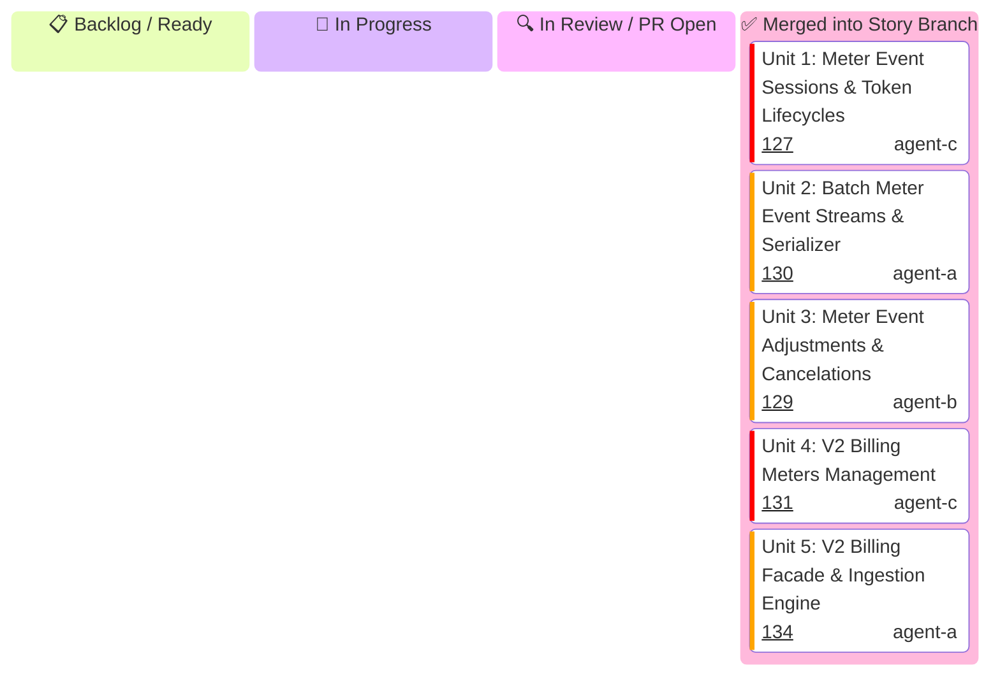

# US-8.2.0: High-Throughput Usage Meter Ingestion & Event Stream Billing — Kanban Board

Hierarchical task tracking for **US-8.2.0 (High-Throughput Usage Meter Ingestion & Event Stream Billing)**.

---

## 1. Status Board

---

## 2. Micro-Unit Specifications Matrix

| Unit ID | Unit Title & Functional Scope | Assigned Profile | Branch Name | Target PR Title | Status |
| :--- | :--- | :---: | :--- | :--- | :---: |
| **Unit 1** | **Meter Event Sessions & Token Lifecycles**: `MeterEventSession`, `MeterEventSessionStatus`, `SessionTokenDetails`, `CreateMeterEventSessionParams`, and `MeterEventSessionResource` (`create`, `retrieve`, `expire`) with memory zeroization on drop. | `agent-c` | `feat/us-8.2.0/unit-1-meter-session-resource` | `feat(us-8.2.0/unit-1): meter event sessions domain models and resource endpoints` | ✅ Merged ([PR #127](https://github.com/some-of-cs/some-stripe/pull/127)) |
| **Unit 2** | **Batch Meter Event Streams & Serializer**: `MeterEventPayload`, `MeterPayload`, `MeterEventBatch`, `BatchIngestionResponse`, `CreateMeterEventStreamParams`, `MeterBatchSerializer` (zero-copy JSON batch streaming), and `MeterEventStreamResource` (`create`, `create_batch`). | `agent-a` | `feat/us-8.2.0/unit-2-meter-stream-resource` | `feat(us-8.2.0/unit-2): batch meter event streams and zero-copy serializer` | ✅ Merged ([PR #130](https://github.com/some-of-cs/some-stripe/pull/130)) |
| **Unit 3** | **Meter Event Adjustments & Cancelations**: `MeterEventAdjustment`, `CancelAdjustmentDetails`, `AdjustmentReason`, `CreateMeterEventAdjustmentParams`, `ListMeterEventAdjustmentsParams`, and `MeterEventAdjustmentsResource` (`create`, `retrieve`, `list`) with client deduplication audit. | `agent-b` | `feat/us-8.2.0/unit-3-meter-adjustments-resource` | `feat(us-8.2.0/unit-3): meter event adjustments domain entities and resource endpoints` | ✅ Merged ([PR #129](https://github.com/some-of-cs/some-stripe/pull/129)) |
| **Unit 4** | **V2 Billing Meters Management**: `V2BillingMeter`, `MeterStatus`, `ValueSettings`, `CustomerMappingSettings`, `AggregationFormula`, `CreateBillingMeterParams`, `UpdateBillingMeterParams`, `ListBillingMetersParams`, and `BillingMetersResource` (`create`, `retrieve`, `update`, `deactivate`, `reactivate`, `list`). | `agent-c` | `feat/us-8.2.0/unit-4-billing-meters-resource` | `feat(us-8.2.0/unit-4): v2 billing meters management domain models and resource` | ✅ Merged ([PR #131](https://github.com/some-of-cs/some-stripe/pull/131)) |
| **Unit 5** | **V2 Billing Facade & Ingestion Engine**: `V2Billing` resource facade mounting `meter_event_session()`, `meter_event_stream()`, `meter_event_adjustments()`, `meters()`, `MeterIngestionEngine` (pipelined keep-alive connection pool & idempotency cache), and `StripeClient` integration `client.v2().billing()`. | `agent-a` | `feat/us-8.2.0/unit-5-v2-billing-facade-engine` | `feat(us-8.2.0/unit-5): v2 billing facade and high-throughput meter ingestion engine` | ✅ Merged ([PR #134](https://github.com/some-of-cs/some-stripe/pull/134)) |
