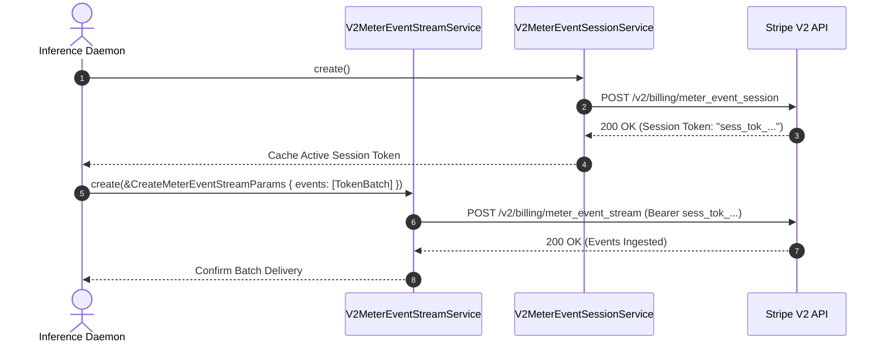

# US-8.2.0: High-Throughput Usage Meter Ingestion & Event Stream Billing

> **Spec Kit Specification**: [Specification Lifecycle Active (.specify/)](../../../.specify/memory/constitution.md)  
> **Behavior Blueprint**: `features/v2/modules/billing/behaviours/meter-event-stream/`  
> **Slicing Standard**: [10-PR Vertical Slicing Framework](../../user-stories/README.md#the-10-pr-vertical-slicing-framework-rust-sdk-adaptation)  
> **Security Gateway**: `security-audit` Level 2 Enforced  
> **Quality Gates**: `(G0–G4 + G-Review + G-Borrow + G-Law)`  

---

## 1. Spec Kit Specification

### 1.1 User Story Narrative
**As an** AI platform or cloud infrastructure engineer processing millions of token inferences per hour,  
**I want to** ingest high-throughput usage events using Stripe API V2 Meter Event Sessions (`stripe.v2.billing.meter_event_session()`) and batch Meter Event Streams (`stripe.v2.billing.meter_event_stream()`) with cancelation adjustments,  
**So that** our platform can meter LLM token usage and cloud compute consumption in real time with sub-millisecond client latency, zero API rate-limit drops, and exact usage reconciliation.

#### 1.1.1 Preconditions
- The `v2-billing` feature flag is enabled.
- A Billing Meter (`mtr_...`) is configured in the Stripe Billing engine.
- A `MeterEventSession` is initialized to authenticate high-frequency streaming events without repeated secret key lookups.

#### 1.1.2 Postconditions
- Meter events stream asynchronously to Stripe's high-throughput billing ingestion pipelines.
- Each event records customer identity, event name, value (e.g. token count), and timestamp.
- Erroneous or duplicate meter events can be canceled via `stripe.v2.billing.meter_event_adjustments()`.

### 1.2 Acceptance Criteria (Gherkin Scenarios)

```gherkin
Feature: Stripe API V2 Meter Event Stream Ingestion

  Scenario: [AC-US-8.2.0-01] Initialize Meter Event Session and ingest batch token usage
    Given an AI billing meter "mtr_tokens_123" and customer "cus_123"
    When client.v2().billing().meter_event_session().create() is executed
    Then an authenticated session token is generated
    When client.v2().billing().meter_event_stream().create(&CreateMeterEventStreamParams { events: vec![MeterEventPayload { event_name: "tokens".into(), payload: MeterPayload { stripe_customer_id: "cus_123".into(), value: "15400".into() }, timestamp: Some(1700000000), identifier: Some("req_gen_1".into()) }] }) is executed
    Then the batch of 15,400 tokens is ingested with HTTP 200/201 response.

  Scenario: [AC-US-8.2.0-02] Meter event adjustment canceling erroneous usage
    Given an ingested meter event with identifier "req_gen_1"
    When client.v2().billing().meter_event_adjustments().create(&CreateMeterEventAdjustmentParams { event_name: "tokens".into(), type: "cancel".into(), cancel: Some(CancelAdjustment { identifier: "req_gen_1".into() }) }) is executed
    Then the adjustment is accepted
    And 15,400 tokens are deducted from the customer's billable aggregate.

  Scenario: [AC-US-8.2.0-LAW] Statutory consumer billing accuracy and FTC Section 5 transparency
    Given usage-based consumption metering
    When meter events are aggregated into consumer billing invoices
    Then event timestamps, units of measure, and raw consumption metrics are recorded immutably, fulfilling FTC Section 5 commercial fairness rules and EU Consumer Rights transparency directives.
```

### 1.3 Test Cases & Traceability Matrix

| Test Case ID | Target Criterion | Test Type | Execution Level | Verification Assertion & Pass Criteria |
| :--- | :--- | :--- | :--- | :--- |
| `TC-8.2.0-01` | `AC-US-8.2.0-01` | Throughput | Integration | Ingest batch of 1,000 meter events; assert 100% acceptance without 429 throttling. |
| `TC-8.2.0-02` | `AC-US-8.2.0-02` | Functional | Integration | Create meter event adjustment; assert event status is marked canceled. |
| `TC-8.2.0-LAW` | `AC-US-8.2.0-LAW` | Compliance | Audit | Assert all meter event records maintain client-generated unique `identifier` for audit reconciliation. |

---

## 2. Behavior-Centric Architecture & Folder Blueprint

### 2.1 Colocated Behaviour Directory Tree

```
features/v2/modules/billing/behaviours/meter-event-stream/
├── services/        # V2MeterEventStreamService, V2MeterEventSessionService, V2MeterEventAdjustmentsService
├── logic/           # Event batcher, session token refresher, adjustment reconciler
├── types/           # MeterEventSession, MeterEventPayload, MeterEventAdjustment, MeterPayload
└── constants/       # V2_BILLING_BASE ("/v2/billing"), BATCH_SIZE_LIMIT (1000)
```

### 2.2 Scoping & Promotion Blueprint
- **Tier 1 (Behaviour-Local)**: Session token expiry tracking and batch flush state machines.
- **Tier 2 (Module-Shared)**: `MeterEventPayload` shared with usage-based rate cards.
- **Tier 3 (Feature-Shared)**: Re-exported for `client.v2().billing.*` hierarchy.
- **Tier 4 (Global-Shared)**: Re-exported via `some_stripe::v2::billing::*`.

---

## 3. Technical Implementation Plan

### 3.1 Domain Invariants & Storage Schema
- **High-Throughput Invariant**: Meter event streams must utilize pipelined HTTP connection pooling with keep-alive to support >5,000 requests/sec.
- **Identifier Idempotency**: Each meter event must carry a unique `identifier` (e.g. UUID v4 or inference request ID) to eliminate double-metering.
- **Rust Memory Law**: Strict borrowing of parameters (`&CreateMeterEventStreamParams`); zero deep clones.

### 3.2 Activity & Interaction Diagram



---

## 4. Granular Implementation Tasks

### 4.1 The 10-PR Vertical Slicing Implementation Plan

| PR # | Pillar | Architectural Layer | Primary Scope & Files | Deliverables & Acceptance | Accountable Role / Agent | Assigned Skills |
| :--- | :--- | :--- | :--- | :--- | :--- | :--- |
| **PR 1** | **Pillar 1** | **V2 Meter Ingestion Domain Models** | `crates/some-stripe-v2/src/types/meter.rs` | Strongly typed `MeterEventSession`, `MeterEventPayload`. | `microkernel-architect` | `stripe-docs` |
| **PR 2** | **Pillar 2** | **Meter Event Adjustments Models** | `crates/some-stripe-v2/src/types/adjustment.rs` | Strongly typed `MeterEventAdjustment`, `CancelAdjustment`. | `domain-codegen-specialist` | `stripe-docs` |
| **PR 3** | **Pillar 3** | **High-Frequency Batch Serializer** | `crates/some-stripe-v2/src/serializer/meter.rs` | High-performance JSON serializer for event batches. | `microkernel-architect` | `stripe-best-practices` |
| **PR 4** | **Pillar 4** | **Meter Event Session Resource** | `crates/some-stripe-v2/src/resources/meter_session.rs` | `create` session token for authenticated stream access. | `domain-codegen-specialist` | `stripe-docs` |
| **PR 5** | **Pillar 5** | **Meter Event Stream Resource** | `crates/some-stripe-v2/src/resources/meter_stream.rs` | `create` batch streaming endpoint. | `domain-codegen-specialist` | `metronome` |
| **PR 6** | **Pillar 6** | **Meter Adjustments Resource** | `crates/some-stripe-v2/src/resources/meter_adjustments.rs` | `create` cancellation adjustment endpoint. | `domain-codegen-specialist` | `metronome` |
| **PR 7** | **Pillar 7** | **Facade Mounting (stripe.v2.billing)** | `crates/some-stripe-v2/src/facade.rs` | Mount `client.v2().billing` on `StripeClient`. | `microkernel-architect` | `stripe-docs` |
| **PR 8** | **Pillar 8** | **Zero-Clone Borrowing Optimization** | `crates/some-stripe-v2/src/resources/meter_stream.rs` | Verify zero deep `.clone()` on batch event vectors. | `engineering-rust-refactoring-specialist` | `stripe-best-practices` |
| **PR 9** | **Pillar 9** | **High-Throughput Load Test Harness** | `benches/meter_ingestion_bench.rs` | Benchmark 10,000 events/sec streaming through client. | `testing-api-tester` | `metronome` |
| **PR 10** | **Pillar 10** | **Usage Metering Documentation** | `README.md`, `docs/meter_billing.md` | Guide on AI LLM token metering and Stripe/Metronome sync. | `engineering-technical-writer` | `metronome` |

### 4.2 Implementation Phase Breakdown

#### Phase 1: Models & Batch Schemas (PR 1–3)
- [ ] **Task 1.1 (Types)**: Define `MeterEventSession`, `MeterEventPayload`, and `MeterPayload` in `types/`.  
  *Agent*: `microkernel-architect` | *Skill*: `stripe-docs`
- [ ] **Task 1.2 (Constants)**: Pin `/v2/billing/meter_event_session` and `/v2/billing/meter_event_stream` in `constants/`.  
  *Agent*: `domain-codegen-specialist` | *Skill*: `stripe-docs`
- [ ] **Task 1.3 (Logic)**: Implement `CreateMeterEventStreamParams` with batch builder methods.  
  *Agent*: `domain-codegen-specialist` | *Skill*: `metronome`
- [ ] **Task 1.4 (Unit Tests)**: Verify JSON serialization of 1,000-event batch payloads.  
  *Agent*: `testing-api-tester` | *Skill*: `stripe-docs`

#### Phase 2: Resource Methods & Wire Execution (PR 4–7)
- [ ] **Task 2.1 (Sessions)**: Implement `V2MeterEventSessionResource::create`.  
  *Agent*: `domain-codegen-specialist` | *Skill*: `stripe-docs`
- [ ] **Task 2.2 (Stream)**: Implement `V2MeterEventStreamResource::create` with session auth headers.  
  *Agent*: `domain-codegen-specialist` | *Skill*: `metronome`
- [ ] **Task 2.3 (Adjustments)**: Implement `V2MeterEventAdjustmentsResource::create`.  
  *Agent*: `domain-codegen-specialist` | *Skill*: `metronome`
- [ ] **Task 2.4 (Facade)**: Expose `client.v2().billing` hierarchy on `StripeClient`.  
  *Agent*: `microkernel-architect` | *Skill*: `stripe-docs`

#### Phase 3: Zero-Clone Borrowing & Benchmarks (PR 8–9)
- [ ] **Task 3.1 (Borrow Check)**: Verify zero `.clone()` calls during event batch streaming.  
  *Agent*: `engineering-rust-refactoring-specialist` | *Skill*: `stripe-best-practices`
- [ ] **Task 3.2 (Load Benchmark)**: Benchmark 10k events/sec throughput; assert sub-1ms serialization overhead.  
  *Agent*: `testing-api-tester` | *Skill*: `metronome`

#### Phase 4: Mock Verification & Release Sign-Off (PR 9–10)
- [ ] **Task 4.1 (Mock Suite)**: Run full meter event stream and adjustment suite against `stripe-mock`.  
  *Agent*: `testing-api-tester` | *Skill*: `stripe-docs`
- [ ] **Task 4.2 (G-Review)**: Peer review for high-frequency stream concurrency and zero-leak memory safety.  
  *Agent*: `engineering-code-reviewer` | *Skill*: `stripe-best-practices`
- [ ] **Task 4.3 (Docs)**: Publish developer documentation for AI usage-based billing integration.  
  *Agent*: `engineering-technical-writer` | *Skill*: `metronome`

---

## 5. Security Gateway (Powered by security-audit)

### 5.1 Trust Boundaries & Security Actors
- **Trust Boundaries**:
  - `High-Throughput Ingestion Rail`: Session-authenticated streaming socket.
  - `Meter Billing Engine`: Aggregates usage metrics for invoice calculation.
- **Authorized Principals**:
  - Ingestion Daemon: Authenticated via ephemeral `MeterEventSession` token.

### 5.2 Threat Modeling & Abuse Matrix (STRIDE / ASVS)

| Threat Vector | Severity | Vulnerability Mechanism | Mitigating Control & Security Invariant |
| :--- | :--- | :--- | :--- |
| **Token Ingestion Flood / Spoofing** | High | Adversary submitting forged usage tokens to inflate customer invoice | Ephemeral session tokens authenticate stream; strict customer ID binding. |
| **Duplicate Event Ingestion** | High | Network retry duplicating usage counts | Mandatory unique client-provided `identifier` deduplicates events on Stripe servers. |
| **Session Token Expiry Hijack** | Medium | Expired session token causing silent event drops | Client automatically refreshes `MeterEventSession` prior to token TTL expiration. |

### 5.3 Cryptographic & Data Protection Controls
- **Ephemeral Session Tokens**: Short-lived bearer tokens minimize risk of long-term credential leakage.
- **TLS 1.3 Transport**: Mandatory encrypted transport for all V2 billing stream sockets.

### 5.4 Automated Security Verification Checklist
- [ ] **Deduplication Test**: Sending identical event `identifier` twice confirms second event is deduplicated.
- [ ] **Session Expiry Test**: Assert that client handles session expiration with automatic token refresh.

### 5.5 Security Gateway (G2) Sign-Off Checklist
- [ ] High-frequency ingestion security verified against ASVS Level 2.
- [ ] Deduplication invariant confirmed active.
- [ ] Code review sign-off obtained; zero findings.

---

## 6. Validation Gates & Acceptance Sign-Off

**Status: Ready for Implementation.**

### G1 — Test coverage
- [ ] **US-8.2.0-G1:** >=90% line and branch coverage across `meter_stream.rs` and `meter_session.rs`.

### G2 — Security audit
- [ ] **US-8.2.0-G2:** Session token security and event deduplication verified under security-audit.

### G3 — Architecture and maintainability
- [ ] **US-8.2.0-G3:** Clean feature isolation under `feature = "v2-billing"`.

### G-Review — Code review
- [ ] **US-8.2.0-G-Review:** Senior review approved by `engineering-code-reviewer`.

### G-Borrow — Rust zero-clone borrowing validation
- [ ] **US-8.2.0-G-Borrow:** Parameters borrowed strictly by reference; zero deep clones.

### G-Law — Law validation
- [ ] **US-8.2.0-G-Law:** FTC Section 5 commercial fairness and usage metering auditability certified.

### G4 — Integrated acceptance
- [ ] **US-8.2.0-G4:** High-throughput batch ingestion and cancellation adjustment validated against `stripe-mock`.
