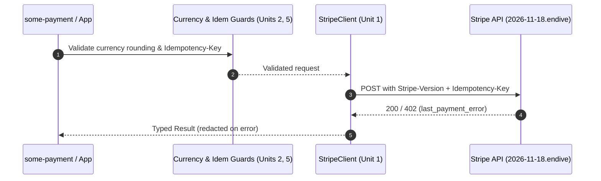

# User Story `US-9.1.0`: Stripe Pre-Integration Hardening (`Stripe-Version`, `last_payment_error`, Refund Lifecycle, Currency Guardrails & `Idempotency-Key`)

- **Module**: `module-9-some-payment-alignment` (`some-payment` Orchestrator Alignment & Optional Adapter)
- **Story Branch**: `feat/us-9.1.0-stripe-core-hardening-and-currency-guardrails`
- **Field Profile**: `software`
- **Story Decomposition Score ($S_{\text{story}}$)**: `2.60` $\to$ **`5` Parallel Implementation Units (`unit-1..5`)**

---

## 1. Spec Kit Specifications

### 1.1 User Story Narrative
> **As a** `some-payment` integrator routing global USD/EUR/KWD payments through `some-stripe`,  
> **I want** `some-stripe` to pin `Stripe-Version: 2026-11-18.endive`, enforce Stripe's currency/rounding rules, deserialize `last_payment_error`, support the full 5-status Refund lifecycle, and safely forward caller `Idempotency-Key` across retries,  
> **So that** multi-tenant `some-payment` deployments never hit silent API drift, currency rejections, lost decline codes, or duplicate charges.

Executes all P0 and P1 pre-integration audit items for `some-stripe` from `some-payment/docs/sdk-implementation.md`, keeping standalone `some-stripe` 100% backward compatible.

#### 1.1.1 Preconditions
- `some-stripe` Modules 1–8 are merged on `main`.

#### 1.1.2 Postconditions
- `Stripe-Version: 2026-11-18.endive` is sent explicitly from instance-scoped client config with injectable `reqwest::Client`.
- CheckoutSession cancel enforces `requires_capture`-only rule (falling back to `expire`).
- `last_payment_error` deserializes `type`, `code`, `decline_code`, `advice_code`, `network_decline_code`, `message` (never checking `status == "failed"`).
- ISK/UGX two-decimal `00` and 3-decimal multiple-of-10 (`BHD`, `JOD`, `KWD`, `OMR`, `TND`) rules are enforced pre-flight.

### 1.2 Acceptance Criteria (Gherkin Scenarios)
```gherkin
Feature: some-stripe Pre-Integration Core Hardening

  Scenario: AC-1 — Explicit Stripe-Version header and instance-scoped injectable transport
    Given a StripeClient constructed with a custom reqwest::Client and Stripe-Version "2026-11-18.endive"
    When any API request is dispatched
    Then the Stripe-Version header is sent explicitly with zero global singleton state

  Scenario: AC-2 — Enforce Stripe currency normalization and rounding guardrails
    Given minor-unit Money in JPY (0-dec), ISK/UGX (mandatory 00), and KWD (3-dec trailing 0)
    When validated pre-flight
    Then currency codes are lowercased and non-multiple-of-10 KWD amounts fail closed locally

  Scenario: AC-3 — Deserialize last_payment_error and support 5-status Refund lifecycle
    Given a PaymentIntent in requires_payment_method with last_payment_error or a Refund in requires_action
    When parsed by some-stripe
    Then decline_code/advice_code are preserved and POST /v1/refunds/:id/cancel is supported

  Scenario: AC-4 — Reuse exact caller Idempotency-Key across transport retries
    Given a mutating POST with caller Idempotency-Key (<= 255 chars) that encounters a 503 retry
    When some-stripe retries the HTTP request
    Then the exact same Idempotency-Key header is sent on every retry attempt
```

### 1.3 Test Cases & Traceability Matrix

| Test Case ID | Mapped AC | Owning Unit | Test Level | Description & Input Vector | Expected Result & Pass Threshold |
| :--- | :---: | :---: | :---: | :--- | :--- |
| `TC-9.1.1` | `AC-1` | `unit-1` | Unit | Explicit `Stripe-Version` header + injectable `reqwest::Client` + redacted `Debug` | Header sent; zero secret keys in `Debug` |
| `TC-9.1.2` | `AC-2` | `unit-2` | Boundary | `JPY`, `USD`, `ISK`, `UGX`, `KWD` (`1050` ok, `1055` rejected) | Lowercase ISO-4217; invalid rounding fails closed pre-flight |
| `TC-9.1.3` | `AC-3` | `unit-3` | Unit | Deserialize `last_payment_error` + CheckoutSession cancel vs expire guard | Decline codes surfaced; non-`requires_capture` calls `expire` |
| `TC-9.1.4` | `AC-3` | `unit-4` | Unit | 5-status Refund (`pending`, `requires_action`, `succeeded`, `failed`, `canceled`) + cancel endpoint | All 5 statuses & `POST /v1/refunds/:id/cancel` verified |
| `TC-9.1.5` | `AC-4` | `unit-5` | Integration | 503 retry with caller-supplied `Idempotency-Key` (>255 rejected) | Identical key reused across retries; >255 rejected pre-flight |

---

## 2. Technical Implementation Plan

### 2.1 Domain Invariants & Storage Schema
- **Zero Global Singletons**: All config is strictly per-`StripeClient` instance.
- **Never Check `status == "failed"`**: PaymentIntents use the 7 official Stripe statuses + `last_payment_error`.

### 2.2 Sequence Diagram


---

## 3. Expected Folder Architecture at the Project

```text
src/crates/
├── some-stripe-core/src/
│   ├── version_transport.rs        # Owned exclusively by unit-1
│   └── idempotency_passthrough.rs  # Owned exclusively by unit-5
└── some-stripe-types/src/
    ├── currency_guardrails.rs      # Owned exclusively by unit-2
    ├── payment_error_detail.rs     # Owned exclusively by unit-3
    └── refund_lifecycle.rs         # Owned exclusively by unit-4
```

---

## 4. Implementation Units in Detail & Specialist Agent Assignment

### 4.1 Story Decomposition Score ($S_{\text{story}}$) & Dynamic Unit Count ($K$)
- **$D_1$ (35% Surface)**: `3` — 5 P0/P1 alignment areas (version pinning/transport, PI/Checkout rules, `last_payment_error` & Refund lifecycle, currency rounding, `Idempotency-Key`)
- **$D_2$ (25% Volume)**: `3` — ~650–850 production LOC + unit tests
- **$D_3$ (20% Complexity)**: `2` — Multi-decimal Stripe currency rounding (`ISK`/`UGX`/`KWD`), `requires_capture`-only cancel, retry-safe `Idempotency-Key`
- **$D_4$ (20% Boundaries)**: `2` — 5 disjoint files across `some-stripe-core` and `some-stripe-types`
- **Calculated Score**: $S_{\text{story}} = 0.35(3) + 0.25(3) + 0.20(2) + 0.20(2) = \mathbf{2.60}$ $\to$ **`5` Parallel Units**

### 4.2 Detailed Unit Specifications (`unit-1..5`)
- **`unit-1` (`feat/us-9.1.0/unit-1-version-transport`)**:
  - **Deliverable Scope**: Explicit `Stripe-Version: 2026-11-18.endive` config, injectable `reqwest::Client`, timeout & redacted `Debug`
  - **Owned Files**: `src/crates/some-stripe-core/src/version_transport.rs`
  - **Public Contract / Exports**: `StripeVersion`, `TransportConfig`
  - **Unit Verification & Target Complexity**: Unit tests + doc-tests for `src/crates/some-stripe-core/src/version_transport.rs`, Max Cyclomatic Complexity $CC \le 6$ (cap $\le 10$, nesting $\le 2$)
- **`unit-2` (`feat/us-9.1.0/unit-2-currency-guardrails`)**:
  - **Deliverable Scope**: Lowercase ISO-4217 normalization, 0-dec, ISK/UGX `00`, and 3-dec multiple-of-10 (`BHD`/`JOD`/`KWD`/`OMR`/`TND`) guardrails
  - **Owned Files**: `src/crates/some-stripe-types/src/currency_guardrails.rs`
  - **Public Contract / Exports**: `validate_stripe_money`
  - **Unit Verification & Target Complexity**: Unit tests + doc-tests for `src/crates/some-stripe-types/src/currency_guardrails.rs`, Max Cyclomatic Complexity $CC \le 6$ (cap $\le 10$, nesting $\le 2$)
- **`unit-3` (`feat/us-9.1.0/unit-3-payment-error-detail`)**:
  - **Deliverable Scope**: `LastPaymentError` deserialization (`decline_code`, `advice_code`, `network_decline_code`) & CheckoutSession cancel/expire rule
  - **Owned Files**: `src/crates/some-stripe-types/src/payment_error_detail.rs`
  - **Public Contract / Exports**: `LastPaymentError`, `can_cancel_checkout_pi`
  - **Unit Verification & Target Complexity**: Unit tests + doc-tests for `src/crates/some-stripe-types/src/payment_error_detail.rs`, Max Cyclomatic Complexity $CC \le 6$ (cap $\le 10$, nesting $\le 2$)
- **`unit-4` (`feat/us-9.1.0/unit-4-refund-lifecycle`)**:
  - **Deliverable Scope**: Full 5-status Refund resource (`pending_reason`, `next_action`, `failure_reason`) + `POST /v1/refunds/:id/cancel`
  - **Owned Files**: `src/crates/some-stripe-types/src/refund_lifecycle.rs`
  - **Public Contract / Exports**: `RefundStatus`, `cancel_refund`
  - **Unit Verification & Target Complexity**: Unit tests + doc-tests for `src/crates/some-stripe-types/src/refund_lifecycle.rs`, Max Cyclomatic Complexity $CC \le 6$ (cap $\le 10$, nesting $\le 2$)
- **`unit-5` (`feat/us-9.1.0/unit-5-idempotency-passthrough`)**:
  - **Deliverable Scope**: Caller `Idempotency-Key` (`<= 255` chars) validation & retry-safe key preservation
  - **Owned Files**: `src/crates/some-stripe-core/src/idempotency_passthrough.rs`
  - **Public Contract / Exports**: `IdempotencyKey`
  - **Unit Verification & Target Complexity**: Unit tests + doc-tests for `src/crates/some-stripe-core/src/idempotency_passthrough.rs`, Max Cyclomatic Complexity $CC \le 6$ (cap $\le 10$, nesting $\le 2$)

### 4.3 Best-Fit Specialist Agents per Unit (`msitarzewski/agency-agents` + Core Roster)

| Unit ID | Branch Name | Primary Implementer Agent(s) (`agency-catalog`) | Reviewing Council Agent(s) | Mandatory Skills Enforced |
| :--- | :--- | :--- | :--- | :--- |
| `unit-1` | `feat/us-9.1.0/unit-1-version-transport` | `backend-architect` | `code-reviewer`, `application-security-engineer`, `test-automation-engineer` | `code-review-council`, `security-audit`, `cyclomatic-complexity` |
| `unit-2` | `feat/us-9.1.0/unit-2-currency-guardrails` | `backend-architect` | `code-reviewer`, `security-architect`, `test-automation-engineer` | `code-review-council`, `security-audit`, `cyclomatic-complexity` |
| `unit-3` | `feat/us-9.1.0/unit-3-payment-error-detail` | `api-platform-engineer` | `code-reviewer`, `application-security-engineer`, `test-automation-engineer` | `code-review-council`, `security-audit`, `cyclomatic-complexity` |
| `unit-4` | `feat/us-9.1.0/unit-4-refund-lifecycle` | `api-platform-engineer` | `code-reviewer`, `security-architect`, `test-automation-engineer` | `code-review-council`, `security-audit`, `cyclomatic-complexity` |
| `unit-5` | `feat/us-9.1.0/unit-5-idempotency-passthrough` | `backend-architect` | `code-reviewer`, `penetration-tester`, `test-automation-engineer` | `code-review-council`, `security-audit`, `cyclomatic-complexity` |
| **Story Remediation** | `patch/us-9.1.0-fixes` | `patch-implementer` | `code-reviewer-council-president` | Full 6-Gate Re-Verification |

### 4.4 Parallel Execution & Zero-Blocking Contract Seeding Plan
1. **Base Contract Seeding**: Seed module declarations in `some-stripe-core/src/lib.rs` and `some-stripe-types/src/lib.rs` on `feat/module-9-some-payment-alignment`.
2. **Simultaneous Worktree Spawning**: All 5 units are provisioned in `.worktrees/feat-us-9.1.0-stripe-core-hardening-and-currency-guardrails-unit-1..5` and spawned simultaneously in Wave 2.
3. **Ordered Cascading Merge Sequence**: `unit-1` $\to$ `unit-2` $\to$ `unit-3` $\to$ `unit-4` $\to$ `unit-5` into `feat/us-9.1.0-stripe-core-hardening-and-currency-guardrails` via `gh pr merge <PR> --merge`.

---

## 5. Security Gateway (Powered by `security-audit` Skill)

### 5.1 Trust Boundaries & Security Actors
- **Security Actors**: Multi-tenant Rust services calling `some-stripe` standalone or via `some-payment`.
- **Trust Boundaries**: HTTP header construction (`Authorization`, `Stripe-Version`, `Idempotency-Key`); error deserialization.

### 5.2 Threat Modeling & Abuse Matrix (STRIDE / OWASP ASVS)

| Threat ID | STRIDE Category | ASVS / CWE Ref | Attack Vector / Abuse Scenario | Impact | Required Mitigation & Code Control |
| :--- | :---: | :---: | :--- | :---: | :--- |
| `TM-1` | **S**poofing | ASVS V2 / CWE-287 | Global static key leaking tenant A credentials to tenant B | Critical | Strict instance-scoped `StripeClient` |
| `TM-2` | **T**ampering | ASVS V5 / CWE-190 | Double-scaling `amount * 100` on minor-unit input | Critical | Integer minor-unit inputs exclusively + currency guardrail tests |
| `TM-3` | **R**epudiation | ASVS V7 / CWE-778 | Dropping `decline_code`/`advice_code` on failed intent | Medium | Full `LastPaymentError` structured deserialization |
| `TM-4` | **I**nformation Disclosure | ASVS V8 / CWE-200 | Leaking `sk_live_` in `Debug` or error strings | Critical | Custom `[REDACTED]` `Debug` & `zeroize` on key buffers |
| `TM-5` | **D**enial of Service | ASVS V11 / CWE-400 | Generating new UUID per retry causing duplicate charges | Critical | Reuse exact caller `Idempotency-Key` across all retries |
| `TM-6` | **E**levation of Privilege | ASVS V4 / CWE-285 | Calling `cancel` on non-`requires_capture` CheckoutSession PI | Medium | Pre-flight state guard routing to `expire` |

### 5.3 Cryptography & Global Data Protection Controls (Worldwide Legal & Regulatory Compliance)
1. **Cryptographic Standards**: TLS 1.2/1.3+ in transit; constant-time comparison (`subtle::ConstantTimeEq`) for all HMAC digests and secret tokens; `SHA-256`/`SHA-512` only; zero hardcoded secrets or weak hashes (`MD5`/`SHA-1`).
2. **Global Multi-Jurisdictional Privacy & Legal Compliance**: Supports PCI-DSS v4.0 (zero raw PANs in logs/errors/server-side defaults), GDPR / UK GDPR, CCPA/CPRA, and regional MENA payment sovereignty (SA/EG/AE/OM/PK) via automatic `[REDACTED]` PII/secret scrubbing across UTF-8 logs and telemetry.

### 5.4 Automated Security Verification Checklist (`cloudflare/security-audit-skill`)
- [ ] Applicable `skills/security-audit/playbooks/` reviewed (`WEB-PROTOCOL-AND-AUTH.md`, `MEMORY-SAFETY-AND-BINARY.md`, `SUPPLY-CHAIN-AND-RELEASE.md`).
- [ ] All untrusted inputs validated for type, length, range, and encoding prior to domain processing.
- [ ] Zero secrets, API keys, private keys, or raw PII emitted in `Debug` formatting, logs, or error messages.
- [ ] Zero `unsafe` blocks and zero `f32`/`f64` floats for monetary calculations.

### 5.5 Security Gateway (Gate G2) Sign-Off Checklist
- [ ] **0 Critical / High / Medium** vulnerabilities in `security-audit` scan.
- [ ] All STRIDE / ASVS threat mitigations (`TM-1..TM-6`) implemented and covered by negative/security test cases in Section 1.3.
- [ ] Independent Security Reviewer agent sign-off posted to the GitHub PR conversation.

---

## 6. Validation Gates & Acceptance Sign-Off

| Gate | Gate Name | Pass Criteria for `US-9.1.0` | Verification Command / Evidence | Status |
| :--- | :--- | :--- | :--- | :---: |
| **Gate G0** | **Build, Lint & Format** | 0 errors, 0 warnings, 100% `rustfmt` compliance | `CARGO_BUILD_JOBS=1 cargo fmt --check && cargo clippy --all-targets -- -D warnings` | `[ ]` |
| **Gate G1** | **Tests, Coverage & Traceability** | 100% of `AC-*` and `TC-*` passing ($\ge 90\%$ line, $\ge 85\%$ branch coverage) | `CARGO_BUILD_JOBS=1 cargo test` | `[ ]` |
| **Gate G2** | **Security Gateway (`security-audit`)** | All Section 5 STRIDE, crypto, and global compliance checks pass (0 findings) | `security-audit` report on PR | `[ ]` |
| **Gate G-Complexity** | **Cyclomatic Complexity** | Every function $CC \le 6$ target ($CC \le 10$ ceiling, $CC > 15$ blocker, nesting $\le 2$) | `cyclomatic-complexity` table on PR | `[ ]` |
| **Gate G-Docs** | **Documentation & Doc-Tests** | 100% public symbols documented + runnable doc-tests pass | `CARGO_BUILD_JOBS=1 cargo test --doc` | `[ ]` |
| **Gate G-Review** | **Council President Sign-Off** | Independent Reviewing Council posts `GATE G-REVIEW APPROVED` on GitHub PR | `gh pr comment <PR>` | `[ ]` |

### Final Acceptance Sign-Off Block
- **Story Leader Verification**: All 5 units merged via cascading `gh pr merge`, story integration suite green, and zero unaddressed findings.
- **Reviewing Council Verdict**: `PENDING` $\to$ `GATE G-REVIEW APPROVED`
