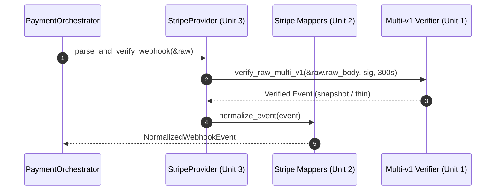

# User Story `US-9.2.0`: Raw-Body Multi-`v1` Webhook Hardening & Optional `some-payment-adapter` (`PaymentProvider` Impl)

- **Module**: `module-9-some-payment-alignment` (`some-payment` Orchestrator Alignment & Optional Adapter)
- **Story Branch**: `feat/us-9.2.0-stripe-webhook-hardening-and-adapter`
- **Field Profile**: `software`
- **Story Decomposition Score ($S_{\text{story}}$)**: `2.45` $\to$ **`4` Parallel Implementation Units (`unit-1..4`)**

---

## 1. Spec Kit Specifications

### 1.1 User Story Narrative
> **As a** `some-payment` orchestrator consumer using Stripe,  
> **I want** hardened raw-body multi-`v1` webhook verification and an optional `#[cfg(feature = "some-payment-adapter")]` `StripeProvider` implementing `some_payment_core::PaymentProvider`,  
> **So that** zero-downtime Stripe webhook secret rotation works safely and `some-stripe` plugs directly into `some-payment` without cyclic dependencies.

Hardens `some-stripe-webhooks` against `v0` downgrade attacks and re-serialized JSON, then exposes `StripeProvider` behind an optional feature depending only on `some-payment-core`.

#### 1.1.1 Preconditions
- `some-payment` Module 1 (`some-payment-core`) is available.
- `US-9.1.0` hardening is seeded/merged on `feat/module-9-some-payment-alignment`.

#### 1.1.2 Postconditions
- Standalone `cargo check --no-default-features` compiles with zero dependency on `some-payment-core`.
- `#[cfg(feature = "some-payment-adapter")]` exposes `StripeProvider: PaymentProvider`.
- Webhook verifier validates every `v1` signature in constant time, ignores `v0`, enforces 300s replay tolerance, and distinguishes thin vs snapshot events.

### 1.2 Acceptance Criteria (Gherkin Scenarios)
```gherkin
Feature: Stripe Multi-v1 Webhook Hardening & some-payment-adapter

  Scenario: AC-1 — Verify any matching v1 signature during 7-day secret rotation and ignore v0
    Given a Stripe-Signature header containing v0, an old v1, and a valid rotated v1 within 300s
    When verified over exact raw bytes
    Then verification succeeds in constant time
    And a header containing only v0 fails with WebhookVerificationFailed

  Scenario: AC-2 — Reject stale timestamps (> 300s) and re-serialized JSON
    Given a valid signature whose timestamp is 301 seconds old or whose JSON whitespace was modified
    When parse_and_verify_webhook runs
    Then it returns Err(PaymentError::WebhookVerificationFailed)

  Scenario: AC-3 — Optional some-payment-adapter implements PaymentProvider
    Given feature "some-payment-adapter" enabled
    When StripeProvider::new(cfg) is registered in PaymentOrchestrator
    Then capabilities(), create_payment, create_checkout, get_payment, capture, void_payment, refund, and parse_and_verify_webhook satisfy ProviderConformanceSuite
```

### 1.3 Test Cases & Traceability Matrix

| Test Case ID | Mapped AC | Owning Unit | Test Level | Description & Input Vector | Expected Result & Pass Threshold |
| :--- | :---: | :---: | :---: | :--- | :--- |
| `TC-9.2.1` | `AC-1, AC-2` | `unit-1` | Security | Dual-`v1` rotation, `v0`-only downgrade, `t > 300s`, re-serialized JSON, thin-event flag | Valid dual-`v1` passes; all adversarial cases rejected |
| `TC-9.2.2` | `AC-3` | `unit-2` | Unit | Pure `TryFrom` mappers for status, `NextAction`, `last_payment_error`, and refunds | Zero panics; `CC <= 6` static lookup tables |
| `TC-9.2.3` | `AC-3` | `unit-3` | Integration | `StripeProvider` implementing `PaymentProvider` trait behind feature flag | Compiles cleanly with and without `some-payment-adapter` |
| `TC-9.2.4` | `AC-3` | `unit-4` | Integration | Offline `wiremock` conformance tests for `StripeProvider` | All capability, money, status, webhook, and redaction assertions pass |

---

## 2. Technical Implementation Plan

### 2.1 Domain Invariants & Storage Schema
- **Optional Feature Isolation**: `some-payment-core` MUST be `optional = true` behind `some-payment-adapter`.
- **Exact Raw Bytes**: Never deserialize JSON before verifying `Stripe-Signature`.

### 2.2 Sequence Diagram


---

## 3. Expected Folder Architecture at the Project

```text
src/
├── crates/some-stripe-webhooks/src/
│   └── multi_v1_verifier.rs        # Owned exclusively by unit-1
└── adapter/
    ├── mod.rs                      # Seeded on Module 9 base branch
    ├── mappers.rs                  # Owned exclusively by unit-2
    ├── provider.rs                 # Owned exclusively by unit-3
    └── conformance_tests.rs        # Owned exclusively by unit-4
```

---

## 4. Implementation Units in Detail & Specialist Agent Assignment

### 4.1 Story Decomposition Score ($S_{\text{story}}$) & Dynamic Unit Count ($K$)
- **$D_1$ (35% Surface)**: `3` — Multi-`v1` raw-body verifier, `StripeProvider` adapter, pure `TryFrom` mappers, conformance tests
- **$D_2$ (25% Volume)**: `2` — ~500–650 production LOC
- **$D_3$ (20% Complexity)**: `3` — Constant-time multi-`v1` HMAC-SHA256 rotation, `v0` ignore, 300s replay window, snapshot vs thin events
- **$D_4$ (20% Boundaries)**: `2` — 4 disjoint files under `some-stripe-webhooks` and `src/adapter/`
- **Calculated Score**: $S_{\text{story}} = 0.35(3) + 0.25(2) + 0.20(3) + 0.20(2) = \mathbf{2.45}$ $\to$ **`4` Parallel Units**

### 4.2 Detailed Unit Specifications (`unit-1..4`)
- **`unit-1` (`feat/us-9.2.0/unit-1-multi-v1-verifier`)**:
  - **Deliverable Scope**: Order-agnostic `Stripe-Signature` parser, constant-time multi-`v1` verification, `v0`/debug ignore, 300s replay window, snapshot vs thin detection
  - **Owned Files**: `src/crates/some-stripe-webhooks/src/multi_v1_verifier.rs`
  - **Public Contract / Exports**: `verify_stripe_raw_webhook`
  - **Unit Verification & Target Complexity**: Unit tests + doc-tests for `src/crates/some-stripe-webhooks/src/multi_v1_verifier.rs`, Max Cyclomatic Complexity $CC \le 6$ (cap $\le 10$, nesting $\le 2$)
- **`unit-2` (`feat/us-9.2.0/unit-2-stripe-mappers`)**:
  - **Deliverable Scope**: Pure mappers between `some-stripe` types and `some-payment-core` (`Money`, `PaymentStatus`, `NextAction`, `PaymentError`)
  - **Owned Files**: `src/adapter/mappers.rs`
  - **Public Contract / Exports**: Internal `TryFrom` mappers
  - **Unit Verification & Target Complexity**: Unit tests + doc-tests for `src/adapter/mappers.rs`, Max Cyclomatic Complexity $CC \le 6$ (cap $\le 10$, nesting $\le 2$)
- **`unit-3` (`feat/us-9.2.0/unit-3-stripe-provider`)**:
  - **Deliverable Scope**: `#[cfg(feature = "some-payment-adapter")] pub struct StripeProvider` implementing `PaymentProvider`
  - **Owned Files**: `src/adapter/provider.rs`
  - **Public Contract / Exports**: `StripeProvider`
  - **Unit Verification & Target Complexity**: Unit tests + doc-tests for `src/adapter/provider.rs`, Max Cyclomatic Complexity $CC \le 6$ (cap $\le 10$, nesting $\le 2$)
- **`unit-4` (`feat/us-9.2.0/unit-4-stripe-conformance`)**:
  - **Deliverable Scope**: Offline `wiremock` test suite verifying capabilities, currency rules, webhooks, and secret redaction
  - **Owned Files**: `src/adapter/conformance_tests.rs`
  - **Public Contract / Exports**: Integration test suite
  - **Unit Verification & Target Complexity**: Unit tests + doc-tests for `src/adapter/conformance_tests.rs`, Max Cyclomatic Complexity $CC \le 6$ (cap $\le 10$, nesting $\le 2$)

### 4.3 Best-Fit Specialist Agents per Unit (`msitarzewski/agency-agents` + Core Roster)

| Unit ID | Branch Name | Primary Implementer Agent(s) (`agency-catalog`) | Reviewing Council Agent(s) | Mandatory Skills Enforced |
| :--- | :--- | :--- | :--- | :--- |
| `unit-1` | `feat/us-9.2.0/unit-1-multi-v1-verifier` | `security-engineer` | `code-reviewer`, `penetration-tester`, `test-automation-engineer` | `code-review-council`, `security-audit`, `cyclomatic-complexity` |
| `unit-2` | `feat/us-9.2.0/unit-2-stripe-mappers` | `backend-architect` | `code-reviewer`, `application-security-engineer`, `test-automation-engineer` | `code-review-council`, `security-audit`, `cyclomatic-complexity` |
| `unit-3` | `feat/us-9.2.0/unit-3-stripe-provider` | `backend-architect` | `code-reviewer`, `security-architect`, `test-automation-engineer` | `code-review-council`, `security-audit`, `cyclomatic-complexity` |
| `unit-4` | `feat/us-9.2.0/unit-4-stripe-conformance` | `test-automation-engineer` | `code-reviewer`, `application-security-engineer`, `test-automation-engineer` | `code-review-council`, `security-audit`, `cyclomatic-complexity` |
| **Story Remediation** | `patch/us-9.2.0-fixes` | `patch-implementer` | `code-reviewer-council-president` | Full 6-Gate Re-Verification |

### 4.4 Parallel Execution & Zero-Blocking Contract Seeding Plan
1. **Base Contract Seeding**: Add optional `some-payment-core` dependency & `some-payment-adapter` feature in `Cargo.toml` and seed `src/adapter/mod.rs` on `feat/module-9-some-payment-alignment`.
2. **Simultaneous Worktree Spawning**: All 4 units are provisioned in `.worktrees/feat-us-9.2.0-stripe-webhook-hardening-and-adapter-unit-1..4` and spawned simultaneously in Wave 2.
3. **Ordered Cascading Merge Sequence**: `unit-1` $\to$ `unit-2` $\to$ `unit-3` $\to$ `unit-4` into `feat/us-9.2.0-stripe-webhook-hardening-and-adapter` via `gh pr merge <PR> --merge`.

---

## 5. Security Gateway (Powered by `security-audit` Skill)

### 5.1 Trust Boundaries & Security Actors
- **Security Actors**: Stripe webhook delivery servers and `some-payment` orchestrator.
- **Trust Boundaries**: Raw webhook ingress bytes; feature-gated adapter boundary.

### 5.2 Threat Modeling & Abuse Matrix (STRIDE / OWASP ASVS)

| Threat ID | STRIDE Category | ASVS / CWE Ref | Attack Vector / Abuse Scenario | Impact | Required Mitigation & Code Control |
| :--- | :---: | :---: | :--- | :---: | :--- |
| `TM-1` | **S**poofing | ASVS V2 / CWE-345 | Downgrade attack supplying only `v0` test signature | Critical | Explicitly ignore `v0` and require at least one valid `v1` |
| `TM-2` | **T**ampering | ASVS V5 / CWE-345 | Timing side-channel on signature comparison | High | `subtle::ConstantTimeEq` comparison across all `v1` candidates |
| `TM-3` | **R**epudiation | ASVS V7 / CWE-778 | Thin event processed as empty snapshot event | High | Explicitly detect thin events and flag hydration requirement |
| `TM-4` | **I**nformation Disclosure | ASVS V8 / CWE-200 | Leaking `whsec_` in adapter `Debug` | Critical | Custom `[REDACTED]` `Debug` on `StripeProvider` |
| `TM-5` | **D**enial of Service | ASVS V11 / CWE-400 | Replay of stale captured webhook (> 300s) | High | Enforce default 300s timestamp tolerance |
| `TM-6` | **E**levation of Privilege | ASVS V4 / CWE-285 | Unsigned debug entries (`secret`, `destination`, `payload`) trusted | High | Ignore all non-`t`/`v1` header entries |

### 5.3 Cryptography & Global Data Protection Controls (Worldwide Legal & Regulatory Compliance)
1. **Cryptographic Standards**: TLS 1.2/1.3+ in transit; constant-time comparison (`subtle::ConstantTimeEq`) for all HMAC digests and secret tokens; `SHA-256`/`SHA-512` only; zero hardcoded secrets or weak hashes (`MD5`/`SHA-1`).
2. **Global Multi-Jurisdictional Privacy & Legal Compliance**: Supports PCI-DSS v4.0 (zero raw PANs in logs/errors/server-side defaults), GDPR / UK GDPR, CCPA/CPRA, and regional MENA payment sovereignty (SA/EG/AE/OM/PK) via automatic `[REDACTED]` PII/secret scrubbing across UTF-8 logs and telemetry.

### 5.4 Automated Security Verification Checklist (`cloudflare/security-audit-skill`)
- [ ] Applicable `skills/security-audit/playbooks/` reviewed (`WEB-PROTOCOL-AND-AUTH.md`, `MEMORY-SAFETY-AND-BINARY.md`, `SUPPLY-CHAIN-AND-RELEASE.md`).
- [ ] All untrusted inputs validated for type, length, range, and encoding prior to domain processing.
- [ ] Zero secrets, API keys, private keys, or raw PII emitted in `Debug` formatting, logs, or error messages.
- [ ] Zero `unsafe` blocks and zero `f32`/`f64` floats for monetary calculations.

### 5.5 Security Gateway (Gate G2) Sign-Off Checklist
- [ ] **0 Critical / High / Medium** vulnerabilities in `security-audit` scan.
- [ ] All STRIDE / ASVS threat mitigations (`TM-1..TM-6`) implemented and covered by negative/security test cases in Section 1.3.
- [ ] Independent Security Reviewer agent sign-off posted to the GitHub PR conversation.

---

## 6. Validation Gates & Acceptance Sign-Off

| Gate | Gate Name | Pass Criteria for `US-9.2.0` | Verification Command / Evidence | Status |
| :--- | :--- | :--- | :--- | :---: |
| **Gate G0** | **Build, Lint & Format** | 0 errors, 0 warnings, 100% `rustfmt` compliance | `CARGO_BUILD_JOBS=1 cargo fmt --check && cargo clippy --all-features --all-targets -- -D warnings` | `[ ]` |
| **Gate G1** | **Tests, Coverage & Traceability** | 100% of `AC-*` and `TC-*` passing ($\ge 90\%$ line, $\ge 85\%$ branch coverage) | `CARGO_BUILD_JOBS=1 cargo test --no-default-features && cargo test --features some-payment-adapter` | `[ ]` |
| **Gate G2** | **Security Gateway (`security-audit`)** | All Section 5 STRIDE, crypto, and global compliance checks pass (0 findings) | `security-audit` report on PR | `[ ]` |
| **Gate G-Complexity** | **Cyclomatic Complexity** | Every function $CC \le 6$ target ($CC \le 10$ ceiling, $CC > 15$ blocker, nesting $\le 2$) | `cyclomatic-complexity` table on PR | `[ ]` |
| **Gate G-Docs** | **Documentation & Doc-Tests** | 100% public symbols documented + runnable doc-tests pass | `CARGO_BUILD_JOBS=1 cargo test --doc --features some-payment-adapter` | `[ ]` |
| **Gate G-Review** | **Council President Sign-Off** | Independent Reviewing Council posts `GATE G-REVIEW APPROVED` on GitHub PR | `gh pr comment <PR>` | `[ ]` |

### Final Acceptance Sign-Off Block
- **Story Leader Verification**: All 4 units merged via cascading `gh pr merge`, story integration suite green, and zero unaddressed findings.
- **Reviewing Council Verdict**: `PENDING` $\to$ `GATE G-REVIEW APPROVED`
